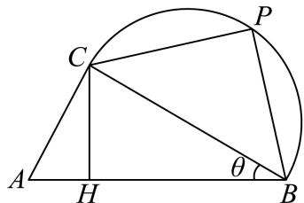
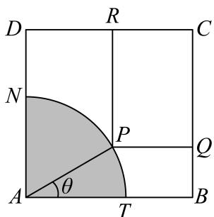
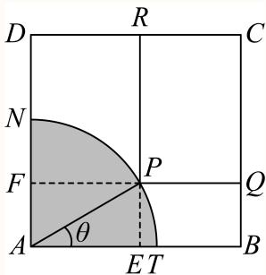
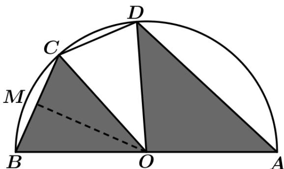
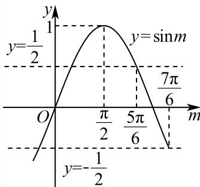

# 三角 · 上海数学大题汇编

> 答案和解析沿用源稿，未逐题独立重算；OCR 与原稿疑点仍可能存在。每题计为一道完整大题。

共 18 道。

### 065 · 原第19题

**来源：** S053 · 上海市大同中学 · 高一 · 2025-2026 · 期中 · 原第19题

**考点说明：** 三角形中的边角关系与三角函数最值。；三角恒等变换（辅助角）求最值。

某公司欲生产一款迎春工艺品回馈消费者，工艺品的平面设计如图所示，该工艺品由直角 $\triangle ABC$ 和以 $BC$ 为直径的半圆拼接而成，点 $P$ 为半圆上一点（异于 $B,C$），点 $H$ 在线段 $AB$ 上，且满足 $CH\perp AB$。已知 $\angle ACB=90^\circ$，$AB=1\text{ dm}$，设 $\angle ABC=\theta$。

(1) 为了使工艺礼品达到最佳观赏效果，需满足 $\angle ABC=\angle PCB$，且 $CA+CP$ 达到最大。当 $\theta$ 为何值时，工艺礼品达到最佳观赏效果？

(2) 为了工艺礼品达到最佳稳定性便于收藏，需满足 $\angle PBA=60^\circ$，且 $CH+CP$ 达到最大。当 $\theta$ 为何值时，工艺礼品达到最佳稳定性？并求此时 $CH+CP$ 的值。

#### 答案

(1) $\theta=30^\circ$

(2) $\theta=15^\circ$，$CH+CP=\dfrac{2+\sqrt3}4$

#### 解析（保留源稿）

(1) 由 $\angle ABC=\angle PCB=\theta$。在直角 $\triangle ABC$ 中，$AC=\sin\theta$，$BC=\cos\theta$；在直角 $\triangle PBC$ 中，$PC=BC\cdot\cos\theta=\cos\theta\cdot\cos\theta=\cos^2\theta$，$PB=BC\cdot\sin\theta=\sin\theta\cos\theta$。$AC+CP=\sin\theta+\cos^2\theta=\sin\theta+1-\sin^2\theta=-\sin^2\theta+\sin\theta+1=-\left(\sin\theta-\dfrac12\right)^2+\dfrac54$，所以当 $\sin\theta=\dfrac12$，即 $\theta=30^\circ$ 时，$AC+CP$ 的最大值为 $\dfrac54$，即 $\theta=30^\circ$ 时工艺礼品达到最佳观赏效果。

(2) 在直角 $\triangle ABC$ 中，由 $S_{\triangle ABC}=\dfrac12CA\cdot CB=\dfrac12AB\cdot CH$，可得 $CH=\sin\theta\cos\theta$；在直角 $\triangle PBC$ 中，由 $\angle PBA=60^\circ$ 得 $\angle PBC=60^\circ-\theta$，所以 $PC=BC\cdot\sin(60^\circ-\theta)=\cos\theta(\sin60^\circ\cos\theta-\cos60^\circ\sin\theta)$。所以
$$CH+CP=\sin\theta\cos\theta+\cos\theta\left(\frac{\sqrt3}2\cos\theta-\frac12\sin\theta\right)=\frac14\sin2\theta+\frac{\sqrt3}4\cos2\theta+\frac{\sqrt3}4=\frac12\sin(2\theta+60^\circ)+\frac{\sqrt3}4,$$
当 $2\theta+60^\circ=90^\circ$，即 $\theta=15^\circ$ 时，$CH+CP$ 取得最大值 $\dfrac12+\dfrac{\sqrt3}4=\dfrac{2+\sqrt3}4$。

---

---

### 066 · 原第20题

**来源：** S053 · 上海市大同中学 · 高一 · 2025-2026 · 期中 · 原第20题

**考点说明：** 正切型函数的最小正周期。；正切函数的单调性与间断点。；正切函数的周期与方程根的个数（根数—周期数对应）。

已知函数 $f(x)=\tan\!\left(\omega x+\dfrac\pi3\right)(\omega>0)$。

(1) 若 $\omega=2$，求函数 $f(x)$ 的最小正周期；

(2) 若函数 $f(x)$ 在区间 $[0,\pi]$ 上为严格增函数，求 $\omega$ 的取值范围；

(3) 若函数 $f(x)$ 在 $[a,b]\,(a,b\in R$ 且 $a<b)$ 上满足“关于 $x$ 的方程 $f(x)=\sqrt3$ 在 $[a,b]$ 上至少存在 2024 个根”，且在所有满足上述条件的 $[a,b]$ 中，$b-a$ 的最小值不小于 2024，求 $\omega$ 的取值范围。

#### 答案

(1) $\dfrac\pi2$

(2) $\left(0,\dfrac16\right)$

(3) $\left(0,\dfrac{2023\pi}{2024}\right]$

#### 解析（保留源稿）

(1) 由 $f(x)=\tan\left(\omega x+\dfrac\pi3\right)$ 且 $\omega=2$，所以 $f(x)=\tan\left(2x+\dfrac\pi3\right)$，其最小正周期为 $\dfrac\pi2$。

(2) 由 $x\in[0,\pi]$ 且 $\omega>0$，得 $\dfrac\pi3\le\omega x+\dfrac\pi3\le\omega\pi+\dfrac\pi3$。若函数 $y=f(x)$ 在 $[0,\pi]$ 上严格递增，则只需保证 $\omega\pi+\dfrac\pi3<\dfrac\pi2$，求得 $\omega<\dfrac16$，即 $0<\omega<\dfrac16$。所以 $\omega$ 的取值范围为 $\left(0,\dfrac16\right)$。

(3) 由关于 $x$ 的方程 $f(x)=\tan\left(\omega x+\dfrac\pi3\right)=\sqrt3$ 在区间 $[a,b]$ 上至少存在 2024 个根，则 $\omega x+\dfrac\pi3=k\pi+\dfrac\pi3\,(k\in Z)$ 至少存在 2024 个根，即至少存在 2024 个 $k\in Z$ 使得 $x=\dfrac{k\pi}\omega\in[a,b]$。因为 $f(x)=\tan\left(\omega x+\dfrac\pi3\right)(\omega>0)$ 的最小正周期为 $\dfrac\pi\omega$，故 $b-a$ 至少包含 2023 个周期，即 $b-a\ge2023\cdot\dfrac\pi\omega$。又在所有满足上述条件的 $[a,b]$ 中，$b-a$ 的最小值不小于 2024，则 $2023\cdot\dfrac\pi\omega\ge2024$，得 $0<\omega\le\dfrac{2023\pi}{2024}$。所以 $\omega$ 的取值范围为 $\left(0,\dfrac{2023\pi}{2024}\right]$。

---

---

### 067 · 原第21题

**来源：** S053 · 上海市大同中学 · 高一 · 2025-2026 · 期中 · 原第21题

**考点说明：** 新定义“伴生函数/源点”的理解与三角恒等变换。；辅助角公式与换元后求值域。；向量的线性运算与数量积（外心性质）。

定义点 $P(m,n)$，若函数满足 $f(x)=m\sin x+n\cos x$，则称函数 $y=f(x)$ 为点 $P$ 的“$m$-$n$ 伴生函数”，点 $P(m,n)$ 为函数 $y=f(x)$ 的“源点”。

(1) 已知点 $P(\sqrt3,1)$ 为函数 $g(x)=\sin(x+\varphi)-\cos\!\left(\dfrac{4\pi}3-x\right)\left(\vert\varphi\vert<\dfrac\pi2\right)$ 的“源点”，求实数 $\varphi$ 的值；

(2) 已知点 $A(m,n)$ 满足 $m=3$，$n\in\left(0,\sqrt3\right]$。若点 $A(m,n)$ 的“$m$-$n$ 伴生函数”$y=h(x)$ 在 $x=a$ 时取得最大值，当点 $A$ 运动时，求 $\tan2a$ 的取值范围；

(3) 已知点 $A$ 的“$0$-$1$ 伴生函数”$y=F(x)$ 满足 $F(t)=\dfrac{\sqrt2}2$。若 $\triangle ABC$ 中，$AB=\sqrt2$，$\cos C=F(t)$，点 $O$ 为该三角形的外心，求 $\overrightarrow{OC}\cdot\overrightarrow{AB}+\overrightarrow{CA}\cdot\overrightarrow{CB}$ 的最大值。

#### 答案

(1) $\varphi=\dfrac\pi6$

(2) $\left[-\sqrt3,0\right)$

(3) $3$

#### 解析（保留源稿）

(1) 因为 $g(x)=\sqrt3\sin x+\cos x$，所以 $g(x)=\sin(x+\varphi)-\cos\left(\dfrac{4\pi}3-x\right)=\sin(x+\varphi)+\cos\left(\dfrac\pi3-x\right)=\left(\cos\varphi+\dfrac{\sqrt3}2\right)\sin x+\left(\sin\varphi+\dfrac12\right)\cos x=\sqrt3\sin x+\cos x$ 在定义域上恒成立，所以 $\cos\varphi=\dfrac{\sqrt3}2$，$\sin\varphi=\dfrac12$，而 $\vert\varphi\vert<\dfrac\pi2$，则 $\varphi=\dfrac\pi6$。

(2) 由题意 $h(x)=m\sin x+n\cos x=\sqrt{m^2+n^2}\sin(x+\varphi)$，其中 $\tan\varphi=\dfrac nm$。当 $x+\varphi=\dfrac\pi2+2k\pi\,(k\in Z)$ 即 $a=-\varphi+\dfrac\pi2+2k\pi$ 时，$h(x)$ 取最大值，所以 $\tan a=\tan\left(-\varphi+\dfrac\pi2+2k\pi\right)=\dfrac1{\tan\varphi}=\dfrac3n$，则 $\tan2a=\dfrac{2\tan a}{1-\tan^2a}=\dfrac2{\frac n3-\frac3n}$。令 $\dfrac n3=t$，$0<t\le\dfrac{\sqrt3}3$，则 $\tan2a=\dfrac2{t-\frac1t}\left(0<t\le\dfrac{\sqrt3}3\right)$。因为 $y=t-\dfrac1t$ 在定义域内为单调增函数，$t-\dfrac1t\in\left(-\infty,-\dfrac{2\sqrt3}3\right]$，所以 $\tan2a\in\left[-\sqrt3,0\right)$。

(3) 由题意 $F(x)=\cos x$，则 $\cos t=\dfrac{\sqrt2}2$。在 $\triangle ABC$ 中 $AB=\sqrt2$，$\cos C=F(t)=\cos t=\dfrac{\sqrt2}2$，因此 $C=\dfrac\pi4$。设 $\triangle ABC$ 外接圆半径为 $R$，由正弦定理 $\dfrac{AB}{\sin C}=2R=2$，故 $R=1$。所以 $\vert\overrightarrow{OA}\vert=\vert\overrightarrow{OB}\vert=\vert\overrightarrow{OC}\vert=1$。$\overrightarrow{OC}\cdot\overrightarrow{AB}+\overrightarrow{CA}\cdot\overrightarrow{CB}=\overrightarrow{OC}\cdot(\overrightarrow{OB}-\overrightarrow{OA})+(\overrightarrow{OA}-\overrightarrow{OC})\cdot(\overrightarrow{OB}-\overrightarrow{OC})=-2\overrightarrow{OC}\cdot\overrightarrow{OA}+\overrightarrow{OA}\cdot\overrightarrow{OB}+\overrightarrow{OC}^2=-2\cos\angle AOC+\cos\angle AOB+1$。由 $C=\dfrac\pi4$ 得 $\angle AOB=2C=\dfrac\pi2$，$\cos\angle AOB=\cos\dfrac\pi2=0$，代入得 $\overrightarrow{OC}\cdot\overrightarrow{AB}+\overrightarrow{CA}\cdot\overrightarrow{CB}=1-2\cos\angle AOC$。所以当 $\angle AOC=\pi$ 时，$\overrightarrow{OC}\cdot\overrightarrow{AB}+\overrightarrow{CA}\cdot\overrightarrow{CB}$ 取得最大值 3。

---

### 068 · 原第18题

**来源：** S045 · 上海市七宝中学 · 高三 · 2025-2026 · 期中 · 原第18题

**考点说明：** 辅助角公式与三角方程的定角；三角形面积、余弦定理与周长

在 $\triangle A B C$ 中 ， 若 角 A ， B ， C 的 对 应 边 分 别 为 a ， b ， c ， 且 $\sin A + { \sqrt { 3 } } \cos A = 2$ ， a = 2 ，$S _ { \triangle A B C } = \sqrt { 3 }$

(1) 求角A；

(2) 求 $\triangle A B C$ 的周长.

#### 答案

(1) $\frac { \pi } { 6 }$

(2) $4 + 2 \sqrt { 3 }$

#### 解析（保留源稿）

(1) 对 $\sin A + { \sqrt { 3 } } \cos A = 2$ 变形，得 $2 \sin \left( A + { \frac { \pi } { 3 } } \right) = 2$ ，即 $| \sin ( A + { \frac { \pi } { 3 } } ) = 1$ 因 $A \in ( 0 , \pi )$ ，故 $A + { \frac { \pi } { 3 } } \in \left( { \frac { \pi } { 3 } } , { \frac { 4 \pi } { 3 } } \right)$ ，所以 $A + { \frac { \pi } { 3 } } = { \frac { \pi } { 2 } }$ ，解得 $A = \frac { \pi } { 6 }$

(2) 由 $\large { 1 } S _ { \triangle A B C } = { \frac { 1 } { 2 } } b c { \sin A } = { \sqrt { 3 } } , { \sin A } = { \frac { 1 } { 2 } }$ ，得 $b c = 4 { \sqrt { 3 } }$

由余弦定理 $a ^ { 2 } = b ^ { 2 } + c ^ { 2 } - 2 b c \cos A$ ，代入 $. a = 2$ $\cos A = { \frac { \sqrt { 3 } } { 2 } }$

得 $\mathring { \mathsf { f } } 4 = b ^ { 2 } + c ^ { 2 } - 1 2$ ，即 $b ^ { 2 } + c ^ { 2 } = 1 6 \scriptscriptstyle { \frac { \ d } { \ d t } }$

$$
\text {则} (b + c) ^ {2} = b ^ {2} + c ^ {2} + 2 b c = 1 6 + 8 \sqrt {3} = 4 (\sqrt {3} + 1) ^ {2}, \text {故} b + c = 2 (\sqrt {3} + 1)
$$

因此， $\triangle \mathrm { A B C }$ 的周长为2 $+ 2 \left( { \sqrt { 3 } } + 1 \right) = 4 + 2 { \sqrt { 3 } } .$

---

---

### 069 · 原第18题

**来源：** S014 · 上海市南洋模范中学 · 高三 · 2025-2026 · 期中 · 原第18题

**考点说明：** 三角恒等变换（辅助角）与周期；图象变换与三角恒等变换（给值求值）

> **校订提示**
>
> 源稿本题题号行写作“18 18”（题号重复一次），系转录噪声；按题号严格递增，本题为第 18 题。

> 下列正文保留原转录；与本提示冲突的文字或公式不作为有效依据。

已知函数 $f(x)=\sqrt3\sin\left(\omega x+\dfrac{\pi}{3}\right)+2\sin^{2}\left(\dfrac{\omega x}{2}+\dfrac{\pi}{6}\right)-1\ (\omega>0)$ 的两条相邻对称轴的距离为 $\dfrac{\pi}{2}$．

(1) 求 $f(x)$ 的解析式；

(2) 将函数 $f(x)$ 的图象向右平移 $\dfrac{\pi}{6}$ 个单位长度，再将所有点的纵坐标伸长到原来的 2 倍（横坐标不变），得到函数 $y=g(x)$ 的图象．若 $g(x_{0})=\dfrac{12}{5}$，且 $x_{0}\in\left[0,\dfrac{\pi}{3}\right]$，求 $\cos 2x_{0}$ 的值．

#### 答案

(1) $f(x)=2\sin\left(2x+\dfrac{\pi}{6}\right)$　(2) $\cos2x_{0}=\dfrac{4\sqrt3-3}{10}$

#### 解析（保留源稿）

(1) 因为

$$
2\sin^{2}\left(\dfrac{\omega x}{2}+\dfrac{\pi}{6}\right)-1=-\cos\left(\omega x+\dfrac{\pi}{3}\right),
$$

所以

$$
f(x)=\sqrt3\sin\left(\omega x+\dfrac{\pi}{3}\right)-\cos\left(\omega x+\dfrac{\pi}{3}\right)=2\sin\left(\omega x+\dfrac{\pi}{3}-\dfrac{\pi}{6}\right)=2\sin\left(\omega x+\dfrac{\pi}{6}\right).
$$

相邻两条对称轴的距离为 $\dfrac{\pi}{2}$，即 $\dfrac T2=\dfrac{\pi}{2}$，故 $T=\pi$，$\omega=\dfrac{2\pi}{\pi}=2$。

所以 $f(x)=2\sin\left(2x+\dfrac{\pi}{6}\right)$。

(2) 向右平移 $\dfrac{\pi}{6}$ 得 $y=2\sin\left[2\left(x-\dfrac{\pi}{6}\right)+\dfrac{\pi}{6}\right]=2\sin\left(2x-\dfrac{\pi}{6}\right)$；纵坐标伸长到原来的 2 倍得

$$
g(x)=4\sin\left(2x-\dfrac{\pi}{6}\right).
$$

由 $g(x_{0})=4\sin\left(2x_{0}-\dfrac{\pi}{6}\right)=\dfrac{12}{5}$ 得 $\sin\left(2x_{0}-\dfrac{\pi}{6}\right)=\dfrac35$。

又 $x_{0}\in\left[0,\dfrac{\pi}{3}\right]$，故 $2x_{0}-\dfrac{\pi}{6}\in\left[-\dfrac{\pi}{6},\dfrac{\pi}{2}\right]$，从而 $\cos\left(2x_{0}-\dfrac{\pi}{6}\right)=\dfrac45$（取正值）。

于是

$$
\cos2x_{0}=\cos\left[\left(2x_{0}-\dfrac{\pi}{6}\right)+\dfrac{\pi}{6}\right]=\dfrac45\times\dfrac{\sqrt3}{2}-\dfrac35\times\dfrac12=\dfrac{4\sqrt3-3}{10}.
$$

---

---

### 070 · 原第19题

**来源：** S006 · 上海市嘉定区第一中学 · 高三 · 2025-2026 · 期中 · 原第19题

**考点说明：** 矩形面积的三角函数建模，利用正弦与余弦之和换元求闭区间最值

如图，有一块边长为 50 m 的正方形球场 $ABCD$，其中阴影部分 $ATN$ 是一个半径为 30 m 的扇形，由于天气原因，这个扇形内有积水，无法在上面踢球，但是球场的其余部分可以正常使用。一群热爱足球的、正在准备“霸王杯”比赛的高一同学想在可以正常使用的球场上截取一块矩形场地 $PQCR$ 进行训练，其中 $R$、$Q$ 两点分别在边 $CD$、$BC$ 上，点 $P$ 落在弧 $TN$ 上（包括 $T$、$N$ 两点）。设 $\angle TAP=\theta$，矩形 $PQCR$ 的面积为 $S\ \mathrm{m^{2}}$。

(1) 求 $S$ 关于 $\theta$ 的函数表达式；

(2) 求 $S$ 的最大值，并求此时 $\theta$ 的值。

#### 答案

(1) $S=2500-1500(\sin\theta+\cos\theta)+900\sin\theta\cos\theta\ \left(0\le\theta\le\dfrac{\pi}{2}\right)$

(2) $S_{\max}=1000$，此时 $\theta=0$ 或 $\dfrac{\pi}{2}$

#### 解析（保留源稿）

(1) 延长 $RP$ 交 $AB$ 于 $E$，延长 $QP$ 交 $AD$ 于 $F$，由四边形 $ABCD$ 是正方形，四边形 $PQCR$ 是矩形，可知 $PE\perp AB$，$PF\perp AD$。

由 $\angle TAP=\theta$，$AP=30$，$AB=50$，可得 $EP=30\sin\theta$，$FP=30\cos\theta$，

所以 $PR=50-30\sin\theta$，$PQ=50-30\cos\theta$，

所以 $S=PR\cdot PQ=(50-30\sin\theta)(50-30\cos\theta)=2500-1500(\sin\theta+\cos\theta)+900\sin\theta\cos\theta$。

故 $S$ 关于 $\theta$ 的函数表达式为 $S=2500-1500(\sin\theta+\cos\theta)+900\sin\theta\cos\theta\ \left(0\le\theta\le\dfrac{\pi}{2}\right)$。

(2) 令 $t=\sin\theta+\cos\theta$，

则 $t^{2}=(\sin\theta+\cos\theta)^{2}=1+2\sin\theta\cos\theta$，即 $\sin\theta\cos\theta=\dfrac{t^{2}-1}{2}$。

又 $t=\sin\theta+\cos\theta=\sqrt{2}\sin\left(\theta+\dfrac{\pi}{4}\right)$，由 $\theta\in\left[0,\dfrac{\pi}{2}\right]$，则 $\theta+\dfrac{\pi}{4}\in\left[\dfrac{\pi}{4},\dfrac{3\pi}{4}\right]$，

即 $\sin\left(\theta+\dfrac{\pi}{4}\right)\in\left[\dfrac{\sqrt{2}}{2},1\right]$，即 $t\in[1,\sqrt{2}]$。

所以 $S=2500-1500t+900\cdot\dfrac{t^{2}-1}{2}=450t^{2}-1500t+2050$，函数开口向上，对称轴为 $t=\dfrac{5}{3}$。

因为 $\dfrac{5}{3}>\sqrt{2}$，所以该函数在 $[1,\sqrt{2}]$ 上单调递减，故当 $t=1$，即 $\sqrt{2}\sin\left(\theta+\dfrac{\pi}{4}\right)=1$，解得 $\theta=0$ 或 $\dfrac{\pi}{2}$ 时，$S$ 取得最大值，最大值为 $1000\ \mathrm{m^{2}}$。

---

---

### 071 · 原第18题

**来源：** S050 · 上海市市北中学 · 高三 · 2025-2026 · 期中 · 原第18题

**考点说明：** 三角恒等变换（辅助角公式）与周期、单调区间；闭区间上正弦型函数的最值

已知函数 $f \left( x \right) = \cos \left( { \frac { \pi } { 2 } } - x \right) \cdot \sin \left( x + { \frac { \pi } { 6 } } \right) - { \sqrt { 3 } } .$

(1) 求f(x)的最小正周期与单调增区间；

(2) 若 $x \in \left[ - { \frac { \pi } { 4 } } , { \frac { \pi } { 4 } } \right]$ ，求函数f (x)的最值.

#### 答案

(1) $T = \pi , \quad \left[ k \pi - { \frac { \pi } { 1 2 } } , k \pi + { \frac { 5 \pi } { 1 2 } } \right] , \quad k \in { \bf Z }$

(2) f (x)取得最小值为 $- { \frac { 2 + 3 { \sqrt { 3 } } } { 4 } }$ ，最大值为 $\frac { 1 - 3 { \sqrt { 3 } } } { 4 }$

#### 解析（保留源稿）

(1) 解：

$$\begin{aligned}
f(x)&=\sin x\left(\frac{1}{2}\cos x+\frac{\sqrt{3}}{2}\sin x\right)-\sqrt{3}\\
&=\frac{1}{2}\sin x\cos x+\frac{\sqrt{3}}{2}\sin^{2}x-\sqrt{3}\\
&=\frac{1}{4}\sin 2x+\frac{\sqrt{3}}{4}(1-\cos 2x)-\sqrt{3}\\
&=\frac{1}{4}\sin 2x-\frac{\sqrt{3}}{4}\cos 2x-\frac{3\sqrt{3}}{4}\\
&=\frac{1}{2}\sin\left(2x-\frac{\pi}{3}\right)-\frac{3\sqrt{3}}{4}.
\end{aligned}$$

则最小正周期 $T=\dfrac{2\pi}{2}=\pi$。

令 $2k\pi-\dfrac{\pi}{2}\le 2x-\dfrac{\pi}{3}\le 2k\pi+\dfrac{\pi}{2}$，$k\in\mathbf{Z}$，

解得 $k\pi-\dfrac{\pi}{12}\le x\le k\pi+\dfrac{5\pi}{12}$，$k\in\mathbf{Z}$，

所以函数的单调增区间为 $\left[k\pi-\dfrac{\pi}{12},k\pi+\dfrac{5\pi}{12}\right]$，$k\in\mathbf{Z}$。

(2) 因为 $x\in\left[-\dfrac{\pi}{4},\dfrac{\pi}{4}\right]$，则 $2x-\dfrac{\pi}{3}\in\left[-\dfrac{5\pi}{6},\dfrac{\pi}{6}\right]$，

所以 $-1\le\sin\left(2x-\dfrac{\pi}{3}\right)\le\dfrac{1}{2}$。

$\sin\left(2x-\dfrac{\pi}{3}\right)=-1$ 时，函数 $f(x)$ 取得最小值 $-\dfrac{1}{2}-\dfrac{3\sqrt{3}}{4}=-\dfrac{2+3\sqrt{3}}{4}$；

$\sin\left(2x-\dfrac{\pi}{3}\right)=\dfrac{1}{2}$ 时，函数 $f(x)$ 取得最大值 $\dfrac{1}{4}-\dfrac{3\sqrt{3}}{4}=\dfrac{1-3\sqrt{3}}{4}$。

---

---

### 072 · 原第17题

**来源：** S016 · 上海市徐汇中学 · 高三 · 2025-2026 · 期中 · 原第17题

**考点说明：** 正弦定理与两角差的余弦公式；三角形面积公式与余弦定理

在三角形ABC中，内角A，B，C所对边分别为a、b、c，已知 $\left| a \sin B = b \cos \left( A - { \frac { \pi } { 6 } } \right) \right.$

(1) 求角A的大小；

(2) 若 $A = \frac { \pi } { 3 }$ 且 $. c = 2 b$ ，三角形ABC的面积为 $\frac { 2 { \sqrt { 3 } } } { 3 }$ ，求三角形ABC的周长

#### 答案

(1) $A = { \frac { \pi } { 3 } }$

(2) $2 \sqrt { 3 } + 2$

#### 解析（保留源稿）

(1) 由正弦定理 $\dfrac{a}{\sin A}=\dfrac{b}{\sin B}$ 得 $a\sin B=b\sin A$，

所以由 $a\sin B=b\cos\left(A-\dfrac{\pi}{6}\right)$ 得

$$b\sin A=b\cos\left(A-\frac{\pi}{6}\right),$$

所以

$$\sin A=\cos\left(A-\frac{\pi}{6}\right)=\frac{\sqrt{3}}{2}\cos A+\frac{1}{2}\sin A,$$

整理得 $\sin A=\sqrt{3}\cos A$。

因为 $A\in(0,\pi)$，所以 $\sin A>0$，因此 $\cos A>0$，所以

$$\tan A=\frac{\sin A}{\cos A}=\sqrt{3},$$

所以 $A=\dfrac{\pi}{3}$。

(2) 由 $\triangle ABC$ 的面积为 $\dfrac{2\sqrt{3}}{3}$，得

$$\frac{1}{2}bc\sin A=\frac{2\sqrt{3}}{3},$$

所以 $bc=\dfrac{8}{3}$。又 $c=2b$，则

$$b=\frac{2\sqrt{3}}{3},\quad c=\frac{4\sqrt{3}}{3},$$

所以 $b+c=2\sqrt{3}$。由余弦定理得

$$a^{2}=c^{2}+b^{2}-2bc\cos A=\frac{16}{3}+\frac{4}{3}-\frac{8}{3}=4,$$

解得 $a=2$，所以 $\triangle ABC$ 的周长为 $2\sqrt{3}+2$。

---

---

### 073 · 原第19题

**来源：** S029 · 上海市杨浦高级中学 · 高三 · 年份待核 · 摸底考 · 原第19题

**考点说明：** 正弦乘积函数的单调区间，并结合锐角三角形约束求周长最大值。

（本题满分14分，第1小题满分6分，第2小题满分8分）

已知函数 $f(x)=\sin x\cdot\sin\left(x+\dfrac\pi6\right)$。

（1）求 $y=f(x)$ 在 $x\in[0,\pi]$ 的单调减区间；

（2）在锐角 $\triangle ABC$ 中，角 $A,B,C$ 的对边分别为 $a,b,c$。若 $f(A)=\dfrac{\sqrt3}2$，$a=\sqrt3$，求 $\triangle ABC$ 周长的最大值。

#### 答案

（1）$[5\pi/12,11\pi/12]$；（2）$3\sqrt3$。

**核心考点：** 积化和差后使用余弦单调性。

**易卡点：** 角的锐角限制遗漏；周长最大值等号未核验。

**关联考点：** 三角恒等变换；正弦定理；三角形。

#### 解析（保留源稿）

（1）由积化和差，

$$
f(x)=\frac12\left[\cos\frac\pi6-\cos\left(2x+\frac\pi6\right)\right]
=\frac{\sqrt3}4-\frac12\cos\left(2x+\frac\pi6\right).
$$

当 $x\in[0,\pi]$ 时，$2x+\pi/6\in[\pi/6,13\pi/6]$。余弦函数在 $[\pi,2\pi]$ 上严格递增，因此 $f(x)$ 严格递减的区间是

$$
\left[\frac{5\pi}{12},\frac{11\pi}{12}\right].
$$

（2）由 $f(A)=\sqrt3/2$ 得 $\cos(2A+\pi/6)=-\sqrt3/2$。由于 $0<A<\pi/2$，故 $2A+\pi/6\in(\pi/6,7\pi/6)$，只可取 $2A+\pi/6=5\pi/6$，得 $A=\pi/3$。右端对应的 $A=\pi/2$ 不符合锐角条件。

由正弦定理，$2R=a/\sin A=2$，因此

$$
a+b+c=\sqrt3+2(\sin B+\sin C)
=\sqrt3+2\sqrt3\cos\frac{B-C}{2}\le3\sqrt3.
$$

当 $B=C=\pi/3$ 时取等号，此时三角形为等边三角形，符合锐角限制。

---

### 074 · 原第17题

**来源：** S056 · 上海市格致中学 · 高三 · 2025-2026 · 期中 · 原第17题

**考点说明：** 正弦定理与三角恒等变换（和角公式）；余弦定理与三角形面积（等面积法求高）

> **校订提示**
>
> 源稿在 `## 三、解答题` 之后**缺第 17 题题号**，直接给出本题题干，随后才出现 `18`；依题号严格递增与上下文补为第 17 题。

> 下列正文保留原转录；与本提示冲突的文字或公式不作为有效依据。

在 $\triangle ABC$ 中，内角A,B,C所对的边分别为 $a,b,c$，且 $a\sin C-\sqrt{3}c\cos B\cos C=\sqrt{3}b\cos^{2}C$，$a+b=5$，$\triangle ABC$ 的外接圆半径为 $\dfrac{4\sqrt{3}}{3}$。

(1) 求sin C；

(2) 求△ABC的边AB上的高h.

#### 答案

(1) $\sin C=\dfrac{\sqrt{3}}{2}$ (2) $h=\dfrac{3\sqrt{3}}{8}$

#### 解析（保留源稿）

(1) 因为 $a\sin C-\sqrt{3}c\cos B\cos C=\sqrt{3}b\cos^{2}C$，所以由正弦定理得 $\sin A\sin C=\sqrt{3}\sin C\cos B\cos C+\sqrt{3}\sin B\cos^{2}C$，即 $\sin A\sin C=\sqrt{3}\cos C(\sin C\cos B+\sin B\cos C)$。又 $\sin C\cos B+\sin B\cos C=\sin(B+C)=\sin A$，故 $\sin A\sin C=\sqrt{3}\cos C\sin A$。又 $A\in(0,\pi)$，所以 $\sin A\neq 0$，所以 $\sin C=\sqrt{3}\cos C$，即 $\tan C=\sqrt{3}$。由 $C\in(0,\pi)$，可得 $C=\dfrac{\pi}{3}$，所以 $\sin C=\dfrac{\sqrt{3}}{2}$。

(2) 由题意知 $c=2\times\dfrac{4\sqrt{3}}{3}\sin C=4$。由余弦定理得 $c^{2}=a^{2}+b^{2}-2ab\cos C=(a+b)^{2}-3ab=16$，又 $a+b=5$，所以 $ab=3$。所以△ABC的面积 $S=\dfrac{1}{2}ab\sin C=\dfrac{3\sqrt{3}}{4}$，所以 $\dfrac{1}{2}ch=\dfrac{3\sqrt{3}}{4}$，所以 $h=\dfrac{3\sqrt{3}}{8}$。

---

---

### 075 · 原第21题

**来源：** S012 · 上海市行知中学 · 高三 · 2025-2026 · 期中 · 原第21题

**考点说明：** 新定义“余弦相关”的直接代入求解；辅助角公式与三角方程有解的条件；对称性变换与构造性证明

> **校订提示**
>
> 源稿把第 (2)(3) 问的推理拆成十余个彼此孤立的 `$$` 块，第 (2) 问的辅助角合并步骤与第 (3) 问“$\ge\dfrac{\pi}{2}$”之后的三段丢失衔接。此处已按“构造辅助角 $\to$ 有解条件 $\vert\cos x\vert\le\sqrt{\sin^{2}x+(1-\cos x)^{2}}$”与“反证 $x+y<\pi$ $\to$ 对称替换 $2\pi-x,2\pi-y$ $\to$ 取 $z=3\pi-(x+y)$”复原，数学内容与结论均未改动。

> 下列正文保留原转录；与本提示冲突的文字或公式不作为有效依据。

若实数 $x$、$y\in[0,2\pi]$，且满足 $\cos(x+y)=\cos x+\cos y$，则称 $x$、$y$ 是“余弦相关”的．

(1) 若 $x=\dfrac{\pi}{2}$，求出所有与之“余弦相关”的实数 $y$；

(2) 若实数 $x$、$y$ 是“余弦相关”的，求 $x$ 的取值范围；

(3) 若不相等的两个实数 $x$、$y$ 是“余弦相关”的，求证：存在实数 $z$，使得 $x$、$z$ 为“余弦相关”的，$y$、$z$ 也为“余弦相关”的．

#### 答案

(1) $\dfrac{3\pi}{4}$ 或 $\dfrac{7\pi}{4}$

(2) $\left[\arccos\left(\sqrt{3}-1\right),\ 2\pi-\arccos\left(\sqrt{3}-1\right)\right]$

(3) 见解析

#### 解析（保留源稿）

(1) 把 $x=\dfrac{\pi}{2}$ 代入定义式得

$$
\cos\left(\frac{\pi}{2}+y\right)=\cos y,\qquad \text{即}\quad -\sin y=\cos y,
$$

所以 $\tan y=-1$．又 $y\in[0,2\pi]$，故

$$
y=\frac{3\pi}{4}\quad\text{或}\quad y=\frac{7\pi}{4}.
$$

(2) 由 $\cos(x+y)=\cos x+\cos y$ 展开得

$$
\cos x\cos y-\sin x\sin y=\cos x+\cos y,
$$

移项整理为关于 $y$ 的方程

$$
\sin x\sin y+(1-\cos x)\cos y=-\cos x.
$$

令 $A=\sin x$、$B=1-\cos x$、$C=-\cos x$，则上式即 $A\sin y+B\cos y=C$．该方程关于 $y$ 有解当且仅当

$$
C^{2}\le A^{2}+B^{2},
$$

即

$$
\cos^{2}x\le \sin^{2}x+(1-\cos x)^{2}.
$$

右边展开为

$$
\sin^{2}x+1-2\cos x+\cos^{2}x=2-2\cos x,
$$

故得 $\cos^{2}x\le 2-2\cos x$，即

$$
\cos^{2}x+2\cos x-2\le 0.
$$

解关于 $\cos x$ 的二次不等式，其两根为 $-1\pm\sqrt{3}$，而 $\cos x\ge -1>-1-\sqrt{3}$，故

$$
-1\le\cos x\le \sqrt{3}-1.
$$

又 $x\in[0,2\pi]$，所以

$$
x\in\left[\arccos\left(\sqrt{3}-1\right),\ 2\pi-\arccos\left(\sqrt{3}-1\right)\right].
$$

(3) 证明：先证 $\pi\le x+y\le 3\pi$．

**证 $x+y\ge\pi$：**反证，假设 $x+y<\pi$．则 $x<\pi$、$y<\pi$，由余弦函数在 $[0,\pi]$ 上单调递减及 $x+y>x$、$x+y>y$，得

$$
\cos(x+y)\le\cos x.
$$

于是

$$
\cos y=\cos(x+y)-\cos x\le 0,
$$

结合 $y\in[0,2\pi]$ 得 $y\ge\dfrac{\pi}{2}$．同理可得 $x\ge\dfrac{\pi}{2}$．故 $x+y\ge\pi$，与假设矛盾，所以 $x+y\ge\pi$．

**证 $x+y\le 3\pi$：**因为 $x,y\in[0,2\pi]$，所以 $2\pi-x,2\pi-y\in[0,2\pi]$，且

$$
\cos\bigl[(2\pi-x)+(2\pi-y)\bigr]=\cos\bigl(4\pi-(x+y)\bigr)=\cos(x+y),
$$

$$
\cos(2\pi-x)+\cos(2\pi-y)=\cos x+\cos y.
$$

由 $x$、$y$ 余弦相关知 $\cos(x+y)=\cos x+\cos y$，故

$$
\cos\bigl[(2\pi-x)+(2\pi-y)\bigr]=\cos(2\pi-x)+\cos(2\pi-y),
$$

即 $2\pi-x$、$2\pi-y$ 也是余弦相关的．由已经证得的结论，

$$
(2\pi-x)+(2\pi-y)\ge\pi,
$$

即 $x+y\le 3\pi$．

综上，$\pi\le x+y\le 3\pi$．

记 $z=3\pi-(x+y)$，由 $x+y\in[\pi,3\pi]$ 知 $z\in[0,2\pi]$．于是

$$
\cos(x+z)=\cos\bigl(x+3\pi-x-y\bigr)=\cos(3\pi-y)=-\cos y,
$$

而

$$
\cos x+\cos z=\cos x+\cos\bigl(3\pi-x-y\bigr)=\cos x-\cos(x+y)=\cos x-(\cos x+\cos y)=-\cos y,
$$

两者相等，故 $\cos(x+z)=\cos x+\cos z$，即 $x$、$z$ 为“余弦相关”的．

同理，$\cos(y+z)=\cos\bigl(3\pi-x\bigr)=-\cos x=\cos y+\cos z$，故 $y$、$z$ 也为“余弦相关”的．

所以存在实数 $z$，使得 $x$、$z$ 为“余弦相关”的，$y$、$z$ 也为“余弦相关”的．

---

### 076 · 原第19题

**来源：** S047 · 上海市闵行中学 · 高三 · 2025-2026 · 期中 · 原第19题

**考点说明：** 半圆弦长与面积的三角建模，利用三角函数或导数求最大值。

> **校订提示**
>
> 源稿题干情境为“六安市某生态旅游景区”，与本校所在地不符，疑为源卷原题地名；本成品保留原转录文字不改，**是否原题照搬需以原 PDF 复核**。

> 下列正文保留原转录；与本提示冲突的文字或公式不作为有效依据。

六安市某生态旅游景区升级改造，有一块半圆形土地打算种植花草供人游玩欣赏，如图所示，其中$A B$ 长为4km，C、D两点在半圆弧上，满足 $B C = C D$ ，设 $\angle C O B = \theta .$

(1) 现要在景区内铺设一条观光道路，由线段BC，CD和DA组成，则当θ为何值时，观光道路的总长l最长，并求l最大值；

(2) 若在△AOD和△BOC内种满月季花，在扇形COD内种满薰衣草，已知月季花利润是每平方千米 $2 a \overline { { \mathcal { T } \mathbb { L } } }$ ，薰衣草的利润是每平方千米 $\cdot a \mathcal { \overline { { T } } }$ ，则当θ为何值时，才能使总利润最大？最大利润是多少？

#### 答案

(1) $\theta = { \frac { \pi } { 3 } } , \ 6$

(2) 当 $\theta = \frac { \pi } { 3 }$ 时，总利润最大， $W _ { \mathrm { m a x } } = \left( 4 \sqrt { 3 } + \frac { 2 \pi } { 3 } \right) \Re$ a

#### 解析（保留源稿）

(1) 解：由图知： $\angle C O B = \theta , \angle A O D = \pi - 2 \theta , \theta \in \left( 0 , \frac { \pi } { 2 } \right)$ 由BC的中点M，则 $\cal O M \bot B C , \angle B O M = \frac { \theta } { 2 } ,$ 所以 $B C = 2 B M = 4 \sin { \frac { \theta } { 2 } } .$ 同理可得 $\cdot C D = 4 \sin \frac { \theta } { 2 } , ~ A D = 4 \sin \frac { \pi - 2 \theta } { 2 } = 4 \cos \theta ,$ 所以l = $4 \sin { \frac { \theta } { 2 } } + 4 \sin { \frac { \theta } { 2 } } + 4 \cos \theta = 4 \left( 1 - 2 \sin ^ { 2 } { \frac { \theta } { 2 } } \right) + 8 \sin { \frac { \theta } { 2 } } ,$ 即l = − $\displaystyle { - 8 \left( \sin \frac { \theta } { 2 } - \frac { 1 } { 2 } \right) ^ { 2 } + 6 , ~ \theta \in \left( 0 , \frac { \pi } { 2 } \right) }$ 所以当sin ${ \frac { \theta } { 2 } } = { \frac { 1 } { 2 } }$ ，即 $| \theta = \frac { \pi } { 3 }$ 时， $\begin{array} { r } { \operatorname { \mathbb { H } } l _ { \mathrm { m a x } } = 6 ; } \end{array}$

(2)

$$
S _ {\triangle B O C} = 2 \sin \theta , S _ {\triangle A O D} = 2 \sin (\pi - 2 \theta) = 4 \sin \theta \cos \theta , S _ {\text {扇形} C O D} = 2 \theta .
$$

$$
W = 2 a (2 \sin \theta + 4 \sin \theta \cos \theta) + 2 a \theta = 2 a (2 \sin \theta + 2 \sin 2 \theta + \theta)
$$

$$
f (\theta) = 2 \sin \theta + 2 \sin 2 \theta + \theta ,
$$

$$
f ^ {\prime} (\theta) = 2 \cos \theta + 4 \cos 2 \theta + 1 = (4 \cos \theta + 3) (2 \cos \theta - 1)
$$

因为 $\theta \in \left( 0 , \frac { \pi } { 2 } \right)$ ，由 $S ^ { \prime } = 0 \rlap / { \overleftrightarrow { \mathrm {  ~  ~ } } } { \theta } = \frac \pi 3 .$ ，当θ变化时，f′(θ)，f(θ)的变化如下表所示，

<table><tr><td>θ</td><td>(0, π/3)</td><td>π/3</td><td>(π/3, π/2)</td></tr><tr><td>f&#x27;(θ)</td><td>+</td><td>0</td><td>-</td></tr><tr><td>f(θ)</td><td>递增</td><td>极大值</td><td>递减</td></tr></table>

所以当 $\theta = \frac { \pi } { 3 }$ 时，总利润最大， $W _ { \mathrm { m a x } } = { \bigg ( } 4 { \sqrt { 3 } } + { \frac { 2 \pi } { 3 } } { \bigg ) } a$

---

---

### 077 · 原第18题

**来源：** S052 · 上海市风华中学 · 高三 · 2025-2026 · 期中 · 原第18题

**考点说明：** 三角恒等变换（二倍角、辅助角）与三角函数的单调区间；已知三角函数值求角、余弦定理与三角形面积（含锐角条件对两根的取舍）

已知函数 $f(x)=\cos x\cdot\sin x+\sqrt3\cos^2x-\dfrac{\sqrt3}2$。

(1) 求函数 $f(x)$ 的单调递增区间；

(2) 在锐角 $\triangle ABC$ 中，角 $A$，$B$，$C$ 的对边分别为 $a$，$b$，$c$，若 $f(A)=\dfrac12$，$a=3$，$b=4$，求 $\triangle ABC$ 的面积。

#### 答案

（1） $\left[k\pi-\dfrac{5\pi}{12},k\pi+\dfrac{\pi}{12}\right]$，$k\in\mathbf{Z}$；（2） $4+\sqrt2$

#### 解析（保留源稿）

(1) 利用二倍角、辅助角公式化简，结合三角函数的单调性即可求解 $f(x)$ 的单调递增区间；

(2) 根据 $f(A)=\dfrac12$ 求解 $A$，$a=3$，$b=4$，利用余弦定理求解 $c$，即可求解 $\triangle ABC$ 的面积。

$$
f(x)=\cos x\cdot\sin x+\sqrt3\cos^2x-\frac{\sqrt3}2=\frac12\sin2x+\frac{\sqrt3}2\cos2x=\sin\left(2x+\frac\pi3\right)
$$

$$
2k\pi-\frac\pi2\le2x+\frac\pi3\le2k\pi+\frac\pi2,
$$

得 $k\pi-\dfrac{5\pi}{12}\le x\le k\pi+\dfrac\pi{12}$。

所以 $f(x)$ 的单调递增区间为 $\left[k\pi-\dfrac{5\pi}{12},k\pi+\dfrac\pi{12}\right]$，$k\in\mathbf{Z}$。

(2) 由 $f(A)=\dfrac12$，即 $\sin\left(2A+\dfrac\pi3\right)=\dfrac12$，

$\triangle ABC$ 是锐角三角形，

$$
\therefore 2A+\frac\pi3=\frac{5\pi}6
$$

可得 $A=\dfrac\pi4$。

余弦定理：$\cos A=\dfrac{b^2+c^2-a^2}{2bc}=\dfrac{4^2+c^2-3^2}{2\times4\times c}=\dfrac{\sqrt2}2$，即 $c^2-4\sqrt2c+7=0\ (c>0)$，

$$
c=2\sqrt2+1
$$

$\triangle ABC$ 的面积 $S=\dfrac12bc\sin A=4+\sqrt2$。

本题主要考查三角函数的图象和性质，余弦定理的应用，利用三角函数公式将函数进行化简是解决本题的关键。

---

---

### 078 · 原第18题

**来源：** S003 · 华东师范大学第二附属中学 · 高三 · 2025-2026 · 期中 · 原第18题

**考点说明：** 三角函数的周期、单调区间与图象变换，换元处理不等式恒成立

> **校订提示**
>
> 源稿题干写作“`$\cos^{2}^{2}\left(x-\dfrac{\pi}{4}\right)$`”，双上标为转录残形；据解析应为 $\cos^{2}\left(x-\dfrac{\pi}{4}\right)$。题干“$\vert x\in[0,\pi]$”前的竖线亦为残形，已去除。

> 下列正文保留原转录；与本提示冲突的文字或公式不作为有效依据。

已知函数 $f(x)=\sin\left(\omega x-\dfrac{\pi}{6}\right)\ (\omega>0)$ 的最小正周期为 $\pi$。

(1) 求 $f(x)$ 的单调递减区间；

(2) 先将 $f(x)$ 图象上所有点的横坐标变为原来的 2 倍，再将所得图象向左平移 $\dfrac{5\pi}{12}$ 个单位长度，得到函数 $g(x)$ 的图象，若对任意的 $x\in[0,\pi]$，不等式 $g(x)-\cos^{2}\left(x-\dfrac{\pi}{4}\right)\le 3m^{2}-4m+\dfrac{5}{4}$ 恒成立，求实数 $m$ 的取值范围。

#### 答案

(1) $\left[k\pi+\dfrac{\pi}{3},\ k\pi+\dfrac{5\pi}{6}\right],\ k\in\mathbf{Z}$　(2) $\left(-\infty,\dfrac{1}{3}\right]\cup[1,+\infty)$

#### 解析（保留源稿）

(1) 因为 $f(x)$ 的最小正周期为 $\pi$，

所以 $\omega=\dfrac{2\pi}{T}=\dfrac{2\pi}{\pi}=2$，所以 $f(x)=\sin\left(2x-\dfrac{\pi}{6}\right)$。

令 $2k\pi+\dfrac{\pi}{2}\le 2x-\dfrac{\pi}{6}\le 2k\pi+\dfrac{3\pi}{2},\ k\in\mathbf{Z}$，得 $k\pi+\dfrac{\pi}{3}\le x\le k\pi+\dfrac{5\pi}{6},\ k\in\mathbf{Z}$。

故 $f(x)$ 的单调递减区间为 $\left[k\pi+\dfrac{\pi}{3},\ k\pi+\dfrac{5\pi}{6}\right],\ k\in\mathbf{Z}$。

(2) $f(x)=\sin\left(2x-\dfrac{\pi}{6}\right)$ 的横坐标变为原来的 2 倍得到 $y=\sin\left(x-\dfrac{\pi}{6}\right)$，再将所得图象向左平移 $\dfrac{5\pi}{12}$ 个单位长度得到

$$
g(x)=\sin\left(x-\dfrac{\pi}{6}+\dfrac{5\pi}{12}\right)=\sin\left(x+\dfrac{\pi}{4}\right).
$$

因为 $\cos\left(x-\dfrac{\pi}{4}\right)=\sin\left(x+\dfrac{\pi}{4}\right)$，令

$$
y=g(x)-\cos^{2}\left(x-\dfrac{\pi}{4}\right)=\sin\left(x+\dfrac{\pi}{4}\right)-\sin^{2}\left(x+\dfrac{\pi}{4}\right).
$$

令 $t=\sin\left(x+\dfrac{\pi}{4}\right)$，由 $x\in[0,\pi]$ 得 $x+\dfrac{\pi}{4}\in\left[\dfrac{\pi}{4},\dfrac{5\pi}{4}\right]$，故 $t\in\left[-\dfrac{\sqrt{2}}{2},1\right]$。

因为 $y=-t^{2}+t=-\left(t-\dfrac{1}{2}\right)^{2}+\dfrac{1}{4}$，所以当 $t=\dfrac{1}{2}$ 时，$y$ 取得最大值 $\dfrac{1}{4}$。

要使不等式恒成立，只需 $3m^{2}-4m+\dfrac{5}{4}\ge\dfrac{1}{4}$，即 $3m^{2}-4m+1\ge 0$，解得 $m\ge 1$ 或 $m\le\dfrac{1}{3}$。

故实数 $m$ 的取值范围为 $\left(-\infty,\dfrac{1}{3}\right]\cup[1,+\infty)$。

---

---

### 079 · 原第19题

**来源：** S042 · 联考 / 学校待核 · 高三 · 2025-2026 · 期中 · 原第19题

**考点说明：** 三角恒等变换（辅助角化一角一函数）与正弦型函数的单调区间；解三角形（已知一角与两边之积求面积）与向量数量积的定义式

对于函数 $y=f(x)$，其中 $f(x)=2\sin x\cos x+2\sqrt{3}\cos^{2}x-\sqrt{3}$，$x\in\mathbf{R}$．

(1) 求函数 $y=f(x)$ 的单调增区间；

(2) 在锐角三角形 $ABC$ 中，若 $f(A)=1$，$\overrightarrow{AB}\cdot\overrightarrow{AC}=\sqrt{2}$，求 $\triangle ABC$ 的面积．

#### 答案

(1) $\left[k\pi-\dfrac{5\pi}{12},\,k\pi+\dfrac{\pi}{12}\right]\ (k\in\mathbf{Z})$

(2) $\dfrac{\sqrt{2}}{2}$

#### 解析（保留源稿）

(1) 由

$$
\begin{aligned}
f(x)&=2\sin x\cos x+2\sqrt{3}\cos^{2}x-\sqrt{3}\\
&=2\sin x\cos x+\sqrt{3}(2\cos^{2}x-1)\\
&=\sin 2x+\sqrt{3}\cos 2x\\
&=2\sin\left(2x+\frac{\pi}{3}\right).
\end{aligned}
$$

由 $2k\pi-\dfrac{\pi}{2}\le 2x+\dfrac{\pi}{3}\le 2k\pi+\dfrac{\pi}{2}\ (k\in\mathbf{Z})$，可得

$$
k\pi-\frac{5\pi}{12}\le x\le k\pi+\frac{\pi}{12}\ (k\in\mathbf{Z}),
$$

所以函数 $f(x)$ 的单调增区间是 $\left[k\pi-\dfrac{5\pi}{12},\,k\pi+\dfrac{\pi}{12}\right]\ (k\in\mathbf{Z})$．

(2) 由已知 $f(A)=2\sin\left(2A+\dfrac{\pi}{3}\right)=1$，所以 $\sin\left(2A+\dfrac{\pi}{3}\right)=\dfrac{1}{2}$．

因为 $0<A<\dfrac{\pi}{2}$，所以 $\dfrac{\pi}{3}<2A+\dfrac{\pi}{3}<\dfrac{4\pi}{3}$，在该区间内正弦值为 $\dfrac{1}{2}$ 的角只有 $\dfrac{5\pi}{6}$，即 $2A+\dfrac{\pi}{3}=\dfrac{5\pi}{6}$，所以 $A=\dfrac{\pi}{4}$．

又 $\overrightarrow{AB}\cdot\overrightarrow{AC}=\left\vert\overrightarrow{AB}\right\vert\cdot\left\vert\overrightarrow{AC}\right\vert\cos A=\sqrt{2}$，所以 $\left\vert\overrightarrow{AB}\right\vert\cdot\left\vert\overrightarrow{AC}\right\vert=\dfrac{\sqrt{2}}{\cos\dfrac{\pi}{4}}=2$．

所以 $\triangle ABC$ 的面积

$$
S=\frac{1}{2}\left\vert\overrightarrow{AB}\right\vert\cdot\left\vert\overrightarrow{AC}\right\vert\sin A=\frac{1}{2}\times 2\times\frac{\sqrt{2}}{2}=\frac{\sqrt{2}}{2}.
$$

---

---

### 080 · 原第17题

**来源：** S021 · 上海市宜川中学 · 高二 · 2025-2026 · 期中 · 原第17题

**考点说明：** 三角函数化简与解方程；三角函数的严格增区间

已知向量 $\vec{a} = (2\sin x,\cos x)$ ， $\vec{b} = (\cos x,2\cos x)$ ，且函数 $f(x) = \vec{a}\cdot \vec{b}$

(1) 若 $f(x) = 2$ , $x \in \left[0, \frac{\pi}{2}\right]$ , 求 $x$ 的值;

(2) 求函数 $y = f(x)$ 在 $x \in [0, \pi]$ 上的严格增区间.

#### 答案

(1) $x = 0$ 或 $x = \frac{\pi}{4}$

(2) 严格增区间为 $\left[0, \frac{\pi}{8}\right)$ 和 $\left(\frac{5\pi}{8}, \pi\right]$

#### 解析（保留源稿）

(1) 因为 $\vec{a} = (2\sin x, \cos x)$ , $\vec{b} = (\cos x, 2\cos x)$ ,

所以 $f(x)=\vec{a}\cdot\vec{b}=2\sin x\cos x+2\cos^{2}x=\sin2x+\cos2x+1=\sqrt{2}\sin\left(2x+\frac{\pi}{4}\right)+1.$ 令 $f(x)=2$ ，则 $\sin\left(2x+\frac{\pi}{4}\right)=\frac{\sqrt{2}}{2}$ ，所以 $2x+\frac{\pi}{4}=\frac{\pi}{4}+2k\pi,k\in\mathbb{Z}$ 或 $2x+\frac{\pi}{4}=\frac{3\pi}{4}+2k\pi,k\in\mathbb{Z}.$ 解得 $x=k\pi,k\in Z$ 或 $x=\frac{\pi}{4}+k\pi,k\in\mathbb{Z}.$ 因为 $x\in\left[0,\frac{\pi}{2}\right]$ ，所以x=0或 $x=\frac{\pi}{4}$ .

(2) 因为 $f(x) = \sqrt{2} \sin \left( 2x + \frac{\pi}{4} \right) + 1,$ 所以当 $-\frac{\pi}{2}+2k\pi<2x+\frac{\pi}{4}<\frac{\pi}{2}+2k\pi,k\in\mathbb{Z}$ 时，函数严格递增.

解得 $-\frac{3\pi}{8}+k\pi<x<\frac{\pi}{8}+k\pi,k\in\mathbb{Z}.$

因为 $x\in[0,\pi]$ ，所以令k=0时， $-\frac{3\pi}{8}<x<\frac{\pi}{8}$ ；令k=1时， $\frac{5\pi}{8}<x<\frac{11\pi}{8}$ .

所以函数 $y = f(x)$ 在 $x \in [0, \pi]$ 上的严格增区间为 $\left[0, \frac{\pi}{8}\right)$ 和 $\left(\frac{5\pi}{8}, \pi\right]$ .

---

---

### 081 · 原第19题

**来源：** S019 · 上海市西南位育中学 · 高二 · 2025-2026 · 期中 · 原第19题

**考点说明：** 三角恒等变换与单调区间；三角不等式与参数区间

已知函数 $y = f(x)$ ，其中 $f(x) = 2\sqrt{3}\sin \omega x\cos \omega x + 2\cos^2\omega x (\omega >0)$ .

(1) 若函数 $y = f(x)$ 的最小正周期为 $\frac{\pi}{2}$ ，求 $\omega$ 的值和函数 $y = f(x)$ 的严格增区间；

(2) 当 $\omega = 1$ 时，若对任意 $\left[t, \frac{\pi}{2}\right]$ ，都有 $|f(x) - 1| \leq 1$ ，求实数 $t$ 的取值范围.

#### 答案

$$
\begin{array}{l} \text {(1)} \omega = 2; \quad \left[ \frac {k \pi}{2} - \frac {\pi}{6}, \frac {k \pi}{2} + \frac {\pi}{1 2} \right], k \in \mathbf {Z} \\ \text {(2)} \left[ \frac {\pi}{3}, \frac {\pi}{2}\right) \end{array}
$$

#### 解析（保留源稿）

(1) 由题意可得:

$$
f (x) = 2 \sqrt {3} \sin \omega x \cos \omega x + 2 \cos^ {2} \omega x = \sqrt {3} \sin 2 \omega x + \cos 2 \omega x + 1 = 2 \sin \left(2 \omega x + \frac {\pi}{6}\right) + 1,
$$

因为 $f(x)$ 的最小正周期为 $\frac{\pi}{2}$ ，且 $\omega > 0$

则 $\frac{2\pi}{2\omega} = \frac{\pi}{2}$ ，解得 $\omega = 2$ ，此时 $f(x) = 2\sin \left(4x + \frac{\pi}{6}\right) + 1,$

令 $2k\pi-\frac{\pi}{2}\leq4x+\frac{\pi}{6}\leq2k\pi+\frac{\pi}{2},k\in\mathbf{Z}$ ，解得 $\frac{k\pi}{2}-\frac{\pi}{6}\leq x\leq\frac{k\pi}{2}+\frac{\pi}{12},k\in\mathbf{Z}$

所以函数 $f(x)$ 的严格增区间为 $\left[\frac{k\pi}{2}-\frac{\pi}{6},\frac{k\pi}{2}+\frac{\pi}{12}\right],k\in\mathbf{Z}.$

(2) 当 $\omega = 1$ 时， $f(x) = 2\sin \left(2x + \frac{\pi}{6}\right) + 1,$

若 $x \in \left[t, \frac{\pi}{2}\right]$ ，则 $2x + \frac{\pi}{6} \in \left[2t + \frac{\pi}{6}, \frac{7\pi}{6}\right]$ .

因为 $|f(x)-1|\leq1$ ，可得 $0\leq f(x)\leq2$

即 $0 \leq 2\sin \left(2x + \frac{\pi}{6}\right) + 1 \leq 2$ ，解得 $-\frac{1}{2} \leq \sin \left(2x + \frac{\pi}{6}\right) \leq \frac{1}{2}$ ,

令 $m=2x+\frac{\pi}{6}$ ，即 $-\frac{1}{2}\leq\sin m\leq\frac{1}{2}$

结合下图可知： $\frac{5\pi}{6} \leq 2t + \frac{\pi}{6} < \frac{7\pi}{6}$ ，解得 $\frac{\pi}{3} \leq t < \frac{\pi}{2}$

所以实数t的取值范围是 $\left[\frac{\pi}{3},\frac{\pi}{2}\right)$ .

---

---

### 082 · 原第19题

**来源：** S040 · 华东师范大学附属东昌中学 · 高二 · 2025-2026 · 期中 · 原第19题

**考点说明：** 三角恒等变换与最值定参，三角函数单调递减区间及不等式求解

已知函数 $f(x) = \sin \left(2x + \frac{\pi}{6}\right) + \sin \left(2x - \frac{\pi}{6}\right) + \cos 2x + a$ 的最大值为1.

(1) 求常数 $a$ 的值;

(2) 求函数 $f(x)$ 的单调递减区间；

(3) 求使 $f(x) \geq 0$ 成立的 $x$ 的取值集合.

#### 答案

(1) -1

(2) $\left[k\pi + \frac{\pi}{6}, k\pi + \frac{2\pi}{3}\right], (k \in \mathbf{Z})$

(3) $\left\{x \mid k\pi \leq x \leq k\pi + \frac{\pi}{3}, k \in \mathbb{Z}\right\}$

#### 解析（保留源稿）

(1) 根据题意，函数 $f(x) = \sin \left(2x + \frac{\pi}{6}\right) + \sin \left(2x - \frac{\pi}{6}\right) + \cos 2x + a,$ 化简得 $f(x) = \sin 2x\cos \frac{\pi}{6} +\cos 2x\sin \frac{\pi}{6} +\sin 2x\cos \frac{\pi}{6} -\cos 2x\sin \frac{\pi}{6} +\cos 2x + a$ $= \frac{\sqrt{3}}{2}\sin 2x + \frac{1}{2}\cos 2x + \frac{\sqrt{3}}{2}\sin 2x - \frac{1}{2}\cos 2x + \cos 2x + a$ $= \sqrt{3}\sin 2x + \cos 2x + a$ $= 2\sin \left(2x + \frac{\pi}{6}\right) + a$ 因为 $\sin \left(2x + \frac{\pi}{6}\right)$ 的最大值为1，已知函数 $f(x)$ 的最大值为1，所以 $2\times 1 + a = 1$ ，解得 $a = -1$

(2) 由（1）可知，函数 $f(x) = 2\sin \left(2x + \frac{\pi}{6}\right) - 1$ ，

由 $2k\pi + \frac{\pi}{2} \leq 2x + \frac{\pi}{6} \leq 2k\pi + \frac{3\pi}{2}, (k \in \mathbb{Z})$

解得 $k\pi + \frac{\pi}{6} \leq x \leq k\pi + \frac{2\pi}{3}, (k \in \mathbb{Z})$

所以函数 $f(x)$ 的单调递减区间为 $\left[k\pi+\frac{\pi}{6},k\pi+\frac{2\pi}{3}\right],(k\in\mathbf{Z})$ ;

(3) 由 $f(x) \geq 0$ ，得 $2\sin \left(2x + \frac{\pi}{6}\right) - 1 \geq 0$ ，即 $\sin \left(2x + \frac{\pi}{6}\right) \geq \frac{1}{2}$ ，

所以 $2k\pi + \frac{\pi}{6} \leq 2x + \frac{\pi}{6} \leq 2k\pi + \frac{5\pi}{6}, (k \in \mathbf{Z})$

解得 $k\pi \leq x \leq k\pi + \frac{\pi}{3}, (k \in \mathbb{Z})$

因此， $f(x)\geq 0$ 成立的 $x$ 的取值集合是 $\left\{x\mid k\pi \leq x\leq k\pi +\frac{\pi}{3},k\in \mathbb{Z}\right\} .$

---

---
