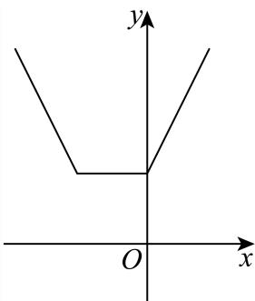
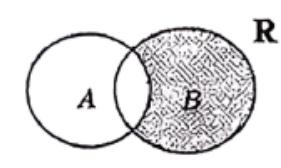

# 不等式与代数 · 上海数学大题汇编

> 答案和解析沿用源稿，未逐题独立重算；OCR 与原稿疑点仍可能存在。每题计为一道完整大题。

共 41 道。

### 213 · 原第17题

**来源：** S001 · 上海交通大学附属中学 · 高一 · 2025-2026 · 期中 · 原第17题

**考点说明：** 存在命题用判别式定参，结合正根条件讨论命题一真一假。

已知命题 $p:\exists x\in\mathbf{R},x^2+ax+a<0$，命题 $q$：方程 $x^2-x-a=0$ 有两个不相等的正根。

(1) 若命题 $p$ 为真命题，求实数 $a$ 的取值范围；

(2) 若命题 $p,q$ 中有且仅有一个为真命题，求实数 $a$ 的取值范围。

#### 答案

(1) $a<0$ 或 $a>4$；

(2) $a\le-\dfrac14$ 或 $a>4$。

#### 解析（保留源稿）

(1) 若 $p$ 为真命题，有 $\Delta=a^2-4a>0$，解得 $a<0$ 或 $a>4$。

(2) 若 $p$ 为真命题，则 $a<0$ 或 $a>4$；若 $q$ 为真，则 $\begin{cases}\Delta=1+4a>0\\x_1+x_2=1>0\\x_1\cdot x_2=-a>0\end{cases}$，解得 $-\dfrac14<a<0$。若 $p,q$ 中有且仅有一个为真命题，则 $p$ 真 $q$ 假或 $p$ 假 $q$ 真。若 $p$ 真 $q$ 假，则 $\begin{cases}a<0\text{ 或 }a>4\\a\le-\dfrac14\text{ 或 }a\ge0\end{cases}$，解得 $a\le-\dfrac14$ 或 $a>4$；若 $p$ 假 $q$ 真，则 $\begin{cases}0\le a\le4\\-\dfrac14<a<0\end{cases}$，解得 $a\in\varnothing$。综上，实数 $a$ 的取值范围是 $a\le-\dfrac14$ 或 $a>4$。

---

---

### 214 · 原第18题

**来源：** S001 · 上海交通大学附属中学 · 高一 · 2025-2026 · 期中 · 原第18题

**考点说明：** 绝对值不等式零点分段求解，以及解集为全体实数的参数条件

已知 $a\in\mathbf{R}$，关于 $x$ 的不等式 $|x+1|+|x-1|>a^2-5a+4$。

(1) 当 $a=0$ 时，求不等式的解集；

(2) 若不等式的解集为 $\mathbf{R}$，求 $a$ 的取值范围。

#### 答案

(1) $\{x\mid x<-2\text{ 或 }x>2\}$；

(2) $\left(\dfrac{5-\sqrt{17}}2,\dfrac{5+\sqrt{17}}2\right)$。

#### 解析（保留源稿）

(1) 当 $a=0$ 时，$a^2-5a+4=4$。当 $x<-1$ 时，不等式可化为 $-x-1-x+1>4$，解得 $x<-2$；当 $-1\le x\le1$ 时，不等式可化为 $x+1-x+1>4$，无解；当 $x>1$ 时，不等式可化为 $x+1+x-1>4$，解得 $x>2$；综上，不等式的解集为 $\{x\mid x<-2\text{ 或 }x>2\}$。

(2) $f(x)=|x+1|+|x-1|=\begin{cases}-2x,&x<-1\\2,&-1\le x\le1\\2x,&x>1\end{cases}$，则当 $x<-1$ 时，$f(x)>2$；当 $-1\le x\le1$ 时，$f(x)=2$；当 $x>1$ 时，$f(x)>2$。所以 $f(x)\ge2$。因为不等式的解集为 $\mathbf{R}$，则 $a^2-5a+4<2$，解得 $\dfrac{5-\sqrt{17}}2<a<\dfrac{5+\sqrt{17}}2$。所以 $a$ 的取值范围为 $\left(\dfrac{5-\sqrt{17}}2,\dfrac{5+\sqrt{17}}2\right)$。

---

---

### 215 · 原第17题

**来源：** S013 · 上海市南洋模范中学 · 高一 · 2025-2026 · 期中 · 原第17题

**考点说明：** 分式不等式兼顾分母非零，按参数与零点的相对位置分类。

关于 $x$ 的不等式 $\dfrac{(x+2)(x-a)}{x^2}\ge0$。

(1) 若 $a=1$，求不等式解集；

(2) 当 $a\in R$ 时，求上述不等式的解集。

#### 答案

(1) $(-\infty,-2]\cup[1,+\infty)$

(2) 答案见解析

#### 解析（保留源稿）

(1) 因为 $a=1$，所以 $\dfrac{(x+2)(x-1)}{x^2}\ge0$，所以 $(x+2)(x-1)\ge0$ 且 $x\ne0$，解得 $x\le-2$ 或 $x\ge1$。所以不等式的解集为 $(-\infty,-2]\cup[1,+\infty)$。

(2) ①当 $a=-2$ 时，$\dfrac{(x+2)^2}{x^2}\ge0$。因为 $(x+2)^2\ge0$ 恒成立，所以只需 $x\ne0$，即不等式的解集为：$(-\infty,0)\cup(0,+\infty)$；

②当 $a<-2$ 时，$(x+2)(x-a)\ge0$ 且 $x\ne0$，解得 $x\le a$ 或 $x\ge-2$ 且 $x\ne0$，即不等式的解集为：$(-\infty,a]\cup[-2,0)\cup(0,+\infty)$；

③当 $-2<a<0$ 时，$(x+2)(x-a)\ge0$ 且 $x\ne0$，解得 $x\le-2$ 或 $x\ge a$ 且 $x\ne0$，即不等式的解集为：$(-\infty,-2]\cup[a,0)\cup(0,+\infty)$；

④当 $a=0$ 时，$\dfrac{(x+2)x}{x^2}\ge0$，所以 $(x+2)x\ge0$ 且 $x\ne0$，解得 $x\le-2$ 或 $x>0$，即不等式的解集为：$(-\infty,-2]\cup(0,+\infty)$；

⑤当 $a>0$ 时，$(x+2)(x-a)\ge0$ 且 $x\ne0$，解得 $x\le-2$ 或 $x\ge a$，即不等式的解集为：$(-\infty,-2]\cup[a,+\infty)$。

---

---

### 216 · 原第18题

**来源：** S013 · 上海市南洋模范中学 · 高一 · 2025-2026 · 期中 · 原第18题

**考点说明：** 集合封闭性质的直接运用，构造新元素并枚举检验双元素集。

由正数组成的集合 $A$ 具有如下性质：若 $a\in A$，$b\in A$ 且 $a<b$，则 $1+\dfrac ab\in A$。

(1) 若 $1\in A$ 且 $2\in A$，试分别判断 $\dfrac74$、$\dfrac85$ 是否在集合 $A$ 内，并说明理由；

(2) 试问集合 $A$ 能否恰有两个元素且 $\dfrac{10}{9}\in A$？若能，求出所有满足条件的集合 $A$；若不能，请说明理由。

#### 答案

(1) $\dfrac74\in A$，$\dfrac85\in A$

(2) 能，所有满足条件的集合为：$\left\{\dfrac{10}{81},\dfrac{10}{9}\right\}$、$\left\{\dfrac{10}{9},\dfrac53\right\}$、$\left\{\dfrac{10}{9},10\right\}$

#### 解析（保留源稿）

(1) 由题意 $1\in A$，$2\in A$ 且 $1<2$，所以 $1+\dfrac12=\dfrac32\in A$；又 $1<\dfrac32$，所以 $1+\dfrac{1}{3/2}=1+\dfrac23=\dfrac53\in A$；由 $\dfrac32<2$，所以 $1+\dfrac{3/2}{2}=1+\dfrac34=\dfrac74\in A$；由 $1<\dfrac53$，所以 $1+\dfrac{1}{5/3}=1+\dfrac35=\dfrac85\in A$。所以 $\dfrac74\in A$，$\dfrac85\in A$。

(2) 设 $A=\{a,b\}\,(a<b)$，由性质有 $1+\dfrac ab\in A$。所以 $1+\dfrac ab=a$ 或 $1+\dfrac ab=b$。

当 $1+\dfrac ab=a$ 时，整理得 $a+b=ab$，即 $(a-1)(b-1)=1$。因为 $\dfrac{10}{9}\in A$：若 $a=\dfrac{10}{9}$，则 $b=1+\dfrac{1}{a-1}=1+\dfrac{1}{1/9}=10$，即 $A=\left\{\dfrac{10}{9},10\right\}$；若 $b=\dfrac{10}{9}$，解得 $a=10$，与 $a<b$ 矛盾，不满足题意。

当 $1+\dfrac ab=b$ 时，则 $a=b^2-b$。由 $\dfrac{10}{9}\in A$：若 $a=\dfrac{10}{9}$，则 $b^2-b=\dfrac{10}{9}$，即 $9b^2-9b-10=0$，解得 $b=\dfrac53$（负根舍去），$A=\left\{\dfrac{10}{9},\dfrac53\right\}$；若 $b=\dfrac{10}{9}$，则 $a=b^2-b=\left(\dfrac{10}{9}\right)^2-\dfrac{10}{9}=\dfrac{10}{81}$，即 $A=\left\{\dfrac{10}{81},\dfrac{10}{9}\right\}$。

综上所述，集合 $A$ 能恰有两个元素且 $\dfrac{10}{9}\in A$，所有满足条件的集合为：$\left\{\dfrac{10}{81},\dfrac{10}{9}\right\}$、$\left\{\dfrac{10}{9},\dfrac53\right\}$、$\left\{\dfrac{10}{9},10\right\}$。

---

---

### 217 · 原第20题

**来源：** S013 · 上海市南洋模范中学 · 高一 · 2025-2026 · 期中 · 原第20题

**考点说明：** 集合和集差集的新定义，利用有序元素关系与构造确定最大数目。

设集合 $A$ 为非空数集，定义 $A^+=\{x\mid x=a+b,\ a,b\in A\}$，$A^-=\{x\mid x=\vert a-b\vert,\ a,b\in A\}$。

(1) 若 $A=\{-1,1\}$，写出集合 $A^+$、$A^-$；

(2) 若 $A=\{x_1,x_2,x_3,x_4\}$，$x_1<x_2<x_3<x_4$，且 $A^-=A$，求证：$x_1+x_4=x_2+x_3$；

(3) 若 $A\subseteq\{x\mid 0\le x\le2020,\ x\in N\}$ 且 $A^+\cap A^-=\varnothing$，求集合 $A$ 元素个数的最大值。

#### 答案

(1) $A^+=\{-2,0,2\}$，$A^-=\{0,2\}$

(2) 见解析

(3) $1347$

#### 解析（保留源稿）

(1) 由题意，得 $A^+=\{-2,0,2\}$，$A^-=\{0,2\}$。

(2) 由于集合 $A=\{x_1,x_2,x_3,x_4\}$，$x_1<x_2<x_3<x_4$，且 $A^-=A$，所以 $A^-$ 中也只包含四个元素，即 $A^-=\{0,x_2-x_1,x_3-x_1,x_4-x_1\}$，剩下的 $x_3-x_2=x_4-x_3=x_2-x_1$，所以 $x_1+x_4=x_2+x_3$。

(3) 设 $A=\{a_1,a_2,a_3,\dots,a_k\}$ 满足题意，其中 $a_1<a_2<a_3<\dots<a_k$，则
$$2a_1<a_1+a_2<a_1+a_3<\dots<a_1+a_k<a_2+a_k<a_3+a_k<\dots<a_{k-1}+a_k<2a_k,$$
所以 $|A^+|\ge2k-1$。因为 $a_1-a_1<a_2-a_1<a_3-a_1<\dots<a_k-a_1$，所以 $|A^-|\ge k$。又 $A^+\cap A^-=\varnothing$，所以 $|A^+\cup A^-|=|A^+|+|A^-|\ge3k-1$。$A^+\cup A^-$ 中最小的元素为 0、最大的元素为 $2a_k$，所以 $|A^+\cup A^-|\le2a_k+1$。又 $A\subseteq\{x\mid0\le x\le2020,\ x\in N\}$，故 $2a_k+1\le4041$，即 $3k-1\le4041$，解得 $k\le1347\frac13$，所以 $k\le1347$。

实际当 $A=\{674,675,676,\dots,2020\}$ 时满足题意，证明如下：取 $A=\{m,m+1,m+2,\dots,2020\}$，$m\in N$，则 $A^+=\{2m,2m+1,2m+2,\dots,4040\}$，$A^-=\{0,1,\dots,2020-m\}$，由题意得 $2020-m<2m$，即 $m>673\dfrac13$，故 $m$ 的最小值为 674，即 $A=\{674,675,676,\dots,2020\}$ 时满足题意，此时集合 $A$ 中元素的个数为 $2020-674+1=1347$。

综上所述，集合 $A$ 中元素个数的最大值为 1347。

> **校订提示**
>
> 源稿本题解析写作 $3k-1\le2a_k+1\le4043$，其中上界 4043 与题设 $A\subseteq\{x\mid0\le x\le2020\}$ 不符（此时 $2a_k+1\le4041$）。本文按题设复算为 $k\le1347$，与答案 1347 一致。需以原 PDF 复核定案。

> 下列正文保留原转录的主要步骤；与本提示冲突的数值不作为有效依据。

---

---

### 218 · 原第21题

**来源：** S013 · 上海市南洋模范中学 · 高一 · 2025-2026 · 期中 · 原第21题

**考点说明：** 由二次式取值区间反推系数，讨论整数解个数及含参不等式。

已知不等式 $2\le ax^2+bx+c\le3$ 的解集为 $\{x\mid 2\le x\le3\}$。

(1) 若 $a>0$，求 $6b+5c$ 的值；

(2) 若 $a>0$，且不等式 $ax^2+(b-3)x-c\le0$ 有且仅有 9 个整数解，求 $a$ 的取值范围；

(3) 若 $a\ne0$，解关于 $x$ 的不等式：$ax^2+(b-1)x+5<0$。

#### 答案

(1) $15$

(2) $\left(\dfrac32,3\right]$

(3) 见解析

#### 解析（保留源稿）

(1) 因为 $a>0$，不等式 $2\le ax^2+bx+c\le3$ 的解集为 $\{x\mid2\le x\le3\}$，所以不等式 $ax^2+bx+c\le3$ 的解集为 $\{x\mid2\le x\le3\}$，且不等式 $ax^2+bx+c\ge2$ 的解集为 $R$。所以方程 $ax^2+bx+c-3=0$ 的两个根分别为 2 和 3，所以 $\begin{cases}2+3=-\dfrac ba\\ 2\times3=\dfrac{c-3}{a}\end{cases}$，可得 $b=-5a$，$c=6a+3$，所以 $6b+5c=6\times(-5a)+5(6a+3)=15$。

(2) 由(1)可知 $b=-5a$，$c=6a+3$。所以不等式 $ax^2+bx+c\ge2$ 可化为 $ax^2-5ax+6a+1\ge0$。由(1)知 $ax^2+bx+c\ge2$ 的解集为 $R$，所以 $ax^2-5ax+6a+1\ge0$ 恒成立，所以 $\begin{cases}a>0\\ \Delta=25a^2-4a(6a+1)\le0\end{cases}$，解得 $0<a\le4$。不等式 $ax^2+(b-3)x-c\le0$ 等价于 $ax^2-(5a+3)x-(6a+3)\le0$，所以 $[ax-(6a+3)](x+1)\le0$，得 $-1\le x\le6+\dfrac3a$。因为不等式有且仅有 9 个整数解，所以 $7\le6+\dfrac3a<8$，解得 $\dfrac32<a\le3$。综上，$a$ 的取值范围为 $\left(\dfrac32,3\right]$。

(3) 若 $a>0$，则由(1)可知不等式 $ax^2+(b-1)x+5<0$ 可化为 $ax^2-(5a+1)x+5<0$，即 $(ax-1)(x-5)<0$。当 $0<a<\dfrac15$ 时，$5<x<\dfrac1a$，解集为 $\left(5,\dfrac1a\right)$；当 $a=\dfrac15$ 时，解集为 $\varnothing$；当 $\dfrac15<a\le4$ 时，$\dfrac1a<x<5$，解集为 $\left(\dfrac1a,5\right)$。

若 $a<0$，则不等式 $ax^2+bx+c\ge2$ 的解集为 $\{x\mid2\le x\le3\}$、$ax^2+bx+c\le3$ 的解集为 $R$，所以方程 $ax^2+bx+c-2=0$ 的两个根分别为 2 和 3，所以 $\begin{cases}2+3=-\dfrac ba\\ 2\times3=\dfrac{c-2}{a}\end{cases}$，得 $b=-5a$，$c=6a+2$。所以 $ax^2+bx+c-3=ax^2-5ax+6a-1\le0$ 恒成立，所以 $\begin{cases}a<0\\ \Delta=25a^2-4a(6a-1)\le0\end{cases}$，解得 $-4\le a<0$。此时 $ax^2+(b-1)x+5=ax^2-(5a+1)x+5=(ax-1)(x-5)<0$，解得 $x<\dfrac1a$ 或 $x>5$，解集为 $\left(-\infty,\dfrac1a\right)\cup(5,+\infty)$。

若 $a=0$，$b>0$ 时，$2b+c=2$，$3b+c=3$，得 $b=1$，$c=0$，不等式化为 $5<0$ 无解，解集为 $\varnothing$；若 $a=0$，$b<0$ 时，$2b+c=3$，$3b+c=2$，得 $b=-1$，$c=5$，不等式化为 $5-2x<0$，解得 $x>\dfrac52$，解集为 $\left(\dfrac52,+\infty\right)$。

综上：当 $-4\le a<0$ 时，解集为 $\left(-\infty,\dfrac1a\right)\cup(5,+\infty)$；当 $a=0,b>0$ 时，解集为 $\varnothing$；当 $a=0,b<0$ 时，解集为 $\left(\dfrac52,+\infty\right)$；当 $0<a<\dfrac15$ 时，解集为 $\left(5,\dfrac1a\right)$；当 $a=\dfrac15$ 时，解集为 $\varnothing$；当 $\dfrac15<a\le4$ 时，解集为 $\left(\dfrac1a,5\right)$。

> **校订提示**
>
> 源稿本题题干作“若 $a\ne0$ 解关于 $x$ 的不等式”，而原解析完整列出了 $a=0$（分 $b>0$ 与 $b<0$）的两种情形，二者表述不尽一致，需以原 PDF 复核定案。

> 下列正文保留原转录；与本提示冲突的文字或公式不作为有效依据。

---

### 219 · 原第17题

**来源：** S053 · 上海市大同中学 · 高一 · 2025-2026 · 期中 · 原第17题

**考点说明：** 复数代数运算，利用虚部已知和乘积为实数条件确定复数。

已知复数 $z_1$ 满足 $(z_1-2)(1+i)=1-i$（$i$ 为虚数单位），复数 $z_2$ 的虚部为 2，$z_1\cdot z_2$ 是实数，求 $z_2$。

#### 答案

$z_2=4+2i$

#### 解析（保留源稿）

由 $(z_1-2)(1+i)=1-i$ 得 $z_1-2=\dfrac{1-i}{1+i}=-i$，所以 $z_1=2-i$。设 $z_2=a+2i\,(a\in R)$，则 $z_1z_2=(2-i)(a+2i)=(2a+2)+(4-a)i$。因为 $z_1z_2\in R$，所以 $4-a=0$，即 $a=4$，故 $z_2=4+2i$。

---

---

### 220 · 原第18题

**来源：** S007 · 上海市奉贤中学 · 高一 · 2025-2026 · 期中 · 原第18题

**考点说明：** 分母恒正的分式不等式求集合，判断交集非空与参数端点。

已知集合 $A=\left\{x\ \middle|\ \frac{-x+6}{x^2+3}>0\right\}$，$B=\{x\mid x+a\ge0\}$。

(1) 当 $a=-2$ 时，求 $A\cap B$；

(2) 若 $A\cap B\ne\varnothing$，求实数 $a$ 的取值范围。

#### 答案

(1) $A\cap B=\{x\mid 2\le x<6\}$；

(2) $(-6,+\infty)$

#### 解析（保留源稿）

(1) $A=\left\{x\ \middle|\ \frac{-x+6}{x^2+3}>0\right\}=\{x\mid -x+6>0\}=\{x\mid x<6\}$，当 $a=-2$ 时，$B=\{x\mid x\ge2\}$，所以 $A\cap B=\{x\mid 2\le x<6\}$。

(2) $B=\{x\mid x\ge-a\}$，根据 $A\cap B\ne\varnothing$，则 $-a<6$，即 $a>-6$，所以实数 $a$ 的取值范围为 $(-6,+\infty)$。

---

---

### 221 · 原第19题

**来源：** S007 · 上海市奉贤中学 · 高一 · 2025-2026 · 期中 · 原第19题

**考点说明：** 全称命题的否定与绝对值函数的最值。；充分不必要条件与集合的包含关系。

已知命题：“对任意 $x\in\mathbf R$，不等式 $\vert x+2\vert+\vert x\vert-m\ge0$”是假命题。

(1) 求实数 $m$ 的取值集合 $B$；

(2) 设不等式 $(x-a)(x-a-1)<0$ 的解集为 $A$，若 $x\in A$ 是 $x\in B$ 的充分不必要条件，求实数 $a$ 的取值范围。

#### 答案

(1) $B=\{m\mid m>2\}$；

(2) $[2,+\infty)$

#### 解析（保留源稿）

(1) 命题“对任意 $x\in\mathbf R$，不等式 $\vert x+2\vert+\vert x\vert-m\ge0$”是假命题，则其否定是真命题，即“存在 $x\in\mathbf R$，使 $\vert x+2\vert+\vert x\vert-m<0$”，所以 $m>(\vert x+2\vert+\vert x\vert)_{\min}$。而 $y=\vert x+2\vert+\vert x\vert=\begin{cases}2x+2,&x\ge0,\\ 2,&-2\le x<0,\\ -2x-2,&x<-2,\end{cases}$ 作出图象，可得 $y_{\min}=2$，所以 $m>2$，即实数 $m$ 的取值集合 $B=\{m\mid m>2\}$。

(2) 不等式 $(x-a)(x-a-1)<0$，因为 $a<a+1$，所以解集 $A=\{x\mid a<x<a+1\}$。因为 $x\in A$ 是 $x\in B$ 的充分不必要条件，得 $A$ 是 $B$ 的真子集，所以 $a\ge2$，则实数 $a$ 的取值范围 $[2,+\infty)$。

---

---

### 222 · 原第20题

**来源：** S007 · 上海市奉贤中学 · 高一 · 2025-2026 · 期中 · 原第20题

**考点说明：** 二次不等式解集与系数的关系（韦达定理）。；韦达定理与基本不等式求最值。；含参二次不等式的分类讨论。

已知函数 $y=ax^2+bx-a+3$。

(1) 若关于 $x$ 的不等式 $y>0$ 的解集是 $\{x\mid -1<x<4\}$，求实数 $a,b$ 的值；

(2) 若 $a>0$，$b=-a^2-1$，$x_1,x_2$ 是关于 $x$ 的方程 $y=0$ 的两个根，求 $(x_1+1)(x_2+1)$ 的最小值；

(3) 若 $b=4$，$a\ge0$，解关于 $x$ 的不等式 $y\le-2a$。

#### 答案

(1) $a=-1$，$b=3$；

(2) $4$；

(3) 见解析

#### 解析（保留源稿）

(1) 由题意知方程 $ax^2+bx-a+3=0$ 的两根为 $-1,4$，且 $a<0$，所以 $-1\times4=\frac{-a+3}a\Rightarrow a=-1$；$-1+4=-\frac ba\Rightarrow b=3$。所以 $a=-1$，$b=3$。

(2) 由韦达定理可得 $x_1+x_2=-\frac ba=\frac{a^2+1}a$，$x_1x_2=\frac{-a+3}a$，所以 $(x_1+1)(x_2+1)=x_1+x_2+x_1x_2+1=\frac{a^2+1}a+\frac{-a+3}a+1=\frac{a^2+4}a=a+\frac4a$。因为 $a>0$，所以 $a+\frac4a\ge2\sqrt{a\cdot\frac4a}=4$（当且仅当 $a=2$ 时取“$=$”）。又当 $a=2$ 时，方程为 $2x^2-5x+1=0$，因为 $\Delta=25-4\times2\times1>0$，所以方程有两个根。所以 $(x_1+1)(x_2+1)$ 的最小值为 $4$。

(3) 当 $b=4$ 时，由 $y\le-2a$ 化为 $ax^2+4x+a+3\le0$。因为 $a\ge0$：若 $a=0$，则原不等式可化为 $4x+3\le0$，即 $x\le-\frac34$；若 $a>0$，$\Delta=16-4a(a+3)=-4(a^2+3a-4)=-4(a-1)(a+4)$，当 $\Delta>0$ 时，方程 $ax^2+4x+a+3=0$ 的两根为 $x_1=\frac{-2-\sqrt{4-a^2-3a}}a$，$x_2=\frac{-2+\sqrt{4-a^2-3a}}a$。① 当 $a>1$ 时 $\Delta<0$，原不等式的解集为 $\varnothing$；② 当 $a=1$ 时 $\Delta=0$，原不等式的解集为 $\{-2\}$；③ 当 $0<a<1$ 时 $\Delta>0$，原不等式的解集为 $\{x\mid x_1\le x\le x_2\}$。

综上可知：①当 $a>1$ 时，原不等式的解集为 $\varnothing$；②当 $a=1$ 时，原不等式的解集为 $\{-2\}$；③当 $0<a<1$ 时，原不等式的解集为 $\left\{x\ \middle|\ \frac{-2-\sqrt{4-a^2-3a}}a\le x\le\frac{-2+\sqrt{4-a^2-3a}}a\right\}$；④当 $a=0$ 时，原不等式的解集为 $\left\{x\ \middle|\ x\le-\frac34\right\}$。

---

---

### 223 · 原第21题

**来源：** S020 · 上海市宜川中学 · 高一 · 2025-2026 · 期中 · 原第21题

**考点说明：** 集合新定义下的元素构造与检验，通过极端元素和反证限制集合。

> **校订提示**
>
> 源稿本题**题号缺失**：它在解答题第 20 题之后另起新题，但源稿未给出题号。按题号严格递增与题序，本文暂编为“第 21 题”。需以原 PDF 复核定案。

若有限个正整数组成的集合 $A$ 中至少有两个元素，且对于任意的 $x,y\in A\,(x>y)$，都有 $\dfrac{y^2}{x-y}\in A$，则称 $A$ 为“双J集合”。

(1) 判断 $\{1,2,4\}$ 是否为“双J集合”，说明理由；

(2) 若双元素集 $M$ 为“双J集合”，且 $2\in M$，求所有满足条件的集合 $M$；

(3) 求所有满足条件的“双J集合”。

#### 答案

(1) $\{1,2,4\}$ 不是“双J集合”，理由见解析；

(2) $M=\{1,2\}$ 或 $M=\{2,4\}$；

(3) $\{k,2k\}\,(k\in N^*)$

#### 解析（保留源稿）

(1) 假设 $x=4$，$y=1$，则 $\dfrac{y^2}{x-y}=\dfrac13\notin A$，故 $\{1,2,4\}$ 不是“双J集合”。

(2) 假设 $x=2$，则另一个元素为 $y$，因为 $\dfrac{y^2}{x-y}\in A$。若 $\dfrac{y^2}{2-y}=2$，解得 $y=-1\pm\sqrt5$，不符合题意；若 $\dfrac{y^2}{2-y}=y$，解得 $y=1$（符合题意）或 $y=0$（不符合题意）。所以此时 $M=\{1,2\}$。假设 $y=2$，则另一个元素为 $x$，因为 $\dfrac{y^2}{x-y}\in A$。若 $\dfrac{2^2}{x-2}=2$，解得 $x=4$，符合题意；若 $\dfrac{2^2}{x-2}=x$，解得 $x=1\pm\sqrt5$，不符合题意。所以此时 $M=\{2,4\}$。

(3) 若满足条件的“双J集合”只有两个元素，仿照（2）讨论，可得满足“双J集合”的有 $\{k,2k\}\,(k\in N^*)$。当“双J集合”有两个以上的元素时，设最小的元素为 $b$，最大元素为 $a$，第二大的元素为 $n$，所以有 $\dfrac{b^2}{a-b}$、$\dfrac{n^2}{a-n}$ 是“双J集合”中的元素，所以 $\dfrac{b^2}{a-b}\ge b\Rightarrow a\le2b$。若 $\dfrac{n^2}{a-n}\le n\Rightarrow a\ge2n$，与已知矛盾，故 $\dfrac{n^2}{a-n}\le a$，解得 $n=\dfrac{\sqrt5-1}{2}a$，显然 $a$ 与 $n$ 不可能同时为整数，故该假设不成立。所以“双J集合”不可能有两个以上的元素；故所有满足的“双J集合”为 $\{k,2k\}\,(k\in N^*)$。

---

### 224 · 原第14题

**来源：** S049 · 上海市市北中学 · 高一 · 2025-2026 · 期中 · 原第14题

**考点说明：** 二次不等式解集与韦达定理，结合判别式讨论恒成立条件。

（1）若不等式 $x^2-ax+b<0$ 的解集是 $\{x\mid 2<x<3\}$，求不等式 $bx^2-ax+1<0$ 的解集；

（2）若 $b=2a-3$，$x^2-ax+b\ge0$ 恒成立，求实数 $a$ 的取值范围。

#### 答案

（1）$\left(\frac13,\frac12\right)$；（2）$a\in[2,6]$

#### 解析（保留源稿）

（1）由不等式的解集求得 $a=5$、$b=6$，代入目标不等式求解集即可。由题设 $a=2+3=5$，$b=2\times3=6$，则 $bx^2-ax+1=6x^2-5x+1=(3x-1)(2x-1)<0$，所以 $\frac13<x<\frac12$，故解集为 $\left(\frac13,\frac12\right)$。

（2）由题设 $x^2-ax+(2a-3)\ge0$ 恒成立，只需 $\Delta\le0$ 即可求参数范围。由题设 $x^2-ax+(2a-3)\ge0$ 恒成立，故 $\Delta=a^2-4(2a-3)=a^2-8a+12\le0$，所以 $(a-2)(a-6)\le0\Rightarrow2\le a\le6$，则 $a\in[2,6]$。

---

---

### 225 · 原第15题

**来源：** S049 · 上海市市北中学 · 高一 · 2025-2026 · 期中 · 原第15题

**考点说明：** 分数指数幂的运算。；指对数互化与对数的运算性质。

（1）已知正数 $a$ 满足 $a^{2m}=16$，$a^n=9$，求 $a^{\frac{m-n}2}$ 的值；

（2）已知 $a$、$b$、$c$ 均为正数，且 $3^a=4^b=6^c$，求 $\frac2a+\frac1b-\frac2c$ 的值。

#### 答案

（1）$\frac23$；（2）$0$

#### 解析（保留源稿）

（1）根据指数幂的运算法则，即可求得答案。因为 $a^{2m}=16$，所以 $a^m=4$；又 $a^n=9$，所以 $a^{m-n}=\frac{a^m}{a^n}=\frac49$，所以 $a^{\frac{m-n}2}=\sqrt{\frac49}=\frac23$。

（2）根据指对数互换的法则，可得 $a$、$b$、$c$ 的表示，代入所求化简计算即可。设 $3^a=4^b=6^c=k$，则 $a=\log_3 k$，$b=\log_4 k$，$c=\log_6 k$。所以 $\frac2a+\frac1b-\frac2c=2\log_k 3+\log_k 4-2\log_k 6=\log_k 9+\log_k 4-\log_k 36=\log_k\frac{9\times4}{36}=\log_k 1=0$。

---

---

### 226 · 原第17题

**来源：** S049 · 上海市市北中学 · 高一 · 2025-2026 · 期中 · 原第17题

**考点说明：** 一元二次不等式与元素归属（端点取等）。；由不等式解集反求参数，再解二次不等式。；含参二次不等式的分类讨论。

已知函数 $f(x)=mx^2-(2m+1)x+3$，$m\in\mathbf R$。

(1) 已知 $A=\{x\mid f(x)>0\}$，若 $1\notin A$，求实数 $m$ 的取值范围；

(2) 若 $f(x)<1$ 的解集是 $(2,+\infty)$，求 $f(x)>x^2$ 的解集；

(3) 解关于 $x$ 的不等式 $f(x)\le mx$。

> **校订提示**
>
> 源稿第 (3) 问解析“综上所述”的最后一条写作“当 $\frac1m>3$ 时，原不等式的解集为 $\left\{x\mid 3\le x\le\frac1m\right\}$”，与 $0<m<\frac13$ 的情形重复，且漏列 $m>\frac13$（此时 $\frac1m<3$，解集应为 $\left\{x\mid\frac1m\le x\le3\right\}$）。按分类，末条应为 $m>\frac13$ 的情形。需以原 PDF 复核定案。

> 下列正文保留原转录；与本提示冲突的文字或公式不作为有效依据。

#### 答案

(1) $[2,+\infty)$；

(2) $\left(-\dfrac{1+\sqrt{13}}2,\dfrac{\sqrt{13}-1}2\right)$；

(3) 答案见解析

#### 解析（保留源稿）

(1) 由题意可得 $f(1)=m-(2m+1)+3=2-m\le0$，解得 $m\ge2$。因此，实数 $m$ 的取值范围是 $[2,+\infty)$。

(2) 由题意 $f(x)=mx^2-(2m+1)x+3<1$，可得 $mx^2-(2m+1)x+2<0$，即 $(mx-1)(x-2)<0$。因为不等式 $(mx-1)(x-2)<0$ 的解集为 $(2,+\infty)$，则 $m=0$。此时，不等式即为 $-(x-2)<0$，解得 $x>2$，合乎题意，故 $f(x)=-x+3$。由 $f(x)>x^2$ 得 $-x+3>x^2$，即 $x^2+x-3<0$，解得 $-\frac{1+\sqrt{13}}2<x<\frac{\sqrt{13}-1}2$，所以不等式 $f(x)>x^2$ 的解集为 $\left(-\frac{1+\sqrt{13}}2,\frac{\sqrt{13}-1}2\right)$。

(3) 由 $f(x)\le mx$ 可得 $mx^2-(3m+1)x+3\le0$，即 $(mx-1)(x-3)\le0$。当 $m=0$ 时，原不等式即为 $-(x-3)\le0$，解得 $x\ge3$；当 $m\ne0$ 时，方程 $(mx-1)(x-3)=0$ 的根为 $x_1=\frac1m$，$x_2=3$。（i）当 $\frac1m<0$，即 $m<0$ 时，解原不等式可得 $x\le\frac1m$ 或 $x\ge3$；（ii）当 $\frac1m=3$，即 $m=\frac13$ 时，原不等式即为 $(x-3)^2\le0$，解得 $x=3$；（iii）当 $0<\frac1m<3$，即 $m>\frac13$ 时，解原不等式可得 $\frac1m\le x\le3$；（iv）当 $\frac1m>3$，即 $0<m<\frac13$ 时，解原不等式可得 $3\le x\le\frac1m$。

综上所述，当 $m<0$ 时，原不等式的解集为 $\left\{x\ \middle|\ x\le\frac1m\ \text{或}\ x\ge3\right\}$；当 $m=0$ 时，原不等式的解集为 $\{x\mid x\ge3\}$；当 $0<m<\frac13$ 时，原不等式的解集为 $\left\{x\ \middle|\ 3\le x\le\frac1m\right\}$；当 $m=\frac13$ 时，原不等式的解集为 $\{3\}$；当 $m>\frac13$ 时，原不等式的解集为 $\left\{x\ \middle|\ \frac1m\le x\le3\right\}$。

---

---

### 227 · 原第18题

**来源：** S049 · 上海市市北中学 · 高一 · 2025-2026 · 期中 · 原第18题

**考点说明：** 类比因式分解推导三次韦达关系，应用对称式求方程参数。

（1）若方程 $x^2+2x-4=0$ 的两根分别为 $x_1$、$x_2$，求 $\frac1{x_1}+\frac1{x_2}$ 的值。

（2）教材中有对一元二次方程的根与系数关系（韦达定理）的证明：若一元二次方程 $ax^2+bx+c=0\,(a\ne0)$ 的两个根为 $x_1$、$x_2$，则 $x_1+x_2=-\frac ba$，$x_1x_2=\frac ca$。证明：因为一元二次方程 $ax^2+bx+c=0$ 的两个根为 $x_1$、$x_2$，所以二次三项式 $ax^2+bx+c$ 可以因式分解为 $ax^2+bx+c=a(x-x_1)(x-x_2)$，而 $a(x-x_1)(x-x_2)=ax^2-a(x_1+x_2)x+ax_1x_2$，从而等式 $ax^2+bx+c=ax^2-a(x_1+x_2)x+ax_1x_2$ 恒成立，该等式两边的对应项系数应相等，因此 $x_1+x_2=-\frac ba$，$x_1x_2=\frac ca$。类比以上思路，推导一元三次方程 $ax^3+bx^2+cx+d=0\,(a\ne0)$ 的根与系数关系；

（3）根据你的发现，解决以下问题：已知关于 $x$ 的方程 $x^3+x^2+cx+1=0\,(c\in\mathbf R)$ 有三个实数根 $x_1$、$x_2$、$x_3$ 满足 $x_1^2+x_2^2+x_3^2=11$，求实数 $c$ 的值。

#### 答案

（1）$\frac12$；

（2）$x_1+x_2+x_3=-\frac ba$，$x_1x_2+x_1x_3+x_2x_3=\frac ca$，$x_1x_2x_3=-\frac da$；

（3）$-5$

#### 解析（保留源稿）

（1）根据韦达定理，可得 $x_1+x_2=-2$、$x_1x_2=-4$，代入所求即可得答案。由题意 $x_1+x_2=-2$，$x_1x_2=-4$，所以 $\frac1{x_1}+\frac1{x_2}=\frac{x_1+x_2}{x_1x_2}=\frac{-2}{-4}=\frac12$。

（2）设 $ax^3+bx^2+cx+d=0\,(a\ne0)$ 有三个不相等的实数根 $x_1$、$x_2$、$x_3$，则 $ax^3+bx^2+cx+d=0$ 可分解因式为 $a(x-x_1)(x-x_2)(x-x_3)=0$，打开括号得 $ax^3-a(x_1+x_2+x_3)x^2+a(x_1x_2+x_1x_3+x_2x_3)x-ax_1x_2x_3=0$，所以有 $ax^3-a(x_1+x_2+x_3)x^2+a(x_1x_2+x_1x_3+x_2x_3)x-ax_1x_2x_3=ax^3+bx^2+cx+d$ 恒成立，所以等式两边对应系数相等，所以有 $x_1+x_2+x_3=-\frac ba$，$x_1x_2+x_1x_3+x_2x_3=\frac ca$，$x_1x_2x_3=-\frac da$。

（3）由（2）可知，$x_1+x_2+x_3=-1$，$x_1x_2+x_1x_3+x_2x_3=c$，$x_1x_2x_3=-1$。因为 $\left(x_1+x_2+x_3\right)^2=x_1^2+x_2^2+x_3^2+2(x_1x_2+x_1x_3+x_2x_3)$，又 $x_1+x_2+x_3=-1$，$x_1^2+x_2^2+x_3^2=11$，所以有 $11+2c=1$，解得 $c=-5$。

---

### 228 · 原第17题

**来源：** S051 · 上海市市西中学 · 高一 · 2025-2026 · 期中 · 原第17题

**考点说明：** 对数式的化简与定义域约束。；换底公式与对数的恒等变形。

已知 $m=2\log_3 x$，$n=\log_5(x-1)$。

(1) 当 $3^m-5^n=3$，求 $x$ 的值；

(2) 当 $x=4$ 时，用 $m$、$n$ 表示 $\log_{15}20$。

#### 答案

(1) $x=2$；

(2) $\log_{15}20=\dfrac{mn+2}{2n+2}$。

#### 解析（保留源稿）

(1) $\because m=2\log_3 x$，$n=\log_5(x-1)$，$\therefore\begin{cases}x>0\\ x-1>0\end{cases}$，解得 $x>1$。$\therefore 3^m-5^n=3^{2\log_3 x}-5^{\log_5(x-1)}=3^{\log_3 x^2}-(x-1)=x^2-x+1=3$，解得 $x=-1$（舍）或 $x=2$，即 $x=2$。

(2) 当 $x=4$ 时，$m=2\log_3 4=4\log_3 2$，$n=\log_5 3$，$\therefore\dfrac m4=\log_3 2$，$\dfrac1n=\log_3 5$，$\therefore\log_{15}20=\dfrac{\log_3 20}{\log_3 15}=\dfrac{\log_3(2\times2\times5)}{\log_3(3\times5)}=\dfrac{2\log_3 2+\log_3 5}{1+\log_3 5}=\dfrac{\frac m2+\frac1n}{1+\frac1n}=\dfrac{mn+2}{2n+2}$。

---

---

### 229 · 原第20题

**来源：** S051 · 上海市市西中学 · 高一 · 2025-2026 · 期中 · 原第20题

**考点说明：** 含两个绝对值的方程（零点分段）。；绝对值函数的恒成立问题。；绝对值距离和的几何意义与最值。

若设 $M(a,n)=|ax-1|+|ax-2|+\cdots+|ax-n|$ 为曼哈顿扩张距离，它由 $n$ 个绝对值之和组成，其中 $n$ 为正整数。

(1) 若 $M(1,2)\le3$，求 $x$ 的取值范围；

(2) 若 $M(4,2)\ge m$ 对一切实数 $x$ 恒成立，求实数 $m$ 的取值范围；

(3) $M(4,8)$ 是否存在最小值？若存在，求出该最小值及此时 $x$ 的取值范围；若不存在，说明理由。

#### 答案

(1) $0\le x\le3$；

(2) $(-\infty,1]$；

(3) 最小值为 16，此时 $x\in\left[1,\dfrac54\right]$

#### 解析（保留源稿）

(1) 依题意，得 $M(1,2)=|x-1|+|x-2|\le3$。当 $x<1$ 时，$1-x+2-x\le3$，解得 $x\ge0$，故 $0\le x<1$；当 $1\le x\le2$ 时，$x-1+2-x=1\le3$ 恒成立，故 $1\le x\le2$；当 $x>2$ 时，$x-1+x-2\le3$，解得 $x\le3$，故 $2<x\le3$。综上：$0\le x\le3$。

(2) 依题意，得 $M(4,2)=|4x-1|+|4x-2|\ge m$ 对一切实数 $x$ 恒成立。因为 $|4x-1|+|4x-2|\ge|(4x-1)-(4x-2)|=1$，当且仅当 $(4x-1)(4x-2)\le0$，即 $\dfrac14\le x\le\dfrac12$ 时等号成立，故 $m\le1$，实数 $m$ 的取值范围为 $(-\infty,1]$。

(3) $M(4,8)=|4x-1|+|4x-2|+\cdots+|4x-8|=\left|x-\dfrac14\right|+\left|x-\dfrac24\right|+\left|x-\dfrac34\right|+\left|x-\dfrac44\right|+\left|x-\dfrac54\right|+\left|x-\dfrac64\right|+\left|x-\dfrac74\right|+\left|x-\dfrac84\right|$ 的 4 倍，其几何意义为数轴上点 $x$ 到 $\dfrac14,\dfrac24,\dfrac34,\dfrac44,\dfrac54,\dfrac64,\dfrac74,\dfrac84$ 的距离之和。要想距离之和最小，按首尾配对：

$\left|x-\dfrac44\right|+\left|x-\dfrac54\right|\ge\dfrac14$，当且仅当 $\left(x-\dfrac44\right)\left(x-\dfrac54\right)\le0$，即 $x\in\left[1,\dfrac54\right]$ 时取得最小值；

$\left|x-\dfrac34\right|+\left|x-\dfrac64\right|\ge\dfrac34$，当且仅当 $x\in\left[\dfrac34,\dfrac32\right]$ 时取得最小值；

$\left|x-\dfrac24\right|+\left|x-\dfrac74\right|\ge\dfrac54$，当且仅当 $x\in\left[\dfrac12,\dfrac74\right]$ 时取得最小值；

$\left|x-\dfrac14\right|+\left|x-\dfrac84\right|\ge\dfrac74$，当且仅当 $x\in\left[\dfrac14,2\right]$ 时取得最小值。

综上，当 $x\in\left[1,\dfrac54\right]$ 时 $\left|x-\dfrac14\right|+\cdots+\left|x-\dfrac84\right|$ 取得最小值 $\dfrac74+\dfrac54+\dfrac34+\dfrac14=4$，故 $M(4,8)$ 的最小值为 $16$。

---

---

### 230 · 原第21题

**来源：** S051 · 上海市市西中学 · 高一 · 2025-2026 · 期中 · 原第21题

**考点说明：** 新定义零一序列运算，证明充要条件并用递推归纳求集合最大数目。

设 $n$ 为正整数且 $n\ge2$，集合 $A_n=\{\alpha\mid\alpha=(t_1,t_2,\cdots,t_n),\ t_k\in\{0,1\},\ (k=1,2,\cdots,n)\}$。对于集合 $A_n$ 中的任意元素 $\alpha=(x_1,x_2,\cdots,x_n)$ 和 $\beta=(y_1,y_2,\cdots,y_n)$，规定 $\alpha*\beta=x_1y_n+x_2y_{n-1}+\cdots+x_ny_1$。设 $B_n$ 是 $A_n$ 的子集，且满足：对于 $B_n$ 中的任意两个不同的元素 $\alpha,\beta$，都有 $\alpha*\beta=0$，则称集合 $B_n$ 具有性质 $P(n)$。

(1) 当 $n=3$ 时，若 $\alpha=(1,1,0)$，$\beta=(0,0,1)$，求 $\alpha*\alpha$、$\alpha*\beta$ 的值；

(2) 已知正整数 $n\ge2$，集合 $C_{n+2}$ 是 $A_{n+2}$ 的子集。求证：“集合 $C_{n+2}$ 具有性质 $P(n+2)$”的充要条件是“对 $C_{n+2}$ 中任意两个不同的元素 $\alpha=(p_1,r_1,r_2,\cdots,r_n,q_1)$，$\beta=(p_2,s_1,s_2,\cdots,s_n,q_2)$ 都有 $(r_1,r_2,\cdots,r_n)*(s_1,s_2,\cdots,s_n)=0$，且 $(p_1,q_1)*(p_2,q_2)=0$”；

(3) 设 $n$ 为偶数，已知集合 $B_n$ 具有性质 $P(n)$，集合 $B_n$ 中元素个数的最大值为 $b_n$，求 $b_2$ 的值及 $b_n$ 关于 $n$ 的表达式。

#### 答案

(1) 1，1；

(2) 证明见解析；

(3) $b_2=2$，$b_n=2^{\frac n2}$

#### 解析（保留源稿）

(1) 因为 $\alpha=(1,1,0)$，$\beta=(0,0,1)$，由定义可知：$\alpha*\alpha=1\times0+1\times1+0\times1=1$，$\alpha*\beta=1\times1+1\times0+0\times0=1$。

(2) ① 若集合 $C_{n+2}$ 具有性质 $P(n+2)$，任取 $C_{n+2}$ 中不同元素 $\alpha,\beta$，设 $\alpha=(p_1,r_1,r_2,\cdots,r_n,q_1)$，$\beta=(p_2,s_1,s_2,\cdots,s_n,q_2)$，有 $\alpha*\beta=p_1q_2+r_1s_n+r_2s_{n-1}+\cdots+r_ns_1+q_1p_2=(r_1,r_2,\cdots,r_n)*(s_1,s_2,\cdots,s_n)+(p_1,q_1)*(p_2,q_2)=0$。由 $*$ 的定义可知，对任意正整数 $n$，都有 $\alpha*\beta\ge0$，所以 $(r_1,r_2,\cdots,r_n)*(s_1,s_2,\cdots,s_n)=0$，$(p_1,q_1)*(p_2,q_2)=0$。

② 若对 $C_{n+2}$ 中任意两个不同的元素 $\alpha=(p_1,r_1,r_2,\cdots,r_n,q_1)$，$\beta=(p_2,s_1,s_2,\cdots,s_n,q_2)$ 都有 $(r_1,r_2,\cdots,r_n)*(s_1,s_2,\cdots,s_n)=0$，$(p_1,q_1)*(p_2,q_2)=0$，那么 $\alpha*\beta=p_1q_2+r_1s_n+r_2s_{n-1}+\cdots+r_ns_1+q_1p_2=(r_1,r_2,\cdots,r_n)*(s_1,s_2,\cdots,s_n)+(p_1,q_1)*(p_2,q_2)=0$。综上，结论成立。

(3) 设具有性质 $P(n)$ 的集合 $B_n$ 的元素个数最大值为 $b_n$，下证：$b_2=2$，$b_{n+2}=2b_n\ (n\ge2)$，其中 $n$ 为偶数。当 $n=2$ 时，$A_2=\{(0,0),(0,1),(1,0),(1,1)\}$，由于 $(0,1)*(1,0)=1$，$(0,1)*(1,1)=1$，$(1,0)*(1,1)=1$，则 $\{(0,1),(1,0),(1,1)\}$ 中至多有一个属于 $B_2$，当 $B_2=\{(0,0),(0,1)\}$ 时 $B_2$ 元素个数取到最大值为 2，即 $b_2=2$。

一方面，若集合 $B_2$、$B_n$ 分别具有性质 $P(2)$、$P(n)$，令集合 $C_{n+2}=\{\alpha\mid\alpha=(p,t_1,t_2,\cdots,t_n,q),\ \text{其中}(t_1,t_2,\cdots,t_n)\in B_n,\ (p,q)\in B_2\}$，则 $C_{n+2}$ 中任意两个不同的元素 $\alpha=(p_1,r_1,r_2,\cdots,r_n,q_1)$、$\beta=(p_2,s_1,s_2,\cdots,s_n,q_2)$ 都有 $\alpha*\beta=0$，由 $b_2=2$ 知 $b_{n+2}\ge2b_n$。

另一方面，设具有性质 $P(n+2)$ 的集合 $B_{n+2}$ 元素个数取到最大值 $b_{n+2}$，取 $\alpha=(x_1,x_2,\cdots,x_n,x_{n+1},x_{n+2})$ 与 $\beta=(y_1,y_2,\cdots,y_n,y_{n+1},y_{n+2})$ 为 $B_{n+2}$ 的两个不同元素，则有 $\alpha*\beta=x_1y_{n+2}+x_2y_{n+1}+\cdots+x_{n+1}y_2+x_{n+2}y_1=(x_1y_{n+2}+x_{n+2}y_1)+(x_2y_{n+1}+\cdots+x_{n+1}y_2)=0$，因此 $x_1y_{n+2}+x_{n+2}y_1=0$，$x_2y_{n+1}+\cdots+x_{n+1}y_2=0$。由于 $b_2=2$，因此 $b_{n+2}\le2b_n$。

综上，$b_{n+2}=2b_n\ (n\ge2)$，$n$ 为偶数，所以 $b_n=2^{\frac n2}$。

---

### 231 · 原第17题

**来源：** S034 · 上海市建平中学 · 高一 · 2025-2026 · 期中 · 原第17题

**考点说明：** 将目标式作差或利用基本不等式，证明正实数对称不等式。

已知 $a$、$b$ 都是正实数，证明：$\dfrac{a^2}{b}+\dfrac{b^2}{a}\ge a+b$

#### 答案

证明见解析

#### 解析（保留源稿）

结合不等式的加法法则，利用基本不等式即可证明。因为 $a$、$b$ 都是正实数，所以 $\dfrac{a^2}{b}+b\ge2\sqrt{\dfrac{a^2}{b}\times b}=2a$，当且仅当 $\dfrac{a^2}{b}=b$ 即 $a=b$ 时等号成立；$\dfrac{b^2}{a}+a\ge2\sqrt{\dfrac{b^2}{a}\times a}=2b$，当且仅当 $\dfrac{b^2}{a}=a$ 即 $a=b$ 时等号成立；所以 $\dfrac{a^2}{b}+\dfrac{b^2}{a}+b+a\ge2a+2b$，即 $\dfrac{a^2}{b}+\dfrac{b^2}{a}\ge a+b$，当且仅当 $a=b$ 时等号成立。

---

---

### 232 · 原第18题

**来源：** S034 · 上海市建平中学 · 高一 · 2025-2026 · 期中 · 原第18题

**考点说明：** 解含参二次与分式不等式，利用集合相等或真包含确定参数。

已知集合 $A=\{x\mid(x-a)(x-a^2)<0\}$，集合 $B=\left\{x\left|\dfrac{2x}{x-1}<1\right.\right\}$，命题 $p$：$x\in A$，命题 $q$：$x\in B$

(1) 当实数 $a$ 为何值时，$A=B$；

(2) 若 $q$ 是 $p$ 的充分不必要条件，求实数 $a$ 的取值范围。

#### 答案

(1) $a=-1$；

(2) $(-\infty,-1)$

#### 解析（保留源稿）

(1) 令 $\dfrac{2x}{x-1}<1$，即 $\dfrac{2x}{x-1}-1=\dfrac{x+1}{x-1}<0$，有 $(x-1)(x+1)<0$，解得 $-1<x<1$，故 $B=\{x\mid-1<x<1\}$。$\because(x-a)(x-a^2)=0$ 的解为 $x=a$、$x=a^2$，且 $A=B$：当 $0<a<1$ 时 $a^2<a$，$A=\{x\mid a^2<x<a\}$，由 $\begin{cases}a=1\\ a^2=-1\end{cases}$ 无解；当 $a=0$ 或 $a=1$ 时 $a^2=a$，$A=\varnothing$，此时 $A\ne B$；当 $a<0$ 或 $a>1$ 时 $a^2>a$，$A=\{x\mid a<x<a^2\}$，由 $\begin{cases}a=-1\\ a^2=1\end{cases}$ 解得 $a=-1$。综上，$a=-1$。

(2) 因为 $q$ 是 $p$ 的充分不必要条件，所以 $B$ 是 $A$ 的真子集。当 $0<a<1$ 时 $a^2<a$，$A=\{x\mid a^2<x<a\}$，不能包含 $B$，无解；当 $a=0$ 或 $a=1$ 时 $a^2=a$，$A=\varnothing$，不符合题意；当 $a<0$ 或 $a>1$ 时 $a^2>a$，$A=\{x\mid a<x<a^2\}$，要使 $(-1,1)$ 是 $(a,a^2)$ 的真子集，需 $a<-1$ 且 $a^2>1$，即 $a<-1$。综上所述，$a$ 的取值范围为 $(-\infty,-1)$。

---

---

### 233 · 原第21题

**来源：** S034 · 上海市建平中学 · 高一 · 2025-2026 · 期中 · 原第21题

**考点说明：** 集合新定义的验证与反证，利用奇偶性和极端构造限制元素数。

对于集合 $M=\{a_1,a_2,\ldots,a_n\}\ (n\in\mathbf N^*,\ n\ge3)$，其中 $a_i\in\mathbf N^*\ (i=1,2,\ldots,n)$。如果任意去掉其中一个元素 $a_i\ (i=1,2,\ldots,n)$ 之后，剩余的所有元素组成的集合都能分成两个交集为空集的集合，且这两个集合的所有元素之和相等，就称集合 $M$ 为“可调和集合”。

(1) 判断集合 $\{1,2,3,5\}$ 和 $\{2,4,6,8,10,12,14\}$ 是否为“可调和集合”（不必写过程）；

(2) 求证：集合 $M=\{a_1,a_2,a_3,a_4,a_5\}$，其中 $a_i\in\mathbf N^*\ (i=1,2,3,4,5)$，不是“可调和集合”；

(3) 若集合 $M=\{a_1,a_2,\ldots,a_n\}\ (n\in\mathbf N^*,\ n\ge3)$，其中 $a_i\in\mathbf N^*\ (i=1,2,\ldots,n)$ 是“可调和集合”。① 证明：$n$ 为奇数；② 求集合 $M$ 中元素个数的最小值。

#### 答案

(1) 都不是；

(2) 证明见解析；

(3) ① 证明见解析；② $7$

#### 解析（保留源稿）

(1) 当去掉集合 $\{1,2,3,5\}$ 中的元素 3 时，剩余元素 1、2、5，显然无法分成两个非空集合并且两个集合的所有元素之和相等，故集合 $\{1,2,3,5\}$ 不是“可调和集合”；若两个集合的元素之和相等，则所有元素同时除以 2 后元素之和也相等，所以若集合 $\{2,4,6,8,10,12,14\}$ 是“可调和集合”，则集合 $\{1,2,3,4,5,6,7\}$ 也是“可调和集合”；当去掉元素 1 时，剩余元素之和为 $2+3+4+5+6+7=27$，为奇数，不可能将剩余元素分成两个非空数集且元素之和相等，所以集合 $\{2,4,6,8,10,12,14\}$ 不是“可调和集合”。

(2) 不妨设 $a_1<a_2<a_3<a_4<a_5$。若去掉的元素为 $a_3$，将集合 $\{a_1,a_3,a_4,a_5\}$ 分成两个交集为空集的子集且两个子集元素之和相等，则有 $a_1+a_5=a_3+a_4$ ①，或者 $a_5=a_1+a_3+a_4$ ②；若去掉的元素为 $a_1$，将集合 $\{a_2,a_3,a_4,a_5\}$ 分成两个交集为空集的子集且两个子集元素之和相等，则有 $a_2+a_5=a_3+a_4$ ③，或者 $a_5=a_2+a_3+a_4$ ④。由①、③得 $a_1=a_2$，矛盾；由①、④得 $a_1=-a_2$，矛盾；由②、③得 $a_1=-a_2$，矛盾；由②、④得 $a_1=a_2$，矛盾。因此当 $n=5$ 时，集合 $M$ 一定不是“可调和集合”。

(3) ① 设集合 $M=\{a_1,a_2,\cdots,a_n\}$ 所有元素之和为 $S$。由题可知，$S-a_i\ (i=1,2,\cdots,n)$ 均为偶数，因此 $a_i\ (i=1,2,\cdots,n)$ 均为奇数或均为偶数。如果 $S$ 为奇数，则 $a_i\ (i=1,2,\cdots,n)$ 均为奇数；由于 $S=a_1+a_2+\cdots+a_n$，所以 $n$ 为奇数。如果 $S$ 为偶数，则 $a_i\ (i=1,2,\cdots,n)$ 均为偶数，此时设 $a_i=2b_i$，则 $\{b_1,b_2,\cdots,b_n\}$ 也是“可调和集合”。重复上述操作有限次，便可得各项均为奇数的“可调和集合”，此时各项之和也为奇数，则集合 $M$ 中元素个数 $n$ 为奇数。综上所述，集合 $M$ 中元素个数为奇数。

② 当 $n=3$ 时，显然任意集合 $\{a_1,a_2,a_3\}$ 不是“可调和集合”。当 $n=5$ 时，第 (2) 问已经证明集合 $M=\{a_1,a_2,a_3,a_4,a_5\}$ 不是“可调和集合”。当 $n=7$ 时，集合 $M=\{1,3,5,7,9,11,13\}$，因为 $3+5+7+9=11+13$，$1+9+13=5+7+11$，$9+13=1+3+7+11$，$1+9+11=3+5+13$，$1+3+5+11=7+13$，$3+7+9=1+5+13$，$1+3+5+9=7+11$，则集合 $M$ 是“可调和集合”。所以集合 $M$ 中元素个数的最小值是 7。

---

### 234 · 原第17题

**来源：** S035 · 上海市建平中学 · 高一 · 年份待核 · 月考 · 原第17题

**考点说明：** 用作差分解证明不等式，按临界点顺序分类解含参分式不等式。

本题共10分，第（1）小题4分，第（2）小题6分。

（1）已知$a>b>0$，用作差法证明：$a^5-b^5>a^3b^2-a^2b^3$。

（2）已知$a\in\mathbf R$，求关于$x$的不等式$\dfrac{x-a^2}{x-2a}\ge0$的解集。

#### 答案

（1）证明见解析；（2）
$$
\begin{cases}
(-\infty,2a)\cup[a^2,+\infty),&a<0\text{或}a>2,\\
\mathbf R\setminus\{2a\},&a=0\text{或}a=2,\\
(-\infty,a^2]\cup(2a,+\infty),&0<a<2.
\end{cases}
$$

**考点：** 作差法；参数分式不等式。

#### 解析（保留源稿）

（1）两边作差并因式分解：
$$
\begin{aligned}
&(a^5-b^5)-(a^3b^2-a^2b^3)\\
&=(a-b)(a^4+a^3b+a^2b^2+ab^3+b^4-a^2b^2)\\
&=(a-b)(a^4+a^3b+ab^3+b^4)>0.
\end{aligned}
$$
因此原不等式成立。

（2）分子零点为$a^2$，分母零点为$2a$，且$x=2a$必须排除。比较临界点得$a^2-2a=a(a-2)$。

- 若$a<0$或$a>2$，则$2a<a^2$，分式在两端非负，解集为$(-\infty,2a)\cup[a^2,+\infty)$；
- 若$a=0$或$a=2$，分式在$x\ne2a$时恒等于$1$，解集为$\mathbf R\setminus\{2a\}$；
- 若$0<a<2$，则$a^2<2a$，解集为$(-\infty,a^2]\cup(2a,+\infty)$。

**易卡点：** 分子为零的点可取，分母为零的点不可取；两临界点重合时必须单独讨论。

---

### 235 · 原第18题

**来源：** S035 · 上海市建平中学 · 高一 · 年份待核 · 月考 · 原第18题

**考点说明：** 集合包含与交集为空，兼顾空集并讨论含参数方程根的位置。

本题共12分，第（1）、（2）小题各6分。

已知集合
$$
A=\{x\mid-1<x<5\},\quad
B=\{x\mid a<x<2a-1\},\quad
C=\{x\mid x^2-5ax+6a^2=0\}.
$$

（1）若$A\cap B=B$，求实数$a$的取值范围；

（2）若$A\cap C=\varnothing$，求实数$a$的取值范围。

#### 答案

（1）$(-\infty,3]$；（2）$\left(-\infty,-\dfrac12\right]\cup\left[\dfrac52,+\infty\right)$。

**考点：** 集合包含中的空集情形；根与区间的位置关系。

#### 解析（保留源稿）

（1）$A\cap B=B$等价于$B\subseteq A$。

当$a\ge2a-1$，即$a\le1$时，$B=\varnothing$，条件自动成立。

当$a>1$时，$B=(a,2a-1)$非空。要使$B\subseteq(-1,5)$，需且只需$a\ge-1$且$2a-1\le5$。结合$a>1$得$1<a\le3$。注意两个区间均为开区间，右端点相等仍满足包含。

综上$a\le3$。

（2）因$x^2-5ax+6a^2=(x-2a)(x-3a)$，故$C=\{2a,3a\}$（$a=0$时只含一个元素$0$）。

若$a<0$，则$3a<2a<0<5$。两个根都不在$(-1,5)$内，等价于较大根$2a\le-1$，即$a\le-\dfrac12$。

若$a=0$，则$0\in A\cap C$，不满足条件。

若$a>0$，则$-1<0<2a<3a$。两个根都不在$(-1,5)$内，等价于较小根$2a\ge5$，即$a\ge\dfrac52$。

因此所求范围为$\left(-\infty,-\dfrac12\right]\cup\left[\dfrac52,+\infty\right)$。

---

### 236 · 原第20题

**来源：** S035 · 上海市建平中学 · 高一 · 年份待核 · 月考 · 原第20题

**考点说明：** 集合封闭新定义的逐项检验，用极端元素与量词条件进行反证。

本题共18分，第（1）小题4分，第（2）小题6分，第（3）小题8分。

已知集合$M$中的元素均为正整数，且集合$M$至少有2个元素。若存在整数$k$，使得对任意的正整数$x,y$，当$x+y\in M$时，$xy-k\in M$恒成立，则称集合$M$具有性质$T(k)$。

（1）判断集合$\{1,2\}$是否具有性质$T(0)$，$\{2,3\}$是否具有性质$T(1)$，并说明理由；

（2）若集合$M=\{1,a\}$具有性质$T(1)$，求$a$的值；

（3）求证：对任意整数$k\ge2$，不存在具有性质$T(k)$的集合。

#### 答案

（1）$\{1,2\}$具有性质$T(0)$；$\{2,3\}$不具有性质$T(1)$；（2）$a=3$；（3）证明见解析。

**考点：** 新定义集合性质、最小元素与反证法。

#### 解析（保留源稿）

（1）对$M=\{1,2\}$，正整数$x,y$的和至少为$2$，所以$x+y\in M$只可能是$x+y=2$，即$x=y=1$。此时$xy-0=1\in M$，故具有性质$T(0)$。

对$M=\{2,3\}$，取$x=y=1$，则$x+y=2\in M$，但$xy-1=0\notin M$，故不具有性质$T(1)$。

（2）由于集合至少有2个元素，$a$是大于$1$的整数。取$x=1,y=a-1$，则$x+y=a\in M$，所以
$$
a-2=xy-1\in\{1,a\}.
$$
$a-2=a$不可能，故$a-2=1$，得到$a=3$。

反过来，对$M=\{1,3\}$，正整数$x,y$满足$x+y\in M$时，只可能有$x+y=3$，即$(x,y)=(1,2)$或$(2,1)$，此时$xy-1=1\in M$。因此$a=3$确实满足条件。

（3）用反证法。设某个整数$k\ge2$对应的集合$M$具有性质$T(k)$。

先证$1\in M$。若$M$的最小元素$m\ge2$，取$x=1,y=m-1$，有$x+y=m\in M$，从而
$$
m-1-k\in M.
$$
但$m-1-k<m$：若它非正，则与$M$只含正整数矛盾；若它为正，则与$m$是最小元素矛盾。因此$M$的最小元素只能是$1$。

因为$M$至少有两个元素，设$n$是其中第二小的元素，则$n\ge2$。取$x=1,y=n-1$，由性质得$n-1-k\in M$，且$n-1-k<n$，故它只能等于$1$，从而$n=k+2$。

再取$x=2,y=k$，二者都是正整数，且$x+y=k+2=n\in M$，于是
$$
xy-k=2k-k=k\in M.
$$
可是$k\ge2$且$k<n=k+2$，这与$n$是第二小的元素矛盾。

故对任意整数$k\ge2$，不存在具有性质$T(k)$的集合。

**易卡点：** 定义中的$x,y$只要求是正整数，并不要求$x,y\in M$；正整数集合可以无限，但仍存在最小元素，去掉最小元素后仍有第二小元素。

---

### 237 · 原第17题

**来源：** S015 · 上海市徐汇中学 · 高一 · 2025-2026 · 期中 · 原第17题

**考点说明：** 分式不等式求集合，结合阴影图示与真包含条件求参数。

已知集合 $A=\left\{x\left|\dfrac{2x-3}{x+5}\le0\right.\right\}$，$B=\{x\mid|x-a|<1\}$，全集为 $R$。

(1) 若 $a=1$，求阴影部分表示的集合。

(2) 若 $A\cap B=B$，求实数 $a$ 的取值范围。

#### 答案

(1) $\left\{x\left|\dfrac32<x<2\right.\right\}$；

(2) $\left[-4,\dfrac12\right]$

#### 解析（保留源稿）

(1) 由 $\dfrac{2x-3}{x+5}\le0$ 等价于 $\begin{cases}(2x-3)(x+5)\le0\\ x+5\ne0\end{cases}$，解得 $-5<x\le\dfrac32$，即 $A=\left\{x\left|-5<x\le\dfrac32\right.\right\}$。当 $a=1$ 时，$|x-1|<1$ 等价于 $0<x<2$，即 $B=\{x\mid0<x<2\}$。由 Venn 图知阴影部分为 $(\complement_RA)\cap B$，而 $\complement_RA=\left\{x\left|x\le-5\text{ 或 }x>\dfrac32\right.\right\}$，故 $(\complement_RA)\cap B=\left\{x\left|\dfrac32<x<2\right.\right\}$，即阴影部分表示的集合为 $\left\{x\left|\dfrac32<x<2\right.\right\}$。

(2) 由（1）知 $A=\left\{x\left|-5<x\le\dfrac32\right.\right\}$，$B=\{x\mid a-1<x<a+1\}$。由 $A\cap B=B$ 得 $B\subseteq A$，所以 $\begin{cases}a-1\ge-5\\ a+1\le\dfrac32\end{cases}$，解得 $-4\le a\le\dfrac12$，即实数 $a$ 的取值范围为 $\left[-4,\dfrac12\right]$。

---

---

### 238 · 原第18题

**来源：** S015 · 上海市徐汇中学 · 高一 · 2025-2026 · 期中 · 原第18题

**考点说明：** 韦达定理与判别式筛选参数，利用对称式变形和作差比较大小。

已知一元二次方程 $x^2+px+p=0$ 有两个不相等的实根分别为 $x_1$、$x_2$。

(1) 若 $x_1^2+x_2^2=3$，求实数 $p$ 的值；

(2) 将 $A=x_1^2+x_2^2$、$B=x_1x_2(x_1+x_2)$ 表示为 $p$ 的代数式，并比较 $A$ 与 $B$ 的大小。

#### 答案

(1) $-1$；

(2) $A=p^2-2p$，$B=-p^2$，$A>B$

#### 解析（保留源稿）

(1) 方程有两个不相等的实根，则 $\Delta=p^2-4p>0$，解得 $p<0$ 或 $p>4$。由韦达定理 $x_1+x_2=-p$，$x_1x_2=p$，所以 $x_1^2+x_2^2=(x_1+x_2)^2-2x_1x_2=p^2-2p=3$，解得 $p=-1$ 或 $p=3$。结合 $p<0$ 或 $p>4$，舍去 $p=3$，故 $p=-1$。

(2) 由（1）得 $p<0$ 或 $p>4$，且 $x_1+x_2=-p$，$x_1x_2=p$，所以 $A=x_1^2+x_2^2=(x_1+x_2)^2-2x_1x_2=p^2-2p$，$B=x_1x_2(x_1+x_2)=-p^2$，于是 $A-B=(p^2-2p)-(-p^2)=2p(p-1)$。当 $p<0$ 时 $p(p-1)>0$，故 $A>B$；当 $p>4$ 时 $p(p-1)>0$，故 $A>B$。综上，$A=p^2-2p$，$B=-p^2$，且 $A>B$。

---

---

### 239 · 原第17题

**来源：** S028 · 上海市控江中学 · 高一 · 2025-2026 · 期中 · 原第17题

**考点说明：** 立方根函数单调性与平方分数幂的偶性，用于化简参数不等式。

(1) 若 $(a-1)^{\frac13}<(2a)^{\frac13}$，求实数 $a$ 的取值范围；

(2) 若 $(a-1)^{\frac23}<(2a)^{\frac23}$，求实数 $a$ 的取值范围。

#### 答案

(1) $(-1,+\infty)$；

(2) $(-\infty,-1)\cup\left(\dfrac13,+\infty\right)$

#### 解析（保留源稿）

(1) 因为 $y=x^{\frac13}=\sqrt[3]{x}$ 是 $R$ 上的增函数，所以 $(a-1)^{\frac13}<(2a)^{\frac13}$ 等价于 $a-1<2a$，解得 $a>-1$，即 $a\in(-1,+\infty)$。

(2) 因为 $f(x)=x^{\frac23}=\sqrt[3]{x^2}$ 是偶函数，且在 $(0,+\infty)$ 上是增函数，所以 $(a-1)^{\frac23}<(2a)^{\frac23}$ 等价于 $|a-1|<|2a|$，平方得 $(a-1)^2<4a^2$，即 $3a^2+2a-1>0$，解得 $a<-1$ 或 $a>\dfrac13$，即 $a\in(-\infty,-1)\cup\left(\dfrac13,+\infty\right)$。

---

---

### 240 · 原第20题

**来源：** S028 · 上海市控江中学 · 高一 · 2025-2026 · 期中 · 原第20题

**考点说明：** 新定义距离的代入计算，比较不同阶距离并用放缩证明集合包含。

距离的度量是机器学习算法的重要基础，对平面直角坐标系中的两点 $P_1(x_1,y_1)$，$P_2(x_2,y_2)$（可重合），定义它们的 $q$ 阶闵可夫斯基距离为 $D_q(P_1,P_2)=(|x_1-x_2|^q+|y_1-y_2|^q)^{\frac1q}$（其中 $q>0$）。

(1) 设点 $A(3,-4)$，点 $B(1,-1)$，求 $D_1(A,B)$ 与 $D_3(A,B)$ 的值；

(2) 若 $m>n\ge1$，点 $A$ 和点 $B$ 关于直线 $y=x$ 对称，比较 $D_m(A,B)$ 与 $D_n(A,B)$ 的大小，并证明结论；

(3) 若 $m>n\ge1$，给定点 $C$，设集合 $P=\{A(x,y)\mid D_n(A,C)\le1\}$，$Q=\{B(x,y)\mid D_m(B,C)\le1\}$，证明：$P\subseteq Q$。

#### 答案

(1) $D_1(A,B)=5$，$D_3(A,B)=\sqrt[3]{35}$；

(2) $D_m(A,B)\le D_n(A,B)$，且等号成立当且仅当 $A=B$；

(3) 证明见详解

#### 解析（保留源稿）

(1) $D_1(A,B)=|3-1|+|-4-(-1)|=2+3=5$；$D_3(A,B)=(|3-1|^3+|-4-(-1)|^3)^{\frac13}=(2^3+3^3)^{\frac13}=(8+27)^{\frac13}=\sqrt[3]{35}$。

(2) 设 $A(a,b)$，由关于 $y=x$ 对称得 $B(b,a)$，则 $D_q(A,B)=(|a-b|^q+|b-a|^q)^{\frac1q}=2^{\frac1q}|a-b|$。令 $d=|a-b|\ge0$。若 $d=0$（即 $A=B$），则 $D_m(A,B)=D_n(A,B)=0$；若 $d>0$，由 $m>n\ge1$ 得 $\dfrac1m<\dfrac1n$，而 $f(x)=2^x$ 单调递增，故 $2^{\frac1m}<2^{\frac1n}$，于是 $D_m(A,B)=2^{\frac1m}d<2^{\frac1n}d=D_n(A,B)$。综上，当 $m>n\ge1$ 时 $D_m(A,B)\le D_n(A,B)$，且等号成立当且仅当 $A=B$。

(3) 先证明一般情形：当 $m>n\ge1$ 时，对任意两点 $X$、$Y$ 都有 $D_m(X,Y)\le D_n(X,Y)$。令 $u=|x_1-x_2|$，$v=|y_1-y_2|$，由 $D_n(X,Y)=(u^n+v^n)^{\frac1n}\le1$ 得 $u^n+v^n\le1$。又因 $m>n>0$，当 $0\le u^n\le1$、$0\le v^n\le1$ 时 $u^m+v^m\le u^n+v^n\le1$，所以 $D_m(X,Y)=(u^m+v^m)^{\frac1m}\le(u^n+v^n)^{\frac1n}=D_n(X,Y)$。于是若 $A\in P$，则 $D_n(A,C)\le1$，从而 $D_m(A,C)\le D_n(A,C)\le1$，即 $A\in Q$。所以 $P\subseteq Q$。

---

---

### 241 · 原第21题

**来源：** S028 · 上海市控江中学 · 高一 · 2025-2026 · 期中 · 原第21题

**考点说明：** 新定义（加法封闭）的反例证明。；加法封闭条件的求解。；对数型函数定义域与乘法封闭条件的求解。

设 $A$ 是一个非空集合，如果对于任意的 $x\in A$，$y\in A$，有 $x+y\in A$，则称 $A$ 是加法封闭的；而如果对于任意的 $x\in A$，$y\in A$，有 $xy\in A$，则称 $A$ 是乘法封闭的。

(1) 证明：区间 $(0,1)$ 不是加法封闭的；

(2) 若区间 $[a,+\infty)$ 是加法封闭的，求实数 $a$ 的取值范围；

(3) 设 $a>0$，集合 $B$ 是函数 $\lg(-x^2+2ax+3a^2)$ 的定义域，若 $B$ 是乘法封闭的，求实数 $a$ 的取值范围。

#### 答案

(1) 证明见解析；

(2) $[0,+\infty)$；

(3) $0<a\le\dfrac13$

#### 解析（保留源稿）

(1) 取 $x=\dfrac12\in(0,1)$，$y=\dfrac23\in(0,1)$，但 $x+y=\dfrac12+\dfrac23=\dfrac76\notin(0,1)$，即不满足"对任意 $x,y\in(0,1)$ 都有 $x+y\in(0,1)$"，所以区间 $(0,1)$ 不是加法封闭的。

(2) 因为区间 $[a,+\infty)$ 是加法封闭的，所以对任意 $x,y\in[a,+\infty)$ 都有 $x+y\in[a,+\infty)$，其最小和 $(x+y)_{\min}=2a$，需 $2a\ge a$，解得 $a\ge0$，所以实数 $a$ 的取值范围是 $[0,+\infty)$。

(3) 要使 $\lg(-x^2+2ax+3a^2)$ 有意义，需 $-x^2+2ax+3a^2>0$，即 $x^2-2ax-3a^2<0$，解得 $-a<x<3a$（$a>0$），所以 $B=(-a,3a)$。因为 $B$ 是乘法封闭的，所以对任意 $x,y\in(-a,3a)$ 都有 $xy\in(-a,3a)$，乘积 $xy$ 的取值范围为 $(-3a^2,9a^2)$，需 $\begin{cases}-3a^2\ge-a\\ 9a^2\le3a\\ a>0\end{cases}$，解得 $0<a\le\dfrac13$，所以实数 $a$ 的取值范围是 $0<a\le\dfrac13$。

---

### 242 · 原第17题

**来源：** S022 · 上海市晋元高级中学 · 高一 · 2025-2026 · 期中 · 原第17题

**考点说明：** 分式不等式与交补运算，必要非充分条件转化为集合真包含。

已知全集 $U=R$，集合 $A=\left\{x\ \middle|\ \frac{x-1}{x-3}\le0\right\}$，集合 $B=\{x\mid (x-a)(x-a^2-2)\le0\}$。

(1) 当 $a=\frac12$ 时，求 $A\cap\overline{B}$；

(2) 若“$x\in B$”是“$x\in A$”的必要非充分条件，求实数 $a$ 的取值范围。

#### 答案

(1) $\left(\frac94,3\right)$；

(2) $(-\infty,-1]\cup\{1\}$

#### 解析（保留源稿）

(1) 由 $\frac{x-1}{x-3}\le0$ 可得 $\begin{cases}(x-1)(x-3)\le0\\ x\ne3\end{cases}$，解得 $1\le x<3$，即 $A=[1,3)$。当 $a=\frac12$ 时，$(x-a)(x-a^2-2)\le0$ 即 $\left(x-\frac12\right)\left(x-\frac94\right)\le0$，解得 $\frac12\le x\le\frac94$，即 $B=\left[\frac12,\frac94\right]$，于是 $\overline{B}=\left(-\infty,\frac12\right)\cup\left(\frac94,+\infty\right)$。所以 $A\cap\overline{B}=\left(\frac94,3\right)$。

(2) 由“$x\in B$”是“$x\in A$”的必要非充分条件，可得集合 $A$ 是集合 $B$ 的真子集。因 $A=[1,3)$，由 $(a^2+2)-a=\left(a-\frac12\right)^2+\frac74>0$ 可知 $B=[a,a^2+2]$。故需 $\begin{cases}a\le1\\ a^2+2\ge3\end{cases}$，解得 $a\le-1$ 或 $a=1$。故实数 $a$ 的取值范围为 $(-\infty,-1]\cup\{1\}$。

---

---

### 243 · 原第17题

**来源：** S023 · 上海市曹杨第二中学 · 高一 · 2025-2026 · 期中 · 原第17题

**考点说明：** 指数与分式不等式求集合，将充分条件转化为区间包含关系。

已知 $a\in R$，$A=\left\{x\ \middle|\ 1\le\left(\frac13\right)^{x-a}\le9\right\}$，$B=\left\{x\ \middle|\ \frac{1}{1-x}\le1\right\}$。

(1) 若 $U=R$，求 $\overline{B}$；

(2) 若 $x\in A$ 是 $x\in B$ 的充分条件，求 $a$ 的取值范围。

#### 答案

(1) $\overline{B}=(0,1]$；

(2) $a\in(-\infty,0]\cup(3,+\infty)$

#### 解析（保留源稿）

(1) 解不等式 $\frac{1}{1-x}\le1$，得 $B=(-\infty,0]\cup(1,+\infty)$，所以 $\overline{B}=(0,1]$。

(2) 解不等式 $1\le\left(\frac13\right)^{x-a}\le9$，即 $1\le3^{a-x}\le9$，得 $0\le a-x\le2$，所以 $A=[a-2,a]$。因为 $x\in A$ 是 $x\in B$ 的充分条件，所以 $A\subseteq B$。又 $a-2<a$ 恒成立，所以 $A\ne\varnothing$。所以 $[a-2,a]\subseteq(-\infty,0]$ 或 $[a-2,a]\subseteq(1,+\infty)$，即 $a\le0$ 或 $a-2>1$，解得 $a\le0$ 或 $a>3$。故 $a\in(-\infty,0]\cup(3,+\infty)$。

---

---

### 244 · 原第20题

**来源：** S023 · 上海市曹杨第二中学 · 高一 · 2025-2026 · 期中 · 原第20题

**考点说明：** 解不等式得到区间长度，结合称心集定义推导元素数的上界。

对于任意实数 $c,d$（$c<d$），定义区间 $(c,d)$、$[c,d)$、$(c,d]$、$[c,d]$ 的长度均为 $d-c$。若集合 $I$ 是若干个两两交集为空集的区间的并集，则把这些区间的长度的和称为 $I$ 的长度。特别地，记正整数集 $A=\{a_1,a_2,\dots,a_n\}$，且 $a_1<a_2<\dots<a_n$，若对任意的 $i=1,2,\dots,n-1$，区间 $\left[\frac{1}{a_n},\frac{1}{a_i}\right]$ 的长度始终不小于 $\frac{n-i}{25}$ 恒成立，则称该集合为“称心集”。

(1) 若 $|2x+1|<x+2$ 的解集为 $B$，求集合 $B$ 的区间长度；

(2) 若关于 $x$ 的不等式组 $\begin{cases}x^2-2x-15<0\\ 2\log_4 x+\log_2(tx+2t)<2\end{cases}$ 的解集构成的各区间长度之和为 5，求实数 $t$ 的取值范围；

(3) 求“称心集”$A=\{a_1,a_2,\dots,a_n\}$ 中元素个数的最大值，并说明理由。

#### 答案

(1) $2$；

(2) $\left(0,\frac4{35}\right)$；

(3) 元素个数的最大值为 9，理由见解析。

#### 解析（保留源稿）

(1) 因为 $|2x+1|<x+2$。当 $2x+1\ge0$，即 $x\ge-\frac12$ 时，$2x+1<x+2$，解得 $x<1$，此时 $x\in\left(-\frac12,1\right)$；当 $2x+1\le0$，即 $x\le-\frac12$ 时，$-2x-1<x+2$，解得 $x>-1$，此时 $x\in\left(-1,-\frac12\right]$。所以 $B=(-1,1)$，集合 $B$ 的区间长度为 $1-(-1)=2$。

(2) 由 $x^2-2x-15<0$ 得 $(x-5)(x+3)<0$，解集为 $C=(-3,5)$。由 $2\log_4 x+\log_2(tx+2t)<2$ 得 $\log_2(tx+2t)x<\log_2 4$，即 $tx^2+2tx-4<0$ 且 $x>0$、$tx+2t>0$。设其解集为 $D$，则 $D\subseteq(0,+\infty)$。因为不等式组的解集构成的各区间长度之和为 5，所以 $C\cap D=(0,5)$，即需 $\begin{cases}tx+2t>0\\ tx^2+2tx-4<0\end{cases}$ 在 $x\in(0,5)$ 上恒成立。当 $x\in(0,5)$ 时 $tx+2t>0$ 恒成立，得 $t>0$；当 $x\in(0,5)$ 时 $tx^2+2tx-4<0$ 恒成立，即 $t<\frac{4}{x^2+2x}$ 恒成立，而 $\frac{4}{x^2+2x}$ 在 $(0,5)$ 上单调递减，所以 $\frac{4}{x^2+2x}\in\left(\frac4{35},+\infty\right)$，故 $t\le\frac4{35}$。综上，$t$ 的取值范围为 $\left(0,\frac4{35}\right)$。

(3) 因为 $\frac{1}{a_i}-\frac{1}{a_n}\ge\frac{n-i}{25}$，取 $i=1$ 得 $\frac{1}{a_1}-\frac{1}{a_n}\ge\frac{n-1}{25}$，又 $a_1\ge1$，$\frac{1}{a_n}>0$，可得 $1>\frac{n-1}{25}$，因此 $n<26$。同时 $\frac{1}{a_i}>\frac{n-i}{25}$，又 $a_i\ge i$，可得 $\frac1i>\frac{n-i}{25}$，所以 $i(n-i)<25$ 对 $i=1,2,\dots,n-1$ 均成立。当 $n\ge10$ 时，取 $i=5$，则 $i(n-i)=5(n-5)\ge25$，与 $i(n-i)<25$ 矛盾，故 $n<10$。又当 $n\le9$ 时，$i(n-i)\le\left(\frac{i+n-i}{2}\right)^2=\frac{n^2}4<25$ 恒成立，所以 $n\le9$。因此，“称心集”$A$ 中元素个数的最大值为 9。

---

### 245 · 原第17题

**来源：** S032 · 上海市松江二中 · 高一 · 2025-2026 · 期中 · 原第17题

**考点说明：** 绝对值与分式不等式求集合，充分不必要条件对应真包含关系。

设集合 $A=\{x\mid |x-a|<1\}$，$B=\left\{x\left|\dfrac{x-4}{x}<0\right.\right\}$。

(1) 若 $a=0$，求 $A\cup B$；

(2) 若“$x\in A$”是“$x\in B$”的充分不必要条件，求实数 $a$ 的取值范围。

#### 答案

(1) $\{x\mid -1<x<4\}$；

(2) $[1,3]$

#### 解析（保留源稿）

(1) 由 $|x-a|<1$，即 $-1<x-a<1$，解得 $a-1<x<a+1$，所以 $A=\{x\mid |x-a|<1\}=\{x\mid a-1<x<a+1\}$。当 $a=0$ 时 $A=\{x\mid -1<x<1\}$。由 $\dfrac{x-4}{x}<0$，即 $(x-4)x<0$，解得 $0<x<4$，所以 $B=\left\{x\left|\dfrac{x-4}{x}<0\right.\right\}=\{x\mid 0<x<4\}$。所以 $A\cup B=\{x\mid -1<x<4\}$。

(2) 因为“$x\in A$”是“$x\in B$”的充分不必要条件，所以 $A$ 是 $B$ 的真子集。又 $a+1>a-1$ 恒成立，即 $A\ne\varnothing$，所以 $\begin{cases}a-1\ge0\\ a+1\le4\end{cases}$（等号不同时取到），解得 $1\le a\le3$，所以实数 $a$ 的取值范围为 $[1,3]$。

---

---

### 246 · 原第18题

**来源：** S032 · 上海市松江二中 · 高一 · 2025-2026 · 期中 · 原第18题

**考点说明：** 韦达定理与判别式检验，利用解集包含关系分类讨论方程参数。

已知集合 $A=\{x\mid 2x^2-3x-2=0\}$，集合 $B=\{x\mid x^2+2(a+1)x+a^2-5=0\}$。

(1) 若集合 $B=\{x_1,x_2\}$，且满足 $x_1^2+x_2^2=24$，求实数 $a$ 的值；

(2) 若 $\complement_R A\cap B=\varnothing$，求实数 $a$ 的取值范围。

#### 答案

(1) $a=1$；

(2) $\{a\mid a\le-3\}$

#### 解析（保留源稿）

(1) 因为 $B=\{x_1,x_2\}$，所以 $\Delta=4(a+1)^2-4(a^2-5)>0$，解得 $a>-3$。由韦达定理可得 $\begin{cases}x_1+x_2=-2(a+1)\\ x_1x_2=a^2-5\end{cases}$，所以 $x_1^2+x_2^2=(x_1+x_2)^2-2x_1x_2=4(a+1)^2-2(a^2-5)=2a^2+8a+14$。又因为 $x_1^2+x_2^2=24$，所以 $2a^2+8a+14=24$，解得 $a=-5$ 或 $a=1$，又因为 $a>-3$，所以 $a=1$。

(2) 因为 $A=\{x\mid 2x^2-3x-2=0\}=\left\{-\dfrac12,2\right\}$，所以 $\complement_R A=\left\{x\left| x\ne-\dfrac12 \text{ 且 } x\ne2\right.\right\}$。又因为 $\complement_R A\cap B=\varnothing$，所以 $B\subseteq A$。当 $B=\varnothing$ 时，$\Delta=4(a+1)^2-4(a^2-5)=8a+24<0$，解得 $a<-3$；当 $B$ 为单元素集时，则有 $\Delta=8a+24=0$，解得 $a=-3$，此时 $B=\{x\mid x^2-4x+4=0\}=\{2\}$，满足 $B\subseteq A$；当 $B=\left\{-\dfrac12,2\right\}$ 时，即方程 $x^2+2(a+1)x+a^2-5=0$ 的两个根为 $-\dfrac12,2$，所以 $\begin{cases}-2(a+1)=-\dfrac12+2=\dfrac32\\ a^2-5=-\dfrac12\times2=-1\\ \Delta=4(a+1)^2-4(a^2-5)>0\end{cases}$，无解。综上，$a\le-3$，所以实数 $a$ 的取值范围为 $\{a\mid a\le-3\}$。

---

---

### 247 · 原第21题

**来源：** S032 · 上海市松江二中 · 高一 · 2025-2026 · 期中 · 原第21题

**考点说明：** 新定义性质的验证与枚举，构造元素证明两种集合性质等价。

已知集合 $A\subseteq N^*$，且 $A$ 中至少有三个元素。如果 $\exists x,y,z\in A$，同时满足 ① $x<y<z$；② $x+y>z$；③ $x+y+z$ 为偶数，那么称集合 $A$ 具有性质 $P$。已知集合 $S_n=\{1,2,3,\cdots,2n\}$，其中 $n\in N^*$，$n\ge4$（例如：$S_4=\{1,2,3,4,5,6,7,8\}$），对于集合 $S_n$ 的非空子集 $B$，若 $S_n$ 中存在三个互不相同的元素 $a,b,c$，使得 $a+b,b+c,c+a$ 均属于 $B$，则称集合 $B$ 是集合 $S_n$ 的“优美子集”。

(1) 若集合 $A_1=\{1,3,4,5\}$，$A_2=\{1,3,5,7\}$，判断 $A_1,A_2$ 是否具有性质 $P$，并说明理由；

(2) 若集合 $B=\{4,6,a\}$ 具有性质 $P$，判断集合 $B$ 是否是集合 $S_4$ 的“优美子集”，并说明理由；

(3) 对于集合 $S_n$ 的非空子集 $M$，证明：集合 $M$ 具有性质 $P$ 的充要条件是集合 $M$ 是集合 $S_n$ 的“优美子集”。

#### 答案

(1) $A_1$ 具有，$A_2$ 不具有，理由见解析；

(2) 是，理由见解析；

(3) 证明见解析

#### 解析（保留源稿）

(1) 集合 $A_1=\{1,3,4,5\}$ 具有性质 $P$，理由如下：取 $x=3,y=4,z=5$，满足 $x<y<z$，$x+y=7>5=z$，$x+y+z=12$ 是偶数，所以集合 $A_1=\{1,3,4,5\}$ 具有性质 $P$；集合 $A_2=\{1,3,5,7\}$ 不具有性质 $P$，理由如下：集合 $A_2$ 中所有元素均为奇数，任意三个元素的和为奇数，不满足条件③，所以 $A_2=\{1,3,5,7\}$ 不具有性质 $P$。

(2) 由 $4+6+a$ 是偶数，得 $a$ 是偶数。① 若 $a=2$，则由 $a+4>6$，得 $a>2$，矛盾；② 若 $a>6$，则 $x=4,y=6,z=a$，由 $x+y>z$，得 $6<a<10$，故 $a=8$，满足题意，所以集合 $B=\{4,6,8\}$。又 $1+3=4$，$1+5=6$，$3+5=8$，所以 $B$ 是 $S_4$ 的“优美子集”。

(3) 先证充分性：$M$ 是集合 $S_n$ 的“优美子集”$\Rightarrow M$ 具有性质 $P$。集合 $M$ 是集合 $S_n$ 的“优美子集”，所以存在三个互不相同的 $a,b,c\in S_n$，不妨设 $a<b<c$，使得 $x=a+b\in M$，$y=c+a\in M$，$z=b+c\in M$。且 $x<y<z$，$x+y-z=(a+b)+(a+c)-(b+c)=2a>0$，$x+y+z=2(a+b+c)$ 为偶数，所以集合 $M$ 具有性质 $P$。再证必要性：$M$ 具有性质 $P\Rightarrow M$ 是集合 $S_n$ 的“优美子集”。集合 $M$ 具有性质 $P$，所以 $M$ 中存在 $x,y,z$，同时满足 ① $x<y<z$；② $x+y>z$；③ $x+y+z$ 为偶数。令 $a=\dfrac{x+y+z}{2}-z$，$b=\dfrac{x+y+z}{2}-y$，$c=\dfrac{x+y+z}{2}-x$，所以 $a<b<c$，且 $a=\dfrac{x+y+z}{2}-z=\dfrac{x+y-z}{2}>0$，$a,b,c$ 均为整数。因为 $z-c=z+x-\dfrac{x+y+z}{2}=\dfrac{z+x-y}{2}>0$，所以 $c<z$，所以 $0<a<b<c<z$，且 $a,b,c$ 均为正整数，所以 $a,b,c\in S_n$。因为 $a+b=x$，$a+c=y$，$b+c=z$，所以 $a+b,b+c,c+a\in M$，所以当集合 $M$ 具有性质 $P$ 时，集合 $M$ 是集合 $S_n$ 的“优美子集”。综上所述，对于 $S_n$ 的非空子集 $M$，集合 $M$ 是集合 $S_n$ 的“优美子集”的充要条件是集合 $M$ 具有性质 $P$。

---

### 248 · 原第18题

**来源：** S055 · 上海市格致中学 · 高一 · 2025-2026 · 期中 · 原第18题

**考点说明：** 集合补集运算，含参一次不等式和区间包含关系的分类讨论。

已知集合 $A=\{x\mid x<-2 \text{ 或 } x\ge3\}$，$U=R$。

(1) 求 $\overline A$；

(2) 若 $B=\{x\mid mx-1>0\}$，当 $B\subseteq A$ 时，求实数 $m$ 的取值范围；

(3) 若 $B=\{x\mid 2m-6\le x\le m+4\}$，当 $B\cap\overline A=\varnothing$ 时，求实数 $m$ 的取值范围。

#### 答案

(1) $\{x\mid -2\le x<3\}$；

(2) $\left[-\dfrac12,\dfrac13\right]$；

(3) $(-\infty,-6)\cup\left[\dfrac92,+\infty\right)$

#### 解析（保留源稿）

(1) 因为 $A=\{x\mid x<-2 \text{ 或 } x\ge3\}$，$U=R$，所以 $\overline A=\{x\mid -2\le x<3\}$。

(2) 当 $m=0$ 时，$B=\varnothing$，满足 $B\subseteq A$；当 $m>0$ 时，$B=\left\{x\left| x>\dfrac1m\right.\right\}$，由 $B\subseteq A$ 得 $\dfrac1m\ge3$，解得 $0<m\le\dfrac13$；当 $m<0$ 时，$B=\left\{x\left| x<\dfrac1m\right.\right\}$，由 $B\subseteq A$ 得 $\dfrac1m\le-2$，解得 $-\dfrac12\le m<0$。综上，实数 $m$ 的取值范围是 $\left[-\dfrac12,\dfrac13\right]$。

(3) 当 $B=\varnothing$ 时，$2m-6>m+4$，解得 $m>10$；当 $B\ne\varnothing$ 时，$m\le10$，由 $B\cap\overline A=\varnothing$ 得 $m+4<-2$ 或 $2m-6\ge3$，即 $m<-6$ 或 $m\ge\dfrac92$，结合 $m\le10$，得 $m<-6$ 或 $\dfrac92\le m\le10$。综上，实数 $m$ 的取值范围是 $(-\infty,-6)\cup\left[\dfrac92,+\infty\right)$。

---

---

### 249 · 原第18题

**来源：** S011 · 上海市行知中学 · 高一 · 2025-2026 · 期中 · 原第18题

**考点说明：** 指数幂运算与代数恒等变形，通过平方和立方差求表达式的值。

(1) 已知 $10^{m}=2$，$10^{n}=3$，求 $10^{m+n}$ 和 $10^{\frac{3m-2n}{2}}$ 的值；

(2) 正实数 $a$ 满足 $a^{\frac12}-a^{-\frac12}=1$，求 $a^{2}+a^{-2}$ 和 $\left(a^{\frac32}-a^{-\frac32}\right)\left(a+a^{-1}-6\right)$ 的值。

#### 答案

(1) $6$；$\dfrac{2\sqrt2}{3}$；

(2) $7$；$-12$

#### 解析（保留源稿）

(1) 直接由指数幂的运算可得。$10^{m+n}=10^{m}\cdot10^{n}=6$；$10^{\frac{3m-2n}{2}}=10^{\frac32m-n}=(10^{m})^{\frac32}\cdot(10^{n})^{-1}=2^{\frac32}\cdot3^{-1}=\dfrac{2\sqrt2}{3}$。

(2) 先将等式完全平方求出 $a+a^{-1}=3$，再平方可得 $a^{2}+a^{-2}$，由立方差公式可求 $\left(a^{\frac32}-a^{-\frac32}\right)\left(a+a^{-1}-6\right)$。因为正实数 $a$ 满足 $a^{\frac12}-a^{-\frac12}=1$，所以 $\left(a^{\frac12}-a^{-\frac12}\right)^{2}=a-2+a^{-1}=1\Rightarrow a+a^{-1}=3$，所以 $a^{2}+a^{-2}=\left(a+a^{-1}\right)^{2}-2=7$，$\left(a^{\frac32}-a^{-\frac32}\right)\left(a+a^{-1}-6\right)=\left(a^{\frac12}-a^{-\frac12}\right)\left(a+1+a^{-1}\right)\left(a+a^{-1}-6\right)=1\times4\times(-3)=-12$。

---

---

### 250 · 原第18题

**来源：** S036 · 上海市进才中学 · 高一 · 2025-2026 · 期中 · 原第18题

**考点说明：** 全称和存在命题的真假，利用判别式与区间运算讨论一真一假。

已知 $p$：$\forall x\in\mathbf{R}$，$ax^{2}+ax+1>0$；$q$：$\exists x\in[-1,1]$，$2^{x}-a\le0$。

(1) 若 $p$ 为假命题，求实数 $a$ 的取值范围；

(2) 若 $p,q$ 中有且仅有一个为真命题，求实数 $a$ 的取值范围。

#### 答案

(1) $(-\infty,0)\cup[4,+\infty)$；

(2) $\left[0,\dfrac12\right)\cup[4,+\infty)$

#### 解析（保留源稿）

(1) 若 $p$：$\forall x\in R$，$ax^{2}+ax+1>0$ 为真命题，当 $a=0$ 时，不等式 $1>0$ 恒成立；当 $a\ne0$ 时，有 $\begin{cases}a>0\\\Delta=a^{2}-4a<0\end{cases}$，解得 $0<a<4$。所以 $p$ 为真命题时 $a$ 的取值范围是 $[0,4)$，故 $p$ 为假命题时 $a$ 的取值范围是 $(-\infty,0)\cup[4,+\infty)$。

(2) $q$：$\exists x\in[-1,1]$，$2^{x}-a\le0$ 等价于 $\exists x\in[-1,1]$，$a\ge2^{x}$。又 $2^{x}\in\left[\frac12,2\right]$，故 $a\ge\frac12$，即 $q$ 为真命题时 $a$ 的取值范围是 $\left[\frac12,+\infty\right)$。由 (1) $p$ 为真命题时 $a$ 的取值范围是 $[0,4)$。若 $p,q$ 中有且仅有一个为真命题，则 $p$ 真 $q$ 假或 $p$ 假 $q$ 真。若 $p$ 真 $q$ 假，则 $\begin{cases}0\le a<4\\a<\frac12\end{cases}$，解得 $0\le a<\frac12$；若 $p$ 假 $q$ 真，则 $\begin{cases}a<0 \text{ 或 } a\ge4\\a\ge\frac12\end{cases}$，解得 $a\ge4$。综上，实数 $a$ 的取值范围是 $\left[0,\frac12\right)\cup[4,+\infty)$。

---

---

### 251 · 原第17题

**来源：** S002 · 华东师范大学第二附属中学 · 高一 · 2025-2026 · 期中 · 原第17题

**考点说明：** 由区间交集端点求参数，利用并集关系讨论包含和空集情形。

已知 $k\in\mathbf{R}$，集合 $P=\{x\mid k+1\le x\le2k-1\}$。

(1) 若 $P\cap[-2,5]=\{5\}$，求 $k$ 的值；

(2) 若 $P\cup[2,5]=[2,5]$，求 $k$ 的取值范围。

#### 答案

(1) $4$；

(2) $k\le3$。

#### 解析（保留源稿）

(1) 集合 $P=\{x\mid k+1\le x\le2k-1\}$，$P\cap[-2,5]=\{5\}$，则 $\begin{cases}k+1=5\\2k-1\ge k+1\end{cases}$，解得 $k=4$，所以 $k$ 的值为 4。

(2) 由 $P\cup[2,5]=[2,5]$，得 $P\subseteq[2,5]$。当 $P=\varnothing$ 时，$2k-1<k+1$，解得 $k<2$；当 $P\ne\varnothing$ 时，$2\le k+1\le2k-1\le5$，解得 $2\le k\le3$。所以 $k$ 的取值范围是 $k\le3$。

---

---

### 252 · 原第18题

**来源：** S002 · 华东师范大学第二附属中学 · 高一 · 2025-2026 · 期中 · 原第18题

**考点说明：** 由二次不等式解集反推系数，按系数符号讨论两个解集相等。

已知 $a,b\in\mathbf{R}$，关于 $x$ 的不等式 $x^2-ax+b<0$ 的解集为开区间 $A$。

(1) 若 $A=(2,3)$，求 $a$、$b$ 的值；

(2) 若 $A=\{x\mid bx^2-ax+4>0\}$，求 $A$。

#### 答案

(1) $a=5$，$b=6$；

(2) $A=(-\sqrt2,\sqrt2)$。

#### 解析（保留源稿）

(1) 由已知 2、3 是 $x^2-ax+b=0$ 的两个根，则 $\begin{cases}a=2+3=5\\b=2\times3=6\end{cases}$，所以 $a=5$，$b=6$。

(2) 由 $A=\{x\mid bx^2-ax+4>0\}=\{x\mid x^2-ax+b<0\}$，可得 $b<0$，所以不等式 $-bx^2+ax-4<0$ 与不等式 $x^2-ax+b<0$ 解集相同，所以 $\begin{cases}\dfrac ab=a\\\dfrac4b=b\end{cases}\Rightarrow\begin{cases}a=0\\b=-2\end{cases}$，所以 $A=\{x\mid x^2-2<0\}=(-\sqrt2,\sqrt2)$。

---

---

### 253 · 原第17题

**来源：** S042 · 上海市浦东新区期中联考 · 高三 · 2025-2026 · 期中 · 原第17题

**考点说明：** 绝对值不等式的元素归属定参，利用距离和或三角不等式求最值。

> **校订提示**
>
> 源稿题干第 (2) 问与解析中的 $\vert x+a\vert+\vert x-2\vert$ 末竖线位置漂移（分别作 $\vert x+a\vert+\vert x-2$ 后另起一竖线）；此处按绝对值三角不等式统一为 $\vert x+1\vert+\vert 2-x\vert\ge 3$。数学内容未改。

> 下列正文保留原转录；与本提示冲突的文字或公式不作为有效依据。

设不等式 $\vert x-2\vert<a\ (a\in\mathbf{N},\ a>0)$ 的解集为 $A$，且 $\dfrac{3}{2}\in A$，$\dfrac{1}{2}\notin A$．

(1) 求 $a$ 的值；

(2) 求 $\vert x+a\vert+\vert x-2\vert$ 的最小值．

#### 答案

(1) $1$

(2) $3$

#### 解析（保留源稿）

(1) 因为 $\dfrac{3}{2}\in A$，$\dfrac{1}{2}\notin A$，

所以 $\left\vert\dfrac{3}{2}-2\right\vert<a$，且 $\left\vert\dfrac{1}{2}-2\right\vert\ge a$，

即 $\dfrac{1}{2}<a\le\dfrac{3}{2}$．

又 $a\in\mathbf{N}$，从而 $a=1$．

(2) 由 (1) 知 $a=1$，于是

$$
\vert x+a\vert+\vert x-2\vert=\vert x+1\vert+\vert x-2\vert=\vert x+1\vert+\vert 2-x\vert\ge\vert (x+1)+(2-x)\vert=3,
$$

当且仅当 $(x+1)(2-x)\ge 0$，即 $-1\le x\le 2$ 时等号成立．

故 $\vert x+a\vert+\vert x-2\vert$ 的最小值为 $3$．

---

---
