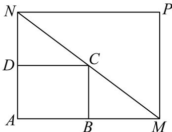
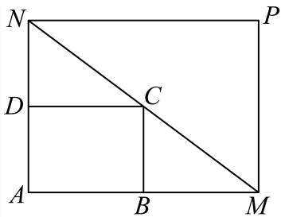
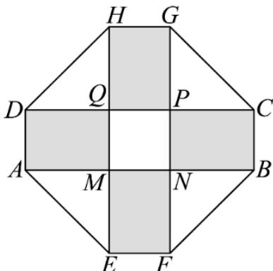
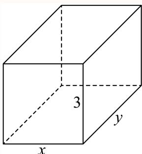
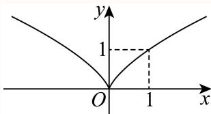
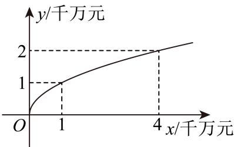
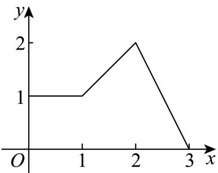
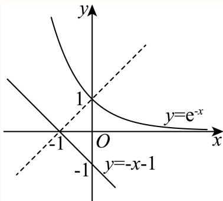
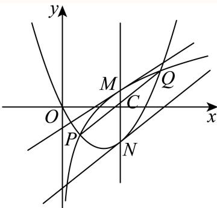

# 函数与导数 · 上海数学大题汇编

> 答案和解析沿用源稿，未逐题独立重算；OCR 与原稿疑点仍可能存在。每题计为一道完整大题。

共 64 道。

### 124 · 原第19题

**来源：** S001 · 上海交通大学附属中学 · 高一 · 2025-2026 · 期中 · 原第19题

**考点说明：** 由实际情境确定函数解析式中的待定常数。；建模求年利润函数与二次不等式求解。；分式型利润函数的最大值（基本不等式/对勾函数）。

果农种植一种水果，每年施肥和灌溉等需投入 4 万元。为了提高产量同时改善水果口味以赢得市场，计划在今年投入 $x$ 万元用于改良品种。根据其他果农种植经验发现，该水果年产量 $t$（万斤）与用于改良品种的资金投入 $x$（万元）之间的关系大致为：$t=3-\dfrac{m}{x+1}\,(x\ge0,m\text{ 为常数})$，若不改良品种，年产量为 1 万斤。该水果最初售价为每斤 4 元，改良品种后，售价每斤提高 $\dfrac x5$ 元。假设产量和价格不受其他因素的影响。

(1) 求 $m$ 的取值；

(2) 设该果农种植该水果所获得的年利润为 $y$（万元），试求 $y$ 关于资金投入 $x$（万元）的函数表达式，并求当果农种植该水果所获得的利润不低于 4 万元时，实数 $x$ 的取值范围；

(3) 该果农一年内应当投入多少万元用于改良品种，才能使得年利润最大？最大利润是多少？

#### 答案

(1) $2$；

(2) $y=\dfrac{2x(18-x)}{5(x+1)}\,(x\ge0)$，$x\in[4-\sqrt6,4+\sqrt6]$；

(3) 投入 $\sqrt{19}-1$ 万元，最大利润为 $8-\dfrac{4\sqrt{19}}5$ 万元。

#### 解析（保留源稿）

(1) $\because$ 若不改良品种，年产量为 1 万斤，$\therefore x=0$ 时 $t=1$，即 $1=3-\dfrac m1$，解得 $m=2$。

(2) $\because$ 年产量 $t=3-\dfrac2{x+1}$ 万斤，改良后售价 $p=4+\dfrac x5$ 元/斤，总成本 $4+x$ 万元，$\therefore$ 利润 $y=\left(3-\dfrac2{x+1}\right)\left(4+\dfrac x5\right)-(4+x)=12+\dfrac{3x}5-\dfrac8{x+1}-\dfrac{2x}{5(x+1)}-4-x=8-\dfrac{2x}5-\dfrac8{x+1}-\dfrac{2x}{5(x+1)}=\dfrac{2x(18-x)}{5(x+1)}\,(x\ge0)$。若利润不低于 4 万元，则 $y=\dfrac{2x(18-x)}{5(x+1)}\ge4$。$\because5(x+1)\ge0$，$\therefore2x(18-x)\ge20(x+1)$，化简并整理得 $x^2-8x+10\le0$，解得 $4-\sqrt6\le x\le4+\sqrt6$，$\therefore x\in[4-\sqrt6,4+\sqrt6]$。

(3) $\because y=8-\dfrac{2x}5-\dfrac8{x+1}-\dfrac{2x}{5(x+1)}=\dfrac{2x(18-x)}{5(x+1)}$，$\therefore y=8-\dfrac{2x}5-\dfrac8{x+1}-\dfrac{2x}{5(x+1)}=8-\left[\dfrac{2(x+1)}5+\dfrac{38}{5(x+1)}\right]\le8-2\sqrt{\dfrac{2(x+1)}5\cdot\dfrac{38}{5(x+1)}}=8-\dfrac{4\sqrt{19}}5$，当且仅当 $\dfrac{2(x+1)}5=\dfrac{38}{5(x+1)}$，即 $x=\sqrt{19}-1$ 时取等号。$\therefore$ 投入 $x=\sqrt{19}-1$ 万元时获得最大利润，最大利润为 $8-\dfrac{4\sqrt{19}}5$ 万元。

---

---

### 125 · 原第20题

**来源：** S001 · 上海交通大学附属中学 · 高一 · 2025-2026 · 期中 · 原第20题

**考点说明：** 对数型函数定义域的求法（真数为正）。；对数型复合函数的单调性（同增异减与真数恒正）。；“任意—存在”型不等式的等价转化与换元、对勾函数。

已知函数 $f(x)=\log_2(x^2-ax+2)$。

(1) 若 $a=3$，求 $f(x)$ 的定义域；

(2) 若 $f(x)$ 在 $[2,+\infty)$ 上单调递增，求 $a$ 的取值范围；

(3) 已知 $g(x)=4^x-2^{x+1}$，若对任意 $x_1\in(0,1)$，存在 $x_2\in[-1,1]$，使得不等式 $f(x_1)\ge g(x_2)$ 成立，求 $a$ 的取值范围。

#### 答案

(1) $(-\infty,1)\cup(2,+\infty)$；

(2) $(-\infty,3)$；

(3) $\left(-\infty,\dfrac52\right]$。

#### 解析（保留源稿）

(1) 由题意得 $x^2-3x+2>0$，因式分解得 $(x-1)(x-2)>0$，解得 $x<1$ 或 $x>2$，即函数定义域为 $(-\infty,1)\cup(2,+\infty)$。

(2) 因为 $y=\log_2 x$ 在 $(0,+\infty)$ 上单调递增，所以当 $f(x)=\log_2(x^2-ax+2)$ 在 $[2,+\infty)$ 上单调递增时，函数 $y=x^2-ax+2$ 在 $[2,+\infty)$ 单调递增且 $y>0$。因为 $y=x^2-ax+2$ 是对称轴为直线 $x=\dfrac a2$、开口向上的二次函数，则 $\begin{cases}\dfrac a2\le2\\4-2a+2>0\end{cases}$，解得 $a<3$，所以 $a$ 的取值范围为 $(-\infty,3)$。

(3) 对任意 $x_1\in(0,1)$，存在 $x_2\in[-1,1]$，使得不等式 $f(x_1)\ge g(x_2)$ 成立，即 $g(x_2)_{\min}\le f(x_1)$ 对任意 $x_1\in(0,1)$ 恒成立。由 $g(x)=4^x-2^{x+1}=(2^x)^2-2\cdot2^x=(2^x-1)^2-1$，当 $x\in[-1,1]$ 时，$2^x\in\left[\dfrac12,2\right]$，则 $g(x)\in[-1,0]$，所以 $g(x_2)_{\min}=-1$。可得任意 $x_1\in(0,1)$，$f(x_1)\ge-1$ 恒成立，即 $\log_2(x_1^2-ax_1+2)\ge-1$ 恒成立，等价于 $\log_2(x_1^2-ax_1+2)\ge\log_2\dfrac12$ 恒成立。因为 $y=\log_2 x$ 在 $(0,+\infty)$ 上单调递增，即 $x^2-ax+2\ge\dfrac12$ 在 $(0,1)$ 恒成立即可，即 $a\le x+\dfrac3{2x}$ 在 $(0,1)$ 恒成立。由对勾函数可知 $y=x+\dfrac3{2x}$ 在 $(0,1)$ 上单调递减，所以 $x+\dfrac3{2x}>1+\dfrac32=\dfrac52$，可得 $a\le\dfrac52$ 时 $a\le x+\dfrac3{2x}$ 在 $(0,1)$ 恒成立。所以 $a$ 的取值范围为 $\left(-\infty,\dfrac52\right]$。

---

---

### 126 · 原第21题

**来源：** S001 · 上海交通大学附属中学 · 高一 · 2025-2026 · 期中 · 原第21题

**考点说明：** 由已知函数值求指数函数的底数。；对数方程有解与换元求参数范围。；指数方程根的关系与函数最值。

已知函数 $y=f(x)$ 的表达式为 $f(x)=a^x\,(a>0,a\ne1)$，且 $f(-2)=\dfrac14$。

(1) 求函数 $y=f(x)$ 的解析式；

(2) 若 $\log_2\left(m-(f(x))^2+4f(x)\right)=0$ 在区间 $[0,2]$ 上有解，求实数 $m$ 的取值范围；

(3) 已知 $\dfrac13\le k<1$，若方程 $|f(x)-1|-k=0$ 的解分别为 $x_1,x_2\,(x_1<x_2)$，方程 $|f(x)-1|-\dfrac{k}{2k+1}=0$ 的解分别为 $x_3,x_4\,(x_3<x_4)$，求 $x_1-x_2+x_3-x_4$ 的最大值。

#### 答案

(1) $f(x)=2^x$；

(2) $[-3,1]$；

(3) $-\log_2 3$。

#### 解析（保留源稿）

(1) 由 $f(-2)=a^{-2}=\dfrac1{a^2}=\dfrac14$，所以 $a=2$，所以 $f(x)=2^x$。

(2) $\log_2\left(m-(f(x))^2+4f(x)\right)=0$ 在区间 $[0,2]$ 上有解，即 $m-(f(x))^2+4f(x)=1$ 在区间 $[0,2]$ 上有解，即 $m-(2^x)^2+4\times2^x=1$ 在区间 $[0,2]$ 上有解。设 $t=2^x$，由 $x\in[0,2]$，则 $1\le t\le4$，所以 $m=t^2-4t+1=(t-2)^2-3$ 在 $t\in[1,4]$ 上有解。当 $t\in[1,4]$ 时，$t^2-4t+1\in[-3,1]$，所以 $-3\le m\le1$。

(3) 由 $|f(x)-1|-k=0$，即 $2^x=1+k$ 或 $2^x=1-k$。由方程 $|f(x)-1|-k=0$ 的解分别为 $x_1,x_2\,(x_1<x_2)$，则 $2^{x_1}=1-k$，$2^{x_2}=1+k$，所以 $2^{x_1-x_2}=\dfrac{1-k}{1+k}$。由 $|f(x)-1|-\dfrac{k}{2k+1}=0$，即 $2^x=1+\dfrac{k}{2k+1}=\dfrac{3k+1}{2k+1}$ 或 $2^x=1-\dfrac{k}{2k+1}=\dfrac{k+1}{2k+1}$。方程 $|f(x)-1|-\dfrac{k}{2k+1}=0$ 的解分别为 $x_3,x_4\,(x_3<x_4)$，则 $2^{x_4}=\dfrac{3k+1}{2k+1}$ 且 $2^{x_3}=\dfrac{k+1}{2k+1}$，所以 $2^{x_3-x_4}=\dfrac{k+1}{3k+1}$。于是

$$2^{(x_1-x_2)+(x_3-x_4)}=2^{x_1-x_2}\cdot2^{x_3-x_4}=\dfrac{1-k}{1+k}\times\dfrac{k+1}{3k+1}=\dfrac{1-k}{3k+1}=-\dfrac13+\dfrac{\frac43}{3k+1}.$$

函数 $y=-\dfrac13+\dfrac{\frac43}{3k+1}$ 在 $k\in\left[\dfrac13,1\right)$ 上单调递减，当 $k=\dfrac13$ 时，$y=-\dfrac13+\dfrac{\frac43}{3k+1}$ 有最大值 $\dfrac13$。所以 $2^{(x_1-x_2)+(x_3-x_4)}\le\dfrac13$，则 $x_1-x_2+x_3-x_4\le\log_2\dfrac13=-\log_2 3$，所以 $x_1-x_2+x_3-x_4$ 的最大值为 $-\log_2 3$。

关键点睛：本题考查指数的运算和方程有解求参数、方程根的关系，解答本题的关键是由题意可得 $m-(2^x)^2+4\times2^x=1$ 在区间 $[0,2]$ 上有解，设 $t=2^x$，分离参数即 $m=t^2-4t+1=(t-2)^2-3$ 在区间 $t\in[1,4]$ 上有解，以及根据方程的根的情况可得 $2^{(x_1-x_2)+(x_3-x_4)}=2^{x_1-x_2}\cdot2^{x_3-x_4}=\dfrac{1-k}{1+k}\times\dfrac{k+1}{3k+1}=\dfrac{1-k}{3k+1}=-\dfrac13+\dfrac{\frac43}{3k+1}$，属于中档题。

---

### 127 · 原第19题

**来源：** S013 · 上海市南洋模范中学 · 高一 · 2025-2026 · 期中 · 原第19题

**考点说明：** 几何模型的函数表示与一元二次不等式。；基本不等式求最值（换元 t=x-3 ）。

如图所示，将一个矩形花坛 $ABCD$ 扩建成一个更大的矩形花坛 $AMPN$，要求 $M$ 在射线 $AB$ 上，$N$ 在射线 $AD$ 上，且对角线 $MN$ 过点 $C$，已知 $AB$ 长为 4 米，$AD$ 长为 3 米，设 $AN=x$ 米。

(1) 要使矩形花坛 $AMPN$ 的面积大于 54 平方米，则 $AN$ 的长应在什么范围内；

(2) 要使矩形花坛 $AMPN$ 的扩建部分铺上大理石，则 $AN$ 的长度是多少时，用料最省？

#### 答案

(1) $\left(3,\dfrac92\right)\cup(9,+\infty)$

(2) $AN=6$ 米时，用料最省

#### 解析（保留源稿）

(1) 由 $DC\parallel AM$，可得 $\dfrac{DN}{AN}=\dfrac{DC}{AM}$，则 $\dfrac{x-3}{x}=\dfrac{4}{AM}$，则 $AM=\dfrac{4x}{x-3}$。花坛 $AMPN$ 面积等于 $AM\cdot AN=\dfrac{4x^2}{x-3}>54$。由题意 $x>3$，可得 $2x^2-27x+81>0$，即 $(2x-9)(x-9)>0$，解得 $3<x<\dfrac92$ 或 $x>9$。所以 $AN$ 的长应在 $\left(3,\dfrac92\right)\cup(9,+\infty)$ 范围内。

(2) 根据题意，可得扩建部分面积 $S=\dfrac{4x^2}{x-3}-12$。令 $t=x-3>0$，则 $x=t+3$，
$$S=\dfrac{4(t+3)^2}{t}-12=4\!\left(t+\dfrac9t+6\right)-12\ge4(2\sqrt9+6)-12=48,$$
当且仅当 $t=\dfrac9t$，即 $t=3$ 时，等号成立，即 $AN=x=6$ 米时，用料最省。

---

---

### 128 · 原第17题

**来源：** S007 · 上海市奉贤中学 · 高一 · 2025-2026 · 期中 · 原第17题

**考点说明：** 指数函数的定义与解析式。；指数函数的单调性与含绝对值的不等式。

已知函数 $y=(a-1)^x$ 是指数函数。

(1) 该指数函数的图象经过点 $(2,4)$，求函数的表达式；

(2) 解关于 $x$ 的不等式：$\left(\frac1a\right)^{\vert3x-4\vert}>\left(\frac1a\right)^3$

#### 答案

(1) $y=2^x$；

(2) $\left\{x\ \middle|\ \frac13<x<\frac73\right\}$

#### 解析（保留源稿）

(1) $\because$ 指数函数 $y=(a-1)^x$ 的图象经过点 $(2,4)$，$\therefore\begin{cases}4=(a-1)^2,\\ a-1>0,\\ a-1\ne1,\end{cases}$ 解得 $a=3$，所以 $y=2^x$。

(2) 由 (1) 知 $a=3$，故 $\frac1a=\frac13\in(0,1)$，函数 $y=\left(\frac13\right)^x$ 是单调递减函数，由 $\left(\frac13\right)^{\vert3x-4\vert}>\left(\frac13\right)^3$ 得 $3>\vert3x-4\vert$，即 $-3<3x-4<3$，解得 $\frac13<x<\frac73$，所以不等式的解集为 $\left\{x\ \middle|\ \frac13<x<\frac73\right\}$。

---

---

### 129 · 原第17题

**来源：** S020 · 上海市宜川中学 · 高一 · 2025-2026 · 期中 · 原第17题

**考点说明：** 幂函数的定义（系数为 1）与单调性检验。；集合的包含关系与函数值域。

已知幂函数 $f(x)=(m-1)^2x^{-3m+5}$ 在 $(0,+\infty)$ 上是严格增函数，函数 $g(x)=2^x-k$，其中 $m,k\in R$。

(1) 求 $m$ 的值；

(2) 记集合 $A=\{y\mid y=f(x),x\in[1,2]\}$，集合 $B=\{y\mid y=g(x),x\in[1,2]\}$，若 $A\cap B=B$，求实数 $k$ 的取值范围。

#### 答案

(1) $m=0$；

(2) $\{k\mid-28\le k\le1\}$

#### 解析（保留源稿）

(1) $\because f(x)=(m-1)^2x^{-3m+5}$ 是幂函数，$\therefore(m-1)^2=1$，即 $m=2$ 或 $m=0$。当 $m=2$ 时，$f(x)=x^{-1}=\dfrac1x$，不满足在 $(0,+\infty)$ 上是严格增函数，故 $m=2$ 舍去；当 $m=0$ 时，$f(x)=x^5$，满足在 $(0,+\infty)$ 上是严格增函数，故 $m=0$ 成立。综上所述：$m=0$。

(2) 由幂函数的单调性可知：$f(x)=x^5$ 在 $[1,2]$ 上单调递增；$\therefore f(x)_{\min}=f(1)=1$，$f(x)_{\max}=f(2)=32$，$\therefore A=\{y\mid 1\le y\le32\}$；易判断 $g(x)=2^x-k$ 在 $[1,2]$ 上单调递增；$\therefore g(x)_{\min}=g(1)=2-k$，$g(x)_{\max}=g(2)=4-k$，$\therefore B=\{y\mid 2-k\le y\le4-k\}\ne\varnothing$，$\because A\cap B=B$，$\therefore B\subseteq A$，$\therefore\begin{cases}2-k\ge1\\ 4-k\le32\end{cases}$，解得 $-28\le k\le1$，故 $k$ 的取值范围 $\{k\mid-28\le k\le1\}$。

---

---

### 130 · 原第18题

**来源：** S020 · 上海市宜川中学 · 高一 · 2025-2026 · 期中 · 原第18题

**考点说明：** 用基本不等式求值域（负区间）。；函数单调性的定义证明。

已知函数 $f(x)=x+\dfrac ax$，$a\in R$，函数 $y=f(x)$ 的定义域为 $D$。

(1) 当 $a=2$，$D=(-\infty,0)$ 时，求函数 $y=f(x)$ 的值域；

(2) 当 $a=-1$，$D=(0,+\infty)$ 时，判断函数 $y=f(x)$ 的单调性并证明。

#### 答案

(1) $(-\infty,-2\sqrt2]$；

(2) 函数 $y=f(x)$ 单调递增，证明见解析。

#### 解析（保留源稿）

(1) 当 $a=2$，$D=(-\infty,0)$ 时，函数 $f(x)=x+\dfrac2x$。因为 $x<0$，所以 $-x>0$，所以 $-x+\dfrac{2}{-x}\ge2\sqrt{-x\times\dfrac{2}{-x}}=2\sqrt2$，所以 $f(x)=-\left(-x+\dfrac{2}{-x}\right)\le-2\sqrt2$，当且仅当 $-x=\dfrac{2}{-x}$，即 $x=-\sqrt2$ 时，等号成立，所以函数 $y=f(x)$ 的值域为 $(-\infty,-2\sqrt2]$。

(2) 当 $a=-1$ 时，$f(x)=x+\dfrac{-1}{x}$，函数 $y=f(x)$ 在 $(0,+\infty)$ 上单调递增。证明：设 $x_1,x_2$ 是 $(0,+\infty)$ 上任意两个实数，且 $x_1<x_2$，则 $f(x_1)-f(x_2)=x_1-\dfrac{1}{x_1}-\left(x_2-\dfrac{1}{x_2}\right)=(x_1-x_2)+\left(\dfrac{1}{x_2}-\dfrac{1}{x_1}\right)=x_1-x_2+\dfrac{x_1-x_2}{x_1x_2}=\dfrac{(x_1-x_2)(x_1x_2+1)}{x_1x_2}$。因为 $x_1<x_2$，所以 $x_1-x_2<0$，又 $x_1>0$，$x_2>0$，所以 $x_1x_2>0$，$x_1x_2+1>0$，所以 $\dfrac{(x_1-x_2)(x_1x_2+1)}{x_1x_2}<0$，即 $f(x_1)-f(x_2)<0$，$f(x_1)<f(x_2)$，所以函数 $y=f(x)$ 在 $(0,+\infty)$ 上单调递增。

---

---

### 131 · 原第19题

**来源：** S020 · 上海市宜川中学 · 高一 · 2025-2026 · 期中 · 原第19题

**考点说明：** 由奇偶性求分段函数解析式。；利用单调性与奇偶性解抽象函数不等式。

已知函数 $y=f(x)$ 是定义在 $(-1,1)$ 上的奇函数，且当 $x>0$ 时，$f(x)=x+1$。

(1) 求函数 $y=f(x)$ 的表达式；

(2) 求关于 $x$ 的不等式 $f(x^2-1)+f(x-1)<f(0)$ 的解集。

#### 答案

(1) $f(x)=\begin{cases}x+1,&0<x<1\\ 0,&x=0\\ x-1,&-1<x<0\end{cases}$

(2) 区间 $(0,1)$。

#### 解析（保留源稿）

(1) $\because y=f(x)$ 是定义在 $(-1,1)$ 上的奇函数，$\therefore f(0)=0$。当 $0<x<1$ 时，$f(x)=x+1$。$\because y=f(x)$ 是定义在 $(-1,1)$ 上的奇函数，$\therefore f(-x)=-f(x)$。当 $-1<x<0$ 时，$0<-x<1$，$f(-x)=-x+1$，$\therefore-f(x)=-x+1$，$\therefore f(x)=x-1$，$\therefore f(x)=\begin{cases}x+1,&0<x<1\\ 0,&x=0\\ x-1,&-1<x<0\end{cases}$。

(2) 当 $0<x<1$ 时，$f(x)=x+1$ 单调递增，又因为当 $x$ 从右侧趋近于 $0$ 时，$f(x)>0=f(0)$，所以 $f(x)$ 在 $[0,1)$ 上单调递增，结合 $y=f(x)$ 是定义在 $(-1,1)$ 上的奇函数，所以 $y=f(x)$ 是定义在 $(-1,1)$ 上的单调递增函数。因为 $f(0)=0$，所以 $f(x^2-1)+f(x-1)<f(0)$ 也就是 $f(x^2-1)+f(x-1)<0$，即 $f(x^2-1)<-f(x-1)=f(-x+1)$。所以 $\begin{cases}x^2-1<-x+1\\ -1<x^2-1<1\\ -1<-x+1<1\end{cases}$，解得 $0<x<1$。$\therefore$ 不等式 $f(x^2-1)+f(x-1)<f(0)$ 的解集为区间 $(0,1)$。

---

---

### 132 · 原第20题

**来源：** S020 · 上海市宜川中学 · 高一 · 2025-2026 · 期中 · 原第20题

**考点说明：** 分式函数的奇偶性分类讨论。；分式不等式与充分非必要条件。；新定义区间与二次函数图象（方程根的分布）。

在研究函数过程中，我们经常会遇到一类形如 $y=\dfrac{kx+f}{dx+e}$（$k,f,d,e$ 为实常数且 $d\ne0$）的函数，我们称为一次型分式函数。请根据条件完成下列问题。

(1) 设 $a$ 是实数，函数 $f(x)=\dfrac{x+a}{x-a}$，请根据 $a$ 的不同取值，讨论函数 $y=f(x)$ 的奇偶性，并说明理由；

(2) 设 $m$ 是实数，函数 $g(x)=\dfrac{x-m+1}{x-2m}$。若 $g(x)<0$ 成立的一个充分非必要条件是 $\dfrac13<x<\dfrac12$，求 $m$ 的取值范围；

(3) 设 $n$ 是实数，函数 $h(x)=4-\dfrac1x$，若存在区间 $[\lambda,\mu]\subseteq\left(\dfrac13,+\infty\right)$，使得 $\{y\mid y=h(x),x\in[\lambda,\mu]\}=[n\lambda,n\mu]$，求 $n$ 的取值范围。

#### 答案

(1) 见解析；

(2) $\left[\dfrac14,\dfrac43\right]$；

(3) $(3,4)$

#### 解析（保留源稿）

(1) 对于函数 $f(x)=\dfrac{x+a}{x-a}$，其定义域为 $\{x\mid x\ne a,x\in R\}$。若 $a=0$，此时 $f(x)=1\,(x\ne0)$，定义域关于原点对称，且显然有 $f(x)=f(-x)$，故此时 $f(x)=\dfrac{x+a}{x-a}$ 是偶函数；若 $a\ne0$，则定义域不关于原点对称，故此时 $f(x)=\dfrac{x+a}{x-a}$ 是非奇非偶函数。

(2) 根据题意可知不等式 $g(x)<0$ 的解集真包含区间 $\left(\dfrac13,\dfrac12\right)$。$g(x)=\dfrac{x-m+1}{x-2m}<0\Rightarrow(x-m+1)(x-2m)<0$。若 $m-1=2m$，即 $m=-1$ 时，此时不等式无解，不符合题意；若 $m-1<2m$，即 $m>-1$ 时，此时不等式的解集为 $(m-1,2m)$，要符合题意，则需 $m-1\le\dfrac13<\dfrac12\le2m\Rightarrow m\in\left[\dfrac14,\dfrac43\right]$，注意到等号不能同时取得，故满足条件；若 $m-1>2m$，即 $m<-1$ 时，此时不等式的解集为 $(2m,m-1)$，显然 $m-1<0<\dfrac13$，不符合题意。综上：$m\in\left[\dfrac14,\dfrac43\right]$。

(3) 易知函数 $h(x)=4-\dfrac1x$ 在 $\left(\dfrac13,+\infty\right)$ 上单调递增，由题意可知 $\begin{cases}h(\lambda)=n\lambda\\ h(\mu)=n\mu\end{cases}\Rightarrow h(x)=nx$ 有两个不等实根，即 $4-\dfrac1x=nx$ 在 $\left(\dfrac13,+\infty\right)$ 上有两个不同解，即 $n=-\left(\dfrac1x-2\right)^2+4$ 在 $\left(\dfrac13,+\infty\right)$ 上有两个不同解，易知 $\dfrac1x\in(0,3)$，由二次函数的性质可知 $n\in(3,4)$。

---

---

### 133 · 原第16题

**来源：** S049 · 上海市市北中学 · 高一 · 2025-2026 · 期中 · 原第16题

**考点说明：** 几何量的函数建模与取值范围。；函数建模与基本不等式求最值。

2025 年上海奇迹花园国际艺术花展于 9 月 20 日正式启幕。某公园受此启发打算设计一个八边形活动区域，该区域的主体造型平面图是由两个相同的矩形 ABCD 和 EFGH 构成的十字形区域，十字形的面积为 $200\ \mathrm{m^2}$。计划在正方形 MNPQ 上建一座花坛，造价为 2100 元$/\mathrm{m^2}$；在四个相同的矩形（图中阴影部分）上铺地砖，造价为 105 元$/\mathrm{m^2}$；再在四个空角（图中四个三角形）上铺草坪，造价为 40 元$/\mathrm{m^2}$。设 AD 长为 $x\ \mathrm m\,(x>0)$，总造价为 $W$ 元，求：

(1) 设 DQ 长为 $y\ \mathrm m\,(y>0)$，用 $x$ 表示 $y$，并求出 $x$ 的取值范围；

(2) 如何设计 AD 可使总造价最低，并求出最低造价。

#### 答案

(1) $y=\frac{50}x-\frac x4$，$0<x<10\sqrt2$；

(2) 当 AD 的长为 $\sqrt{10}\ \mathrm m$ 时，总造价最低，为 59000 元

#### 解析（保留源稿）

(1) 因为十字形区域面积为 $200\ \mathrm{m^2}$，所以 $4xy+x^2=200$，解得 $y=\frac{200-x^2}{4x}=\frac{50}x-\frac x4$。因为 $y>0$，所以 $x^2<200$，因为 $x>0$，所以 $0<x<10\sqrt2$。

(2) 四个矩形地砖面积 $S_{四个矩形}=4xy=200-x^2$，造价 $W_{矩}=105(200-x^2)$；四个三角形草坪面积 $S_{四个三角形}=4\times\frac12y^2=2\left(\frac{50}x-\frac x4\right)^2=\frac{5000}{x^2}+\frac{x^2}8-50$，造价 $W_{草}=40\left(\frac{5000}{x^2}+\frac{x^2}8-50\right)$；正方形花坛面积 $S_{正方形MNPQ}=x^2$，造价 $W_{正}=2100x^2$。总造价 $W=W_{矩}+W_{草}+W_{正}=105(200-x^2)+40\left(\frac{5000}{x^2}+\frac{x^2}8-50\right)+2100x^2$，化简得 $W=2000x^2+19000+\frac{200000}{x^2}\ \left(0<x<10\sqrt2\right)$。因为 $2000x^2+\frac{200000}{x^2}\ge2\sqrt{2000\times200000}=40000$，当且仅当 $x=\sqrt{10}$（在 $x$ 范围中）时取等号，此时 $W=59000$ 元。综上，当 AD 的长为 $\sqrt{10}\ \mathrm m$ 时，总造价最低，为 59000 元。

---

---

### 134 · 原第19题

**来源：** S051 · 上海市市西中学 · 高一 · 2025-2026 · 期中 · 原第19题

**考点说明：** 建立平均成本和利润模型，用基本不等式及二次不等式确定产量。

数字经济是以数据资源为关键要素、以现代信息网络为主要载体、通过信息通信技术的融合应用推动全要素数字化转型的新经济形态。现有一人工智能企业生产制造人形机器人，每月的成本 $t$（单位：万元）由两部分构成：①固定成本：1000 万元；②材料成本：$\left(10x+\dfrac{x^2}{10}\right)$ 万元。$x$ 为每月生产人形机器人的个数。

(1) 该企业每月的产量为多少时，平均每个人形机器人的成本 $y$（单位：万元）最低，最低为多少万元？

(2) 若每个人形机器人的售价为 $\left(23+\dfrac x5\right)$ 万元，假设生产出来的每个人形机器人都能够售出，则该企业应如何制订生产计划，才能确保每月的利润 $W$（单位：万元）不低于 400 万元？

附：利润＝售价×销量−成本

#### 答案

(1) 100 台，最低为 30 万元；

(2) 不低于 70 台。

#### 解析（保留源稿）

(1) 生产 $x$ 台人形机器人的总成本为 $y=1000+10x+\dfrac{x^2}{10}$，所以每个人形机器人的平均成本为 $\dfrac yx=\dfrac{1000+10x+\frac{x^2}{10}}{x}=\dfrac{1000}{x}+\dfrac x{10}+10\ge2\sqrt{\dfrac{1000}{x}\cdot\dfrac x{10}}+10=20+10=30$，当且仅当 $\dfrac{1000}{x}=\dfrac x{10}$，即 $x=100$ 时等号成立，所以该企业每月的产量为 100 台时，平均每个人形机器人的成本最低，最低为 30 万元。

(2) 每月的利润 $W=x\cdot\left(23+\dfrac x5\right)-\left(1000+10x+\dfrac{x^2}{10}\right)$。令 $W\ge400$，即 $x\cdot\left(23+\dfrac x5\right)-\left(1000+10x+\dfrac{x^2}{10}\right)\ge400$，整理得 $x^2+130x-14000\ge0$，解得 $x\le-200$ 或 $x\ge70$。因为 $x$ 为正整数，所以 $x\ge70$。所以该企业应每月制订生产的人形机器人不少于 70 台时，才能确保每月的利润不低于 400 万元。

---

---

### 135 · 原第19题

**来源：** S034 · 上海市建平中学 · 高一 · 2025-2026 · 期中 · 原第19题

**考点说明：** 固定面积下建立矩形房间装修成本函数，利用基本不等式确定长宽与最低费用。

某游乐场需要修建一间背面靠围墙的矩形母婴室，地面面积为 5 平方米，地面费用总价为五千元。现需要对母婴室外墙正面和屋顶进行带有游乐场主题特色的装修，因此外墙正面每平方米造价为 1500 元，屋顶造价一万元；母婴室外墙侧面普通装修即可，每平方米造价 600 元；母婴室墙高 3 米，不计母婴室背面费用。

(1) 若游乐场母婴室正面长设为 $x$ 米，请用 $x$ 表示该游乐场母婴室的总造价 $W$（元）；

(2) 如何设计能使得该游乐场母婴室的总造价最低？最低总造价为多少？

#### 答案

(1) $W=4500\left(x+\dfrac2x\right)+15000$；

(2) 底面长宽分别为 $\sqrt2$ m、$\dfrac{5\sqrt2}{2}$ m；最低总造价为 $\left(9000\sqrt2+15000\right)$ 元

#### 解析（保留源稿）

(1) 根据题意，母婴室底面长为 $x$ 米，宽为 $y$ 米，则 $y=\dfrac5x$。

该游乐场母婴室的总造价 $W=3x\cdot1500+3\times\dfrac5x\times600+5000+10000=4500\left(x+\dfrac2x\right)+15000$。

(2) 由 (1) 得 $W=4500\left(x+\dfrac2x\right)+15000\ge4500\times2\sqrt{x\cdot\dfrac2x}+15000=9000\sqrt2+15000$，当且仅当 $x=\dfrac2x$ 即 $x=\sqrt2$ 时等号成立，所以当该游乐场母婴室的底面长宽分别为 $\sqrt2$ m、$\dfrac{5\sqrt2}{2}$ m 时总造价最低，最低总造价为 $9000\sqrt2+15000$ 元。

---

---

### 136 · 原第20题

**来源：** S034 · 上海市建平中学 · 高一 · 2025-2026 · 期中 · 原第20题

**考点说明：** 幂函数的定义与单调性检验。；一元二次不等式的整数解个数与端点取值。；二次不等式恒成立与含参退化情形的讨论。

已知幂函数 $f(x)=\left(m^2+m-1\right)x^{-2m^2+m+3}$ 在 $(0,+\infty)$ 上为严格增函数。

(1) 求 $f(x)$ 的解析式；

(2) 若关于 $x$ 的不等式 $f(x)\le8x-a$ 的解集中有且仅有 5 个整数，求实数 $a$ 的范围；

(3) 若 $k+kf(x)>f(x)-x-1$ 对任意实数 $x$ 都成立，求实数 $k$ 的取值范围。

#### 答案

(1) $f(x)=x^2$；

(2) $(7,12]$；

(3) $\left(\dfrac{\sqrt5}{2},+\infty\right)$

#### 解析（保留源稿）

(1) 因为幂函数 $f(x)=\left(m^2+m-1\right)x^{-2m^2+m+3}$ 在 $(0,+\infty)$ 上为严格增函数，则 $\begin{cases}m^2+m-1=1\\ -2m^2+m+3>0\end{cases}$，解得 $m=1$，故 $f(x)=x^2$。

(2) 因为关于 $x$ 的不等式 $f(x)\le8x-a$ 的解集中有且仅有 5 个整数，即不等式 $x^2-8x+a\le0$ 的解集中有且仅有 5 个整数。因为二次函数 $y=x^2-8x+a$ 图象开口向上、对称轴为直线 $x=4$，所以不等式 $x^2-8x+a\le0$ 的解集中的 5 个整数分别为 2、3、4、5、6，故 1 不在不等式的解集中，故 $\begin{cases}1-8+a>0\\ 2^2-8\times2+a\le0\end{cases}$，解得 $7<a\le12$。因此实数 $a$ 的取值范围是 $(7,12]$。

(3) 因为不等式 $k+kf(x)>f(x)-x-1$ 对任意实数 $x$ 都成立，即 $(k-1)x^2+x+k+1>0$ 对任意实数 $x$ 都成立。当 $k-1=0$，即 $k=1$ 时，则有 $x+2>0$，解得 $x>-2$，不合题意；当 $k-1\ne0$ 时，由题意可得 $\begin{cases}k-1>0\\ \Delta=1-4(k-1)(k+1)=5-4k^2<0\end{cases}$，解得 $k>\dfrac{\sqrt5}{2}$。因此实数 $k$ 的取值范围是 $\left(\dfrac{\sqrt5}{2},+\infty\right)$。

---

---

### 137 · 原第19题

**来源：** S035 · 上海市建平中学 · 高一 · 年份待核 · 月考 · 原第19题

**考点说明：** 依据代理费和销量建立收入模型，解受实际取值范围约束的不等式。

本题共12分，第（1）、（2）小题各6分。

某文具企业生产笔记本，在某市原有年销售量为10万本。现委托代理商销售，代理商收取销售额的$r\%$作为代理费。为保证厂家利润不变，每本笔记本售价调整为$\dfrac{20}{1-r\%}$元。受涨价影响，年销售量减少$0.1r$万本。

（1）若代理商每年获得的代理费不少于2万元，求$r$的取值范围；

（2）是否存在正数$r$，使得代理商每年获得的代理费超过厂家委托代理商之后自身实际到手的收入？若存在，求出所有满足条件的$r$；若不存在，请说明理由。

#### 答案

（1）$[1,100)$；（2）存在，所有满足条件的$r$为$(50,100)$。

**考点：** 百分率建模与实际定义域。

#### 解析（保留源稿）

代理费率为$\dfrac r{100}$，需使售价有意义且销售量非负，故在实际有销售的模型中$0\le r<100$。年销售量为$10-0.1r=\dfrac{100-r}{10}$万本，销售额为
$$
\frac{20}{1-r/100}\cdot\frac{100-r}{10}=200\quad\text{（万元）}.
$$
因此代理商每年获得的代理费为
$$
200\cdot\frac r{100}=2r\quad\text{（万元）},
$$
厂家每年实际到手的收入为$200-2r$万元。

（1）$2r\ge2$，得$r\ge1$，结合实际定义域，得$1\le r<100$。

（2）要求$2r>200-2r$，即$r>50$。结合$0<r<100$，得$50<r<100$，故存在。

**易卡点：** 原题比较的是“实际到手的收入”，不能擅自改为“利润”；$r$是百分数前的数值，$r\%=r/100$。

---

### 138 · 原第19题

**来源：** S015 · 上海市徐汇中学 · 高一 · 2025-2026 · 期中 · 原第19题

**考点说明：** 实际问题中的函数建模（分式函数）。；基本不等式求最值。；分式不等式（一元二次不等式）的求解。

某公司一年购买某种货物 400 吨，每次都购买 $x$ 吨（$x>0$），运费为 4 万元/次，一年的总存储费用为 $4x$ 万元，用 $y$ 表示一年的总运费与总存储费用之和。

(1) 请用 $x$ 的表达式表示出 $y$；

(2) 要使一年的总运费与总存储费用之和最小，则每次购买多少吨；

(3) 要使一年的总运费与总存储费用之和不超过 200 万元，则每次购买量需要在什么范围内？

#### 答案

(1) $y=\dfrac{1600}{x}+4x\ (x>0)$；

(2) 每次购买 20 吨时，一年的总运费与总存储费用之和最小；

(3) $[10,40]$

#### 解析（保留源稿）

(1) 一年的购买次数为 $\dfrac{400}{x}$，故总运费为 $\dfrac{400}{x}\times4$，从而 $y=\dfrac{1600}{x}+4x\ (x>0)$。

(2) 由 $x>0$，$y=\dfrac{1600}{x}+4x\ge2\sqrt{\dfrac{1600}{x}\times4x}=160$，当且仅当 $\dfrac{1600}{x}=4x$ 即 $x=20$ 时等号成立，所以每次购买 20 吨时，一年的总运费与总存储费用之和最小。

(3) 由（1）得 $\dfrac{1600}{x}+4x\le200$，即 $4x^2-200x+1600\le0$，解得 $10\le x\le40$，所以每次购买量需要在 $[10,40]$ 上。

---

---

### 139 · 原第20题

**来源：** S015 · 上海市徐汇中学 · 高一 · 2025-2026 · 期中 · 原第20题

**考点说明：** 新定义“性质 M ”的验证。；新定义下含参方程的有解条件。

定义：对函数 $y=f(x)$，若在其定义域内存在实数 $x_0$，使得 $f(x_0+1)=f(x_0)\cdot f(1)$，则称函数 $y=f(x)$ 具有性质 $M$。

(1) 判断函数 $f_1(x)=\lg x$ 与 $f_2(x)=x^2$ 是否具有性质 $M$，并说明理由；

(2) 设函数 $y=\dfrac{a}{2^x+1}$ 具有性质 $M$，求非零实数 $a$ 的取值范围。

#### 答案

(1) $f_1(x)=\lg x$ 不具有性质 $M$；$f_2(x)=x^2$ 具有性质 $M$；

(2) $a\in\left(\dfrac32,3\right)$

#### 解析（保留源稿）

(1) 对 $f_1(x)=\lg x$，若具有性质 $M$，则 $\lg(x_0+1)=\lg x_0\cdot\lg1=0$，即 $\lg(x_0+1)=0$；而 $x_0>0$ 时 $\lg(x_0+1)>0$，方程无解，故 $f_1(x)=\lg x$ 不具有性质 $M$。对 $f_2(x)=x^2$，方程为 $(x_0+1)^2=x_0^2\cdot1$，即 $x_0^2+2x_0+1=x_0^2$，解得 $x_0=-\dfrac12\in R$，故 $f_2(x)=x^2$ 具有性质 $M$。

(2) 设 $g(x)=\dfrac{a}{2^x+1}$，$x\in R$。由 $g(x_0+1)=g(x_0)\cdot g(1)$ 得 $\dfrac{a}{2^{x_0+1}+1}=\dfrac{a}{2^{x_0}+1}\cdot\dfrac a3\ (a\ne0)$，整理得 $(2a-3)\cdot2^{x_0}=3-a$。当 $2a-3=0$ 即 $a=\dfrac32$ 时，方程为 $0=3-\dfrac32$，无解，不成立；当 $2a-3\ne0$ 时，$2^{x_0}=\dfrac{3-a}{2a-3}$，由 $x_0\in R$ 知 $2^{x_0}>0$，即 $\dfrac{3-a}{2a-3}>0$，解得 $\dfrac32<a<3$。综上，$a\in\left(\dfrac32,3\right)$。

---

---

### 140 · 原第18题

**来源：** S028 · 上海市控江中学 · 高一 · 2025-2026 · 期中 · 原第18题

**考点说明：** 对数函数的单调性与对数不等式。；指数函数的单调性与指数不等式。

已知 $a$，$b$ 是方程 $x^2-4x+1=0$ 的两实根（其中 $a<b$），求下列两个不等式的解集：

(1) $\log_{a+b}x<2$；

(2) $a^{x^2-x+1}\ge a^{3x-2}$

#### 答案

(1) $(0,16)$；

(2) $[1,3]$

#### 解析（保留源稿）

(1) 由韦达定理 $a+b=4$，不等式即为 $\log_4 x<2=\log_4 16$，所以 $0<x<16$，解集为 $(0,16)$。

(2) 由 $a<b$ 得 $a=\dfrac{4-\sqrt{12}}2=2-\sqrt3$，而 $0<2-\sqrt3<1$，所以 $y=a^x$ 是减函数，原不等式等价于 $x^2-x+1\le3x-2$，即 $x^2-4x+3\le0$，也就是 $(x-1)(x-3)\le0$，解得 $1\le x\le3$，解集为 $[1,3]$。

---

---

### 141 · 原第19题

**来源：** S028 · 上海市控江中学 · 高一 · 2025-2026 · 期中 · 原第19题

**考点说明：** 长方体蓄水池体积约束下优化底面周长与铺砖成本，并考虑尺寸范围。

某工厂计划建设一个容积为 1000 立方米的长方体露天蓄水池，并为其底部和侧壁铺设瓷砖。施工公司给出的铺设池底的报价是每平方米 24 元，铺设池壁的报价是每平方米 20 元。由于生产需要，要求蓄水池深度不得超过 10 米，底部长与宽均不得超过 20 米。

(1) 池底的周长最小为多少？（单位：米）

(2) 假设将蓄水池深度限定为 5 米，则应如何设计池底的长与宽，可以使得铺设的成本最小？最小成本又是多少元？（成本精确到小数点后 2 位）

#### 答案

(1) $40$；

(2) 长 $10\sqrt2$ 米、宽 $10\sqrt2$ 米，最小成本 10456.85 元

#### 解析（保留源稿）

(1) 设蓄水池长为 $l$ 米、宽为 $w$ 米、高为 $h$ 米，则 $h\le10$，$l\le20$，$w\le20$。由容积 $V=lwh=1000$ 得 $h=\dfrac{1000}{lw}$，代入 $h\le10$ 得 $\dfrac{1000}{lw}\le10$，即 $lw\ge100$。池底周长 $P=2(l+w)\ge4\sqrt{lw}\ge40$，当且仅当 $lw=100$ 且 $l=w$，即 $l=w=10$ 时取等，所以池底的周长最小为 40 米。

(2) 当 $h=5$ 米时，$lw=\dfrac{1000}5=200$。总成本 $C=200\times24+(2\times5l+2\times5w)\times20=4800+200(l+w)\ge4800+400\sqrt{lw}=4800+4000\sqrt2\approx10456.85$（元），当且仅当 $l=w=10\sqrt2$ 时取等。所以长、宽均为 $10\sqrt2$ 米时成本最小，最小成本约 10456.85 元。

---

---

### 142 · 原第18题

**来源：** S022 · 上海市晋元高级中学 · 高一 · 2025-2026 · 期中 · 原第18题

**考点说明：** 幂函数图象的对称性与单调性，转化为绝对值不等式求解。

(1) 作出幂函数 $y=x^{\frac23}$ 的图象；

(2) 根据 (1) 的结论观察图象，解不等式：$(x-1)^{\frac23}\le(2x+1)^{\frac23}$。

#### 答案

(1) 作图见解析；

(2) $(-\infty,-2]\cup[0,+\infty)$

#### 解析（保留源稿）

(1) 幂函数 $y=x^{\frac23}$ 的定义域是 $R$，且 $(-x)^{\frac23}=\sqrt[3]{(-x)^2}=\sqrt[3]{x^2}=x^{\frac23}$，所以 $y=x^{\frac23}$ 是偶函数，其图象关于 $y$ 轴对称，在 $[0,+\infty)$ 上单调递增。其图象如下图所示。

(2) 由 (1) 知，不等式 $(x-1)^{\frac23}\le(2x+1)^{\frac23}$，由偶函数性质等价于 $|x-1|^{\frac23}\le|2x+1|^{\frac23}$，再由 $y=x^{\frac23}$ 在 $[0,+\infty)$ 上单调递增，等价于 $|x-1|\le|2x+1|$，即 $(x-1)^2\le(2x+1)^2$，整理得 $3x^2+6x\ge0$，解得 $x\le-2$ 或 $x\ge0$。故不等式的解集为 $(-\infty,-2]\cup[0,+\infty)$。

---

---

### 143 · 原第19题

**来源：** S022 · 上海市晋元高级中学 · 高一 · 2025-2026 · 期中 · 原第19题

**考点说明：** 建立平均成本与利润模型，结合基本不等式和二次函数求最值。

为实现节能减排、绿色生态的目标，某单位进行技术攻关，采用新工艺，把二氧化碳转化为一种可利用的化工产品。已知该单位每月的处理量最少为 400 吨，最多为 600 吨，月处理总成本 $y$（元）与月处理量 $x$（吨）之间的函数关系可近似地表示为 $y=\frac12x^2-200x+80000$，且每处理一吨二氧化碳得到可利用的化工产品价值为 300 元。

(1) 该单位每月处理量为多少吨时，才能使每吨的平均处理成本最低？

(2) 该单位每月处理量为多少吨时，每月的总获利最大，并求这个最大获利值。

#### 答案

(1) 该单位每月处理量为 400 吨时，才能使每吨的平均处理成本最低；

(2) 该单位每月处理量为 500 吨时，每月的总获利最大，为 45000 元。

#### 解析（保留源稿）

(1) 因为 $\frac yx=\frac12x+\frac{80000}x-200\ge2\sqrt{\frac12x\times\frac{80000}x}-200=200$，当且仅当 $x=400$ 时取等号，所以该单位每月处理量为 400 吨时，才能使每吨的平均处理成本最低。

(2) 设该单位每月处理 $x$ 吨时获得的利润为 $L$，则 $L=300x-\left(\frac12x^2-200x+80000\right)=-\frac12x^2+500x-80000$。所以当 $x=500$ 时 $L$ 最大，为 $45000$。故该单位每月处理量为 500 吨时，每月的总获利最大，为 45000 元。

---

---

### 144 · 原第20题

**来源：** S022 · 上海市晋元高级中学 · 高一 · 2025-2026 · 期中 · 原第20题

**考点说明：** 幂函数参数确定、对数型复合函数最值及指数不等式的存在性。

已知幂函数 $y=(a^2-a-1)x^{a-1}$（$a\in R$）在 $(0,+\infty)$ 上是严格增函数。

(1) 求 $a$ 的值；

(2) 设 $g(x)=\log_a(x+2)-\log_a(x-1)$，求 $y=g(x)$ 在 $[2,4]$ 上的最小值；

(3) 若存在 $x\in(-1,3)$，使得不等式 $4^{1-x}-m+2\le5\left(\frac12\right)^x$ 成立，求 $m$ 的取值范围。

#### 答案

(1) $a=2$；

(2) 最小值是 $1$；

(3) $\left[\frac7{16},+\infty\right)$

#### 解析（保留源稿）

(1) 因 $y=(a^2-a-1)x^{a-1}$ 为幂函数，且在 $(0,+\infty)$ 上单调递增，所以 $\begin{cases}a^2-a-1=1\\ a-1>0\end{cases}$，解得 $a=2$。

(2) $g(x)=\log_2(x+2)-\log_2(x-1)=\log_2\frac{x+2}{x-1}$。设 $t=\frac{x+2}{x-1}=1+\frac3{x-1}$，而函数 $y=x-1$ 在 $[2,4]$ 上单调递增，所以 $y=\frac3{x-1}$ 在 $[2,4]$ 上单调递减，于是 $t=\frac{x+2}{x-1}$ 在 $[2,4]$ 上单调递减；又 $y=\log_2 t$ 是增函数，根据复合函数单调性可知 $g(x)=\log_2\frac{x+2}{x-1}$ 在 $[2,4]$ 上单调递减，所以当 $x=4$ 时 $y=g(x)$ 取得最小值 $g(4)=\log_2\frac{4+2}{4-1}=\log_2 2=1$。

(3) 令 $u=\left(\frac12\right)^x$，因为 $x\in(-1,3)$，所以 $u\in\left(\frac18,2\right)$。原不等式即 $4u^2-m+2\le5u$，所以存在 $u\in\left(\frac18,2\right)$ 使 $m\ge4u^2-5u+2$ 成立，故 $m\ge\left(4u^2-5u+2\right)_{\min}$。又 $y=4u^2-5u+2$ 的对称轴为 $u=\frac58$，所以当 $u=\frac58$ 时 $y=4u^2-5u+2$ 取得最小值 $\frac7{16}$，所以 $m$ 的取值范围是 $\left[\frac7{16},+\infty\right)$。

---

### 145 · 原第18题

**来源：** S023 · 上海市曹杨第二中学 · 高一 · 2025-2026 · 期中 · 原第18题

**考点说明：** 从图象确定幂函数模型，统一资金单位后建立利润函数求最值。

美国对中国芯片的技术封锁，激发了中国“芯”的研究热潮。近年来，某公司已成功研发 A、B 两种芯片，研发芯片前期已经耗费资金 3 千万元，现在准备投入资金进行生产。经市场调查与预测，生产 A 芯片的净收入与投入的资金成正比，已知每投入 1 千万元，公司获得净收入 0.2 千万元；生产 B 芯片的净收入 $y$（千万元）是关于投入的资金 $x$（千万元）的幂函数，其图象如图所示。

(1) 试分别求出生产 A、B 两种芯片的净收入 $y$（千万元）与投入的资金 $x$（千万元）的函数关系式；

(2) 现在公司准备投入 5 亿元资金同时生产 A、B 两种芯片。设投入 $x$ 千万元生产 B 芯片，用 $f(x)$ 表示公司所获利润，求公司最大利润及此时生产 B 芯片投入的资金。（利润＝A 芯片净收入＋B 芯片净收入－研发耗费资金）

#### 答案

(1) A 芯片：$y=0.2x$；B 芯片：$y=x^{\frac12}$；

(2) 最大利润为 $\frac{33}4$ 千万元，此时生产 B 芯片投入 $\frac{25}4$ 千万元。

#### 解析（保留源稿）

(1) 设生产 A 芯片的净收入 $y$（千万元）与投入资金 $x$（千万元）满足 $y=kx$，由 $0.2=k$ 得 $y=0.2x$。设 B 芯片的净收入满足 $y=x^\alpha$，由图象过点 $(4,2)$ 得 $2=4^\alpha$，解得 $\alpha=\frac12$，故 $y=x^{\frac12}$。

(2) 由题意，投入 5 亿元即 50 千万元，其中投入 $x$ 千万元生产 B 芯片，则投入 $50-x$ 千万元生产 A 芯片，所以 $f(x)=0.2(50-x)+x^{\frac12}-3=x^{\frac12}-0.2x+7=-0.2\left(x^{\frac12}-\frac52\right)^2+\frac{33}4$，$0\le x\le50$。由二次函数性质可知，当 $x^{\frac12}=\frac52$，即 $x=\frac{25}4$ 时，$f(x)$ 有最大值 $\frac{33}4$。即生产 B 芯片投入 $\frac{25}4$ 千万元时，利润最大，最大值为 $\frac{33}4$ 千万元。

---

---

### 146 · 原第19题

**来源：** S023 · 上海市曹杨第二中学 · 高一 · 2025-2026 · 期中 · 原第19题

**考点说明：** 含参二次不等式的整数解个数、绝对值转化与恒成立条件。

已知 $a\in R$，$f(x)=ax^2+(3-a)x-3$，设关于 $x$ 的不等式 $f(x)>0$ 的解集为 $A$。

(1) 若 $3\notin A$，求 $a$ 的取值范围；

(2) 当 $a<0$ 时，若 $A$ 中有且仅有两个整数，求 $a$ 的取值范围；

(3) 若关于 $x$ 的不等式 $f(x)+2^x+|f(x)-2^x|\ge1$ 的解集为 $R$，求 $a$ 的取值范围。

#### 答案

(1) $a\le-1$；

(2) $-1<a\le-\frac34$；

(3) $a\ge\frac{13}4$

#### 解析（保留源稿）

(1) 因为 $3\notin A$，故 $f(3)\le0$，即 $9a+3(3-a)-3\le0$，化简得 $6a+6\le0$，故 $a\le-1$。

(2) $f(x)>0$ 即为 $ax^2+(3-a)x-3>0$，即 $(ax+3)(x-1)>0$。若 $-3<a<0$，则 $-\frac3a>1$，不等式的解为 $\left(1,-\frac3a\right)$，要使其有且仅有两个整数，需 $3<-\frac3a\le4$，解得 $-1<a\le-\frac34$；若 $a=-3$，不等式的解集为空集，不合题意；若 $a<-3$，则 $0<-\frac3a<1$，不等式的解为 $\left(-\frac3a,1\right)$，此时无两个整数解，舍去。综上，$-1<a\le-\frac34$。

(3) $f(x)+2^x+|f(x)-2^x|\ge1$ 即为 $\max\{f(x),2^x\}\ge\frac12$。当 $x\ge-1$ 时，$2^x\ge\frac12$ 恒成立，故只需 $x<-1$ 时 $f(x)\ge\frac12$ 恒成立，即 $ax^2+(3-a)x-3\ge\frac12$ 在 $(-\infty,-1)$ 上恒成立，亦即 $a(x^2-x)\ge\frac72-3x$ 在 $(-\infty,-1)$ 上恒成立。当 $x<-1$ 时，$x^2-x>0$ 恒成立，故 $a\ge\frac{\frac72-3x}{x^2-x}$。设 $t=\frac72-3x\in\left(\frac{13}2,+\infty\right)$，则 $\frac{\frac72-3x}{x^2-x}=\frac{9}{t+\frac{7/4}{t}-4}$，由双勾函数 $y=t+\frac{7/4}{t}$ 在 $\left(\frac{13}2,+\infty\right)$ 上单调递增，得 $t+\frac{7/4}{t}>\frac{13}2+\frac{7}{26}$，所以 $\frac{\frac72-3x}{x^2-x}<\frac{9}{\frac{13}2+\frac{7}{26}-4}=\frac{13}4$，故 $a\ge\frac{13}4$。

---

---

### 147 · 原第19题

**来源：** S032 · 上海市松江二中 · 高一 · 2025-2026 · 期中 · 原第19题

**考点说明：** 建立总盈利与年平均盈利模型，比较二次函数和分式函数最值。

当前，机器人产业蓬勃发展，正极大改变着人类生产和生活方式，为经济社会发展注入强劲动能。2022 年，工业和信息化部等十七部门印发了《“机器人＋”应用行动实施方案》，《方案》指出，到 2025 年，制造业机器人密度较 2020 年应实现翻番，服务机器人、特种机器人行业应用深度和广度应显著提升，机器人促进经济社会高质量发展的能力应明显增强。某动力电池生产企业为提高产能，计划投入 6300 万元购买一批智能工业机器人，使用该批智能机器人后的前 $x\,(x\in N^*)$ 年，设备维护成本共 $(700x^2-300x)$ 万元，每年电池销售收入为 6700 万元，设使用该批智能机器人后，前 $x$ 年的总盈利额为 $y$ 万元。

(1) 写出 $y$ 关于 $x$ 的函数关系式，并指出 $x$ 的取值范围；

(2) 使用若干年后，对该批智能机器人的处理方案有两种。

方案一：当总盈利额达到最大值时，将该批智能机器人以 2000 万价格处理；

方案二：当年平均盈利额达到最大值时，将该批智能机器人以 4800 万元的价格处理。

问哪种方案更合理？并说明理由。

#### 答案

(1) $y=-700\left(x^2-10x+9\right)\,(x\in N^*)$；

(2) 方案一或方案二都有可能更合理，理由见解析

#### 解析（保留源稿）

(1) 由题意，$y=6700x-\left(700x^2-300x\right)-6300=-700\left(x^2-10x+9\right)(x\in N^*)$。

(2) 方案一：总盈利额 $y=-700\left(x^2-10x+9\right)=-700(x-5)^2+11200$，当 $x=5$ 时 $y_{\max}=11200$。若此时处理掉智能机器人，总盈利为 $11200+2000=13200$ 万元；方案二：年均盈利额 $\dfrac yx=-700\left(x+\dfrac9x\right)+7000\le-1400\sqrt{x\cdot\dfrac9x}+7000=2800$，当且仅当 $x=3$ 时年平均盈利额最大，若此时处理掉智能机器人，总盈利为 $2800\times3+4800=13200$ 万元。两方案总利润都是 13200 万元，如果三年后用这些资金投资其他项目盈利，则方案二更合理；若三年后用这些资金投资其他项目亏损，则方案一更合理。

---

---

### 148 · 原第20题

**来源：** S032 · 上海市松江二中 · 高一 · 2025-2026 · 期中 · 原第20题

**考点说明：** 对数函数图象平移、指数对数互化及含参对数不等式分类。

已知函数 $f(x)=\log_5(x+a)+\log_5(10-x)$。

(1) 若将 $f(x)$ 的图象向下平移 $m\,(m>0)$ 个单位长度，所得函数图象经过点 $(5,0),(9,0)$，求 $a,m$ 的值；

(2) 若 $a=10$，解关于 $x$ 的方程 $5^{f(2^x-6)}-2^{x+1}-5^{f(5\sqrt3)}=0$；

(3) 若 $a>-5$，且 $a\ne0$，解关于 $x$ 的不等式 $f(x)\le f(10-x)$。

#### 答案

(1) $a=-4$，$m=1$；

(2) $x=\log_2 13$；

(3) 当 $-5<a<0$ 时解集为 $(-a,5]$；当 $a>0$ 时解集为 $[5,10)$

#### 解析（保留源稿）

(1) 将 $f(x)$ 的图象向下平移 $m\,(m>0)$ 个单位长度，所得图象对应的函数为 $y=\log_5(x+a)+\log_5(10-x)-m$。将点 $(5,0),(9,0)$ 代入上式，得 $\begin{cases}\log_5(5+a)+1-m=0\\ \log_5(9+a)-m=0\end{cases}$，解得 $\begin{cases}a=-4\\ m=1\end{cases}$。

(2) 当 $a=10$ 时，$f(x)=\log_5(x+10)+\log_5(10-x)=\log_5\left(100-x^2\right)$。所以原方程为 $5^{\log_5\left[100-(2^x-6)^2\right]}-2^{x+1}-5^{\log_5(100-75)}=0$，由 $100-(2^x-6)^2>0$，得 $-4<2^x<16$。又 $2^x>0$，所以 $0<2^x<16$。所以 $100-2^{2x}+12\times2^x-36-2\times2^x-25=0$，即 $(2^x)^2-10\times2^x-39=0$，所以 $(2^x-13)(2^x+3)=0$，考虑到 $2^x+3>0$，解得 $2^x=13\in(0,16)$，所以 $x=\log_2 13$。

(3) 由 $f(x)\le f(10-x)$ 得 $\log_5(x+a)+\log_5(10-x)\le\log_5(10+a-x)+\log_5 x$，所以 $\begin{cases}x+a>0\\ 10-x>0\\ 10+a-x>0\\ x>0\end{cases}$ 且 $(x+a)(10-x)\le(10+a-x)x$，所以 $\begin{cases}x>-a\\ x<10\\ x<10+a\\ x>0\end{cases}$ 且 $ax\ge5a$。当 $-5<a<0$ 时，$0<-a<5<10+a<10$，由 $\begin{cases}x>-a\\ x<10\\ x<10+a\\ x>0\end{cases}$ 并由 $ax\ge5a$ 得 $x\le5$，所以 $-a<x\le5$；当 $a>0$ 时，$-a<0$，$10+a>10$，由 $\begin{cases}x>-a\\ x<10\\ x<10+a\\ x>0\end{cases}$ 并由 $ax\ge5a$ 得 $x\ge5$，所以 $5\le x<10$。综上所述，当 $-5<a<0$ 时，原不等式的解集为 $(-a,5]$；当 $a>0$ 时，原不等式的解集为 $[5,10)$。

---

---

### 149 · 原第17题

**来源：** S055 · 上海市格致中学 · 高一 · 2025-2026 · 期中 · 原第17题

**考点说明：** 由已知点确定幂函数，利用定义域和单调性反求参数范围。

已知幂函数 $y=x^m\,(m\in R)$ 经过点 $\left(4,\dfrac12\right)$。

(1) 求此幂函数的表达式和定义域；

(2) 已知点 $A(a+2,y_1)$、点 $B(3-2a,y_2)\,(a\in R)$ 在此幂函数的图象上，且满足 $y_1<y_2$，求实数 $a$ 的取值范围。

#### 答案

(1) $y=x^{-\frac12}$，定义域为 $(0,+\infty)$；

(2) $\left(\dfrac13,\dfrac32\right)$

#### 解析（保留源稿）

(1) $\because$ 幂函数 $y=x^m\,(m\in R)$ 经过点 $\left(4,\dfrac12\right)$，$\therefore 4^m=\dfrac12$，即 $2^{2m}=2^{-1}$，解得 $m=-\dfrac12$，$\therefore y=x^{-\frac12}$。因为 $y=x^{-\frac12}=\dfrac{1}{\sqrt x}$，所以 $y=x^{-\frac12}$ 的定义域为 $(0,+\infty)$。

(2) 由于函数 $y=x^{-\frac12}$ 在其定义域 $(0,+\infty)$ 上单调递减，又因为点 $A(a+2,y_1)$、点 $B(3-2a,y_2)\,(a\in R)$ 在此幂函数的图象上，且满足 $y_1<y_2$，可得 $a+2>3-2a>0$，解得 $\dfrac13<a<\dfrac32$，所以 $a\in\left(\dfrac13,\dfrac32\right)$。

---

---

### 150 · 原第19题

**来源：** S011 · 上海市行知中学 · 高一 · 2025-2026 · 期中 · 原第19题

**考点说明：** 依销量分段建立利润函数，比较各段二次或分式模型的最大值。

国内某知名玩偶公司出售一款 2025 年特别款纪念玩偶产品。某连锁特大商场购买此产品，需要固定投入 300 万元费用。假设购进该款产品全部售出，每件产品的最高售价为 80 元。若按最高售价销售，可售出 15 万件，且每降价 1 元，销量增加五千件。若购进该产品数量不超过 30 万件，则经销商按照每件 30 元成本收费；若购进 30 万件以上，则直接与玩偶公司合作，以全新方式进行销售，此时利润 $y$（万元）与销量 $x$（万件）的关系为 $y=-x-\dfrac{2500}{x+10}+900$。

(1) 当购进产品数量为 10 万件、25 万件、40 万件时，利润分别是多少？

(2) 该连锁特大商场购进并销售产品多少万件时，利润最大？此时利润是多少？

#### 答案

(1) 200 万元，450 万元，810 万元；

(2) 当购进并销售产品 40 万件时，利润最大，此时利润是 810 万元

#### 解析（保留源稿）

(1) 设利润为 $W(x)$。当 $0<x\le15$ 时，$W(x)=(80-30)x-300=50x-300$；当 $15<x\le30$ 时，不妨设降价 $t$ 元，则 $15+0.5t=x$，得到 $t=2x-30$，所以 $W(x)=[80-(2x-30)]x-30x-300=-2x^{2}+80x-300$；当 $x>30$ 时，$W(x)=-x-\dfrac{2500}{x+10}+900$。所以 $W(x)=\begin{cases}50x-300,&0<x\le15\\-2x^{2}+80x-300,&15<x\le30\\-x-\frac{2500}{x+10}+900,&x>30\end{cases}$。当 $x=10$，$W(10)=50\times10-300=200$；当 $x=25$，$W(25)=-2\times25^{2}+80\times25-300=450$；当 $x=40$，$W(40)=-40-\frac{2500}{40+10}+900=810$。

(2) 由 (1) 知，当 $0<x\le15$ 时，$W(x)=50x-300$，当 $x=15$ 时利润最大，为 450 万元；当 $15<x\le30$ 时，$W(x)=-2x^{2}+80x-300=-2(x-20)^{2}+500$，当 $x=20$ 时利润最大，为 500 万元；当 $x>30$ 时，$W(x)=-x-\frac{2500}{x+10}+900=-\left[(x+10)+\frac{2500}{x+10}\right]+910\le-2\sqrt{(x+10)\cdot\frac{2500}{x+10}}+910=810$，当且仅当 $x+10=\frac{2500}{x+10}$，即 $x=40$ 时利润最大，为 810 万元。因为 $810>500>450$，所以当购进并销售产品 40 万件时，利润最大，此时利润是 810 万元。

---

---

### 151 · 原第20题

**来源：** S011 · 上海市行知中学 · 高一 · 2025-2026 · 期中 · 原第20题

**考点说明：** 幂函数定义与图象性质，含参二次不等式及闭区间最值。

已知幂函数 $f(x)=\left(k^{2}-3k+3\right)x^{k^{2}+2k-6}$，其中 $k\in\mathbf{R}$。

(1) 若函数 $y=f(x)$ 不经过原点，求函数 $f(x)$ 的解析式；

(2) 若函数 $y=f(x)$ 在 $(0,+\infty)$ 上为严格增函数，

① 求不等式 $m\cdot f(x)+1<(m+1)x$ 的解集，其中 $m\in\mathbf{R}$；

② 若函数 $g(x)=a\cdot\sqrt{x}+\sqrt{f(x)}$，当 $x\in[1,9]$ 时，是否存在实数 $a$ 使得 $g(x)$ 的最小值为 0？若存在，求出 $a$ 的值；若不存在，说明理由。

#### 答案

(1) $f(x)=x^{-3}$；

(2) ① 见解析；② 存在，$a=-1$

#### 解析（保留源稿）

(1) $f(x)=\left(k^{2}-3k+3\right)x^{k^{2}+2k-6}$ 为幂函数，则 $k^{2}-3k+3=1$，解得 $k=1$ 或 $k=2$。当 $k=1$ 时，$f(x)=x^{-3}$，不过原点，符合题意；当 $k=2$ 时，$f(x)=x^{2}$，过原点，不符合题意。所以 $f(x)=x^{-3}$。

(2) 由 (1) 知，当 $k=1$ 时，$f(x)=x^{-3}$ 在 $(0,+\infty)$ 上单调递减，不符合题意；当 $k=2$ 时，$f(x)=x^{2}$ 在 $(0,+\infty)$ 上单调递增，符合题意。所以 $f(x)=x^{2}$。

① 不等式 $m\cdot f(x)+1<(m+1)x$ 即 $mx^{2}+1<(m+1)x$，即 $mx^{2}-(m+1)x+1=(mx-1)(x-1)<0$。

（Ⅰ）当 $m<0$ 时，不等式的解集为 $\left\{x\ \middle|\ x<\frac1m \text{ 或 } x>1\right\}$；

（Ⅱ）当 $m=0$ 时，不等式的解集为 $\{x\mid x>1\}$；

（Ⅲ）当 $0<m<1$ 时，不等式的解集为 $\left\{x\ \middle|\ 1<x<\frac1m\right\}$；

（Ⅳ）当 $m=1$ 时，不等式的解集为 $\varnothing$；

（Ⅴ）当 $m>1$ 时，不等式的解集为 $\left\{x\ \middle|\ \frac1m<x<1\right\}$。

② $g(x)=a\cdot\sqrt{x}+\sqrt{f(x)}=a\sqrt{x}+\sqrt{x^{2}}$，令 $\sqrt{x}=t\in[1,3]$，则 $h(t)=t^{2}+at$。当 $-\frac a2\le1$，即 $a\ge-2$ 时，$h(t)$ 在 $[1,3]$ 单调递增，$h(t)_{\min}=h(1)=1+a=0$，解得 $a=-1$；当 $-\frac a2\ge3$，即 $a\le-6$ 时，$h(t)$ 在 $[1,3]$ 单调递减，$h(t)_{\min}=h(3)=9+3a=0$，解得 $a=-3$（舍去）；当 $1<-\frac a2<3$，即 $-6<a<-2$ 时，$h(t)_{\min}=h\left(-\frac a2\right)=-\frac{a^{2}}{4}=0$，解得 $a=0$（舍去）。综上，存在，$a=-1$。

---

---

### 152 · 原第21题

**来源：** S011 · 上海市行知中学 · 高一 · 2025-2026 · 期中 · 原第21题

**考点说明：** 待定系数确定二次函数，讨论偶函数根数和动区间函数值差。

已知二次函数 $f(x)=ax^{2}+bx+c$，其中 $a,b,c\in R$。

(1) 若 $y=f(x)$ 满足 $f(0)=2$，$f(x+1)-f(x)=4x+5$，求 $f(x)$；

(2) 若 $a+b=2$，$c=2$，存在 $m>0$ 使关于 $x$ 的方程 $f(\lvert x\rvert)=m+\dfrac1m+2$ 有四个不同的实根，求实数 $a$ 的取值范围；

(3) 当 $a>0$，$b=-2$，$c=0$，若对任意实数 $t$，总存在 $x_1,x_2\in[t,t+1]$，使得 $\lvert f(x_1)-f(x_2)\rvert\ge2$，求实数 $a$ 的取值范围。

#### 答案

(1) $f(x)=2x^{2}+3x+2$；

(2) $(-\infty,-2)\cup(-2,0)$；

(3) $[8,+\infty)$

#### 解析（保留源稿）

(1) 由已知 $f(0)=c=2$，$f(x+1)-f(x)=a(x+1)^{2}+b(x+1)+2-ax^{2}-bx-2=2ax+a+b=4x+5$，所以 $\begin{cases}2a=4\\a+b=5\end{cases}$，解得 $a=2,b=3$，所以 $f(x)=2x^{2}+3x+2$。

(2) 因为 $y=f(\lvert x\rvert)$ 为偶函数，所以若关于 $x$ 的方程 $f(\lvert x\rvert)=m+\frac1m+2$ 有四个不同的实根，则 $x>0$ 时，方程 $f(\lvert x\rvert)=m+\frac1m+2$ 有两个不同的实根，即 $x>0$ 时 $y=f(\lvert x\rvert)$ 与 $y=m+\frac1m+2$ 有两个不同的交点。当 $x>0$ 时，$f(\lvert x\rvert)=ax^{2}+bx+c=ax^{2}+(2-a)x+2$，$f(\lvert 0\rvert)=2$，而 $m>0$ 时，$m+\frac1m+2\ge2+2=4$，当且仅当 $m=1$ 时等号成立，所以当 $x>0$ 时 $y=f(\lvert x\rvert)$ 开口向下、对称轴在 $y$ 轴右侧，且最大值大于 4。所以 $\begin{cases}a<0\\\frac{a-2}{2a}>0\\a\times\left(\frac{a-2}{2a}\right)^{2}+(2-a)\times\frac{a-2}{2a}+2>4\end{cases}$，解得 $a<0$ 且 $a\ne-2$，所以实数 $a$ 的取值范围为 $(-\infty,-2)\cup(-2,0)$。

(3) 由已知可知，对任意实数 $t$，$f(x)_{\max}-f(x)_{\min}\ge2$ 在 $x\in[t,t+1]$ 上恒成立。因为 $f(x)=ax^{2}-2x$ 的对称轴为 $x=\frac1a$，$a>0$。若 $\frac1a\le t$，则 $f(x)$ 在 $[t,t+1]$ 上单调递增，$f(x)_{\max}=a(t+1)^{2}-2(t+1)$，$f(x)_{\min}=at^{2}-2t$，所以 $f(x)_{\max}-f(x)_{\min}=2at+a-2\ge2$ 在 $t\ge\frac1a$ 上恒成立，因为 $y=2at+a-2$ 在 $t\ge\frac1a$ 上单调递增，所以 $2a\times\frac1a+a-2\ge2$，解得 $a\ge2$；若 $\frac1a\ge t+1$，即 $t\le\frac1a-1$，则 $f(x)$ 在 $[t,t+1]$ 单调递减，$f(x)_{\min}=a(t+1)^{2}-2(t+1)$，$f(x)_{\max}=at^{2}-2t$，所以 $f(x)_{\max}-f(x)_{\min}=-2at-a+2\ge2$ 在 $t\le\frac1a-1$ 恒成立，因为 $y=-2at-a+2$ 在 $t\le\frac1a-1$ 单调递减，所以 $-2a\left(\frac1a-1\right)-a+2\ge2$，解得 $a\ge2$；当 $t<\frac1a\le\frac{2t+1}{2}$，即 $\frac1a-\frac12\le t<\frac1a$ 时，$f(x)_{\max}=f(t+1)=a(t+1)^{2}-2(t+1)$，$f(x)_{\min}=f\left(\frac1a\right)=a\left(\frac1a\right)^{2}-2\times\frac1a=-\frac1a$，所以 $f(x)_{\max}-f(x)_{\min}=at^{2}+(2a-2)t+a-2+\frac1a\ge2$ 在 $\frac1a-\frac12\le t<\frac1a$ 恒成立，因为 $y=at^{2}+(2a-2)t+a-2+\frac1a$ 在 $\frac1a-\frac12\le t<\frac1a$ 上单调递增，所以 $a\left(\frac1a-\frac12\right)^{2}+(2a-2)\left(\frac1a-\frac12\right)+a-2+\frac1a\ge2$，解得 $a\ge8$；当 $\frac1a-1\le t<\frac1a-\frac12$ 时，同理可得 $a\ge8$。综上，实数 $a$ 的取值范围是 $[8,+\infty)$。

---

### 153 · 原第17题

**来源：** S036 · 上海市进才中学 · 高一 · 2025-2026 · 期中 · 原第17题

**考点说明：** 用换底公式和换元将对数乘积化为二次函数，讨论区间最值。

设函数 $f(x)=\log_{\frac13}(9x)\cdot\log_3\left(\dfrac x3\right)$，$\dfrac19\le x\le27$。

(1) 设 $t=\log_3 x$，用 $t$ 表示 $f(x)$，并指出 $t$ 的取值范围；

(2) 求 $f(x)$ 的最值，并指出取得最值时对应的 $x$ 的值。

#### 答案

(1) $f(x)=-t^{2}-t+2$，其中 $-2\le t\le3$；

(2) $x=\dfrac{\sqrt3}{3}$ 时 $f(x)$ 取得最大值 $\dfrac94$；$x=27$ 时 $f(x)$ 取得最小值 $-10$

#### 解析（保留源稿）

(1) 设 $t=\log_3 x$，因为 $\frac19\le x\le27$，所以 $-2\le t\le3$。此时 $f(x)=-\log_3(9x)\cdot\log_3\dfrac x3=-\left(\log_3 x+2\right)\cdot\left(\log_3 x-1\right)=-t^{2}-t+2$，即 $f(x)=-t^{2}-t+2$，其中 $-2\le t\le3$。

(2) 由第 (1) 问可得，$y=f(x)=-t^{2}-t+2=-\left(t+\frac12\right)^{2}+\frac94$。因为 $-2\le t\le3$，函数 $y=-t^{2}-t+2$ 在 $\left[-2,-\frac12\right)$ 单调递增，$\left[-\frac12,3\right]$ 单调递减，所以当 $t=-\frac12$，即 $\log_3 x=-\frac12$，即 $x=\frac{\sqrt3}{3}$ 时，$f(x)$ 取得最大值 $\frac94$；当 $t=3$，即 $\log_3 x=3$，即 $x=27$ 时，$f(x)$ 取得最小值 $-10$。

---

---

### 154 · 原第19题

**来源：** S036 · 上海市进才中学 · 高一 · 2025-2026 · 期中 · 原第19题

**考点说明：** 由已知点确定分段成本模型，建立利润函数并比较各段最值。

Labubu 已然成为 2025 年年轻人的新宠，它为年轻人提供了情绪价值，成为了很多年轻人的精神寄托。现有国内一家工厂决定在国内专项生产销售此款玩具，已知生产这种玩具的年固定成本为 15 万元，每生产 $x$ 千件需另投 $c(x)$ 万元。其中 $c(x)$ 与 $x$ 之间的关系为：

$c(x)=\begin{cases}ax^{2}+bx,&0<x<20,\ x\in\mathrm{N}^{*}\\[4pt]22x+\dfrac{c}{x-2}-950,&x\ge20,\ x\in\mathrm{N}^{*}\end{cases}$

且函数 $c(x)$ 的图象过 $A(3,9)$，$B(6,24)$，$C(82,1054)$ 三点。通过市场分析，公司决定每千件 Labubu 售价定为 12 万元，且该厂年内生产的此款玩具能全部销售完。

(1) 求 $a,b,c$ 的值，并写出年利润 $L(x)$（万元）关于年产量 $x$（千件）的函数解析式；

(2) 当年产量为多少千件时，该厂所获年利润最大？并求出最大年利润。

#### 答案

(1) $a=\dfrac13$，$b=2$，$c=16000$；$L(x)=\begin{cases}-\dfrac13x^{2}+10x-15,&0<x<20,\ x\in\mathrm{N}^{*}\\[4pt]-10x-\dfrac{16000}{x-2}+935,&x\ge20,\ x\in\mathrm{N}^{*}\end{cases}$

(2) 当 $x=42$ 时，$L(x)$ 取得最大值，且最大值为 115 万元

#### 解析（保留源稿）

(1) 将 $A(3,9)$，$B(6,24)$，$C(82,1054)$ 三点代入，得 $\begin{cases}9=9a+3b\\24=36a+6b\\1054=22\times82+\frac{c}{82-2}-950\end{cases}$，解得 $\begin{cases}a=\frac13\\b=2\\c=16000\end{cases}$，即 $c(x)=\begin{cases}\frac13x^{2}+2x,&0<x<20,\ x\in\mathrm{N}^{*}\\22x+\frac{16000}{x-2}-950,&x\ge20,\ x\in\mathrm{N}^{*}\end{cases}$。依题意，$L(x)=12x-c(x)-15=\begin{cases}-\frac13x^{2}+10x-15,&0<x<20,\ x\in\mathrm{N}^{*}\\-10x-\frac{16000}{x-2}+935,&x\ge20,\ x\in\mathrm{N}^{*}\end{cases}$。

(2) 当 $0<x<20$ 时，$L(x)=-\frac13(x-15)^{2}+60$，则当 $x=15$ 时，$L(x)$ 取得最大值 60 万元；当 $x\ge20$ 时，$L(x)=-10x-\frac{16000}{x-2}+935=-\left[10(x-2)+\frac{16000}{x-2}\right]+915\le-2\sqrt{10(x-2)\times\frac{16000}{x-2}}+915=115$，当且仅当 $10(x-2)=\frac{16000}{x-2}$ 时，即 $x=42$ 时取得等号，此时 $L(x)$ 取得最大值，且最大值为 115 万元。所以当年产量为 42 千件时，该厂所获年利润最大，最大年利润 115 万元。

---

---

### 155 · 原第20题

**来源：** S036 · 上海市进才中学 · 高一 · 2025-2026 · 期中 · 原第20题

**考点说明：** 幂函数的定义与单调性、含参二次不等式及分离参数求范围。

已知幂函数 $f(x)=\left(m^{2}-m-1\right)x^{m}$ 在 $(0,+\infty)$ 上严格增，$g(x)=2f(x)+2-a$。

(1) 求函数 $f(x)$ 的解析式；

(2) 求关于 $x$ 的不等式 $g(x)-2>(2a-1)x$ 的解集（其中 $a\in\mathbf{R}$）；

(3) 若 $af(x)+\dfrac1x\ge\dfrac14a+2$ 对 $x\in\left(0,\dfrac12\right]$ 上恒成立，求实数 $a$ 的取值范围。

#### 答案

(1) $f(x)=x^{2}$；

(2) 见解析；

(3) $(-\infty,4]$

#### 解析（保留源稿）

(1) 因为 $f(x)=\left(m^{2}-m-1\right)x^{m}$ 是幂函数，所以 $m^{2}-m-1=1$，即 $(m-2)(m+1)=0$，解得 $m=2$ 或 $m=-1$。又因为 $f(x)$ 在 $(0,+\infty)$ 上严格增，所以 $m=2$，所以 $f(x)=x^{2}$。

(2) 由 (1) 可知 $f(x)=x^{2}$，所以 $g(x)=2x^{2}+2-a$。由 $g(x)-2>(2a-1)x$，可得 $2x^{2}-a>(2a-1)x$，即 $2x^{2}-(2a-1)x-a>0$，即 $(2x+1)(x-a)>0$。方程 $(2x+1)(x-a)=0$ 的两根为 $-\frac12$ 和 $a$。当 $a>-\frac12$ 时，不等式解得 $x<-\frac12$ 或 $x>a$；当 $a=-\frac12$ 时，原不等式可化为 $2\left(x+\frac12\right)^{2}>0$，解得 $x\ne-\frac12$；当 $a<-\frac12$ 时，不等式解得 $x>-\frac12$ 或 $x<a$。综上，当 $a>-\frac12$ 时，解集为 $\left\{x\ \middle|\ x<-\frac12 \text{ 或 } x>a\right\}$；当 $a=-\frac12$ 时，解集为 $\left\{x\ \middle|\ x\ne-\frac12\right\}$；当 $a<-\frac12$ 时，解集为 $\left\{x\ \middle|\ x>-\frac12 \text{ 或 } x<a\right\}$。

(3) 由 (1) 可知 $f(x)=x^{2}$，由 $af(x)+\dfrac1x\ge\dfrac14a+2$ 可得 $ax^{2}+\dfrac1x\ge\dfrac14a+2$，即 $a\left(x^{2}-\dfrac14\right)\ge2-\dfrac1x$，即 $a\left(x-\dfrac12\right)\left(x+\dfrac12\right)\ge\dfrac{2\left(x-\dfrac12\right)}{x}$。若对 $x\in\left(0,\dfrac12\right]$ 恒成立，则 $a\left(x-\dfrac12\right)\left(x+\dfrac12\right)\ge\dfrac{2\left(x-\dfrac12\right)}{x}$ 在 $x\in\left(0,\dfrac12\right]$ 上恒成立。当 $x=\dfrac12$ 时，①式可化为 $0\ge0$ 恒成立，此时 $a\in R$；当 $x\in\left(0,\dfrac12\right)$ 时，$x-\dfrac12<0$，$x+\dfrac12>0$，①式可化为 $a\left(x+\dfrac12\right)\le\dfrac2x$，即 $a\le\dfrac{2}{x\left(x+\frac12\right)}$ 在 $\left(0,\dfrac12\right)$ 上恒成立。设 $h(x)=x\left(x+\frac12\right)$，$p(x)=\dfrac{2}{x\left(x+\frac12\right)}$，因为 $h(x)=x^{2}+\frac12x=\left(x+\frac14\right)^{2}-\frac1{16}$ 在 $\left(0,\dfrac12\right)$ 上单调递增，所以 $h(x)<h\left(\dfrac12\right)=\dfrac12$，$p(x)>p\left(\dfrac12\right)=4$，所以 $a\le\dfrac{2}{x\left(x+\frac12\right)}$ 在 $\left(0,\dfrac12\right)$ 上恒成立，需要 $a\le4$。综上可知，实数 $a$ 的取值范围为 $(-\infty,4]$。

---

---

### 156 · 原第21题

**来源：** S036 · 上海市进才中学 · 高一 · 2025-2026 · 期中 · 原第21题

**考点说明：** 立方和最值、约束下变量范围及函数对称关系下的零点求和。

> **校订提示**
>
> 第 (1) 问原解析尾部有乱码赘余：源稿作“……$=1-3x_1x_2\ge1-3\left(\frac{x_1+x_2}{2}\right)^{2}=\frac14+3x_1x_2(x_1+x_2)+\frac{3x_1}{4}$”，其中“$+\ 3x_1x_2(x_1+x_2)+\frac{3x_1}{4}$”为 OCR 混入，正确结果应为 $=1-\frac34=\frac14$。需以原 PDF 复核定案。

> 下列正文保留原转录；与本提示冲突的文字或公式不作为有效依据。

定义 $\displaystyle\sum_{i=1}^{n}x_i=x_1+x_2+\cdots+x_n$（$n>0$，且 $n\in\mathrm{N}$），例如 $\displaystyle\sum_{i=1}^{3}x_i=x_1+x_2+x_3$。回答以下问题：

(1) 若 $\displaystyle\sum_{i=1}^{2}x_i=1$，求 $\displaystyle\sum_{i=1}^{2}x_i^{3}$ 的最小值；

(2) 若 $\displaystyle\sum_{i=1}^{3}x_i=9$ 且 $x_1x_2+x_2x_3+x_3x_1=24$，求 $x_2$ 的取值范围；

(3) 函数 $f(x)$ 定义域为 $(0,+\infty)$，且满足 $f(x)+f\left(\dfrac1x\right)=0$，若 $f(x)$ 恰有 99 个零点分别记作 $x_1,x_2,\cdots,x_{99}$，求 $\displaystyle\sum_{i=1}^{99}x_i$ 的取值范围。

#### 答案

(1) $\dfrac14$；

(2) $[1,5]$；

(3) $(99,+\infty)$

#### 解析（保留源稿）

(1) 若 $\displaystyle\sum_{i=1}^{2}x_i=1$，即 $x_1+x_2=1$，则 $\displaystyle\sum_{i=1}^{2}x_i^{3}=x_1^{3}+x_2^{3}=\left(x_1+x_2\right)^{3}-3x_1x_2\left(x_1+x_2\right)=1-3x_1x_2\ge1-3\left(\frac{x_1+x_2}{2}\right)^{2}=1-\frac34=\frac14$，当且仅当 $x_1=x_2=\frac12$ 取等号，所以 $\displaystyle\sum_{i=1}^{2}x_i^{3}$ 的最小值为 $\dfrac14$。

(2) 若 $\displaystyle\sum_{i=1}^{3}x_i=9$，即 $x_1+x_2+x_3=9$，所以 $x_1+x_3=9-x_2$。因为 $x_1x_2+x_2x_3+x_3x_1=x_2\left(x_1+x_3\right)+x_1x_3\le x_2\left(9-x_2\right)+\left(\frac{x_1+x_3}{2}\right)^{2}=x_2\left(9-x_2\right)+\left(\frac{9-x_2}{2}\right)^{2}$，所以 $x_2\left(9-x_2\right)+\left(\frac{9-x_2}{2}\right)^{2}\ge24$，解得 $1\le x_2\le5$，所以 $x_2$ 的取值范围为 $[1,5]$。

(3) 因为函数 $f(x)$ 定义域为 $(0,+\infty)$，且满足 $f(x)+f\left(\frac1x\right)=0$，令 $x=1$，则 $f(1)+f(1)=2f(1)=0$，即 $f(1)=0$，可知 1 是函数 $f(x)$ 的零点。不妨设 $0<x_1<x_2<\cdots<x_{99}$。若 $x_0$ 是 $f(x)$ 的零点，则 $f(x_0)=0$，则 $f(x_0)+f\left(\frac1{x_0}\right)=0$，即 $f\left(\frac1{x_0}\right)=0$，可知 $\frac1{x_0}$ 也是 $f(x)$ 的零点。不妨设 $x_{99}=\frac1{x_1}$，$x_{98}=\frac1{x_2}$，$\cdots$，$x_{51}=\frac1{x_{49}}$，$x_{50}=1$，则 $x_1+x_2+\cdots+x_{99}=\left(x_1+\frac1{x_1}\right)+\left(x_2+\frac1{x_2}\right)+\cdots+\left(x_{49}+\frac1{x_{49}}\right)+x_{50}$，又 $x_i+\frac1{x_i}>2\sqrt{x_i\cdot\frac1{x_i}}=2$，$i=1,2,\cdots,49$（当 $x_i\ne\frac1{x_i}$，即等号取不到），可得 $\displaystyle\sum_{i=1}^{99}x_i>2\times49+1=99$，所以 $\displaystyle\sum_{i=1}^{99}x_i$ 的取值范围是 $(99,+\infty)$。

---

### 157 · 原第19题

**来源：** S002 · 华东师范大学第二附属中学 · 高一 · 2025-2026 · 期中 · 原第19题

**考点说明：** 从分段函数图象求解析式，利用区间包含关系处理恒成立条件。

> **校订提示**
>
> 源稿本题第 (1) 问的参考答案 OCR 破损，作 $f(x)=\left\{x,1<x\le1;\ 6-2x,2<x\le3\right\}$，其中第一段“$x,1<x\le1$”自相矛盾。据原解析“$0\le x\le1$ 时 $y=1$；$1<x\le2$ 时 $y=x$；$2<x\le3$ 时 $y=-2x+6$”，应为 $f(x)=\begin{cases}1,&0\le x\le1\\x,&1<x\le2\\6-2x,&2<x\le3\end{cases}$。需以原 PDF 复核定案。

> 下列正文保留原转录；与本提示冲突的文字或公式不作为有效依据。

已知函数 $y=f(x)$，$x\in[0,3]$ 的图像如图所示。

(1) 写出函数 $y=f(x)$ 的解析式；

(2) 若 $f(x+m)>1$ 对一切 $x\in\left(\dfrac13m,2m-1\right)$ 恒成立，求实数 $m$ 的取值范围。

#### 答案

(1) $f(x)=\begin{cases}1,&0\le x\le1\\x,&1<x\le2\\6-2x,&2<x\le3\end{cases}$；

(2) $\dfrac34\le m\le\dfrac76$。

#### 解析（保留源稿）

(1) 由图象，$0\le x\le1$ 时 $y=1$；$1<x\le2$ 时，函数图象对应为直线 $y=kx+b$ 的一部分，且该直线过点 $(1,1)$、$(2,2)$，所以 $\begin{cases}k+b=1\\2k+b=2\end{cases}$，可得 $\begin{cases}k=1\\b=0\end{cases}$，则 $y=x$；$2<x\le3$ 时，函数图象对应为直线 $y=ex+n$ 的一部分，且该直线过点 $(2,2)$、$(3,0)$，所以 $\begin{cases}2e+n=2\\3e+n=0\end{cases}$，可得 $\begin{cases}e=-2\\n=6\end{cases}$，则 $y=-2x+6$。综上，$f(x)=\begin{cases}1,&0\le x\le1\\x,&1<x\le2\\6-2x,&2<x\le3\end{cases}$。

(2) 如图及（1）中解析式，得 $f(t)>1$ 时有 $t\in\left(1,\dfrac52\right)$，故 $x+m\in\left(1,\dfrac52\right)$，因此 $\begin{cases}\dfrac13m+m\ge1\\2m-1+m\le\dfrac52\\\dfrac13m<2m-1\end{cases}$，解得 $\dfrac34\le m\le\dfrac76$。

---

---

### 158 · 原第20题

**来源：** S002 · 华东师范大学第二附属中学 · 高一 · 2025-2026 · 期中 · 原第20题

**考点说明：** 分式函数奇偶性与定义域、分式不等式及含参最值条件。

> **校订提示**
>
> 源稿本题**题号缺失**：它在解答题第 19 题之后另起新题，但源稿未给出题号。按题号严格递增与题序，本文暂编为“第 20 题”。需以原 PDF 复核定案。

设 $a\in\mathbf{R}$，记 $f(x)=\dfrac{x-a}{x^2+2ax+4}$。

(1) 若 $y=f(x)$ 是 $\mathbf{R}$ 上的奇函数，求 $a$ 的值；

(2) 若 $a=2$，解关于 $x$ 的不等式 $f(x)<\dfrac1{16}$；

(3) 若满足不等式 $|f(x)|\ge1$ 的 $x$ 的最大值为 0，求 $a$ 的值。

#### 答案

(1) $a=0$；

(2) $x\in(-\infty,-2)\cup(-2,6)\cup(6,+\infty)$；

(3) $a=4$。

#### 解析（保留源稿）

(1) 因 $y=f(x)$ 是 $\mathbf{R}$ 上的奇函数，故 $f(0)=\dfrac{-a}4=0$，得 $a=0$，所以 $f(x)=\dfrac x{x^2+4}$ 的定义域为 $\mathbf{R}$，对任意 $x\in\mathbf{R}$，$f(-x)=\dfrac{-x}{(-x)^2+4}=-\dfrac x{x^2+4}=-f(x)$，即 $y=f(x)$ 是 $\mathbf{R}$ 上的奇函数，故 $a=0$。

(2) 当 $a=2$ 时，$f(x)=\dfrac{x-2}{x^2+4x+4}$。所以 $f(x)<\dfrac1{16}$ 等价于 $x^2+4x+4>16(x-2)$ 且 $x\ne-2$，所以 $x^2-12x+36=(x-6)^2>0$ 且 $x\ne-2$，则 $x<-2$ 或 $-2<x<6$ 或 $x>6$，所以 $x\in(-\infty,-2)\cup(-2,6)\cup(6,+\infty)$。

(3) 由题意，必有 $|f(0)|=\dfrac{|a|}4\ge1$，故 $|a|\ge4$。若 $a\le-4$，则 $\left|f\left(-\dfrac1a\right)\right|=\dfrac{-\dfrac1a-a}{\dfrac1{a^2}+2}=\dfrac{-a(1+a^2)}{2a^2+1}\ge\dfrac{4a^2+4}{2a^2+1}>1$，且 $-\dfrac1a>0$，矛盾；若 $a>4$，设 $a=4+d\,(d>0)$，则 $\dfrac d{2d+10}\in(0,1)$，从而 $\left|f\left(\dfrac d{2d+10}\right)\right|=\dfrac{4+d-\dfrac d{2d+10}}{\left(\dfrac d{2d+10}\right)^2+(8+2d)\dfrac d{2d+10}+4}=\dfrac{4+\dfrac{2d^2+10d}{2d+10}-\dfrac d{2d+10}}{\left(\dfrac d{2d+10}\right)\left(\dfrac d{2d+10}+8+2d\right)+4}>\dfrac{4+\dfrac{d(2d+9)}{2d+10}}{\dfrac{d(9+2d)}{2d+10}+4}=1$，矛盾；当 $a=4$ 时，对任意 $x>0$，$|f(x)|=\dfrac{|x-4|}{x^2+8x+4}<\dfrac{|x-4|}{8x+4}<\dfrac{x+4}{8x+4}<1$。综上，$a=4$。

---

---

### 159 · 原第21题

**来源：** S002 · 华东师范大学第二附属中学 · 高一 · 2025-2026 · 期中 · 原第21题

**考点说明：** 用定义证明分段函数单调性，讨论含绝对值二次函数的零点数。

已知 $a>0$。设 $f(x)=(1-a^2)x^2-8x+9+6a|x|$，$g(x)=(1-a^2)x^2-8x+9-6a|x|$。

(1) 当 $a=1$ 时，用定义证明：$y=g(x)$ 在 $\mathbf{R}$ 上是严格减函数；

(2) 若 $y=f(x)$ 在区间 $[-1,+\infty)$ 上是严格减函数，求 $a$ 的取值范围；

(3) 若集合 $\{x\mid f(x)=0\}\cup\{x\mid g(x)=0\}$ 恰有 3 个元素，求 $a$ 的所有可能取值。

#### 答案

(1) 证明见解析；

(2) $1\le a\le\dfrac43$；

(3) $a=\dfrac{4\pm\sqrt2}6$。

#### 解析（保留源稿）

(1) 当 $a=1$ 时，$g(x)=-8x+9-6|x|$。对任意 $x_1<x_2$，$g(x_2)-g(x_1)=-8(x_2-x_1)-6(|x_2|-|x_1|)$。由三角不等式得 $-6(|x_2|-|x_1|)\le6(x_2-x_1)$，故 $g(x_2)-g(x_1)\le-2(x_2-x_1)<0$，即函数 $y=g(x)$ 在 $\mathbf{R}$ 上严格递减。

(2) $y=f(x)$ 在区间 $[-1,+\infty)$ 上是严格减函数，所以 $y=f(x)$ 在区间 $[0,+\infty)$ 上是严格减函数，因此函数 $y=(1-a^2)x^2+(6a-8)x+9$ 也在区间 $[0,+\infty)$ 上是严格减函数。从而 $\begin{cases}1-a^2=0\\6a-8<0\end{cases}$ 或 $\begin{cases}1-a^2<0\\\dfrac{4-3a}{1-a^2}\le0\\a>0\end{cases}$。对前者，解得 $a=1$；对后者，解得 $1<a\le\dfrac43$。综上，$1\le a\le\dfrac43$ 为所求。（另一方面，当 $a=1$ 时，同（1）可证函数 $y=f(x)$ 在 $\mathbf{R}$ 上严格减，进而满足条件；而当 $1<a\le\dfrac43$ 时，由于二次函数 $y=(1-a^2)x^2-(6a+8)x+9$ 的对称轴为 $x=\dfrac{3a+4}{1-a^2}$，而 $\dfrac{3a+4}{1-a^2}<\dfrac7{1-a^2}\le\dfrac7{1-\frac{16}9}=-9$，故 $y=f(x)$ 在区间 $[-1,0]$ 上严格减，从而在区间 $[-1,+\infty)$ 上也严格减。）

(3) 记 $p(x)=(1-a^2)x^2+(6a-8)x+9$，$q(x)=(1-a^2)x^2-(6a+8)x+9$，则

$$f(x)=\begin{cases}q(x),&x\le0\\p(x),&x>0\end{cases}\qquad g(x)=\begin{cases}p(x),&x\le0\\q(x),&x>0\end{cases}$$

从而 $\{x\mid f(x)=0\}\cup\{x\mid g(x)=0\}=\{x\mid p(x)=0\}\cup\{x\mid q(x)=0\}$。由 $p(x)-q(x)=12ax$ 且 $p(0)\ne0$ 知，关于 $x$ 的方程 $p(x)=0$、$q(x)=0$ 无公共根。

①当 $a>1$ 时，方程 $p(x)=0$、$q(x)=0$ 均有两异号实根，得到 $\{x\mid f(x)=0\}\cup\{x\mid g(x)=0\}$ 的元素个数为 4，不合要求；

②当 $a=1$ 时，同（1）可证 $y=f(x)$ 在 $\mathbf{R}$ 上严格减，得到 $\{x\mid f(x)=0\}\cup\{x\mid g(x)=0\}$ 的元素个数为 2，不合要求；

③当 $0<a<1$ 时，注意 $y=q(x)$ 的判别式 $\Delta_2=72a^2+96a+28>0$，故方程 $q(x)=0$ 总有两相异实根，从而 $y=p(x)$ 的判别式 $\Delta_1=72a^2-96a+28$ 只能为 0，解得 $a=\dfrac{4\pm\sqrt2}6$。

---

### 160 · 原第21题

**来源：** S045 · 上海市七宝中学 · 高三 · 2025-2026 · 期中 · 原第21题

**考点说明：** 导数求切线、单调性证明唯一交点及切线长的对数不等式。

> **校订提示**
>
> 源稿第 (2) 问解析构造 $h(x)$ 时括号写作 $\left(-1<x\le2,\ a<1\right)$，与本课题设 $a>1$ 冲突，且后文用到 $\log_{a}3>0$（需 $a>1$）；判断为源稿笔误，正确应为 $a>1$。第 (3) 问开头的“$\left|AB\right|$”在源稿中写作“$AB|$”，系左绝对值符号脱落。

> 下列正文保留原转录；与本提示冲突的文字或公式不作为有效依据。

已知曲线 $E \colon y = { \sqrt { 4 - x ^ { 2 } } }$ ，曲线 $F \colon y = \log _ { a } { ( x + 1 ) }$ )，其 $\mathrm { \# } a > 1$

(1) 求曲线F在x = 0处的切线；

(2) 证明：E与F存在唯一交点；

(3) 在（2）的条件下，设交点为 $A \left( x _ { 0 } , y _ { 0 } \right)$ ，作E在点A处的切线，交x轴于点 $B ,$ ，证明:$| A B | \leq 2 \log _ { a }$ e

#### 答案

(1) $y = { \frac { 1 } { \ln a } } \cdot x$

(2) 证明见解析

(3) 证明见解析

#### 解析（保留源稿）

(1) 对 $\dot { \boldsymbol { y } } = \log _ { a } \left( \boldsymbol { x } + 1 \right)$ 求导得 $\ \cdot y ^ { \prime } = { \frac { 1 } { ( x + 1 ) \ln a } }$ 当x = 0时，切线斜率为 $\vert y ^ { \prime } = { \frac { 1 } { \ln a } } , \ y = \log _ { a } \left( 0 + 1 \right) = 0 ,$ 所以所求切线方程为 $y = { \frac { 1 } { \ln a } } \cdot x ;$

(2) 记h $\left( x \right) = \sqrt { 4 - x ^ { 2 } } - \log _ { a } \left( x + 1 \right) \left( - 1 < x \leq 2 , a < 1 \right)$ 则当 $x \in ( - 1 , 0 ]$ 时， $\sqrt { 4 - x ^ { 2 } } > 0 , - \log _ { a } { ( x + 1 ) } > 0$ ，故h $( x ) > 0$ $\widehat { \Pi } h \left( 0 \right) = 2 > 0 .$ ，故此时h(x)无零点；当 $\mathrm { \Phi } | x \in ( 0 , 2 ]$ 时，函数 $\dot { y } = \sqrt { 4 - x ^ { 2 } } \mathfrak { F } \mathbb { H } y = - \log _ { a } { ( x + 1 ) } ( a > 1 )$ 均为减函数，所 $\mathcal { V } h \left( x \right) \overline { { \mathcal { N } } }$ 格递减，且 $h \left( 0 \right) = 2 , h \left( 2 \right) = - \log _ { a } 3 < 0$ ，故h(x)有唯一零点.综上，E与F有唯一交点.

(3) 由（2）得 $y _ { 0 } = { \sqrt { 4 - x _ { 0 } ^ { 2 } } } = { \frac { \ln \left( x _ { 0 } + 1 \right) } { \ln a } } ( 0 < x _ { 0 } < 2 ) \left( * \right)$ ，对 $y = { \sqrt { 4 - x ^ { 2 } } }$ 求导得$y ^ { \prime } = - { \frac { x } { \sqrt { 4 - x ^ { 2 } } } } ;$ 故E在点A处的切线斜率为 $- \frac { x _ { 0 } } { \sqrt { 4 - x _ { 0 } ^ { 2 } } }$ 所以E在点A处的切线方程为 $y = - \frac { x _ { 0 } } { \sqrt { 4 - x _ { 0 } ^ { 2 } } } ( x - x _ { 0 } ) + \sqrt { 4 - x _ { 0 } ^ { 2 } } ,$ $\stackrel {  } { \vec { \triangledown } } y = 0 \acute { 1 } \stackrel { \triangledown } { \vec { \triangledown } } x = \frac { 4 } { x _ { 0 } }$ ，故B $\left( \frac { 4 } { x _ { 0 } } , 0 \right)$ 要证 $A B | \leq 2 \log _ { a } \mathrm { e } = { \frac { 2 } { \ln a } }$ 只需证 $\left( \sqrt { 4 - x _ { 0 } ^ { 2 } } \right) ^ { 2 } + \left( x _ { 0 } - \frac { 4 } { x _ { 0 } } \right) ^ { 2 } \leq \left( \frac { 2 } { \ln a } \right) ^ { 2 }$ 即$\frac { 4 } { x _ { 0 } ^ { 2 } } - 1 \leq \frac { 1 } { \ln ^ { 2 } a }$ 由（∗）式得 $\frac { 1 } { \ln ^ { 2 } a } = \frac { 4 - x _ { 0 } ^ { 2 } } { \ln ^ { 2 } \left( x _ { 0 } + 1 \right) }$ ，故只需证 $x _ { 0 } > \ln { ( x _ { 0 } + 1 ) } ( x _ { 0 } \in ( 0 , 2 ) )$ 记 $\mid g ( x ) = x - \ln ( x + 1 ) , g ^ { \prime } ( x ) = { \frac { x } { x + 1 } } > 0 , g ( x ) \overleftarrow { \operatorname { / E } } ( 0 , 2 )$ 上单调递增，所以 $g \left( x _ { 0 } \right) > g \left( 0 \right) = 0$ ，即 $x _ { 0 } > \ln { \left( x _ { 0 } + 1 \right) }$ ，故得证.

---

### 161 · 原第17题

**来源：** S010 · 上海市吴淞中学 · 高三 · 2025-2026 · 期中 · 原第17题

**考点说明：** 函数奇偶性定参，指数换元后将方程存在性化为值域问题。

已知函数 $y=f(x)$ 的表达式 $f(x)=\dfrac{1}{\mathrm{e}^{x}+1}-a$。

(1) 若函数 $y=f(x)$ 是奇函数，求实数 $a$ 的值；

(2) 若存在 $x\in[-\ln 3,\ln 3]$，满足方程 $4f(x)+\mathrm{e}^{x}=0$，求 $a$ 的取值范围。

#### 答案

(1) $a=\dfrac{1}{2}$

(2) $\left[\dfrac{3}{4},1\right]$

#### 解析（保留源稿）

(1) 因为函数 $y=f(x)$ 是奇函数，$y=f(x)$ 的定义域 $(-\infty,+\infty)$ 关于原点对称，由

$f(-x)=\dfrac{1}{\mathrm{e}^{-x}+1}-a=\dfrac{\mathrm{e}^{x}}{1+\mathrm{e}^{x}}-a$，

则 $f(-x)+f(x)=\dfrac{\mathrm{e}^{x}}{1+\mathrm{e}^{x}}+\dfrac{1}{\mathrm{e}^{x}+1}-2a=1-2a=0$，所以 $a=\dfrac{1}{2}$。

(2) $x\in[-\ln 3,\ln 3]\Rightarrow \mathrm{e}^{x}\in\left[\dfrac{1}{3},3\right]\Rightarrow \mathrm{e}^{x}+1\in\left[\dfrac{4}{3},4\right]$。

由 $4f(x)+\mathrm{e}^{x}=0$，即 $\dfrac{4}{\mathrm{e}^{x}+1}-4a+\mathrm{e}^{x}=0$，得

$a=\dfrac{1}{\mathrm{e}^{x}+1}+\dfrac{\mathrm{e}^{x}+1}{4}-\dfrac{1}{4}$。

令 $\mathrm{e}^{x}+1=t$，则 $t\in\left[\dfrac{4}{3},4\right]$，$\therefore a=\dfrac{1}{t}+\dfrac{t}{4}-\dfrac{1}{4}=\dfrac{1}{4}\left(\dfrac{4}{t}+t\right)-\dfrac{1}{4}$，该函数在 $\left[\dfrac{4}{3},2\right]$ 上单调递减，在 $[2,4]$ 上单调递增。

又当 $t=\dfrac{4}{3}$ 时，$a=\dfrac{3}{4}+\dfrac{1}{3}-\dfrac{1}{4}=\dfrac{5}{6}$；当 $t=2$ 时，$a=\dfrac{1}{2}+\dfrac{2}{4}-\dfrac{1}{4}=\dfrac{3}{4}$；当 $t=4$ 时，$a=\dfrac{1}{4}+\dfrac{4}{4}-\dfrac{1}{4}=1$。

$\therefore a\in\left[\dfrac{3}{4},1\right]$。

---

---

### 162 · 原第21题

**来源：** S010 · 上海市吴淞中学 · 高三 · 2025-2026 · 期中 · 原第21题

**考点说明：** 三角函数的高阶求导（逐次求导回到自身）；新定义（最小导周期）与曲线上点到直线距离的最值；导函数与恒成立／存在性条件的等价转化（极值点条件）

> **校订提示**
>
> 源稿第 (2) 问解析在 $g^{(2)}(x)$ 与“令 $x=0$”之间夹有 $\mathrm{o}^{(1)}=\mathrm{e}^{mx}-1$ 一类无意义残式，且“$M(a,b)$”展开处出现重复词（“点Q 点Q”“在曲线 在曲线”）。核心推导（$m=-1,\ n=0$，$g(x)=\mathrm{e}^{-x}$，化为曲线 $y=\mathrm{e}^{-x}$ 上的点到直线 $y=-x-1$ 的距离最小值）完整，答案 $\sqrt{2}$ 已独立复算确认。**该处排版需以原 PDF 复核定案。**

> 下列正文保留原转录；与本提示冲突的文字或公式不作为有效依据。

对于函数 $y=h(x)$，$h^{(0)}(x)=h(x)$，$h^{(1)}(x)=(h(x))'$，$\cdots$，$h^{(n+1)}(x)=\left(h^{(n)}(x)\right)'\ (n\in\mathbf{N})$。如果 $n$ 是满足 $h^{(n)}(x)=h(x)$ 的最小正整数，则称 $n$ 是函数 $y=h(x)$ 的“最小导周期”。

(1) 已知函数 $y=f(x)$，其中 $f(x)=a\sin(x+t)+b\cos(x+t)$，求证：对任意实数 $a,b,t$，都有 $f^{(4)}(x)=f(x)$；

(2) 设 $m,n\in\mathbf{R}$，$g(x)=\mathrm{e}^{mx}+n\cos x$，若函数 $y=g(x)$ 的最小导周期为 2，记 $M(a,b)=\sqrt{(a-b)^{2}+\bigl(a+1+g(b)\bigr)^{2}}$，当实数 $a,b$ 变化时，求 $M(a,b)$ 的最小值；

(3) 设 $\omega>1$，$h(x)=\cos\omega x$，若函数 $y=h(x)$ 满足 $h^{(2)}(x)\le x$ 对任意 $x\in(0,+\infty)$ 恒成立，且存在 $x_{0}\in(0,+\infty)$ 使得 $h^{(2)}(x_{0})=x_{0}$，证明：$x_{0}=\dfrac{\sqrt{\omega^{6}-1}}{\omega}$，且 $\dfrac{\pi}{2\omega}<x_{0}<\dfrac{\pi}{\omega}$。

#### 答案

(1) 证明见解析

(2) $\sqrt{2}$

(3) 证明见解析

#### 解析（保留源稿）

(1) 证明：因为

$f^{(1)}(x)=a\cos(x+t)-b\sin(x+t)$，

$f^{(2)}(x)=-a\sin(x+t)-b\cos(x+t)$，

$f^{(3)}(x)=-a\cos(x+t)+b\sin(x+t)$，

$f^{(4)}(x)=a\sin(x+t)+b\cos(x+t)=f(x)$，

所以，对任意实数 $a,b,t$，都有 $f^{(4)}(x)=f(x)$。

(2) $g(x)=\mathrm{e}^{mx}+n\cos x$，$g^{(1)}(x)=m\mathrm{e}^{mx}-n\sin x$，$g^{(2)}(x)=m^{2}\mathrm{e}^{mx}-n\cos x$。

由题意知，$\mathrm{e}^{mx}+n\cos x=m^{2}\mathrm{e}^{mx}-n\cos x$ 对任意实数 $x$ 恒成立。

令 $x=0$，则 $1+n=m^{2}-n$，即 $m^{2}=1+2n$；令 $x=\dfrac{\pi}{2}$，则 $\mathrm{e}^{\frac{m\pi}{2}}=m^{2}\mathrm{e}^{\frac{m\pi}{2}}$，则 $m^{2}=1$。

所以 $m=1,n=0$ 或 $m=-1,n=0$。

若 $m=1,n=0$，则 $g(x)=\mathrm{e}^{x}$，$g^{(1)}(x)=\mathrm{e}^{x}=g(x)$，最小导周期不是 2，矛盾；

若 $m=-1,n=0$，则 $g(x)=\mathrm{e}^{-x}$，$g^{(1)}(x)=-\mathrm{e}^{-x}$，$g^{(2)}(x)=\mathrm{e}^{-x}=g(x)$，最小导周期为 2，符合要求，所以 $g(x)=\mathrm{e}^{-x}$。

$$
M(a,b)=\sqrt{(a-b)^{2}+\bigl(a+1+g(b)\bigr)^{2}}=\sqrt{(a-b)^{2}+\bigl(a+1+\mathrm{e}^{-b}\bigr)^{2}}=\sqrt{(a-b)^{2}+\bigl(-a-1-\mathrm{e}^{-b}\bigr)^{2}},
$$

可视为点 $P(a,-a-1)$ 与点 $Q(b,\mathrm{e}^{-b})$ 之间的距离。当实数 $a,b$ 变化时，点 $P(a,-a-1)$ 在直线 $y=-x-1$ 上运动，点 $Q(b,\mathrm{e}^{-b})$ 在曲线 $y=\mathrm{e}^{-x}$ 上运动。

因此所求最小值可转化为曲线 $y=\mathrm{e}^{-x}$ 上的点到直线 $y=-x-1$ 距离的最小值，而曲线 $y=\mathrm{e}^{-x}$ 在直线 $y=-x-1$ 上方。

平移直线 $y=-x-1$ 使其与曲线 $y=\mathrm{e}^{-x}$ 相切，则切点到直线 $y=-x-1$ 的距离即为所求。

设切点 $M(x_{0},\mathrm{e}^{-x_{0}})$，$y'=-\mathrm{e}^{-x}$，切线斜率 $-\mathrm{e}^{-x_{0}}=-1$，得 $x_{0}=0$，切点为 $(0,1)$。

点 $(0,1)$ 到直线 $y=-x-1$ 的距离 $d=\dfrac{\vert 1+0+1\vert}{\sqrt{1^{2}+1^{2}}}=\sqrt{2}$。

即 $M(a,b)$ 的最小值为 $\sqrt{2}$。

(3) $h^{(1)}(x)=-\omega\sin(\omega x)$，$h^{(2)}(x)=-\omega^{2}\cos(\omega x)$。

令 $\varphi(x)=h^{(2)}(x)-x$，即 $\varphi(x)=-\omega^{2}\cos\omega x-x$。

由 $\varphi(x)=h^{(2)}(x)-x\le0$ 在 $(0,+\infty)$ 上恒成立及存在 $x_{0}>0$ 使 $\varphi(x_{0})=h^{(2)}(x_{0})-x_{0}=0$，

可知 $x=x_{0}$ 是函数 $y=\varphi(x)$ 的极大值点，于是 $\varphi'(x_{0})=\omega^{3}\sin\omega x_{0}-1=0$，则

$$
\sin\omega x_{0}=\frac{1}{\omega^{3}}\quad\text{①}
$$

又 $\varphi(x_{0})=-\omega^{2}\cos\omega x_{0}-x_{0}=0$，则

$$
\cos\omega x_{0}=\frac{-x_{0}}{\omega^{2}}\quad\text{②}
$$

①²＋②²，得 $\dfrac{1}{\omega^{6}}+\dfrac{x_{0}^{2}}{\omega^{4}}=1$，则 $x_{0}=\dfrac{\sqrt{\omega^{6}-1}}{\omega}$。

又因为 $\sin\omega x_{0}=\dfrac{1}{\omega^{3}}>0$，$\cos\omega x_{0}=\dfrac{-x_{0}}{\omega^{2}}<0$，

所以 $2k\pi+\dfrac{\pi}{2}<\omega x_{0}<2k\pi+\pi\ (k\in\mathbf{Z})$，由 $\omega x_{0}>0$ 得 $k\ge0$。

又因为

$$
\varphi\left(x_{0}-\frac{2k\pi}{\omega}\right)=-\omega^{2}\cos\left[\omega\left(x_{0}-\frac{2k\pi}{\omega}\right)\right]-\left(x_{0}-\frac{2k\pi}{\omega}\right)=-\omega^{2}\cos\omega x_{0}-x_{0}+\frac{2k\pi}{\omega}=\frac{2k\pi}{\omega}\le0,
$$

有 $k\le0$，于是 $k=0$，所以 $\dfrac{\pi}{2\omega}<x_{0}<\dfrac{\pi}{\omega}$。

---

### 163 · 原第18题

**来源：** S006 · 上海市嘉定区第一中学 · 高三 · 2025-2026 · 期中 · 原第18题

**考点说明：** 对数函数的定义域和单调性，将等差中项条件转化为参数存在性。

已知函数 $f(x)=\log_{a}x\ (a>0,a\ne1)$。

(1) 若曲线 $y=f(x)$ 过点 $(8,3)$，求 $f(2x)<f(x+1)$ 的解集；

(2) 若存在 $x$ 使得 $f(x+4)$，$f(\sqrt{ax})$，$f(x+1)$ 成等差数列，求 $a$ 的取值范围。

#### 答案

(1) $\{x\vert 0<x<1\}$

(2) $[9,+\infty)$

#### 解析（保留源稿）

(1) 若曲线 $y=f(x)$ 过点 $(8,3)$，则 $f(8)=\log_{a}8=3=\log_{a}a^{3}$，所以 $a^{3}=8$，$a=2$。

所以 $f(x)=\log_{2}x$，$f(x)$ 在 $(0,+\infty)$ 上单调递增，所以不等式 $f(2x)<f(x+1)$ 等价于

$\begin{cases}2x>0\\ x+1>0\\ 2x<x+1\end{cases}$ 解得 $0<x<1$。

所以不等式 $f(2x)<f(x+1)$ 的解集为 $\{x\vert 0<x<1\}$。

(2) 依题意，存在 $x$ 使得 $f(x+4)$，$f(\sqrt{ax})$，$f(x+1)$ 成等差数列，所以存在 $x$ 使得

$2f(\sqrt{ax})=f(x+4)+f(x+1)$，且 $x>0$，

即存在 $x>0$ 使得 $2\log_{a}(\sqrt{ax})=\log_{a}(x+4)+\log_{a}(x+1)$，

即存在 $x>0$ 使得 $\log_{a}(\sqrt{ax})^{2}=\log_{a}\bigl[(x+4)(x+1)\bigr]$，

即存在 $x>0$ 使得 $ax=(x+4)(x+1)=x^{2}+5x+4$，

即存在 $x>0$ 使得 $a=\dfrac{x^{2}+5x+4}{x}=x+\dfrac{4}{x}+5$，

而 $x+\dfrac{4}{x}+5\ge2\sqrt{x\cdot\dfrac{4}{x}}+5=9$，当且仅当 $x=\dfrac{4}{x}$，即 $x=2$ 时等号成立，所以 $a$ 的取值范围是 $[9,+\infty)$。

---

---

### 164 · 原第21题

**来源：** S041 · 上海市奉贤中学 · 高三 · 2025-2026 · 期中 · 原第21题

**考点说明：** 导数的几何意义与“过定点作切线”的切点方程；新定义（“ k 秩点”）与方程无实数解的证明；新定义（“1 秩数”）与含参三次方程零点个数的分类讨论

给定函数f (x)，若过点P恰能作曲线 $y = f \left( x \right)$ 的k条切线 $( k \in \mathbf { N } )$ ，则称P是f (x)的“k秩点”，切点的横坐标为f (x)的“k秩数”.

(1) 若A (1, 0)是函数 $\cdot y = x ^ { 2 }$ 的“k秩点”，求其“k秩数”；

(2) 证明：B (0, 2)是函数 $\langle y = \cos x \left( - 2 \pi \leq x \leq 2 \pi \right)$ 的“0秩点”；

(3) 记使函数 $\left[ { { y } = { x } ^ { 3 } - { x } } | \right]$ 的“1秩数”小于0的“1秩点”构成的集合为Γ.证明：对 $\forall M \left( x _ { 1 } , y _ { 1 } \right)$ $N \left( x _ { 2 } , y _ { 2 } \right) \in \Gamma$ ，且 $x _ { 2 } - x _ { 1 } > 1$ ，有 $2 y _ { 1 } + y _ { 2 } > 0 .$

#### 答案

(1) 0和2

(2) 证明见解析

(3) 证明见解析

#### 解析（保留源稿）

(1) 设切点为 $\left( t , t ^ { 2 } \right)$ ，由已知得 $y ^ { \prime } = 2 x$ ，所以切线方程为 $y = 2 t \left( x - t \right) + t ^ { 2 }$ 又切线过点A(1,0)，将其代入切线方程得 $\mathrm { \Omega } 0 = 2 t - t ^ { 2 }$ ，即(2 − t)t = 0，所以t = 0或2，则“k秩数”为0和2.(2) 假设过点B(0,2)存在切线与函数 $y = \cos x$ 相切，设切点为(t,cost)，且有 $y ^ { \prime } = - \sin x$ 所以切线方程为 $\begin{array} { r } { y = - \sin t \left( x - t \right) + \cos t , } \end{array}$ 又切线过点B(0,2)，所以 $\underline { { { \sf \sf } } } = t \sin t + \cos t ,$ 令 $\begin{array} { r } { \mathrm {  ~ \widetilde { \ g } ~ } ( t ) = t \sin t + \cos t - 2 , t \in [ - 2 \pi , 2 \pi ] , \mathbb { M } g ^ { \prime } \left( t \right) = t \cos t . } \end{array}$ $\widehat { \vec { \bf { \tau } } ^ { \prime } } g ^ { \prime } \left( t \right) = 0 .$ ，解得t ${ \bf \xi } = - \frac { 3 } { 2 } \pi , { \bf \zeta } - \frac { \pi } { 2 } , { \bf \zeta } 0 , { \frac { \pi } { 2 } } \bar { \breve { \bf z } } \bar { \breve { \bf z } } \pi ,$ 当 $t \in \left[ - 2 \pi , - \frac { 3 } { 2 } \pi \right) \cup \left( - \frac { \pi } { 2 } , 0 \right) \cup \left( \frac { \pi } { 2 } , \frac { 3 } { 2 } \pi \right)$ 时 $g ^ { \prime } ( t ) < 0$ 当$t \in \left( - \frac { 3 } { 2 } \pi , - \frac { \pi } { 2 } \right) \cup \left( 0 , \frac { \pi } { 2 } \right) \cup \left( \frac { 3 } { 2 } \pi , 2 \pi \right]$ 时， $g ^ { \prime } \left( t \right) > 0 ,$ 故g (t)在区间 $\left[ - 2 \pi , - \frac { 3 \pi } { 2 } \right) , \left( - \frac { \pi } { 2 } , 0 \right) ^ { - } , \left( \frac { \pi } { 2 } , \frac { 3 } { 2 } \pi \right)$ 上单调递减，在区间 $\left( - \frac { 3 } { 2 } \pi , - \frac { \pi } { 2 } \right)$ $\left( 0 , \frac { \pi } { 2 } \right) , \left( \frac 3 2 \pi , 2 \pi \right]$ 上单调递增，所 以 $\tilde { g ( t ) } _ { \mathrm { m a x } } = \bar { \left\{ { g ( - 2 \pi ) , g \left( - \frac { \pi } { 2 } \right) , g \left( \frac { \pi } { 2 } \right) , g \left( 2 \pi \right) } \right\} } _ { \mathrm { m a x } }$ ， 又 $g \left( - 2 \pi \right) = g \left( 2 \pi \right) = - 1$ $g \left( - \frac { \pi } { 2 } \right) = g \left( \frac { \pi } { 2 } \right) = \frac { \pi } { 2 } - 2 ,$ 故 $\left[ g ( t ) _ { \mathrm { m a x } } = \frac { \pi } { 2 } - 2 < 0 \right.$ ，故∀ $\because \in [ - 2 \pi , 2 \pi ] , g ( t ) < 0$ ，即方程 $\vdots 2 = t \sin t + \cos$ t无实数解，假设不成立.故B (0, 2)是 $y = \cos x \left( - 2 \pi \leq x \leq 2 \pi \right)$ 的“0秩点”.

(3) 证明：由已知得 $y ^ { \prime } = 3 x ^ { 2 } - 1$ ，则曲线 $y = x ^ { 3 } - x$ 在点 $\left( t , t ^ { 3 } - t \right)$ 处的切线方程为$y - \left( t ^ { 3 } - t \right) = \left( 3 t ^ { 2 } - 1 \right) \left( x - t \right)$ 故点 $( a , b ) \in \Gamma$ 当且仅当关于 的方程 − $\left( t ^ { 3 } - t \right) = \left( 3 t ^ { 2 } - 1 \right) \left( a - t \right)$ 即 $\begin{array} { r l r } { \mathrm { { J } } 2 t ^ { 3 } - 3 a t ^ { 2 } + ( a + b ) = ~ } & { { } } & { } \end{array}$ 0恰有一个实数解，且该解为负值.设h $\ r ( t ) = 2 t ^ { 3 } - 3 a t ^ { 2 } + ( a + b )$ ，则点 $( a , b ) \in \Gamma$ 当且仅当y = h(t)恰有一个零点，且该零点小于0.

①若a = 0，则 $h \left( t \right) = 2 t ^ { 3 } +$ b在R上是增函数， $h ( 0 ) = b$ ，要想y = h(t)恰有一个零点，且该 零点小于0，需满足 $b > 0 ;$

②若 $\dot { \boldsymbol { a } } > 0 ,$ 因为 $h ^ { \prime } \left( t \right) = 6 t ^ { 2 } - 6 a t ,$ ，令 $\mathbf { \nabla } \cdot h ^ { \prime } \left( t \right) = 0 .$ ，解得 $\begin{array} { r } { \mathbf { \nabla } \cdot t = 0 \exists \vec { \Xi } \vec { \mathcal { X } } t = a , } \end{array}$ 列表如下：

<table><tr><td>t</td><td>(-∞,0)</td><td>0</td><td>(0,a)</td><td>a</td><td>(a,+∞)</td></tr><tr><td>h&#x27;(t)</td><td>+</td><td>0</td><td>-</td><td>0</td><td>+</td></tr><tr><td>h(t)</td><td>↗</td><td>极大值h(0)</td><td>↘</td><td>极小值h(a)</td><td>↗</td></tr></table>

所以 $\mathrm { \Large ~ \mathfrak ~ { 2 } ~ } ( a ) = b + a - a ^ { 3 } > 0 \quad$ ，即 $\left| b > a ^ { 3 } - a ; \right.$ ；

③若 $\dot { \mathbf { \zeta } } a < 0 ,$ ，同理可得 $h \left( 0 \right) = a + b > 0$ ，即 $) > - a$

综上所述， $\Gamma = \big \{ ( a , b ) | b > a ^ { 3 } - a .$ 且a ≥ 0} ∪ {(a, b)|b > −a > 0}，

所以对 $\forall M \left( x _ { 1 } , y _ { 1 } \right) , N \left( x _ { 2 } , y _ { 2 } \right) \in \Gamma$ ，若 $x _ { i } \geq 0$ ，则 $y _ { i } > x _ { i } ^ { 3 } - x _ { i } ;$ 若 $x _ { i } \leq 0$ ，则 $y _ { i } > - x _ { i }$ $i = 1 , 2 )$

①当 $x _ { 2 } \leq 0$ 时， $x _ { 1 } < x _ { 2 } - 1$ ，所以 $2 y _ { 1 } + y _ { 2 } > - 2 x _ { 1 } - x _ { 2 } > - 2 \left( x _ { 2 } - 1 \right) - x _ { 2 } = 2 - 3 x _ { 2 } \geq 2$ ，即 $2 y _ { 1 } + y _ { 2 } > 0$

② 当 $x _ { 1 } < 0 < x _ { 2 }$ 时 ， $x _ { 1 } < x _ { 2 } - 1$ 所 以

$$
2 y _ {1} + y _ {2} > - 2 x _ {1} + x _ {2} ^ {3} - x _ {2} > 2 - 2 x _ {2} + x _ {2} ^ {3} - x _ {2} = x _ {2} ^ {3} - 3 x _ {2} + 2.
$$

$\widehat { \vec { \triangledown } } m \left( \boldsymbol { x } \right) = \boldsymbol { x } ^ { 3 } - 3 \boldsymbol { x } + 2 , \ \boldsymbol { x } > 0 ,$ ，则 $m ^ { \prime } \left( x \right) = 3 x ^ { 2 } - 3$ $\diamondsuit m ^ { \prime } ( x ) = 0$ ，得x = 1，

$\sharp 0 < x < 1$ 1时， $m ^ { \prime } \left( x \right) < 0 , m \left( x \right)$ 单调递减；当x > 1时， $m ^ { \prime } \left( x \right) > 0 , m \left( x \right)$ 单调递增.

所以 $m \left( x \right) \geq m \left( 1 \right) = 0$ ，所以 $. 2 y _ { 1 } + y _ { 2 } > 0$

③ 当 x1 ≥ 0 时 $x _ { 2 } > x _ { 1 } + 1 \ge 1$ ， 所 以

$$
2 y _ {1} + y _ {2} > 2 \left(x _ {1} ^ {3} - x _ {1}\right) + \left(x _ {2} ^ {3} - x _ {2}\right) > 2 x _ {1} ^ {3} - 2 x _ {1} + (x _ {1} + 1) ^ {3} - (x _ {1} + 1) = 3 x _ {1} ^ {3} + 3 x _ {1} ^ {2}.
$$

令 $\mathbf { \bar { \rho } } n \left( x \right) = 3 x ^ { 3 } + 3 x ^ { 2 } , x \geq 0 .$ ，则 $| n ^ { \prime } ( x ) = 9 x ^ { 2 } + 6 x \ge 0$ ，所以n(x)单调递增，

所以 $\iota \left( x \right) \geq n \left( 0 \right) = 0$ ，所 $\Sigma \lambda 2 y _ { 1 } + y _ { 2 } > 0$

综上所述，对 $\forall M \left( x _ { 1 } , y _ { 1 } \right)$ $N \left( x _ { 2 } , y _ { 2 } \right) \in \Gamma$ ，且 $x _ { 2 } - x _ { 1 } > 1$ ，有 $2 y _ { 1 } + y _ { 2 } > 0$

---

### 165 · 原第21题

**来源：** S050 · 上海市市北中学 · 高三 · 2025-2026 · 期中 · 原第21题

**考点说明：** 利用导数讨论三次函数极值、区间内极值点与零点个数。

已知函数 $f \left( x \right) = \frac { 1 } { 3 } x ^ { 3 } - x ^ { 2 } + a x - a \left( a \in \mathrm { R } \right)$

(1) 当a = −3时，求函数f(x)的极值；

(2) 设 $: g ( x ) = f ( x ) + f ^ { \prime } ( x ) + a x ^ { 2 }$ ，若函数g(x)在区间(−1,1)有极值，求a的取值范围；

(3) 若函数f(x)的图象与x轴有且只有一个交点，求a的取值范围

#### 答案

(1) 极大值为 $\frac { 1 4 } { 3 }$ ，极小值为 −6.

(2) $( - \infty , - 1 ) \cup \left( \frac { 1 } { 3 } , + \infty \right)$

(3) $( 0 , + \infty )$

#### 解析（保留源稿）

(1) 当 $a=-3$ 时，$f(x)=\dfrac{1}{3}x^{3}-x^{2}-3x+3$，则

$$f'(x)=x^{2}-2x-3=(x-3)(x+1).$$

令 $f'(x)=0$，得 $x_{1}=-1$ 或 $x_{2}=3$。

当 $x<-1$ 时 $f'(x)>0$，则 $f(x)$ 在 $(-\infty,-1)$ 上单调递增；

当 $-1<x<3$ 时 $f'(x)<0$，则 $f(x)$ 在 $(-1,3)$ 上单调递减；

当 $x>3$ 时 $f'(x)>0$，$f(x)$ 在 $(3,+\infty)$ 上单调递增；

所以 $f(x)$ 极大值 $f(-1)=-\dfrac{1}{3}-1+3+3=\dfrac{14}{3}$，极小值 $f(3)=\dfrac{1}{3}\times 27-9-9+3=-6$。

(2) 由题设

$$g(x)=\frac{1}{3}x^{3}+ax^{2}+(a-2)x,$$

则 $g'(x)=x^{2}+2ax+a-2$，而 $\Delta=4a^{2}-4(a-2)>0$，

问题转化为 $g'(x)=0$ 在区间 $(-1,1)$ 内有解。

又 $g'\left(-\dfrac{1}{2}\right)=-\dfrac{7}{4}<0$ 且开口向上：

当对称轴 $x=-a\le 0$，只需 $g'(1)=3a-1>0$，即 $a>\dfrac{1}{3}$；

当对称轴 $x=-a>0$，只需 $g'(-1)=-a-1>0$，即 $a<-1$。

综上，$a<-1$ 或 $a>\dfrac{1}{3}$，故 $a$ 的取值范围为 $(-\infty,-1)\cup\left(\dfrac{1}{3},+\infty\right)$。

(3) 由题设 $f'(x)=x^{2}-2x+a$，则 $\Delta=4(1-a)$。

若 $a\ge 1$，则 $\Delta\le 0$，此时 $f'(x)\ge 0$ 在 $\mathbf{R}$ 上恒成立，即 $f(x)$ 在 $\mathbf{R}$ 上单调递增；

又 $f(0)=-a<0$，$f(3)=2a>0$，故 $f(x)$ 的图象与 $x$ 轴有且只有一个交点。

若 $a<1$，则 $\Delta>0$，$f'(x)=0$ 有两个不相等的实数根，不妨设为 $x_{1},x_{2}$ 且 $x_{1}<x_{2}$，所以

$$x_{1}+x_{2}=2,\quad x_{1}x_{2}=a.$$

当 $x$ 变化时，$f'(x)$、$f(x)$ 的取值情况如下表：

| $x$ | $(-\infty,x_{1})$ | $x_{1}$ | $(x_{1},x_{2})$ | $x_{2}$ | $(x_{2},+\infty)$ |
|---|---|---|---|---|---|
| $f'(x)$ | + | 0 | − | 0 | + |
| $f(x)$ | 递增 | 极大值 | 递减 | 极小值 | 递增 |

由 $x_{1}^{2}-2x_{1}+a=0$，则 $a=-x_{1}^{2}+2x_{1}$，故

$$f(x_{1})=\frac{1}{3}x_{1}^{3}-x_{1}^{2}+ax_{1}-a=\frac{1}{3}x_{1}\left[x_{1}^{2}+3(a-2)\right],$$

同理 $f(x_{2})=\dfrac{1}{3}x_{2}\left[x_{2}^{2}+3(a-2)\right]$，所以

$$\begin{aligned}
f(x_{1})f(x_{2})&=\frac{1}{9}x_{1}x_{2}\left[x_{1}^{2}+3(a-2)\right]\cdot\left[x_{2}^{2}+3(a-2)\right]\\
&=\frac{1}{9}(x_{1}x_{2})\left[(x_{1}x_{2})^{2}+3(a-2)(x_{1}^{2}+x_{2}^{2})+9(a-2)^{2}\right]\\
&=\frac{1}{9}a\left\{a^{2}+3(a-2)\left[(x_{1}+x_{2})^{2}-2x_{1}x_{2}\right]+9(a-2)^{2}\right\}\\
&=\frac{4}{9}a(a^{2}-3a+3)=\frac{4}{9}a\left[\left(a-\frac{3}{2}\right)^{2}+\frac{3}{4}\right].
\end{aligned}$$

令 $f(x_{1})f(x_{2})>0$ 得 $a>0$；当 $0<a<1$ 时 $f(0)=-a<0$，$f(3)=2a>0$，

故当 $0<a<1$ 时，函数 $f(x)$ 的图象与 $x$ 轴有且只有一个交点。

综上，$a$ 的取值范围是 $(0,+\infty)$。

---

### 166 · 原第21题

**来源：** S016 · 上海市徐汇中学 · 高三 · 2025-2026 · 期中 · 原第21题

**考点说明：** 求指数分式函数切线，分类讨论单调区间及闭区间恒成立。

已知函数 $f \left( x \right) = { \frac { a x ^ { 2 } + x - 1 } { \mathrm { e } ^ { x } } } , a \in \mathrm { R }$

(1) 当a = 0时，求曲线 $y = f \left( x \right)$ 在点(0, f (0))处的切线方程；

(2) 求f (x)的单调区间；

(3) 当 $a > 0 \sharp$ 时，若对于任意 $x \in [ 1 , 3 ]$ ，不等式 $\frac { 1 } { 2 } \leq f \left( x \right) \leq 1 + \frac { 1 } { \mathrm { e } ^ { 2 } }$ 恒成立，求a的取值范围

#### 答案

(1) $2 x - y - 1 = 0$

(2) 答案见解析

(3) $\left[ { \frac { \mathrm { e } } { 2 } } , { \frac { \mathrm { e } ^ { 2 } } { 4 } } \right]$

#### 解析（保留源稿）

(1) 因为 $a=0$，所以

$$f(x)=\frac{x-1}{\mathrm{e}^{x}},\quad f'(x)=\frac{2-x}{\mathrm{e}^{x}},$$

所以 $f'(0)=2$，又 $f(0)=-1$，

所以曲线 $y=f(x)$ 在点 $(0,f(0))$ 处的切线方程为 $y+1=2x$，即 $2x-y-1=0$。

(2) $f(x)=\dfrac{ax^{2}+x-1}{\mathrm{e}^{x}}$，定义域为 $\mathbf{R}$，所以

$$f'(x)=-\frac{ax^{2}-2ax+x-2}{\mathrm{e}^{x}}=-\frac{(ax+1)(x-2)}{\mathrm{e}^{x}}.$$

**当 $a>0$ 时**，令 $f'(x)=0$，即 $(ax+1)(x-2)=0$，解得 $x_{1}=-\dfrac{1}{a}$，$x_{2}=2$，所以 $-\dfrac{1}{a}<0<2$。当 $x$ 变化时，$f'(x)$、$f(x)$ 的变化情况如下表所示：

| $x$ | $\left(-\infty,-\dfrac{1}{a}\right)$ | $-\dfrac{1}{a}$ | $\left(-\dfrac{1}{a},2\right)$ | $2$ | $(2,+\infty)$ |
|---|---|---|---|---|---|
| $f'(x)$ | − | 0 | + | 0 | − |
| $f(x)$ | 单调递减 | 极小值 | 单调递增 | 极大值 | 单调递减 |

此时 $f(x)$ 的单调递减区间为 $\left(-\infty,-\dfrac{1}{a}\right)$ 和 $(2,+\infty)$，单调递增区间为 $\left(-\dfrac{1}{a},2\right)$。

**当 $a=0$ 时**，$f'(x)=\dfrac{2-x}{\mathrm{e}^{x}}$，易知 $x\in(-\infty,2)$ 时 $f'(x)>0$，$x\in(2,+\infty)$ 时 $f'(x)<0$。此时 $f(x)$ 的单调递减区间为 $(2,+\infty)$，单调递增区间为 $(-\infty,2)$。

**当 $a<0$ 时**，令 $f'(x)=0$，即 $(ax+1)(x-2)=0$，解得 $x_{1}=-\dfrac{1}{a}$，$x_{2}=2$。

若 $-\dfrac{1}{a}<2$，即 $a<-\dfrac{1}{2}$ 时，当 $x$ 变化时，$f'(x)$、$f(x)$ 的变化情况如下表所示：

| $x$ | $\left(-\infty,-\dfrac{1}{a}\right)$ | $-\dfrac{1}{a}$ | $\left(-\dfrac{1}{a},2\right)$ | $2$ | $(2,+\infty)$ |
|---|---|---|---|---|---|
| $f'(x)$ | + | 0 | − | 0 | + |
| $f(x)$ | 单调递增 | 极大值 | 单调递减 | 极小值 | 单调递增 |

此时 $f(x)$ 的单调递增区间为 $\left(-\infty,-\dfrac{1}{a}\right)$ 和 $(2,+\infty)$，单调递减区间为 $\left(-\dfrac{1}{a},2\right)$。

若 $-\dfrac{1}{a}=2$，即 $a=-\dfrac{1}{2}$ 时，$f'(x)\ge 0$ 恒成立，当且仅当 $x=2$ 时取等号，此时 $f(x)$ 在 $\mathbf{R}$ 上单调递增。

若 $-\dfrac{1}{a}>2$，即 $-\dfrac{1}{2}<a<0$ 时，当 $x$ 变化时，$f'(x)$、$f(x)$ 的变化情况如下表所示：

| $x$ | $(-\infty,2)$ | $2$ | $\left(2,-\dfrac{1}{a}\right)$ | $-\dfrac{1}{a}$ | $\left(-\dfrac{1}{a},+\infty\right)$ |
|---|---|---|---|---|---|
| $f'(x)$ | + | 0 | − | 0 | + |
| $f(x)$ | 单调递增 | 极大值 | 单调递减 | 极小值 | 单调递增 |

此时 $f(x)$ 的单调递增区间为 $(-\infty,2)$ 和 $\left(-\dfrac{1}{a},+\infty\right)$，单调递减区间为 $\left(2,-\dfrac{1}{a}\right)$。

(3) 当 $a>0$ 且 $x\in[1,3]$ 时，由（2）知，$f(x)$ 在区间 $[1,2)$ 上单调递增，在区间 $(2,3]$ 上单调递减。

因为对于任意 $x\in[1,3]$，不等式 $\dfrac{1}{2}\le f(x)\le 1+\dfrac{1}{\mathrm{e}^{2}}$ 恒成立，

所以

$$f(1)\ge\frac{1}{2},\quad f(3)\ge\frac{1}{2},\quad f(2)\le 1+\frac{1}{\mathrm{e}^{2}}.$$

于是

$$f(1)=\frac{a}{\mathrm{e}}\ge\frac{1}{2}\ \Rightarrow\ a\ge\frac{\mathrm{e}}{2};$$

$$f(3)=\frac{9a+2}{\mathrm{e}^{3}}\ge\frac{1}{2}\ \Rightarrow\ a\ge\frac{\mathrm{e}^{3}-4}{18};$$

$$f(2)=\frac{4a+1}{\mathrm{e}^{2}}\le 1+\frac{1}{\mathrm{e}^{2}}\ \Rightarrow\ 4a+1\le \mathrm{e}^{2}+1\ \Rightarrow\ a\le\frac{\mathrm{e}^{2}}{4}.$$

因为

$$\frac{\mathrm{e}}{2}-\frac{\mathrm{e}^{3}-4}{18}=\frac{9\mathrm{e}-\mathrm{e}^{3}+4}{18}>\frac{9\mathrm{e}-\mathrm{e}^{3}}{18}>0,$$

所以 $\dfrac{\mathrm{e}}{2}>\dfrac{\mathrm{e}^{3}-4}{18}$，

所以 $a$ 的取值范围是 $\left[\dfrac{\mathrm{e}}{2},\dfrac{\mathrm{e}^{2}}{4}\right]$。

---

### 167 · 原第21题

**来源：** S024 · 上海市曹杨第二中学 · 高三 · 年份待核 · 开学考 · 原第21题

**考点说明：** 导数求切线，利用面积关系和单调性讨论指定切点的个数。

**题目**　设 $f(x)=x+k\ln(1+x)$（$k\ne0$），直线 $l$ 是曲线 $y=f(x)$ 在 $A(t,f(t))$（$t>0$）处的切线。

(1) 当 $k=-1$ 时，求 $f(x)$ 的单调区间；

(2) 证明 $l$ 不经过 $(0,0)$；

(3) 当 $k=1$ 时，设 $O(0,0)$，$B$ 为 $l$ 与 $y$ 轴交点，$C=(0,f(t))$。若 $S_{\triangle ACO},S_{\triangle ABO}$ 分别表示两三角形面积，问是否存在 $A$ 使 $2S_{\triangle ACO}=15S_{\triangle ABO}$？若存在，这样的点 $A$ 有几个？

#### 答案

(1) 在 $(-1,0)$ 上单调递减，在 $(0,+\infty)$ 上单调递增；(2) 证明见解析；(3) 存在，且有 2 个。

#### 解析（保留源稿）

(1) 当 $k=-1$ 时，定义域为 $(-1,+\infty)$，且
$$
f'(x)=1-\frac1{1+x}=\frac{x}{1+x}.
$$
故单调性如答案。

(2) 切线方程为
$$
y-f(t)=\left(1+\frac{k}{1+t}\right)(x-t).
$$
若过原点，则
$$
\ln(1+t)=\frac{t}{1+t}.
$$
令 $F(t)=\ln(1+t)-\dfrac{t}{1+t}$，则
$$
F'(t)=\frac{t}{(1+t)^2}>0,
$$
且 $F(0)=0$，所以 $F(t)>0$（$t>0$），矛盾。

(3) 当 $k=1$ 时，
$$
A=(t,t+\ln(1+t)),\quad C=(0,t+\ln(1+t)),
$$
$$
B=\left(0,\ln(1+t)-\frac{t}{1+t}\right).
$$
面积条件化为
$$
g(t)=2t-13\ln(1+t)+\frac{15t}{1+t}=0,
$$
其中
$$
g'(t)=\frac{(2t-1)(t-4)}{(1+t)^2}.
$$
函数在 $(0,1/2)$、$(4,+\infty)$ 上递增，在 $(1/2,4)$ 上递减；又 $g(1/2)>0,g(4)<0,g(8)>0$，故在 $(0,+\infty)$ 上有两个零点，因而有两个满足条件的点 $A$。

---

### 168 · 原第21题

**来源：** S029 · 上海市杨浦高级中学 · 高三 · 年份待核 · 摸底考 · 原第21题

**考点说明：** 理解新定义佳点的距离条件，结合导数最值与圆的边界求解。

（本题满分18分，第1小题满分4分，第2小题（i）满分6分、（ii）满分8分）

定义函数 $y=f(x)$ 的“佳点” $W(x_0,y_0)$ 如下：对动点 $A(x,f(x))$，当 $0<x<x_0$ 时，$|WA|<1$；当 $x=x_0$ 时，$|WA|=1$；当 $x>x_0$ 时，$|WA|>1$。

（1）若函数 $f(x)=x^3$，写出 $y=f(x)$ 在 $x$ 轴上的一个“佳点”，无需说明理由；

（2）若函数 $f(x)=(x-a)(\ln x-1)+\ln x$ 的最小值为0，其中 $a\le2$。

（i）求 $a$；

（ii）求 $y=f(x)$ 的横坐标最大的“佳点”。

#### 答案

（1）$(1,0)$；（2）（i）$a=1$；（ii）$(1,1)$。

**核心考点：** 将佳点定义转成距离平方的符号变化。

**易卡点：** 只验证等距而未验证两侧严格不等式。

**关联考点：** 新定义；对数函数；导数；最大横坐标。

#### 解析（保留源稿）

第(1)问：可写 $(1,0)$。若核验：距离平方与1之差为 $x(x^5+x-2)$，$x>0$ 时其符号与 $x-1$ 相同。

第(2)(i)问：由最小值为0，有 $f(1)=a-1\ge0$，结合 $a\le2$ 得 $1\le a\le2$。记

$$
F(x)=x\ln x-x+1.
$$

因为 $F'(x)=\ln x$，故 $F$ 在 $(0,1]$ 上递减、在 $[1,+\infty)$ 上递增，且 $F(1)=0$，即 $F(x)\ge0$。

若 $1<a\le2$，当 $0<x\le e$ 时，

$$
f(x)=F(x)+(a-1)(1-\ln x)>0.
$$

这里两个加数均非负，而 $F$ 仅在 $x=1$ 为0，第二项仅在 $x=e$ 为0，不能同时为0。当 $x\ge e$ 时，

$$
f(x)=(x-1)(\ln x-1)+1+(2-a)(\ln x-1)\ge1>0.
$$

因此 $1<a\le2$ 时函数不可能取得最小值0。只有 $a=1$，此时 $f=F$ 确在 $x=1$ 取得最小值0。

第(2)(ii)问：横坐标最大的佳点为 $(1,1)$。若佳点的横坐标 $x_0>1$，取 $0<x<x_0-1$，则仅横坐标之差已有 $x_0-x>1$，故 $|WA|>1$，与定义矛盾。因此任何佳点都满足 $x_0\le1$。当 $x_0=1$ 时，由 $f(1)=0$ 及 $|WA|=1$ 得 $y_0=\pm1$；若 $y_0=-1$，任取 $0<x<1$，因 $f(x)>0$，纵坐标之差 $f(x)+1>1$，也矛盾。因此横坐标为1的佳点只能是 $(1,1)$。

再验证 $(1,1)$：距离平方与1之差为

$$
(x-1)^2+(x\ln x-x)^2-1
=x\{x[(\ln x-1)^2+1]-2\}.
$$

设 $H(x)=x[(\ln x-1)^2+1]$，则 $H'(x)=(\ln x)^2\ge0$，且 $H$ 严格递增、$H(1)=2$。所以当 $0<x<1$ 时上式负，$x=1$ 时为零，$x>1$ 时正，完全符合佳点定义。

---

### 169 · 原第21题

**来源：** S056 · 上海市格致中学 · 高三 · 2025-2026 · 期中 · 原第21题

**考点说明：** 导数的几何意义（切线斜率）；导数的几何意义与三次方程根的个数；新定义（ T {3} −切线）与函数零点个数的探究

若曲线C的切线l与曲线C共有n个公共点（其中 $n\in\mathrm{N}^{*},n\ge 1$），则称l为曲线C的“$T_{n}$−切线”。

(1) 若曲线 $y=f(x)$ 在点 $(1,-2)$ 处的切线为 $T_{2}$−切线，另一个公共点的坐标为(3, 4)，求 $f'(1)$ 的值；

(2) 求曲线 $y=x^{3}-3x^{2}$ 所有 $T_{1}$−切线的方程；

(3) 设 $f(x)=x+\sin x$，是否存在 $t\in\left(0,\dfrac{\pi}{2}\right)$，使得曲线 $y=f(x)$ 在点 $(t,f(t))$ 处的切线为 $T_{3}$−切线？若存在，探究满足条件的t的个数，若不存在，说明理由。

#### 答案

(1) 3 (2) 答案见解析 (3) 答案见解析

#### 解析（保留源稿）

(1) 曲线 $y=f(x)$ 在点 $(1,-2)$ 处的切线为 $T_{2}$−切线，另一个公共点的坐标为(3,4)，所以切线斜率为 $\dfrac{4-(-2)}{3-1}=3$，所以 $f'(1)=3$。

(2) $y=x^{3}-3x^{2}$，所以 $y'=3x^{2}-6x$。设切点为 $\left(x_{0},x_{0}^{3}-3x_{0}^{2}\right)$，则切线斜率为 $3x_{0}^{2}-6x_{0}$，所以切线方程为 $y-\left(x_{0}^{3}-3x_{0}^{2}\right)=\left(3x_{0}^{2}-6x_{0}\right)(x-x_{0})$，即 $y=\left(3x_{0}^{2}-6x_{0}\right)x-2x_{0}^{3}+3x_{0}^{2}$。设 $h(x)=x^{3}-3x^{2}-\left(3x_{0}^{2}-6x_{0}\right)x+2x_{0}^{3}-3x_{0}^{2}=(x-x_{0})^{2}\left(x+2x_{0}-3\right)$，因为切线为 $T_{1}$−切线，所以 $h(x)=0$ 有且仅有1个根，即第三因式的根 $x=3-2x_{0}$ 与二重根重合，$3-2x_{0}=x_{0}$，解得 $x_{0}=1$，所以曲线 $y=x^{3}-3x^{2}$ 所有 $T_{1}$−切线仅有一条，切线方程为 $y=-3x+1$。

(3) $f(x)=x+\sin x$，所以 $f'(x)=1+\cos x$，$f(t)=t+\sin t$。所以曲线 $y=f(x)$ 在点 $(t,f(t))$ 处的切线方程为 $y-(t+\sin t)=(1+\cos t)(x-t)$，即 $y=(1+\cos t)x+\sin t-t\cos t$。令 $g(x)=x+\sin x-(1+\cos t)x-\sin t+t\cos t=\sin x-x\cos t-\sin t+t\cos t$，所以 $g'(x)=\cos x-\cos t$。因为 $t\in\left(0,\dfrac{\pi}{2}\right)$，所以 $\cos t\in(0,1)$。当 $k\in\mathbf{Z}$，$x\in(2k\pi-t,2k\pi+t)$ 时，$g'(x)=\cos x-\cos t>0$，$g(x)$ 单调递增；当 $x\in(2k\pi+t,2k\pi+2\pi-t)$ 时，$g'(x)=\cos x-\cos t<0$，$g(x)$ 单调递减。所以 $g(x)$ 的所有极大值为 $g(2k\pi+t)=-2k\pi\cos t$：当 $k=0$ 时，极大值为0，即 $g(t)=0$；当 $k$ 为正整数时，极大值均小于0，所以 $g(x)$ 在 $(t,+\infty)$ 无零点；当 $k$ 为负整数时，极大值均大于0，$g(x)$ 的所有极小值为 $g(2k\pi-t)=(2t-2k\pi)\cos t-2\sin t$：当 $k=0$ 时，极小值 $g(-t)=2t\cos t-2\sin t=2\cos t(t-\tan t)<0$，且随着 $k$ 的增大，极小值 $(2t-2k\pi)\cos t-2\sin t$ 越来越小。因此曲线 $y=f(x)$ 在点 $\left(t,f(t)\right)\left(0<t<\dfrac{\pi}{2}\right)$ 处的切线为 $T_{3}$−切线，等价于 $y=g(x)$ 有三个零点，等价于 $(2t+2\pi)\cos t-2\sin t=0$，即 $\tan t-t=\pi$ 有解。

令 $m(t)=\tan t-t\left(0<t<\dfrac{\pi}{2}\right)$，则 $m'(t)=\dfrac{1}{\cos^{2}t}-1=\tan^{2}t>0$。

所以 $m(t)$ 在 $\left(0,\dfrac{\pi}{2}\right)$ 单调递增，又 $m(0)=0<\pi$，$m\left(\dfrac{3}{2}\right)\approx12.6>\pi$。

所以存在唯一实数 $t\in\left(0,\dfrac{\pi}{2}\right)$，满足 $\tan t-t=\pi$。

所以存在唯一实数 $t\in\left(0,\dfrac{\pi}{2}\right)$，使得曲线 $y=f(x)$ 在点 $(t,f(t))$ 处的切线为 $T_{3}$−切线。

---

### 170 · 原第19题

**来源：** S012 · 上海市行知中学 · 高三 · 2025-2026 · 期中 · 原第19题

**考点说明：** 导数求切线与唯一零点，取对数后利用单调性研究零点数列。

> **校订提示**
>
> 源稿第 (1) 问解析作“即 $13x-y-4=0$”（首部多一“1”，正确为 $3x-y-4=0$）；第 (3) 问解析作“两边取自然对数得 $\tan+\ln a_{n}\cdots$”（首项应为 $a_{n}$），且多处残留孤立数字与乱码。此处已按上下文复原，数学步骤与结论均未改动。

> 下列正文保留原转录；与本提示冲突的文字或公式不作为有效依据。

已知函数 $f(x)=\mathrm{e}^{x-1}-\dfrac{n}{x}$，$n\in\mathbf{N}$，$n\ge 1$．

(1) 当 $n=2$ 时，求曲线 $y=f(x)$ 在 $(1,f(1))$ 处的切线方程；

(2) 证明：$f(x)$ 有唯一零点；

(3) 记 $f(x)$ 的零点为 $a_{n}$，判断数列 $\{a_{n}\}$ 中是否存在连续三项按某顺序构成等比数列，并说明理由．

#### 答案

(1) $3x-y-4=0$

(2) 证明见解析

(3) 数列 $\{a_{n}\}$ 中不存在连续三项按某顺序构成等比数列．

#### 解析（保留源稿）

(1) 当 $n=2$ 时，$f(x)=\mathrm{e}^{x-1}-\dfrac{2}{x}$，则

$$
f(1)=\mathrm{e}^{0}-2=-1,\qquad f'(x)=\mathrm{e}^{x-1}+\frac{2}{x^{2}},\qquad f'(1)=\mathrm{e}^{0}+2=3.
$$

所以切线方程为 $y+1=3(x-1)$，即 $3x-y-4=0$．

(2) 函数的定义域为 $\{x\,\vert\,x\ne 0\}$．当 $x<0$ 时，$\mathrm{e}^{x-1}>0$ 且 $-\dfrac{n}{x}>0$，故 $f(x)>0$，所以 $f(x)$ 在 $(-\infty,0)$ 上无零点．

当 $x>0$ 时，

$$
f'(x)=\mathrm{e}^{x-1}+\frac{n}{x^{2}}>0,
$$

所以 $f(x)$ 在 $(0,+\infty)$ 上单调递增，从而在 $(0,+\infty)$ 上至多有一个零点．

当 $n=1$ 时，$f(1)=\mathrm{e}^{0}-1=0$，$f(x)$ 有一个零点 $1$；

当 $n\ge 2$ 时，因为

$$
f(1)=1-n<0,\qquad f(n)=\mathrm{e}^{n-1}-1\ge \mathrm{e}-1>0,
$$

由零点存在定理，$(1,n)$ 内存在零点，再由单调性知零点唯一．

综上，$f(x)$ 有唯一零点．

(3) 由 (2) 有 $\mathrm{e}^{a_{n}-1}=\dfrac{n}{a_{n}}$，且 $a_{n}>0$，两边取自然对数得

$$
a_{n}+\ln a_{n}=\ln n+1 \quad \text{①},
$$

所以

$$
a_{n+1}+\ln a_{n+1}=\ln(n+1)+1 \quad \text{②}.
$$

由 ②−① 得

$$
a_{n+1}-a_{n}+\ln a_{n+1}-\ln a_{n}=\ln\frac{n+1}{n}>0,
$$

即 $a_{n+1}+\ln a_{n+1}>a_{n}+\ln a_{n}$．

令 $g(x)=x+\ln x\ (x>0)$，则 $g'(x)=1+\dfrac{1}{x}>0$，故 $g(x)$ 在 $(0,+\infty)$ 上单调递增，由上一步得 $a_{n+1}>a_{n}$，即数列 $\{a_{n}\}$ 单调递增．

假设数列 $\{a_{n}\}$ 中存在 $a_{m},a_{m+1},a_{m+2}$ 按某顺序构成等比数列．由单调性知只能有 $a_{m+1}^{2}=a_{m}\cdot a_{m+2}$，两边取对数得

$$
2\ln a_{m+1}=\ln a_{m}+\ln a_{m+2}\quad \text{③}.
$$

由 ① 有 $\ln a_{k}=\ln k+1-a_{k}$（对 $k=m,m+1,m+2$ 皆成立），代入 ③ 得

$$
2\ln(m+1)+2-2a_{m+1}=\ln m+1-a_{m}+\ln(m+2)+1-a_{m+2},
$$

整理得

$$
2a_{m+1}-(a_{m}+a_{m+2})=\ln\frac{(m+1)^{2}}{m(m+2)}\quad \text{④}.
$$

一方面，由 $a_{m}>0$、$a_{m+2}>0$ 及基本不等式，

$$
2a_{m+1}-(a_{m}+a_{m+2})\le 2a_{m+1}-2\sqrt{a_{m}a_{m+2}}=0
$$

（最后一步用到 $a_{m+1}^{2}=a_{m}a_{m+2}$，等号当且仅当 $a_{m}=a_{m+2}$ 时成立）．

另一方面，由

$$
\frac{(m+1)^{2}}{m(m+2)}=\frac{m^{2}+2m+1}{m^{2}+2m}>1,
$$

得

$$
\ln\frac{(m+1)^{2}}{m(m+2)}>\ln 1=0.
$$

④ 式左端不大于 $0$、右端大于 $0$，矛盾，故方程 ④ 无解．

所以数列 $\{a_{n}\}$ 中不存在连续三项按某顺序构成等比数列．

---

---

### 171 · 原第17题

**来源：** S026 · 上海市长征中学 · 高三 · 2025-2026 · 期中 · 原第17题

**考点说明：** 对数函数定义域与集合包含关系，按定义证明奇偶性。

已知函数 $f \left( x \right) = \ln { \frac { 1 + x } { 1 - x } }$ 的定义域为集合A，集合 $B = ( a , a + 1 )$ ，且 $B \subseteq A$ .

（1）求实数a的取值范围；

（2）求证：函数f (x)是奇函数但不是偶函数.

#### 答案

（1） [−1,0]；（2）证明见解析.

#### 解析（保留源稿）

（1）由对数的真数大于0，可得集合A，再由集合的包含关系，可得a的不等式组，解不等式即可得到所求范围；（2）求得 $\cdot f \left( x \right)$ 的定义域，计算 $\cdot f \left( - x \right)$ 与f (x)比较，即可得到所求结论.

（1） $\widehat { \vec { \triangledown } } \frac { 1 + x } { 1 - x } > 0 ,$ ，解得\$- $\cdot 1 { < } 1 \mathbb { S } .$ ，所以 $A = \left( - 1 , 1 \right)$

因为 $B \subseteq A ,$ ，所以 $\left\{ \begin{array} { c } { { a \geq - 1 } } \\ { { a + 1 \leq 1 } } \end{array} \right. ,$ 解得 $- 1 \leq a \leq 0 .$ ，即实数a的取值范围是 $\cdot [ - 1 , 0 ]$

（2）函数f (x)的定义域 $A = \left( - 1 , 1 \right)$ ，定义域关于原点对称

$$
f (- x) = \ln \frac {1 - (- x)}{1 + (- x)} = \ln \frac {1 + x}{1 - x} = \ln \left(\frac {1 - x}{1 + x}\right) ^ {- 1} = - \ln \frac {1 - x}{1 + x} = - f (x)
$$

而f $\left( { \frac { 1 } { 2 } } \right) = \ln 3 , f \left( - { \frac { 1 } { 2 } } \right) = \ln { \frac { 1 } { 3 } }$ ，所以f $\left( - { \frac { 1 } { 2 } } \right) \neq f \left( { \frac { 1 } { 2 } } \right)$

所以函数f(x)是奇函数但不是偶函数.

---

---

### 172 · 原第19题

**来源：** S026 · 上海市长征中学 · 高三 · 2025-2026 · 期中 · 原第19题

**考点说明：** 含对数不等式求解，按导数零点和符号讨论极大值存在性。

已知 $f ( x ) = x ^ { 2 } - ( m + 2 ) x + m \ln x , m \in \mathbf { R }$

(1) 若f(1) = 0，求不等式 $f ( x ) \leq x ^ { 2 } - 1$ 1的解集；

(2) 若函数y = f(x)满足在 $( 0 , + \infty )$ 上存在极大值，求 m的取值范围；

#### 答案

(1) $[ 1 , + \infty )$

(2) $m > 0$ 且 $m \neq 2 .$

#### 解析（保留源稿）

(1) 因为f (1) = 0，故 $1 - m - 2 + 0 = 0$ ，故m = −1，故 $f \left( x \right) = x ^ { 2 } - x - \ln x .$ 故 $f \left( x \right) \leq x ^ { 2 } - 1$ 即为 $\textstyle x + \ln x \geq 1$ $\mathrm { i } \frac { \Omega } { \mathcal { K } } s \left( x \right) = x + \ln x , x > 0 ,$ ，则 $s ^ { \prime } \left( x \right) = 1 + \frac { 1 } { x } > 0$ ，故 $s \left( x \right) \mathcal { \left/ { \ddag } \right. } ( 0 , + \infty )$ 上为增函数， $\overrightarrow { \Pi } x + \ln x \geq 1$ 即为 $s \left( x \right) \geq s \left( 1 \right)$ ，故 $. x \geq 1$ 故原不等式的解为 $[ 1 , + \infty )$

(2) f (x)在(0, +∞)有极大值即为有极大值点.$f ^ { \prime } \left( x \right) = 2 x - ( m + 2 ) + { \frac { m } { x } } = { \frac { 2 x ^ { 2 } - ( m + 2 ) x + m } { x } } = { \frac { ( 2 x - m ) \left( x - 1 \right) } { x } } ,$ 若 $\dot { m } \leq 0 _ { \mathrm { { i } } }$ ，则 $x \in ( 0 , 1 )$ 时， $f ^ { \prime } \left( x \right) < 0 , x \in \left( 1 , + \infty \right)$ 时， $f ^ { \prime } \left( x \right) > 0 ,$ 故x = 1为f(x)的极小值点，无极大值点，故舍；若0 $< \frac { m } { 2 } < 1$ 即0 $) < m < 2$ ，则 $x \in \left( { \frac { m } { 2 } } , 1 \right)$ 时， $f ^ { \prime } \left( x \right) < 0 ,$ $x \in \left( 0 , \frac { \overline { { m } } } { 2 } \right) \cup ( 1 , + \infty )$ 时， $f ^ { \prime } \left( x \right) > 0$ 若 $\dot { x } = \frac { m } { 2 }$ 为f(x)的极大值点，符合题设要求；${ \dot { \mathbf { m } } } = 2 ,$ ，则 $x \in ( 0 , + \infty )$ 时， $f ^ { \prime } \left( x \right) \geq 0 , \ f \left( x \right)$ 无极值点，舍；${ \frac { m } { 2 } } >$ 1即 $\mid _ { m \mid > 2 }$ ，则 $x \in \left( 1 , { \frac { m } { 2 } } \right)$ 时， $f ^ { \prime } \left( x \right) < 0 .$ $x \in ( 0 , 1 ) \cup \left( { \frac { m } { 2 } } , + \infty \right)$ 时， $f ^ { \prime } \left( x \right) > 0$ 故x = 1为f(x)的极大值点，符合题设要求；综上，m > 0且 $m \neq 2 .$

---

---

### 173 · 原第21题

**来源：** S047 · 上海市闵行中学 · 高三 · 2025-2026 · 期中 · 原第21题

**考点说明：** 构造对数不等式，讨论导数为负的存在性并反证切线不平行。

已知函数 $\mathbf { \Psi } \cdot \mathbf { \mathcal { f } } \left( x \right) = \ln x . \mathbf { \mathcal { g } } \left( x \right) = \frac { 1 } { 2 } a x ^ { 2 } + b x , a \neq 0 ,$

(1) 对于任意的 $x > 0 .$ ，求证 $f \left( x \right) \leq x - 1$ ；

(2) 若b = 2，且 $\boldsymbol { h } \left( \boldsymbol { x } \right) = \boldsymbol { f } \left( \boldsymbol { x } \right) - \boldsymbol { g } \left( \boldsymbol { x } \right)$ 存在单调递减区间，求实数a的取值范围；

(3) 设函数f (x)的图象 $C _ { 1 }$ 与函数g(x)的图象 $C _ { 2 }$ 交于点 $P , Q _ { i }$ ，过线段PQ的中点作x轴的垂线分别交$C _ { 1 } , \ C _ { 2 }$ 于点 $M , N _ { : }$ ，证明： $C _ { 1 }$ 在点M处的切线 $\ H _ { \overline { { \neg } } \overline { { \neg } } \overline { { \neg } } \overline { { \neg } } }$ 在点N处的切线不平行

#### 答案

(1) 证明见解析

(2) $( - 1 , 0 ) \cup ( 0 , + \infty )$

(3) 证明见解析

#### 解析（保留源稿）

(1) 令 $F \left( x \right) = f \left( x \right) - x + 1 = \ln x - x + 1$ ，

则 $F ^ { \prime } \left( x \right) = \frac { 1 } { x } - 1 = \frac { 1 - x } { x }$

当 $x \in ( 0 , 1 )$ 时， $F ^ { \prime } \left( x \right) > 0$ ，则函数F(x)在(0,1)上单调递增，

当 $x \in ( 1 , + \infty )$ 时， $F ^ { \prime } \left( x \right) < 0$ ，则函数 $F \left( x \right) \overleftarrow { \mathbb { E } } ( 1 , + \infty )$ 上单调递减，

于是 $F \left( x \right) \leq F \left( 1 \right) = 0$ ，故 $\ln x - x + 1 \leq 0$ ，即 $f \left( x \right) \leq x - 1$

(2) 当b = 2时， $h \left( x \right) = \ln x - { \frac { 1 } { 2 } } a x ^ { 2 } - 2 x .$

$$
h ^ {\prime} (x) = \frac {1}{x} - a x - 2 = - \frac {a x ^ {2} + 2 x - 1}{x}
$$

因为函数h(x)存在单调递减区间，所以 $h ^ { \prime } \left( x \right) < 0$ 有解，

又因为 $x > 0$ ，则 $a x ^ { 2 } + 2 x - 1 > 0$ 有正数解，

由 $a > { \frac { 1 } { x ^ { 2 } } } - { \frac { 2 } { x } } = \left( { \frac { 1 } { x } } - 1 \right) ^ { 2 } - 1 \geq - 1$ ，因 $\lvert a \ne 0 \rvert$

故a的取值范围为 $( - 1 , 0 ) \cup ( 0 , + \infty )$

(3)

如图，设点P、Q的坐标分别为 $( x _ { 1 } , y _ { 1 } ) , ( x _ { 2 } , y _ { 2 } ) , 0 < x _ { 1 } < x _ { 2 }$

则点 $M , N$ 的横坐标为 $x = { \frac { x _ { 1 } + x _ { 2 } } { 2 } }$ ， 因 $f ^ { \prime } \left( x \right) = \frac { 1 } { x }$ ，则 $C _ { 1 }$ 在点M处的切线斜率为$k _ { 1 } = { \frac { 1 } { { \frac { x _ { 1 } + x _ { 2 } } { 2 } } } } = { \frac { 2 } { x _ { 1 } + x _ { 2 } } }$

又因 $g ^ { \prime } \left( x \right) = a x + b .$ ，则 $C _ { 2 }$ 在点N处的切线斜率为 $ \lvert k _ { 2 } = \frac { a ( x _ { 1 } + x _ { 2 } ) } { 2 } + b ,$

假 设 $C _ { 1 }$ 在 点 M 处 的 切 线 与 $C _ { 2 }$ 在 点 N 处 的 切 线 平 行 ， 则 $k _ { 1 } = k _ { 2 }$ ， 即${ \frac { 2 } { x _ { 1 } + x _ { 2 } } } = { \frac { a \left( x _ { 1 } + x _ { 2 } \right) } { 2 } } + b ,$ 则

$$
\frac {2 \left(x _ {2} - x _ {1}\right)}{\underset {- \ln x _ {1}} {x _ {1} + x _ {2}}} = \frac {a}{2} \left(x _ {2} ^ {2} - x _ {1} ^ {2}\right) + b \left(x _ {2} - x _ {1}\right) = \left(\frac {a}{2} x _ {2} ^ {2} + b x _ {2}\right) - \left(\frac {a}{2} x _ {1} ^ {2} + b x _ {1}\right) = y _ {2} - y _ {1} = \ln x _ {2}
$$

即ln $\frac { x _ { 2 } } { x _ { 1 } } = \frac { 2 \left( \displaystyle \frac { x _ { 2 } } { x _ { 1 } } - 1 \right) } { 1 + \displaystyle \frac { x _ { 2 } } { x _ { 1 } } }$ ，设 $\mathrm { \Delta } \mathrm { \cdot } t = \frac { x _ { 2 } } { x _ { 1 } }$ ，则ln $\mathbf { \nabla } _ { \cdot } t = \frac { 2 \left( t - 1 \right) } { 1 + t }$ ，t > 1 ①

令 $\bar { \mathbf { \rho } } ( t ) = \ln t - \frac { 2 \left( t - 1 \right) } { 1 + t } , t > 1$ ，则 $r ^ { \prime } \left( t \right) = \frac { 1 } { t } - \frac { 4 } { ( 1 + t ) ^ { 2 } } = \frac { ( t - 1 ) ^ { 2 } } { t ( t + 1 ) ^ { 2 } } > 0 ,$

所以 $r \left( t \right) \mathcal { \left( \pm ( 1 , + \infty ) \right. }$ 上单调递增，故 $r \left( t \right) > r \left( 1 \right) = 0$

则ln $t > \frac { 2 \left( t - 1 \right) } { 1 + t }$ ，这 $\Sigma \textcircled { 1 } \overline { { \lambda } }$ 盾，假设不成立，

---

### 174 · 原第19题

**来源：** S052 · 上海市风华中学 · 高三 · 2025-2026 · 期中 · 原第19题

**考点说明：** 统一销售单位建立分段利润模型，比较二次函数和分式函数最值。

华为为了进一步增加市场竞争力，计划在 2023 年利用新技术生产某款新手机，通过市场分析，生产此款手机全年需投入固定成本 250 万，每生产 $x$（千部）手机，需另投入成本 $R(x)$ 万元，且

$R(x)=\begin{cases}10x^2+100x,\ 0<x<40\\ 701x+\dfrac{10000}{x}-9450,\ x\ge40\end{cases}$

由市场调研知，每部手机售价 0.7 万元，且全年内生产的手机当年能全部销售完。

(1) 求出 2023 年的利润 $W(x)$（万元）关于年产量 $x$（千部）的函数解析式（利润＝销售额－成本）；

(2) 2023 年产量为多少（千部）时，企业所获利润最大？最大利润是多少？

#### 答案

(1) $W(x)=\begin{cases}-10x^2+600x-250,\ 0<x<40\\ -x-\dfrac{10000}{x}+9200,\ x\ge40\end{cases}$

(2) 2023 年产量为 100（千部）时，企业所获利润最大，最大利润为 9000 万元。

#### 解析（保留源稿）

(1) 由题意得：$W(x)=0.7\times1000x-R(x)-250$，故当 $0<x<40$ 时，$W(x)=700x-10x^2-100x-250=-10x^2+600x-250$；当 $x\ge40$ 时，$W(x)=700x-701x-\dfrac{10000}{x}+9450-250=-x-\dfrac{10000}{x}+9200$。

故 $W(x)$（万元）关于年产量 $x$（千部）的函数关系式为：

$W(x)=\begin{cases}-10x^2+600x-250,\ 0<x<40\\ -x-\dfrac{10000}{x}+9200,\ x\ge40\end{cases}$

(2) 当 $0<x<40$ 时，$W(x)=-10x^2+600x-250=-10(x-30)^2+8750$，故当 $x=30$ 时，$W(x)$ 取得最大值，最大值为 8750 万元；

当 $x\ge40$ 时，由基本不等式得 $W(x)=9200-\left(x+\dfrac{10000}{x}\right)\le9200-2\sqrt{x\cdot\dfrac{10000}{x}}=9000$（万元），当且仅当 $x=\dfrac{10000}{x}$，即 $x=100$ 时等号成立。

因为 $9000>8750$，所以 2023 年产量为 100（千部）时，企业所获利润最大，最大利润为 9000 万元。

---

---

### 175 · 原第19题

**来源：** S003 · 华东师范大学第二附属中学 · 高三 · 2025-2026 · 期中 · 原第19题

**考点说明：** 导数求切线，利用对称点条件与严格单调性讨论存在性。

已知函数 $f(x)=ax^{2}+(x^{2}-2x+2)\mathrm{e}^{x}$。

(1) 求曲线 $y=f(x)$ 在点 $(0,f(0))$ 处的切线方程；

(2) 曲线 $y=f(x)$ 上是否存在两个不同的点关于 $y$ 轴对称？若存在，求出此时 $a$ 的值；若不存在，说明理由。

#### 答案

(1) $y=2$　(2) 不存在，理由见解析

#### 解析（保留源稿）

(1) $f'(x)=2ax+(x^{2}-2x+2+2x-2)\mathrm{e}^{x}=2ax+x^{2}\mathrm{e}^{x}$，$f'(0)=0$，$f(0)=2$，

所以曲线 $y=f(x)$ 在点 $(0,f(0))$ 处的切线方程为 $y=2$。

(2) 不存在，理由如下。

假定曲线 $y=f(x)$ 上存在两个不同的点关于 $y$ 轴对称，设其坐标分别为 $(t,y)$、$(-t,y)$，$t\ne 0$，则有 $f(t)=f(-t)$，即

$$
at^{2}+(t^{2}-2t+2)\mathrm{e}^{t}=a(-t)^{2}+\left[(-t)^{2}-2(-t)+2\right]\mathrm{e}^{-t},
$$

化简得 $(t^{2}-2t+2)\mathrm{e}^{t}=\left(t^{2}+2t+2\right)\mathrm{e}^{-t}$。

令 $h(x)=(x^{2}-2x+2)\mathrm{e}^{x}$，则 $h(-t)=\left(t^{2}+2t+2\right)\mathrm{e}^{-t}$，故条件即 $h(t)=h(-t)$。

由 $h'(x)=\left[(2x-2)+(x^{2}-2x+2)\right]\mathrm{e}^{x}=x^{2}\mathrm{e}^{x}\ge 0$ 知，$h'(x)$ 仅在 $x=0$ 处为 0，故函数 $h(x)$ 在 $\mathbf{R}$ 上严格单调递增。

由 $h(t)=h(-t)$ 得 $t=-t$，即 $t=0$，这与 $t\ne 0$ 矛盾。

所以曲线 $y=f(x)$ 上不存在两个不同的点关于 $y$ 轴对称。

---

---

### 176 · 原第18题

**来源：** S030 · 同济大学第一附属中学 · 高三 · 2025-2026 · 期中 · 原第18题

**考点说明：** 对数函数的定义域和单调性，将等差中项条件转化为参数存在性。

已知函数 $f(x)=\log_{a}x\ (a>0,\ a\ne1)$．

(1) 若函数 $y=f(x)$ 的图像经过点 $(4,2)$，求解不等式 $f(2x-2)<f(x)$；

(2) 若存在 $x$，使得 $f(x+1)$、$f(ax)$、$f(x+2)$ 依次成等差数列，求 $a$ 的取值范围．

#### 答案

(1) $(1,2)$　(2) $(1,+\infty)$

#### 解析（保留源稿）

(1) 由 $f(4)=2$ 得 $\log_{a}4=2$，即 $a^{2}=4$，又 $a>0$，故 $a=2$，$f(x)=\log_{2}x$，定义域为 $(0,+\infty)$。

解 $f(2x-2)<f(x)$ 首先要满足 $x>0$ 且 $2x-2>0$，即 $x>1$；又 $f(x)=\log_{2}x$ 在定义域内严格增，故

$$
2x-2<x\ \Longrightarrow\ x<2.
$$

综上，不等式的解集为 $(1,2)$。

(2) 由 $f$ 的定义域为 $(0,+\infty)$，成等差数列即 $2f(ax)=f(x+1)+f(x+2)$，需满足

$$
\begin{cases}x+1>0\\x+2>0\\ax>0\end{cases}
$$

由 $a>0$ 得 $x>0$，故问题化为：$x>0$ 时方程 $\log_{a}(x+1)+\log_{a}(x+2)=2\log_{a}(ax)$ 有解。

即 $\log_{a}\bigl(x^{2}+3x+2\bigr)=\log_{a}\bigl(a^{2}x^{2}\bigr)$。由 $f$ 严格单调得

$$
a^{2}x^{2}=x^{2}+3x+2\ \Longrightarrow\ a^{2}=1+\dfrac3x+\dfrac2{x^{2}}.
$$

令 $t=\dfrac1x$，由 $x>0$ 得 $t\in(0,+\infty)$，则 $a^{2}=2t^{2}+3t+1$。该式在 $(0,+\infty)$ 上严格增，值域为 $(1,+\infty)$。

故 $a^{2}\in(1,+\infty)$，又 $a>0$，得 $a\in(1,+\infty)$。

---

---

### 177 · 原第21题

**来源：** S030 · 同济大学第一附属中学 · 高三 · 2025-2026 · 期中 · 原第21题

**考点说明：** 三次函数零点与韦达定理、导数判极值及绝对值放缩取等。

> **校订提示**
>
> 源稿 (3) 的解析把取等条件的验证写在放缩推导之前，且结尾不完整；本成品按“先放缩得 $M\ge2$，再验证取等”的顺序重排，数学内容未改。另：源稿 (1) 解析中夹杂一处图片残留 `[object Object]`，已剔除。

> 下列正文保留原转录；与本提示冲突的文字或公式不作为有效依据。

已知函数 $f(x)=x^{3}+bx^{2}+cx\ (b,c\in\mathbf R)$，其导函数为 $f'(x)$．

(1) 若函数 $f(x)$ 有三个零点 $x_{1},x_{2},x_{3}$，且 $x_{1}+x_{2}+x_{3}=3$，$x_{1}x_{3}=-9$，试比较 $f(3)-f(0)$ 与 $3f'(2)$ 的大小；

(2) 若 $f'(1)=-2$，试判断 $f(x)$ 在区间 $(0,2)$ 上是否存在极值点，并说明理由；

(3) 在（1）的条件下，对任意的 $m,n\in\mathbf R$，总存在 $x\in[0,3]$ 使得 $\vert f(x)+mx+n\vert\ge t$ 成立，求实数 $t$ 的最大值．

#### 答案

(1) $f(3)-f(0)=3f'(2)$　(2) 存在，理由见解析　(3) $2$

#### 解析（保留源稿）

(1) $f(x)=x^{3}+bx^{2}+cx=x(x^{2}+bx+c)$，故 $x=0$ 是一个零点。由 $x_{1}x_{3}=-9<0$ 知另两个零点异号，故 $x_{2}=0$，且 $x_{1},x_{3}$ 是方程 $x^{2}+bx+c=0$ 的两根。

由韦达定理 $x_{1}+x_{3}=-b$，$x_{1}x_{3}=c$；又 $x_{1}+0+x_{3}=3$，$x_{1}x_{3}=-9$，故 $b=-3$，$c=-9$。

于是 $f(x)=x^{3}-3x^{2}-9x$，$f'(x)=3x^{2}-6x-9$，$f'(2)=12-12-9=-9$；又 $f(3)-f(0)=27-27-27=-27$，$3f'(2)=-27$，所以

$$
f(3)-f(0)=3f'(2).
$$

(2) $f'(x)=3x^{2}+2bx+c$，开口向上。由 $f'(1)=3+2b+c=-2$ 得 $2b+c=-5$；又 $f'(0)=c$，$f'(2)=12+4b+c=12+2(2b+c)-c=2-c$。

① 当 $c>0$ 时，$f'(1)\cdot f'(0)=-2c<0$，由零点存在定理，存在 $x_{0}\in(0,1)$ 使 $f'(x_{0})=0$；且 $x\in(0,x_{0})$ 时 $f'(x)>0$，$x\in(x_{0},1)$ 时 $f'(x)<0$，故 $f(x)$ 在 $(0,2)$ 上存在极大值点。

② 当 $c\le0$ 时，$f'(2)=2-c>0$，而 $f'(1)=-2<0$，故 $f'(1)\cdot f'(2)<0$，存在 $x_{0}\in(1,2)$ 使 $f'(x_{0})=0$；且 $x\in(1,x_{0})$ 时 $f'(x)<0$，$x\in(x_{0},2)$ 时 $f'(x)>0$，故 $f(x)$ 在 $(0,2)$ 上存在极小值点。

综上，$f(x)$ 在区间 $(0,2)$ 上总存在极值点。

(3) 在 (1) 的条件下 $f(x)=x^{3}-3x^{2}-9x$，且 $f(0)=0$，$f(2)=-22$，$f(3)=-27$。

记 $M=\max\limits_{x\in[0,3]}\left\vert f(x)+mx+n\right\vert$，则“对任意 $m,n$，总存在 $x\in[0,3]$ 使 $\vert f(x)+mx+n\vert\ge t$”等价于“对任意 $m,n$ 都有 $M\ge t$”，故 $t$ 的最大值即 $M$ 的最小值。

由 $x=0,2,3$ 三点得

$$
\vert n\vert\le M\ \ (1),\qquad \vert -22+2m+n\vert\le M\ \ (2),\qquad \vert -27+3m+n\vert\le M\ \ (3).
$$

由 $(1)+(3)\times2$ 得 $3M\ge\vert n\vert+2\vert-27+3m+n\vert\ge\vert-54+6m+3n\vert$；由 $(2)\times3$ 得 $3M\ge\vert-66+6m+3n\vert$。

两式相加：

$$
6M\ge\vert-54+6m+3n\vert+\vert-66+6m+3n\vert\ge\left\vert(-54+6m+3n)-(-66+6m+3n)\right\vert=12,
$$

故 $M\ge2$。

又当 $\begin{cases}n=2\\-22+2m+n=-2\\-27+3m+n=2\end{cases}$ 即 $m=9,\ n=2$ 时，上述不等式均取等号，此时 $M=2$ 可以取到。

所以实数 $t$ 的最大值为 2。

---

### 178 · 原第18题

**来源：** S005 · 复旦大学附属中学 · 高三 · 年份待核 · 三模 · 原第18题

**考点说明：** 对数函数定义域与不等式，转化为受限方程讨论唯一零点。

已知 $f(x)=\log_2(ax+1)$，其中 $a\in\mathbf R$。

(1) 当 $a=1$ 时，求不等式 $f(4x-2)<0$ 的解集；

(2) 设 $g(x)=f(2x)+\log_2x$，若函数 $y=g(x)$ 有且只有一个零点，求 $a$ 的取值范围。

#### 答案

(1) $(\frac14,\frac12)$；(2) $a\in\{-\frac18\}\cup[0,+\infty)$

【破题眼】第 (2) 问把两个对数合并，零点变成一个二次方程的正根个数问题。

#### 解析（保留源稿）

(1) 当 $a=1$，$f(4x-2)=\log_2(4x-1)$。不等式 $\log_2(4x-1)<0$ 等价于 $0<4x-1<1$，所以 $\frac14<x<\frac12$。

(2) $g(x)=\log_2(2ax+1)+\log_2x=\log_2[x(2ax+1)]$。定义域要求 $x>0$ 且 $2ax+1>0$。

零点满足 $x(2ax+1)=1$，即 $2ax^2+x-1=0$。只要 $x>0$ 且方程成立，就自动有 $2ax+1=\frac1x>0$，所以只需判断这个二次方程正根个数。

若 $a=0$，方程为 $x-1=0$，有唯一正根。若 $a>0$，二次函数在 $x=0$ 处为 $-1$，开口向上，正半轴上恰有一个正根。若 $a<0$，判别式为 $\Delta=1+8a$。当 $a=-\frac18$ 时，有一个重根 $x=2$；当 $-\frac18<a<0$ 时有两个正根；当 $a<-\frac18$ 时无实根。

所以只有一个零点时，$a\in\{-\frac18\}\cup[0,+\infty)$。

【方法总结】对数零点题先合并成乘积等于 $1$。定义域不要漏，但这里方程本身会反推定义域的一半条件。

【易错点】$-\frac18<a<0$ 时不是一个零点，而是两个正根。

---

### 179 · 原第21题

**来源：** S005 · 复旦大学附属中学 · 高三 · 年份待核 · 三模 · 原第21题

**考点说明：** 新定义线性组合的单调性，将全称条件转化为函数关系证明。

设 $s,t\in\mathbf R$，对于定义域为 $D$ 的函数 $y=f(x)$ 与 $y=g(x)$，设 $h(x)=sf(x)+tg(x)$，若函数 $y=h(x)$ 是区间 $D$ 上的单调函数，则称 $y=f(x)$ 与 $y=g(x)$ 在区间 $D$ 上满足“性质 $M(s,t)$”。

(1) 设 $D=[2,+\infty)$，$f(x)=x^2$，$g(x)=x$，函数 $y=f(x)$ 与 $y=g(x)$ 在区间 $D$ 上满足“性质 $M(1,t)$”，求 $t$ 的取值范围；

(2) 已知 $s>0$，$D=(0,1]$，$f(x)=x$，$g(x)=-\frac3{2x}$，若 $y=f(x)$ 与 $y=g(x)$ 在区间 $D$ 上满足“性质 $M(s,t)$”，求 $\frac ts$ 的取值范围；

(3) 设 $D=\mathbf R$，若对任意的实数 $s,t$，函数 $y=f(x)$ 与 $y=g(x)$ 在 $\mathbf R$ 上都满足“性质 $M(s,t)$”，求证：存在不全为 $0$ 的实数 $A,B$，使得函数 $y=Af(x)+Bg(x)$ 为常值函数。

#### 答案

(1) $t\in[-4,+\infty)$；(2) $\frac ts\in(-\infty,-\frac23]\cup[0,+\infty)$；(3) 见解析

【破题眼】前两问看导数符号；第三问抓住一句话：任意 $sf+tg$ 都单调，说明 $f,g$ 的变化方向不能乱变。

#### 解析（保留源稿）

(1) 此时 $h(x)=x^2+tx$。在 $[2,+\infty)$ 上，$h'(x)=2x+t$。随着 $x$ 变大，$h'(x)$ 会越来越大，所以 $h$ 不可能在整个区间上单调递减；只能考虑单调递增。需 $h'(x)\geq0$ 对所有 $x\geq2$ 成立，即 $4+t\geq0$。故 $t\in[-4,+\infty)$。

(2) 设 $r=\frac ts$。因为 $s>0$，$h(x)=s\left(x-\frac{3r}{2x}\right)$，乘以正数 $s$ 不影响单调性。令 $\phi(x)=x-\frac{3r}{2x}$，则 $\phi'(x)=1+\frac{3r}{2x^2}$。

若 $\phi$ 单调递增，需 $\phi'(x)\geq0$ 对 $x\in(0,1]$ 恒成立。若 $r\geq0$，成立；若 $r<0$，取很小的正数 $x$，$\frac{3r}{2x^2}$ 会是很大的负数，导数会小于 $0$，不成立。所以递增对应 $r\geq0$。

若 $\phi$ 单调递减，需 $\phi'(x)\leq0$ 对 $x\in(0,1]$ 恒成立。此时必须 $r<0$，且最容易失败的是 $x=1$，需 $1+\frac32r\leq0$，所以 $r\leq-\frac23$。

综上，$\frac ts=r\in(-\infty,-\frac23]\cup[0,+\infty)$。

(3) 先翻译“单调”这件事。对任意 $x_1<x_2$，记 $\Delta f=f(x_2)-f(x_1)$，$\Delta g=g(x_2)-g(x_1)$。对固定的 $s,t$，函数 $h=sf+tg$ 的变化量是 $s\Delta f+t\Delta g$。

如果 $h$ 在整个 $\mathbf R$ 上单调，那么所有 $x_1<x_2$ 对应的 $s\Delta f+t\Delta g$ 不能一会儿为正、一会儿为负。否则它既不是单调递增，也不是单调递减。

下面用反证法。若存在两组变化量 $(\Delta f_1,\Delta g_1)$、$(\Delta f_2,\Delta g_2)$ 不平行，那么在平面上总能选一组系数 $(s,t)$，使 $s\Delta f_1+t\Delta g_1>0$，同时 $s\Delta f_2+t\Delta g_2<0$。这时 $h=sf+tg$ 对一组点是增的，对另一组点是减的，不可能在全体实数上单调，矛盾。

所以，所有非零变化量 $(\Delta f,\Delta g)$ 都平行。

若所有变化量都是 $(0,0)$，则 $f,g$ 本身都是常值函数，取 $A=1,B=0$ 即可。

否则，取一组非零变化量 $(u,v)$。因为所有变化量都与 $(u,v)$ 平行，所以对任意 $x_1<x_2$，都有 $(\Delta f,\Delta g)=\lambda(u,v)$。取 $A=v,B=-u$，这两个数不全为 $0$，且 $A\Delta f+B\Delta g=v\lambda u-u\lambda v=0$。

于是对任意 $x_1<x_2$，$A(f(x_2)-f(x_1))+B(g(x_2)-g(x_1))=0$，也就是 $Af(x_2)+Bg(x_2)=Af(x_1)+Bg(x_1)$。任意两点函数值都相同，所以 $y=Af(x)+Bg(x)$ 为常值函数。证毕。

【方法总结】新定义证明题先把定义翻译成最普通的语言。本题的核心翻译是：对任意 $s,t$，所有变化量 $s\Delta f+t\Delta g$ 不能同时出现正负号。

【易错点】第 (3) 问不是要证明 $f,g$ 各自常值，而是证明存在一个非零线性组合为常值。

---

### 180 · 原第20题

**来源：** S042 · 联考 / 学校待核 · 高三 · 2025-2026 · 期中 · 原第20题

**考点说明：** 对数型函数导数与切线，含参单调性及分离参数处理恒成立。

已知函数 $f(x)=ax+\ln x+1$．

(1) 当 $a=1$ 时，求函数在点 $(1,2)$ 处的切线方程；

(2) 讨论函数的单调性；

(3) 对任意的 $x>0$，$f(x)\le 0$ 恒成立，求实数 $a$ 的取值范围．

#### 答案

(1) $2x-y=0$

(2) 答案见解析

(3) $(-\infty,-1]$

#### 解析（保留源稿）

(1) 当 $a=1$ 时，$f(x)=x+\ln x+1$，则 $f'(x)=1+\dfrac{1}{x}$，

所以 $f(1)=2$，$f'(1)=2$，

所以函数在点 $(1,2)$ 处的切线方程为 $y-2=2(x-1)$，即 $2x-y=0$．

(2) 函数 $f(x)$ 的定义域为 $(0,+\infty)$，$f'(x)=a+\dfrac{1}{x}=\dfrac{ax+1}{x}$．

当 $a\ge 0$ 时，对任意的 $x>0$ 有 $f'(x)>0$，此时函数 $f(x)$ 的单调递增区间为 $(0,+\infty)$；

当 $a<0$ 时，由 $f'(x)>0$ 可得 $0<x<-\dfrac{1}{a}$，由 $f'(x)<0$ 可得 $x>-\dfrac{1}{a}$，此时函数 $f(x)$ 的单调递增区间为 $\left(0,-\dfrac{1}{a}\right)$，单调减区间为 $\left(-\dfrac{1}{a},+\infty\right)$．

综上所述，当 $a\ge 0$ 时，函数 $f(x)$ 的单调递增区间为 $(0,+\infty)$；当 $a<0$ 时，函数 $f(x)$ 的单调递增区间为 $\left(0,-\dfrac{1}{a}\right)$，单调减区间为 $\left(-\dfrac{1}{a},+\infty\right)$．

(3) 对任意的 $x>0$，$f(x)=ax+\ln x+1\le 0$，可得

$$
-a\ge\frac{\ln x+1}{x}.
$$

令 $g(x)=\dfrac{\ln x+1}{x}$，其中 $x>0$，则

$$
g'(x)=\frac{1-(\ln x+1)}{x^{2}}=-\frac{\ln x}{x^{2}}.
$$

由 $g'(x)>0$ 得 $0<x<1$，由 $g'(x)<0$ 得 $x>1$，所以函数 $g(x)$ 的单调递增区间为 $(0,1)$，单调递减区间为 $(1,+\infty)$．

所以 $-a\ge g(x)_{\max}=g(1)=1$，解得 $a\le -1$（当 $a=-1$ 时 $f(1)=0$，不等式仍成立，端点可取）．

因此实数 $a$ 的取值范围是 $(-\infty,-1]$．

---

---

### 181 · 原第21题

**来源：** S042 · 联考 / 学校待核 · 高三 · 2025-2026 · 期中 · 原第21题

**考点说明：** 新定义均值点的存在性，函数对称求和与单调性裂项估计。

> **校订提示**
>
> 源稿第 (3) 问解析末句作“$H\cdot G>202\mathfrak{s}$”，阈值被 OCR 打散；据题干“$H\cdot G>2023$”复原为 2023。由此算得的最小整数 $n=15$ 已独立复核（$2^{n}>20230$，$2^{14}=16384<20230<32768=2^{15}$）。

> 下列正文保留原转录；与本提示冲突的文字或公式不作为有效依据。

设函数 $y=f(x)$ 的定义域为 $D$，给定区间 $[a,b]\subseteq D$，若存在 $x_{0}\in(a,b)$，使得 $f(x_{0})=\dfrac{f(b)-f(a)}{b-a}$，则称函数 $y=f(x)$ 为区间 $[a,b]$ 上的“均值函数”，$x_{0}$ 为函数 $y=f(x)$ 的“均值点”．

(1) 试判断函数 $y=x^{2}$ 是否为区间 $[1,2]$ 上的“均值函数”，如果是，请求出其“均值点”；如果不是，请说明理由；

(2) 已知函数 $y=-2^{2x-1}+m\cdot 2^{x-1}-12$ 是区间 $[1,3]$ 上的“均值函数”，求实数 $m$ 的取值范围；

(3) 若函数 $y=\dfrac{x^{2}+a}{2(x^{2}-2x+2)}$（常数 $a\in\mathbf{R}$）是区间 $[-2,2]$ 上的“均值函数”，且 $\dfrac{2}{3}$ 为其“均值点”．将区间 $[-2,0]$ 任意划分成 $m+1\ (m\in\mathbf{N})$ 份，设分点的横坐标从小到大依次为 $t_{1},t_{2},\cdots,t_{m}$，记 $t_{0}=-2$，$t_{m+1}=0$，$G=\sum\limits_{i=0}^{m}\left\vert f(t_{i+1})-f(t_{i})\right\vert$．再将区间 $[0,2]$ 等分成 $2^{n}+1\ (n\in\mathbf{N})$ 份，设等分点的横坐标从小到大依次为 $x_{1},x_{2},\cdots,x_{2^{n}}$，记 $H=\sum\limits_{i=1}^{2^{n}}f(x_{i})$．求使得 $H\cdot G>2023$ 的最小整数 $n$ 的值．

#### 答案

(1) $y=x^{2}$ 为区间 $[1,2]$ 上的“均值函数”，且 $\sqrt{3}$ 为其“均值点”

(2) $(-\infty,2)\cup\left[2\sqrt{3}+6,+\infty\right)$

(3) $15$

#### 解析（保留源稿）

(1) 解：设函数 $y=x^{2}$ 是区间 $[1,2]$ 上的“均值函数”，且均值点为 $x_{0}\in[1,2]$，

可得 $x_{0}^{2}=\dfrac{2^{2}-1^{2}}{2-1}=3$，解得 $x_{0}=\sqrt{3}$ 或 $x_{0}=-\sqrt{3}$（舍去，因 $-\sqrt{3}\notin(1,2)$）．

所以 $y=x^{2}$ 为区间 $[1,2]$ 上的“均值函数”，且 $\sqrt{3}$ 为其“均值点”．

(2) 解：设 $x_{0}$ 为该函数的“均值点”，则 $x_{0}\in(1,3)$，且

$$
-2^{2x_{0}-1}+m\cdot 2^{x_{0}-1}-12=\frac{(-2^{5}+m\cdot 2^{2}-12)-(-2+m\cdot 2^{0}-12)}{3-1},
$$

整理得关于 $x_{0}$ 的方程 $2^{2x_{0}}-m\cdot 2^{x_{0}}+3m-6=0$ 在区间 $(1,3)$ 上有解，即

$$
(2^{x_{0}}-3)m=2^{2x_{0}}-6.
$$

① 当 $2^{x_{0}}=3$ 时，$0\cdot m=3$，方程无解；

② 当 $2^{x_{0}}\ne 3$ 时，可得 $m=\dfrac{2^{2x_{0}}-6}{2^{x_{0}}-3}$．

令 $t=2^{x_{0}}-3$，则 $t\in(-1,0)\cup(0,5)$，且 $2^{x_{0}}=t+3$，于是

$$
m=\frac{(t+3)^{2}-6}{t}=t+\frac{3}{t}+6.
$$

由对勾函数的性质，函数 $y=t+\dfrac{3}{t}+6$ 在 $t\in(-1,0)$ 上是严格减函数，在 $t\in\left(0,\sqrt{3}\right]$ 上是严格减函数，在 $t\in\left[\sqrt{3},5\right)$ 上是严格增函数，

所以当 $t\in(-1,0)$ 时，$y<2$；当 $t\in(0,5)$ 时，$y\ge 2\sqrt{3}+6$．

所以 $m\in(-\infty,2)\cup\left[2\sqrt{3}+6,+\infty\right)$，即实数 $m$ 的取值范围是 $(-\infty,2)\cup\left[2\sqrt{3}+6,+\infty\right)$．

(3) 解：由函数 $y=\dfrac{x^{2}+a}{2(x^{2}-2x+2)}$ 是区间 $[-2,2]$ 上的“均值函数”，且 $\dfrac{2}{3}$ 为其“均值点”，可得

$$
f\left(\frac{2}{3}\right)=\frac{f(2)-f(-2)}{2-(-2)},
$$

即

$$
\frac{\left(\dfrac{2}{3}\right)^{2}+a}{2\left[\left(\dfrac{2}{3}\right)^{2}-2\times\dfrac{2}{3}+2\right]}=\frac{\dfrac{4+a}{2(4-4+2)}-\dfrac{4+a}{2(4+4+2)}}{4},
$$

解得 $a=0$，所以 $f(x)=\dfrac{x^{2}}{2(x^{2}-2x+2)}$．

则

$$
f'(x)=\frac{1}{2}\cdot\frac{2x(x^{2}-2x+2)-x^{2}(2x-2)}{(x^{2}-2x+2)^{2}}=\frac{x(2-x)}{(x^{2}-2x+2)^{2}}.
$$

当 $x\in[-2,0]$ 时，$f'(x)\le 0$，即 $f(x)=\dfrac{x^{2}}{2(x^{2}-2x+2)}$ 在 $[-2,0]$ 上单调递减，

所以 $f(t_{i})\ge f(t_{i+1})\ (i=0,1,2,\cdots,m)$，于是

$$
G=\sum_{i=0}^{m}\left\vert f(t_{i+1})-f(t_{i})\right\vert=\sum_{i=0}^{m}\left[f(t_{i})-f(t_{i+1})\right]=f(t_{0})-f(t_{m+1})=f(-2)-f(0)=\frac{1}{5}.
$$

又因为

$$
f(x)+f(2-x)=\frac{x^{2}}{2(x-1)^{2}+2}+\frac{(2-x)^{2}}{2(1-x)^{2}+2}=\frac{x^{2}+(2-x)^{2}}{2(x^{2}-2x+2)}=1,
$$

而

$$
H=f(x_{1})+f(x_{2})+\cdots+f(x_{2^{n}}),\quad H=f(x_{2^{n}})+f(x_{2^{n}-1})+\cdots+f(x_{1}),
$$

两式相加并利用 $2-x_{i}=x_{2^{n}+1-i}$，得 $2H=2^{n}$，即 $H=2^{n-1}$．

由 $\dfrac{1}{5}\cdot 2^{n-1}>2023$，即 $2^{n}>20230$，可得 $n>\log_{2}20230\approx 14.3$，

故使得 $H\cdot G>2023$ 的最小整数 $n$ 的值为 $15$．

---

### 182 · 原第18题

**来源：** S044 · 上海市复旦中学 · 高二 · 2025-2026 · 期中 · 原第18题

**考点说明：** 由图象上的两点确定参数，检验定义域对称并判断奇偶性。

已知函数 $f(x)=ax+\frac{b}{x}$ ，点 $A(1,5)$ ， $B(2,4)$ 是 $f(x)$ 图象上的两点.

(1) 求 $a, b$ 的值;

(2) 判断函数 $f(x)$ 的奇偶性，并说明理由.

#### 答案

(1) $a = 1, b = 4$

(2) $f(x)$ 为奇函数，理由见解析

#### 解析（保留源稿）

(1) 由题意, $\left\{ \begin{array}{l} 5 = a + b \\ 4 = 2a + \frac{b}{2}, \end{array} \right.$ 解得 $a = 1, b = 4$ .

(2) 由 (1) $f(x) = x + \frac{4}{x}$ ，易得定义域 $(- \infty, 0) \cup (0, +\infty)$ 关于原点对称.

又 $f(-x)=-x+\frac{4}{-x}=-\left(x+\frac{4}{x}\right)=-f(x)$ ，故 $f(x)$ 为奇函数.

---

---

### 183 · 原第19题

**来源：** S021 · 上海市宜川中学 · 高二 · 2025-2026 · 期中 · 原第19题

**考点说明：** 由速度、时间和费用建立分式函数，在实际定义域内求最小值。

甲、乙两地相距1000千米，汽车从甲地匀速驶向乙地，速度不得超过120千米/小时。已知汽车每小时的运输成本（以元为单位）由可变部分和固定部分组成：可变部分与速度v（千米/小时）的立方成正比，比例系数为 $\frac{1}{432}$ ，固定部分为3375。

(1) 把全部运输成本 $y$ 元表示为速度 $v$ （千米/小时）的函数，并指出这个函数的定义域；

(2) 为了使全部运输成本最小，汽车应以多大速度行驶？

#### 答案

(1) $y = 1000 \left( \frac{3375}{v} + \frac{1}{432} v^2 \right), \quad v \in (0, 120]$

(2) 应该以 90 千米/小时行驶

#### 解析（保留源稿）

(1) 由题意得，每小时运输成本为 $\left(3375 + \frac{1}{432} v^3\right)$ ，全程行驶时间为 $\frac{1000}{v}$ 小时，

所以 $y=\frac{1000}{v}\left(3375+\frac{1}{432}v^{3}\right)=1000\left(\frac{3375}{v}+\frac{1}{432}v^{2}\right),\quad v\in(0,120].$

$$
y ^ {\prime} = 1 0 0 0 \left(- \frac {3 3 7 5}{v ^ {2}} + \frac {v}{2 1 6}\right) = 1 0 0 0 \left(\frac {v ^ {3} - 7 2 9 0 0 0}{2 1 6 v ^ {2}}\right)
$$

当v=90时， $y'$ =0,

当0 < v < 90时， $y' < 0$ ，即 $y = 1000\left(\frac{3375}{v} + \frac{1}{432} v^2\right)$ 在(0,90)上单调递减，

当90 < v < 120时， $y' > 0$ ，即 $y = 1000\left(\frac{3375}{v} + \frac{1}{432} v^2\right)$ 在(90,120)上单调递增，

所以当 $v = 90$ 时， $y$ 最小.

综上：应该以90千米/小时行驶.

---

---

### 184 · 原第20题

**来源：** S021 · 上海市宜川中学 · 高二 · 2025-2026 · 期中 · 原第20题

**考点说明：** 指数分式函数导数与切线，单调区间及含参极值点个数讨论。

已知函数 $f(x)=\left(\frac{1}{x}+a\right)\cdot\mathrm{e}^{x},\quad a\in\mathbb{R}.$

(1) 当 $a = 0$ 时，求曲线 $y = f(x)$ 在点 $(1, f(1))$ 处的切线方程；

(2) 当 $a = 1$ 时，求函数 $f(x)$ 的单调递减区间；

(3) 若函数 $f(x)$ 在区间 $(0,1)$ 上只有一个极值点，求a的取值范围.

#### 答案

(1) $y - \mathrm{e} = 0$

$$
(2) \left(0, \frac {- 1 + \sqrt {5}}{2}\right), \quad \left(- \frac {1 + \sqrt {5}}{2}, 0\right)
$$

(3) $(0, +\infty)$

#### 解析（保留源稿）

(1) 当 $a = 0$ 时， $f(x) = \frac{\mathrm{e}^x}{x}$ ，则 $f'(x) = \frac{\mathrm{e}^x(x - 1)}{x^2}$ ，

所以 $f(1)=\mathrm{e},f'(1)=0,$

曲线 $y=f(x)$ 在点 $(1,f(1))$ 处的切线方程为y-e=0,

(2) 当 $a = 1$ 时， $f(x) = \left(\frac{1}{x} + 1\right) \cdot \mathrm{e}^{x} = \frac{\mathrm{e}^{x}(x + 1)}{x}$ ，

所以该函数的定义域为 $\{x|x\neq0\}$ ,

$$
f ^ {\prime} (x) = \frac {(x + 2) x \mathrm{e} ^ {x} - \mathrm{e} ^ {x} (x + 1)}{x ^ {2}} = \frac {\mathrm{e} ^ {x} (x ^ {2} + x - 1)}{x ^ {2}},
$$

由 $f'(x) < 0 \Rightarrow x^2 + x - 1 < 0$ ，解得 $-\frac{1 + \sqrt{5}}{2} < x < 0$ 或 $0 < x < \frac{-1 + \sqrt{5}}{2}$ ，所以当 $a = 1$ 时，求函数 $f(x)$ 的单调递减区间为 $\left(0, \frac{-1 + \sqrt{5}}{2}\right)$ ， $\left(-\frac{1 + \sqrt{5}}{2}, 0\right)$

(3) 因为 $f(x)=\left(\frac{1}{x}+a\right)\cdot\mathrm{e}^{x},$

$$
f ^ {\prime} (x) = \left(\frac {1}{x} + a - \frac {1}{x ^ {2}}\right) \cdot \mathrm{e} ^ {x} = \frac {\mathrm{e} ^ {x} (a x ^ {2} + x - 1)}{x ^ {2}}
$$

令 $g(x)=ax^{2}+x-1$ ，因为函数 $f(x)$ 在区间 $(0,1)$ 上只有一个极值点，

则函数 $g(x)$ 在 $(0,1)$ 上有一个零点，

当a=0时，对任意的 $x\in(0,1)$ ， $g(x)=x-1<0$ ，不合乎题意；

当 $a > 0$ 时，函数 $g(x)$ 在 $(0,1)$ 上单调递增，

因为 $g(0)=-1<0$ ，只需 $g(1)=a>0$ ，合乎题意；

当a<0时，函数 $g(x)$ 的图象开口向下，对称轴为直线 $x=-\frac{1}{2a}>0,$

因为 $g(0)=-1<0$ ，只需 $g(1)=a>0$ ，不合乎题意，舍去.

综上所述，实数a的取值范围是 $(0,+\infty)$ .

---

---

### 185 · 原第21题

**来源：** S019 · 上海市西南位育中学 · 高二 · 2025-2026 · 期中 · 原第21题

**考点说明：** 新定义函数的判断；导数恒成立求参数；抽象函数的奇偶性证明

若函数 $y = f(x)$ 满足：对任意 $x_{1}, x_{2} \in R, x_{1} + x_{2} \neq 0$ ，都有 $\frac{f(x_{1}) + f(x_{2})}{x_{1} + x_{2}} > 0$ ，则称函数 $y = f(x)$ 具有性质 P.

(1) 设 $f(x) = \mathrm{e}^{x}$ ， $g(x) = x^3 + x$ ，分别判断 $y = f(x)$ 与 $y = g(x)$ 是否具有性质 $P$ ? 并说明理由；

(2) 设 $f(x) = x + a \sin 2x$ 函数 $y = f(x)$ 具有性质 $P$ ，求实数 $a$ 的取值范围；

(3) 已知函数 $y = f(x)$ 具有性质 $P$ ，且图像是一条连续曲线，若 $y = f(x)$ 在 $\mathbf{R}$ 上是严格增函数，求证： $y = f(x)$ 是奇函数.

#### 答案

(1) $y = f(x)$ 不具有性质 $P, y = g(x)$ 具有性质 $P$

(2) $\left[-\frac{1}{2}, \frac{1}{2}\right]$

(3) 证明见解析

#### 解析（保留源稿）

(1) $y = f(x)$ 不具有性质 $P$ ，理由如下：

取 $x_{1} = -2, x_{2} = 1$ ，有 $\frac{f(x_1) + f(x_2)}{x_1 + x_2} = \frac{\mathrm{e}^{-2} + \mathrm{e}}{-1} < 0$ .

$y = g(x)$ 具有性质 P，理由如下：

对任意 $x_{1},x_{2}\in\mathbb{R},\quad x_{1}+x_{2}\neq0,$

有

$$
\frac {f \left(x _ {1}\right) + f \left(x _ {2}\right)}{x _ {1} + x _ {2}} = \frac {x _ {1} ^ {3} + x _ {1} + x _ {2} ^ {3} + x _ {2}}{x _ {1} + x _ {2}} = x _ {1} ^ {2} - x _ {1} x _ {2} + x _ {2} ^ {2} + 1 = \left(x _ {1} - \frac {1}{2} x _ {2}\right) ^ {2} + \frac {3}{4} x _ {2} ^ {2} + 1 > 0.
$$

(2) 函数 $f(x)=x+a\sin2x$ 定义域为R,

又 $f(-x) = -x + a\sin (-2x) = -(x + a\sin 2x) = -f(x),$

所以 $f(x)=x+a\sin2x$ 是奇函数,

函数 $f(x)=x+a\sin2x$ 具有性质P，故对 $x_{1},x_{2}\in R,\quad x_{1}-x_{2}\neq0,$

都有 $\frac{f(x_1) + f(-x_2)}{x_1 - x_2} > 0,$

又 $f(x)=x+a\sin2x$ 为奇函数,

故 $\frac{f(x_{1})-f(x_{2})}{x_{1}-x_{2}}>0$ ，即 $y=f(x)$ 是严格增函数， $f'(x)=1+2a\cos2x\geq0$ 恒成立.

若 $a > 0$ ，则 $f^{\prime}(x)_{\min} = 1 - 2a\geq 0$ ，解得 $0 < a\leq \frac{1}{2}$

若a=0，则 $f'(x)=1\geq0$ 恒成立；

若a<0，则 $f'(x)_{\min}=1+2a\geq0$ ，解得 $-\frac{1}{2}\leq a<0;$

综合上述，实数a的取值范围为 $\left[-\frac{1}{2},\frac{1}{2}\right]$ .

(3) 因函数 $y = f(x)$ 的定义域为R,

要证明 $y = f(x)$ 是奇函数,

只要证明对任意实数 $x_{0}$ ， $f(x_{0})+f(-x_{0})=0$ 即可.

对任意实数 $x_{0}$ ，设 $f(x_{0})=c$ ，则由 $y=f(x)$ 具有性质P知：

当 $x + x_{0} \neq 0$ 时， $\frac{f(x) + f(x_{0})}{x + x_{0}} > 0$ ①,

设 $h(x) = f(x) + f(x_0) = f(x) + c$ ，当 $x + x_0 > 0$ ，即 $x > -x_0$ 时，由①得 $f(x) + f(x_0) > 0$

即当 $x\in(-x_{0},+\infty)$ 时 $h(x)>0②,$

当 $x + x_{0} < 0$ ，即x < -x\_{0}时，由①得 $f(x) + f(x_{0}) < 0$ ，

即当 $x\in(-\infty,-x_{0})$ 时 $h(x)<0③,$

于是由曲线 $y = h(x)$ 的连续性，函数 $y = h(x)$ 在R上存在零点 $x_{1}$ ，

$$
\text {即} h \left(x _ {1}\right) = f \left(x _ {1}\right) + f \left(x _ {0}\right) = 0 ④,
$$

由函数 $y = f(x)$ 在R上严格增，知：函数 $y = h(x)$ 在R上严格增；

所以由②知 $x_{1}\leq-x_{0}$ ，由③知 $x_{1}\geq-x_{0}$ ，故 $x_{1}=-x_{0}$ ;

故由④得 $h(-x_{0})=f(-x_{0})+f(x_{0})=0,$

即对任意实数 $x_{0}$ ，均有 $f(x_{0})+f(-x_{0})=0$ ,

因此，函数 $y = f(x)$ 是奇函数.

---

### 186 · 原第21题

**来源：** S037 · 上海市进才中学 · 高二 · 2025-2026 · 期中 · 原第21题

**考点说明：** 新定义关联判定；平移递推函数不等式；新定义充分必要性

> **校订提示**
>
> 第（2）问分段排除条件“n≥1”应为“n≥2”，解集为 $\{0\}\cup[1,3]$。第（3）问损坏反例可用 $f(x)=x+\sin(\pi x)$：满足 $f(x+2)-f(x)=2$，但输入 $3/2,1/2$ 的差为1而输出差为−1，否定充分性；必要性用两个单位增量下界与两单位增量上界夹逼。

> 下列正文保留原转录；与本提示冲突的文字或公式不作为有效依据。

已知f(x)定义域为R的函数， $S \subseteq \mathbf { R } .$ ，若对任意 $x _ { 1 } , x _ { 2 } \in \mathbf { R } , x _ { 1 } - x _ { 2 } \in S ,$ 均有 $f \left( x _ { 1 } \right) - f \left( x _ { 2 } \right) \in S .$ 则称f(x)是S关联.

(1) 判断函数 $f \left( x \right) = 2 x - 1 , g \left( x \right) = \frac { 1 } { 2 } x$ -1是否是[1,+∞)关联，并说明理由：

(2) 若f(x)是{2}关联，当 $x \in [ 0 , 2 )$ 时， $f \left( x \right) = x ^ { 2 } - x$ ，解不等式： $0 \leq f \left( x \right) \leq 2 ;$

(3) 判断“f(x)是{2}关联”是“f(x)是[1,2]关联”的什么条件?试证明你的结论.

#### 答案

(1) 函数 $f ( x ) = 2 x - 1$ 是 $[ 1 , + \infty )$ 关联，函数 $g \left( x \right) = \frac { 1 } { 2 } x$ -1不是 $[ 1 , + \infty )$ 关联，理由见解析

(2) $\{ x | 1 \leq x \leq 3$ 或x = 0}

(3) 必要不充分条件，证明见解析

#### 解析（保留源稿）

(1) 函数 $f ( x ) = 2 x - 1$ 是 $[ 1 , + \infty )$ 关联，证明如下：

任取 $x _ { 1 } , x _ { 2 }$ ∈R，若 $x _ { 1 } - x _ { 2 } \in [ 1 , + \infty )$ ，则 $f \left( x _ { 1 } \right) - f \left( x _ { 2 } \right) = 2 \left( x _ { 1 } - x _ { 2 } \right) \in \left[ 2 , + \infty \right) \subset \left[ 1 , + \infty \right)$

$$
\therefore f \left( x _ { 1 } \right) - f \left( x _ { 2 } \right) = 2 \left( x _ { 1 } - x _ { 2 } \right) \in \left[ 1 , + \infty \right)
$$

所以函数 $\begin{array} { r } { f ( x ) = 2 x - 1 _ { \mathcal { A } } ^ { \boxed { \dag } } [ 1 , + \infty ) } \end{array}$ 关联；

函数 $\dot { \boldsymbol { g } } \left( \boldsymbol { x } \right) = \frac { 1 } { 2 } \boldsymbol { x } - 1$ 不是 $[ 1 , + \infty )$ 关联，证明如下：:

若 $x _ { 1 } - x _ { 2 } \in [ 1 , + \infty )$ ，则 $f \left( x _ { 1 } \right) - f \left( x _ { 2 } \right) = \frac { 1 } { 2 } ( x _ { 1 } - x _ { 2 } ) \in \left[ \frac { 1 } { 2 } , + \infty \right)$

所以函数 $\left[ g \left( x \right) \right] = \frac { 1 } { 2 } x - 1$ 不是 $[ 1 , + \infty )$ 关联；

(2) 因f(x)是{2}关联，则 $x _ { 1 } - x _ { 2 } = 2 .$ 有 $f ( x _ { 1 } ) - f ( x _ { 2 } ) = 2$ 即 $f ( x + 2 ) - f ( x ) = 2$

$$
x \in [ 0 , 2 )
$$

$$
f \left( x \right) = x ^ { 2 } - x = \left( x - { \frac { 1 } { 2 } } \right) ^ { 2 } - { \frac { 1 } { 4 } } \in \left[ - { \frac { 1 } { 4 } } , 2 \right)
$$

$$
0 \leq f \left( x \right) \leq 2
$$

即0 $\leq x ^ { 2 } - x \leq 2$ ，解得 $1 \leq x \leq 2 \tt { E X } - 1 \leq x \leq 0$ ，所以不等式的解集为 $\{ x | 1 \leq x < $ 2或$x = 0 \}$ 2

当 $x \in [ 2 n , 2 n + 2 ) , n \in Z , n \neq$ 0时， $f \left( x \right) = \left( x - \frac { 1 } { 2 } - 2 n \right) ^ { 2 } - \frac { 1 } { 4 } + 2 n ,$

所以当 $x \in [ 2 , 4 )$ 时， $f \left( x \right) = f \left( x - 2 \right) + 2 = \left( x - { \frac { 5 } { 2 } } \right) ^ { 2 } + { \frac { 7 } { 4 } } \in \left[ { \frac { 7 } { 4 } } , 4 \right)$

$\widehat { \Pi } 0 \leq f ( x ) \leq 2$ 得 $) \leq \left( x - { \frac { 5 } { 2 } } \right) ^ { 2 } + { \frac { 7 } { 4 } } \leq 2 ,$ 解得 $\cdot 2 \leq x \leq 3$ ，所以不等式的解集为$\{ x | 2 \leq x \leq 3 \}$ 2

当n < 0时， $f \left( x \right) <$ 0或当 $n \geq 1$ 2时， $f \left( x \right) > 2$ ，此时不等 $\operatorname { \mathbb { E } } \mathrm { 0 } \leq f ( x ) \leq $ 无解；

综上得1 $\begin{array} { r } { \langle \leq x \leq 3 \Re \hat { \chi } x = 0 . } \end{array}$

所以不等 $\operatorname { \mathbb { T } } \Omega \leq f ( x ) \leq$ 3的解集为 $\{ x | 1 \leq x \leq 3 { \tt S } \alpha = 0 \}$ ，.

(3)“f(x)是{2}关联”是“f(x)是[1,2]关联”的必要不充分条件，证明如下，

易得函数 $f ( x ) = \{ { x , x \in Z \mathrm { \backslash } }$ z是{2}关联，但 $1 \leq 2 . 1 - 1 \leq 2 \mathbb { H } \mathbb { f } ( 2 . 1 ) - f ( 2 ) < 0$ ，所以函数f(x)不是[1,2]关联;

所以充分性不成立；

当函数f(x)是[1,2]关联时，即1 ≤ $x _ { 2 } - x _ { 1 } \leq 2 , \ 1 \leq f ( x _ { 2 } ) - f ( x _ { 1 } ) \leq 2$

则有1 $\leq f ( x + 2 ) - f ( x + 1 ) \leq 2 , \ 1 \leq f ( x + 1 ) - f ( x ) \leq 2 ,$ 即有 $2 \leq f ( x + 2 ) - f ( x ) \leq 4$

$\mathbb { X } 1 \le ( x + 2 ) - x \le 2$ ，则有1 $\leq f ( x + 2 ) - f ( x ) \leq 2$ 于是得 $f ( x + 2 ) - f ( x ) = 2$

从而得 $x _ { 2 } - x _ { 1 } = 2 , f \left( x _ { 2 } \right) - f \left( x _ { 1 } \right) = 2 ,$ 即函数f(x)是{2}关联;

所以“f(x)是{2}关联”是“f(x)是[1,2]关联”的必要不充分条件.

---

### 187 · 原第21题

**来源：** S048 · 华东师范大学第二附属中学闵行紫竹分校 · 高二 · 2025-2026 · 期中 · 原第21题

**考点说明：** 函数奇偶性与缩放递推，构造周期函数并研究离散取值求和。

> **校订提示**
>
> 第（2）问指数因子是 $a=2^{1/4}$，转录“a=24”不是24。第（3）问 $f(10)$ 应移回 −2 而非 −1；独立核验 $S_{3m}=2^m-1$、$S_{3m+1}=S_{3m+2}=-1$，故 $S_{33}=2047$，所有前缀均小于2025的最大 n 为32。

> 下列正文保留原转录；与本提示冲突的文字或公式不作为有效依据。

已知定义在R上的函数 $\boldsymbol { \cdot } \boldsymbol { y } = \boldsymbol { f } \left( \boldsymbol { x } \right)$ 满足 $f \left( x + T \right) = k \cdot f \left( x \right)$ (其中k,T为正常数).

(1) 若 $k = 1 , T = 2$ ，且 $y = f \left( x \right)$ 为奇函数，求f(1)的值：

(2) 若 $\dot { \boldsymbol { k } } = 2 , T = 4$ ，且 $f ( x ) = a ^ { x } \cdot \varphi \left( x \right) { \mathrm { ~ } } \left( a > 0 \right.$ 且 $. a \neq 1 )$ ．证明：存在a，使得函数 $\mathbf { \hat { \psi } } _ { } y = \varphi \mathbf { \Psi } ( x )$ 为周期函数.

(3) 若 $k = { \sqrt { 2 } } , T = 6$ ，且当 $x \in [ - 3 , 3 ]$ 时， $f \left( x \right) = \frac { 1 } { 1 0 } x \left( x ^ { 2 } - 9 \right)$ ． 设 $S _ { n } = \sum _ { k = 1 } ^ { n } f \left( 4 k - 2 \right)$ (n为正

整数)，求使得 $S _ { 1 } , S _ { 2 } , S _ { 3 } , \cdots , S _ { n }$ 都小于2025的最大正整数n.

#### 答案

(1) 0

(2) 证明见解析

(3) n最大为32，理由见解析

#### 解析（保留源稿）

(1) 当k = 1, T = 2时， f (x + 2) = f (x)， 即y = f (x)周期为2, ∴f (1) = f(−1)①, 又∵y = f (x)为奇函数， ∴−f (1) = f(−1)②, 结合①②两式得f(1) = f(−1) = 0.

(2) 证明：当k = 2,T = 4时， $f \left( x + 4 \right) = 2 f \left( x \right)$

而 $f ( x ) = a ^ { x } \cdot \varphi \left( x \right)$ ，代入得 $: a ^ { x + 4 } \cdot \varphi \left( x + 4 \right) = 2 a ^ { x } \cdot \varphi \left( x \right)$ 1  
当a4=2时，即a=24时，有 $\dot { a } ^ { x + 4 } = 2 a ^ { x }$   
从而φ (x + 4) = φ (x)，此时y = φ (x)是周期为4的周期函数.

(3) 当 $\mid k = \sqrt { 2 } , T = 6 \not \parallel \not \mathrm { \cdot } \ f \left( x + 6 \right) = \sqrt { 2 } \cdot f \left( x \right) ,$

当x ∈ [-3,3]时, $f \left( x \right) = \frac { 1 } { 1 0 } x \left( x ^ { 2 } - 9 \right)$

$$
\mid f ( - 2 ) = 1 , f ( 0 ) = 0 , f ( 2 ) = - 1 , f \left( 1 0 \right) = \left( \sqrt { 2 } \right) ^ { 2 } f \left( - 2 \right) = 2 ,
$$

$$
S _ { n } = \sum _ { k = 1 } ^ { n } f \left( 4 k - 2 \right) = f ( 2 ) + f ( 6 ) + f ( 1 0 ) + f ( 1 4 ) + \cdots + f ( 4 k - 2 ) ,
$$

$$
S _ { n } = R _ { m } { = } f ( 2 ) + f ( 6 ) + f ( 1 0 ) + f ( 1 4 ) + \cdots + f ( 1 2 m - 1 0 ) + f ( 1 2 m - 6 ) + f ( 1 2 m - 2 )
$$

因为 $/ f \left( 6 m \right) = { { \left( \sqrt { 2 } \right) } ^ { m } } f \left( 0 \right) = 0 ,$

所以 $. R _ { m } = f ( 2 ) + f ( 1 0 ) + f ( 1 4 ) + \cdot \cdot \cdot + f ( 1 2 m - 1 0 ) + f ( 1 2 m - 2 ) ,$

$$
f \left( 2 \right) = - 1 , f \left( 1 0 \right) = \left( \sqrt { 2 } \right) ^ { 2 } f \left( - 1 \right) = 2 ,
$$

$$
= 2 f ( 1 2 m - 1 0 ) + 2 f ( 1 2 m - 2 ) = 2 [ f ( 1 2 m - 1 0 ) + f ( 1 2 m - 2 ) ] ,
$$

所以数列{f(12m − 10) + f(12m − 2)}是以f(2) + f(10) = 1为首项，2为公比的等比数列,所以 $R _ { m } = \frac { 1 - 2 ^ { m } } { 1 - 2 } = 2 ^ { m } - 1$ 显然该数列为递增数列.

令 $R _ { m } = 2 ^ { m } - 1 < 2 0 2 5$ ，解得m最大值为10,

所以n = 3m = 30,

$$
\qquad \operatorname { \mathcal { Z } } S _ { 3 1 } = S _ { 3 0 } + f \left( 1 2 2 \right) = 1 0 2 3 + \left( { \sqrt { 2 } } \right) ^ { 2 0 } f \left( 2 \right) = 1 0 2 3 - 1 0 2 4 = - 1 < 2 0 2 5 ,
$$

$$
S _ { 3 2 } = S _ { 3 1 } + f \left( { 1 2 6 } \right) = - 1 + \left( { \sqrt { 2 } } \right) ^ { 2 1 } f \left( 0 \right) = - 1 < 2 0 2 5 ,
$$

$$
S _ { 3 3 } = S _ { 3 2 } + f \left( 1 3 0 \right) = - 1 + \left( { \sqrt { 2 } } \right) ^ { 2 2 } f \left( - 2 \right) = - 1 + 2 0 4 8 = 2 0 4 7 > 2 0 2 5 ,
$$

所以n最大值为32.

---
