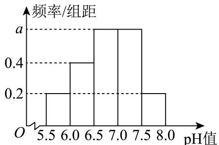
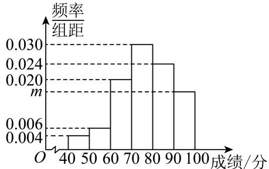
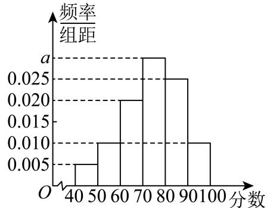
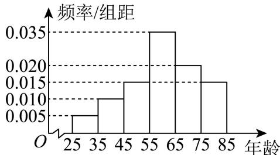

# 概率与统计 · 上海数学大题汇编

> 答案和解析沿用源稿，未逐题独立重算；OCR 与原稿疑点仍可能存在。每题计为一道完整大题。

共 14 道。

### 199 · 原第19题

**来源：** S014 · 上海市南洋模范中学 · 高三 · 2025-2026 · 期中 · 原第19题

**考点说明：** 五场三胜赛制中的独立试验，按结束局数或胜负路径分类求概率。

> **校订提示**
>
> 源稿答案块排版错乱，写作“$\dfrac{512}{625}$ / (1) / (2)”，两问答案与标号错位；依解析认定 (1) 为 $\dfrac{512}{625}$、(2) 为 $\dfrac{529}{625}$。

> 下列正文保留原转录；与本提示冲突的文字或公式不作为有效依据。

中国乒乓球队是中国体育军团的王牌之师，屡次在国际大赛上争金夺银，被体育迷们习惯地称为“梦之队”．2024 年巴黎奥运会，其中团体赛由四场单打和一场双打比赛组成，采用五场三胜制．每个队由三名运动员组成，当一个队赢得三场比赛时，比赛结束．2024 年 8 月 9 日，中国队对战瑞典队，赛前某乒乓球爱好者对赛事情况进行分析，根据以往战绩，中国队在每场比赛中获胜的概率均为 $\dfrac45$．

(1) 已知中国队输掉了第一场，求中国队最终获胜的概率；

(2) 求至多进行四场就结束比赛的概率．

#### 答案

(1) $\dfrac{512}{625}$　(2) $\dfrac{529}{625}$

#### 解析（保留源稿）

(1) 设事件 $B=$“中国队在已输第一场的情况下最终获胜”，有两类互斥情形：

① 事件 $B_{1}=$“中国队自第二场起连胜三场”，$P(B_{1})=\left(\dfrac45\right)^{3}=\dfrac{64}{125}=\dfrac{320}{625}$；

② 事件 $B_{2}=$“中国队在二到四场中胜两场，再胜第五场”，

$$
P(B_{2})=3\times\left(\dfrac45\right)^{2}\times\left(1-\dfrac45\right)\times\dfrac45=\dfrac{192}{625}.
$$

故 $P(B)=P(B_{1})+P(B_{2})=\dfrac{320}{625}+\dfrac{192}{625}=\dfrac{512}{625}$。

(2) 设 $C_{1},C_{2}$ 分别为“赛三场、赛四场且中国队获胜”，$D_{1},D_{2}$ 分别为“赛三场、赛四场且瑞典队获胜”，则四者互斥，且

$$
P(C_{1})=\left(\dfrac45\right)^{3}=\dfrac{64}{125}=\dfrac{320}{625},\quad P(C_{2})=3\times\left(\dfrac45\right)^{2}\times\dfrac15\times\dfrac45=\dfrac{192}{625},
$$

$$
P(D_{1})=\left(\dfrac15\right)^{3}=\dfrac1{125}=\dfrac{5}{625},\quad P(D_{2})=3\times\left(\dfrac15\right)^{2}\times\dfrac45\times\dfrac15=\dfrac{12}{625}.
$$

故至多进行四场就结束比赛的概率

$$
P=\dfrac{320}{625}+\dfrac{192}{625}+\dfrac{5}{625}+\dfrac{12}{625}=\dfrac{529}{625}.
$$

---

---

### 200 · 原第19题

**来源：** S010 · 上海市吴淞中学 · 高三 · 2025-2026 · 期中 · 原第19题

**考点说明：** 互斥与对立事件、独立性证明及不同赛制下的获胜概率比较。

> **校订提示**
>
> 源稿第 (2) 问写作“如果两个事件 A 与 B 相互独立，那么 A 与 B 也独立”，第二个 B 上的上划线在转录中丢失，致原句同义反复。据解析（$P(A\cap\overline{B})=P(A)-P(A\cap B)=P(A)P(\overline{B})$），原意为“那么 A 与 $\overline{B}$ 也独立”。**该处需以原 PDF 复核定案。**

> 下列正文保留原转录；与本提示冲突的文字或公式不作为有效依据。

请解决下列问题：

(1) 已知事件 $A$ 与 $B$ 互斥，$P(A)=\dfrac{2}{5}$，且 $P(A\cup B)=P(\overline{A})$，求 $P(\overline{B})$；

(2) 证明：如果两个事件 $A$ 与 $B$ 相互独立，那么 $A$ 与 $\overline{B}$ 也独立；

(3) 甲乙两个人比赛，对于弱者甲（赢的概率较小者为弱者，设甲每一局赢的概率为 $p$）来说，一局定胜负和三局两胜定胜负比较，哪个更有利？请从数学的角度予以解释。（这里所说的“三局两胜”是常见的比赛模式，指先赢得两局者为胜，最多三局结束）

#### 答案

(1) $\dfrac{4}{5}$

(2) 证明见解析

(3) 一局定胜负对甲有利，解释见解析

#### 解析（保留源稿）

(1) $P(A)=\dfrac{2}{5}\Rightarrow P(\overline{A})=1-P(A)=\dfrac{3}{5}$。

∵ 事件 $A$ 与 $B$ 互斥，$\therefore P(A\cup B)=P(A)+P(B)$，又 $P(A\cup B)=P(\overline{A})$，$\therefore P(A)+P(B)=\dfrac{3}{5}$。

$\therefore \dfrac{2}{5}+P(B)=\dfrac{3}{5}$，$\therefore P(B)=\dfrac{1}{5}$，$\therefore P(\overline{B})=\dfrac{4}{5}$。

(2) 如果两个事件 $A$ 与 $B$ 相互独立，$\therefore P(A\cap B)=P(A)P(B)$。

$\therefore P(A\cap\overline{B})=P(A)-P(A\cap B)=P(A)-P(A)P(B)=P(A)\bigl(1-P(B)\bigr)=P(A)P(\overline{B})$，所以 $A$ 与 $\overline{B}$ 也独立。

(3) 若一局定胜负，甲赢的概率为 $p$；若三局两胜，甲赢的概率为 $p^{2}+p(1-p)p+(1-p)p^{2}=3p^{2}-2p^{3}$。

因为甲是弱者，所以 $p\in\left(0,\dfrac{1}{2}\right)$。

所以 $3p^{2}-2p^{3}-p=-p(2p-1)(p-1)<0$，即 $3p^{2}-2p^{3}<p$，

所以一局定胜负对甲有利。

---

---

### 201 · 原第18题

**来源：** S041 · 上海市奉贤中学 · 高三 · 2025-2026 · 期中 · 原第18题

**考点说明：** 频率直方图与平均数估计，分层抽样后建立不放回抽样模型。

某市环保部门为了监测某条河流的水质情况，连续30天测量了河流的PH值，整理数据后，得到如图所示的频率分布直方图.

(1) 求a的值，并估计这30天河流PH值的平均数（同一组中的数据用该组区间的中点值为代表）；

(2) 若PH值低于6.5的称为“酸性超标日”，其中PH值在[6.0, 6.5)的称为“轻度超标日”，PH值在

[5.5,6.0)的称为“重度超标日”.环保部门决定采用分层抽样的方法从“酸性超标日”中抽取3天，并从这3天中随机选择2天进行水质复检，求这2天都是“轻度超标日”的概率.

#### 答案

(1)(2) $a = 0 . 6 ; \quad 6 . 8$ $\frac 1 3$

#### 解析（保留源稿）

(1) 因为0. $5 \times 0 . 2 \times 2 + 0 . 5 \times 0 . 4 + 0 . 5 \times 2 a = 1$ ，所以 $. a = 0 . 6$ 平均值： $5 . 7 5 \times 0 . 1 + 6 . 2 5 \times 0 . 2 + 6 . 7 5 \times 0 . 3 + 7 . 2 5 \times 0 . 3 + 7 . 7 5 \times 0 . 1 = 6 . 8 .$

(2) 抽取的3天中，“轻度超标日”有2天，记为a，b，“重度超标日”有1天，记为A，样本空间 $\Omega = \{ a b , a A , b A \}$

设事件B为这2天都是“轻度超标日”，则 $B = \{ a b \}$

因为抽中样本空间Ω中每一个样本点的可能性都相等，所以这是一个古典概型.

所以 $P \left( B \right) = \frac { 1 } { 3 }$

---

---

### 202 · 原第19题

**来源：** S016 · 上海市徐汇中学 · 高三 · 2025-2026 · 期中 · 原第19题

**考点说明：** 用频率估计概率，区分抽样口径并比较不同语料搭配的概率。

> **校订提示**
>
> 第 (2) 问的抽取口径在源稿中未明示：源解析按“用频率估计概率”作**独立重复**（有放回）计算，得 $\dfrac{8}{25}$；若按从语料库 A 的 30 个“一”中**不放回**抽取 2 个，则应为 $\dfrac{\mathrm{C}_{6}^{1}\mathrm{C}_{24}^{1}}{\mathrm{C}_{30}^{2}}=\dfrac{48}{145}$。本成品采用源稿口径（题首已声明“假设用频率估计概率”），**原卷口径需以原 PDF 复核定案**。

> 下列正文保留原转录；与本提示冲突的文字或公式不作为有效依据。

人工智能正在逐渐改变着我们的日常生活，不过，它所涉及的数学知识并非都是遥不可及的高深理论．为了解“拼音输入法”的背后原理，随机选取甲类题材“新闻稿”中1200字作为样本语料库A，其中“一”出现了30次，统计“一”与其后面一个字（或标点）的搭配情况，数据如下：

| “一”与其后面一个字(或标点)的搭配情况 | 频数 |
|---|---|
| “一个” | 6 |
| “一些” | 4 |
| “一群” | 2 |
| “一条” | 2 |
| 其他 | a |

假设用频率估计概率

(1) 求a的值，并估计甲类题材中“一”出现的概率；

(2) 在甲类题材“新闻稿”中随机抽取2个“一”，其中搭配“一个”出现的次数仅为1次，求它的概率；

(3) 另外随机选取甲类题材“新闻稿”中800字作为样本语料库B进行统计，“一”出现了24次，“一格”出现了2次，若在甲类题材“新闻稿”的撰写中，输入拼音“yige”时，“一个”和“一格”谁在前面更合适?（结论不要求证明）

#### 答案

(1) $1 6 ; \frac { 1 } { 4 0 }$

(2) $\frac { 8 } { 2 5 }$ ；

(3) “一个”在前面更合适.

#### 解析（保留源稿）

(1) 由题可得

$$a=30-(6+4+2+2)=16.$$

因为随机选取甲类题材“新闻稿”中 1200 字作为样本语料库 A，其中“一”出现了 30 次，所以估计甲类题材中“一”出现的概率为

$$\frac{30}{1200}=\frac{1}{40}.$$

(2) 由题意可得在甲类题材“新闻稿”中随机抽取 1 个“一”，搭配“一个”出现的概率为

$$p_{1}=\frac{6}{30}=\frac{1}{5},$$

则不搭配“一个”出现的概率为 $p_{2}=1-\dfrac{1}{5}=\dfrac{4}{5}$。

所以在甲类题材“新闻稿”中随机抽取 2 个“一”，其中搭配“一个”出现的次数仅为 1 次的概率为

$$\frac{1}{5}\times\frac{4}{5}+\frac{4}{5}\times\frac{1}{5}=\frac{8}{25}.$$

(3) 甲类题材“新闻稿”中随机抽取 1 个字，出现“一个”的频率为 $\dfrac{6}{1200}=\dfrac{1}{200}$；

出现“一格”的频率为 $\dfrac{2}{800}=\dfrac{1}{400}$。

因为 $\dfrac{1}{400}<\dfrac{1}{200}$，所以“一个”出现的概率更高，则输入拼音“yige”时，“一个”在前面更合适。

---

---

### 203 · 原第17题

**来源：** S029 · 上海市杨浦高级中学 · 高三 · 年份待核 · 摸底考 · 原第17题

**考点说明：** 茎叶图的均值、方差与百分位数，建立不放回抽样的古典概型。

（本题满分14分，第1小题满分6分，第2小题满分8分）

已知 $A,B$ 两所大学联合开展大学生青年志愿者培训活动，并在培训结束后统一进行了一次考核。考核成绩在 $[60,85]$ 的为合格等级，成绩在 $[86,100]$ 的为优秀等级。为了解本次培训活动的效果，$A,B$ 两所大学从参加活动的学生中各随机抽取了10名学生的考核成绩作为样本，并作出茎叶图如下。

| $A$ 大学的叶（左侧） | 茎 | $B$ 大学的叶（右侧） |
| --- | :---: | --- |
| $4$ | $6$ | $2\quad7$ |
| $9\quad8\quad8\quad5\quad2$ | $7$ | $0\quad8\quad9$ |
| $6\quad5$ | $8$ | $4\quad5\quad7$ |
| $2\quad1$ | $9$ | $3\quad5$ |

（1）分别求样本中 $A$ 校的平均成绩和第60百分位数，$B$ 校的方差和第65百分位数；

（2）现从样本考核等级为优秀的学生中任取2人，求2人来自同一所大学的概率。

#### 答案

（1）$A$ 校平均数为 $80$，第60百分位数为 $82$；$B$ 校方差为 $108.2$，第65百分位数为 $85$。（2）$\frac25$。

**核心考点：** 准确还原双侧茎叶图并区分百分位规则。

**易卡点：** 整数位置需平均两项；优秀起点为86。

**关联考点：** 统计；百分位数；方差；古典概型。

#### 解析（保留源稿）

（1）由茎叶图还原有序数据：

$A$ 校：$64,72,75,78,78,79,85,86,91,92$；

$B$ 校：$62,67,70,78,79,84,85,87,93,95$。

$A$ 校数据和为800，因此平均成绩为80。因 $10\times60\%=6$ 是整数，第60百分位数为第6、7项的平均数，即 $(79+85)/2=82$。

$B$ 校平均成绩也为80，方差为

$$
s_B^2=\frac{(-18)^2+(-13)^2+(-10)^2+(-2)^2+(-1)^2+4^2+5^2+7^2+13^2+15^2}{10}=108.2.
$$

因 $10\times65\%=6.5$ 不是整数，第65百分位数取第7项，即85。

（2）优秀样本中，$A$ 校为 $86,91,92$，$B$ 校为 $87,93,95$，两校各3人。因此

$$
P=\frac{\binom32+\binom32}{\binom62}=\frac25.
$$

---

### 204 · 原第19题

**来源：** S056 · 上海市格致中学 · 高三 · 2025-2026 · 期中 · 原第19题

**考点说明：** 根据频数关系补列联表，估计条件概率并进行独立性检验。

某中学为探究“周末使用手机时长是否影响学业成绩”，随机调查100名学生，得到部分统计数据如下表：

| 学业成绩 | 使用手机≤2小时 | 使用手机>2小时 |
|---|---|---|
| 良好 | m | 20 |
| 不良好 | n | 40 |

记事件A=“学业成绩良好且使用手机≤2小时”，事件B=“学业成绩不良好且使用手机≤2小时”，已知事件A的频率是事件B的频率的3倍.

(1) 求表中的m，n的值；

(2) 记使用手机 ≤2 小时的学生中学业成绩良好的概率为P，求P的估计值；

(3) 根据上述数据，请画出2×2列联表，并判断是否有95%的把握认为“周末使用手机时长”与“学业成绩”有关？请说明理由.

参考数据：$\chi^{2}=\dfrac{n(ad-bc)^{2}}{(a+b)(c+d)(a+c)(b+d)}$，其中 $n=a+b+c+d$。

| $\alpha$ | 0.10 | 0.05 | 0.01 | 0.005 | 0.001 |
|---|---|---|---|---|---|
| $x_{\alpha}$ | 2.706 | 3.841 | 6.635 | 7.879 | 10.828 |

#### 答案

(1) $n=10,\ m=30.$ (2) 0.75 (3) 有，理由见解析

#### 解析（保留源稿）

(1) 由样本容量为100，得 $m+n+20+40=100$，即 $m+n=40$。又事件A的频率是事件B的频率的3倍，所以 $\dfrac{m}{100}=3\times\dfrac{n}{100}$，即 $m=3n$。故 $n=10$，$m=30$。

(2) 因为在样本中用手机 ≤2 小时的学生中学业成绩良好的频率为 $\dfrac{m}{m+n}=\dfrac{30}{40}=0.75$。根据用样本频率估计总体频率，估计总体中用手机 ≤2 小时的学生中学业成绩良好的频率为0.75，再由频率估计概率，故用手机 $\le$ 2小时的学生中学业成绩良好的概率为0.75。故P的估计值为0.75。

(3) 设假设 $H_{0}$：周末使用手机时长与学业成绩相互独立。由题得列联表：

| 学业成绩 | 使用手机≤2小时 | 使用手机>2小时 | 合计 |
|---|---|---|---|
| 良好 | 30 | 20 | 50 |
| 不良好 | 10 | 40 | 50 |
| 合计 | 40 | 60 | 100 |

可知 $n=100$，$a=30$，$b=20$，$c=10$，$d=40$。

$$
\chi^{2}=\dfrac{n(ad-bc)^{2}}{(a+b)(c+d)(a+c)(b+d)}=\dfrac{100(30\times40-20\times10)^{2}}{50\times50\times40\times60}=\dfrac{50}{3}\approx16.667>3.841
$$

所以在犯错误概率不超过0.05的前提下，认为“周末使用手机时长”与“学业成绩”有关，即有95%的把握认为二者有关。

---

---

### 205 · 原第18题

**来源：** S012 · 上海市行知中学 · 高三 · 2025-2026 · 期中 · 原第18题

**考点说明：** 对比放回与不放回抽样模型，结合基本不等式求概率最大值。

一个袋子中有 $m$ 个红球，$n$ 个白球，球的大小和质地相同．

(1) 若 $m=2$，$n=3$，采取不放回的方式从中依次随机地取出 2 个球，求第一次和第二次都取到白球的概率；

(2) 若 $m+n=10$，采取有放回的方式从中依次随机地取出 2 个球，已知取出一个红球和一个白球的概率是 $P(n)$，求 $P(n)$ 的最大值．

#### 答案

(1) $\dfrac{3}{10}$

(2) $\dfrac{1}{2}$

#### 解析（保留源稿）

(1) 设 2 个红球为 $a_{1},a_{2}$，3 个白球为 $b_{1},b_{2},b_{3}$，依次取出 2 个球的样本空间 $\Omega$，列举得

$$
\begin{aligned}
\Omega=\{&a_{1}a_{2},a_{1}b_{1},a_{1}b_{2},a_{1}b_{3},a_{2}a_{1},a_{2}b_{1},a_{2}b_{2},a_{2}b_{3},b_{1}a_{1},b_{1}a_{2},b_{1}b_{2},b_{1}b_{3},b_{2}a_{1},\\
&b_{2}a_{2},b_{2}b_{1},b_{2}b_{3},b_{3}a_{1},b_{3}a_{2},b_{3}b_{1},b_{3}b_{2}\},
\end{aligned}
$$

共 20 种．设第一次和第二次都取到白球为事件 $A$，则

$$
A=\{b_{1}b_{2},b_{1}b_{3},b_{2}b_{1},b_{2}b_{3},b_{3}b_{1},b_{3}b_{2}\},
$$

共 6 种，所以 $P(A)=\dfrac{6}{20}=\dfrac{3}{10}$．

(2) 有放回取球两次，每次取到红球的概率为 $\dfrac{m}{10}$，取到白球的概率为 $\dfrac{n}{10}$．

先取白球再取红球的概率为 $\dfrac{n}{10}\cdot\dfrac{m}{10}$；先取红球再取白球的概率为 $\dfrac{m}{10}\cdot\dfrac{n}{10}$．

所以

$$
P(n)=\frac{n}{10}\cdot\frac{m}{10}+\frac{m}{10}\cdot\frac{n}{10}=\frac{mn}{50}\le\frac{1}{50}\left(\frac{m+n}{2}\right)^{2}=\frac{1}{50}\times 25=\frac{1}{2},
$$

当且仅当 $m=n=5$ 时等号成立，所以 $P(n)$ 的最大值为 $\dfrac{1}{2}$．

---

---

### 206 · 原第19题

**来源：** S039 · 华东师范大学附属东昌中学 · 高三 · 2025-2026 · 期中 · 原第19题

**考点说明：** 古典概型与对立事件，按独立性的定义构造满足条件的参数。

某项室内体育赛事共有大学生志愿者 36 名，其中男生 12 名，女生 24 名，这些志愿者中会说日语和会说韩语的人数统计如下：

| | 男生志愿者 | 女生志愿者 |
|---|---|---|
| 会说日语 | 8 | 12 |
| 会说韩语 | $m$ | $n$ |

其中 $m$、$n$ 均为正整数，$6\le m\le 8$。

(1) 从这 36 名大学生志愿者中随机抽取两名作为某个小项目的主持人，求抽取的两名志愿者中至少有一名会说日语的概率；

(2) 从这些志愿者中随机抽取一名去接待外宾，用 $A$ 表示事件“抽到的志愿者是男生”，用 $B$ 表示事件“抽到的志愿者会说韩语”．试给出一组 $m$、$n$ 的值，使得事件 $A$ 与 $B$ 相互独立，并说明理由。

#### 答案

(1) $P=\dfrac{17}{21}$

(2) $m=6,\ n=12$；或 $m=7,\ n=14$；或 $m=8,\ n=16$（写出一组即可）

#### 解析（保留源稿）

(1) 由题意，会说日语的志愿者共 $8+12=20$ 名，不会说日语的共 $36-20=16$ 名。设抽取的两名志愿者中至少有一名会说日语的概率为 $P$，则

$$
P=1-\dfrac{\mathrm{C}_{16}^{2}}{\mathrm{C}_{36}^{2}}=1-\dfrac{120}{18\times 35}=1-\dfrac{120}{630}=\dfrac{17}{21}.
$$

(2) 由题意得

$$
P(A)=\dfrac{\mathrm{C}_{12}^{1}}{\mathrm{C}_{36}^{1}}=\dfrac{1}{3},\quad P(B)=\dfrac{\mathrm{C}_{m+n}^{1}}{\mathrm{C}_{36}^{1}}=\dfrac{m+n}{36},
$$

而抽到的志愿者既是男生又会说韩语的概率为

$$
P(AB)=\dfrac{\mathrm{C}_{m}^{1}}{\mathrm{C}_{36}^{1}}=\dfrac{m}{36}.
$$

要使得事件 $A$ 与 $B$ 相互独立，那么 $P(AB)=P(A)P(B)$，即

$$
\dfrac{m}{36}=\dfrac{1}{3}\times\dfrac{m+n}{36},
$$

化简得 $n=2m$。

因为 $m,n$ 均为正整数，且 $6\le m\le 8$，所以

当 $m=6$ 时，$n=12$；当 $m=7$ 时，$n=14$；当 $m=8$ 时，$n=16$。

（任取一组，如 $m=6,\ n=12$，此时 $P(AB)=\dfrac{6}{36}=\dfrac{1}{6}$，$P(A)P(B)=\dfrac{1}{3}\times\dfrac{18}{36}=\dfrac{1}{6}$，二者相等，故 $A$ 与 $B$ 相互独立。）

---

---

### 207 · 原第19题

**来源：** S005 · 复旦大学附属中学 · 高三 · 年份待核 · 三模 · 原第19题

**考点说明：** 条件概率与二项分布近似，利用样本均值方差估计鱼苗比例。

混养不仅能够提高水产养殖的收益，还可以降低单一放养的病害风险，提高养殖效益。某鱼塘中有 $A,B$ 两种鱼苗。为调查这两种鱼苗的比例，设计如下方案：

① 在该鱼塘中捕捉 $50$ 条鱼苗，统计其中鱼苗 $A$ 的数目，以此作为一次试验的结果；

② 每一次试验结束后将鱼苗放回鱼塘，重复进行这个试验 $n$ 次，记第 $i$ 次试验中鱼苗 $A$ 的数目为随机变量 $X_i(i=1,2,\cdots,n)$；

③ 记随机变量 $\bar X=\frac1n\sum_{i=1}^nX_i$，利用 $\bar X$ 的期望 $E[\bar X]$ 和方差 $D[\bar X]$ 进行估算。

设该鱼塘中鱼苗 $A$ 的数目为 $M$，鱼苗 $B$ 的数目为 $N$，其中 $M<N$，并且认为每一次试验都相互独立。

(1) 在一次试验中，已知捕捉的 $50$ 条鱼苗中鱼苗 $A$ 共有 $20$ 条，记录员逐个不放回地记录鱼苗的种类，求第一次记录的是鱼苗 $A$ 的条件下，第二次记录的仍是鱼苗 $A$ 的概率；

(2) 请提出一个合理假设，使得 $X_i$ 服从二项分布：___。基于以上假设，请完成下面的问题。

记 $X_i(i=1,2,\cdots,n)$ 的实际取值分别为 $x_i$，平均值和方差分别记为 $\bar x,s^2$，已知方差 $s^2=\frac{75}{8n}$。该鱼塘的技术顾问认为可以用 $\bar x$ 和 $s^2$ 分别代替 $E[\bar X]$ 和 $D[\bar X]$。请由此估算 $\frac MN$ 和 $\bar x$。

参考公式：$E[\bar X]=E[X_1]$，$D[\bar X]=\frac1nD[X_1]$。

#### 答案

(1) $\frac{19}{49}$；(2) 合理假设见解析，$\frac MN=\frac13$，$\bar x=\frac{25}{2}$

【破题眼】第 (1) 问是条件概率下的不放回抽样；第 (2) 问要先把 $X_i$ 设成 $B(50,p)$。

#### 解析（保留源稿）

(1) 已知 $50$ 条中有 $20$ 条是 $A$。第一次记录为 $A$ 后，剩下 $49$ 条，其中 $A$ 还剩 $19$ 条。所以第二次仍为 $A$ 的条件概率是 $\frac{19}{49}$。

(2) 合理假设：每次捕捉到鱼苗 $A$ 的概率均为 $p=\frac{M}{M+N}$，且一次试验中 $50$ 次捕捉结果相互独立。于是 $X_i\sim B(50,p)$。

因此 $E[X_i]=50p$，$D[X_i]=50p(1-p)$，所以 $D[\bar X]=\frac{50p(1-p)}n$。由题意用 $s^2=\frac{75}{8n}$ 代替 $D[\bar X]$，得 $\frac{50p(1-p)}n=\frac{75}{8n}$，即 $p(1-p)=\frac3{16}$。

解得 $p=\frac14$ 或 $p=\frac34$。因为 $M<N$，所以 $p=\frac{M}{M+N}<\frac12$，取 $p=\frac14$。于是 $\frac MN=\frac{p}{1-p}=\frac{1/4}{3/4}=\frac13$，并且 $\bar x\approx E[\bar X]=E[X_1]=50p=\frac{25}{2}$。

【方法总结】用二项分布建模时，先写清楚独立重复和固定概率两个假设，再用 $E=np,D=np(1-p)$。

【易错点】$s^2$ 在题中用来估计 $D[\bar X]$，不是估计 $D[X_1]$。

---

### 208 · 原第18题

**来源：** S008 · 上海市奉贤中学 · 高二 · 2025-2026 · 期中 · 原第18题

**考点说明：** 频率直方图与总体人数估计，利用对立事件求至少一人被抽中。

某校组织全校800名学生进行校园安全相关知识的测试，从中随机抽取了100名学生的测试成绩（单位：分)，按照[40,50),[50,60),…,[90,100]分组，绘制成如图所示的频率分布直方图.

(1) 求m的值，并估计全校学生测试成绩在[80,100]内的人数;

(2) 学校想了解部分学生测试成绩较低的原因，从样本中测试成绩在[50,60)内的学生中随机抽取2名学生座谈，已知这些待选的学生中包含A和B，求A和B至少有一人被抽到的概率.

#### 答案

(1) m = 0.016, 320

(2) $\frac { 3 } { 5 }$

#### 解析（保留源稿）

(1) 由频率分布直方图知 $( 0 . 0 0 4 + 0 . 0 0 6 + 0 . 0 2 0 + 0 . 0 3 0 + 0 . 0 2 4 + m ) \times 1 0 = 1$ 解得m = 0.016.

则测试成绩在[80,100]内的频率为 $( 0 . 0 1 6 + 0 . 0 2 4 ) \times 1 0 = 0 . 4$

所以估计全校学生测试成绩在[80,100]内的人数为 $8 0 0 \times 0 . 4 = 3 2 0 .$

(2) 样本中测试成绩在[50,60)内的学生人数为 $0 . 0 0 6 \times 1 0 \times 1 0 0 = 6$

记学生A和B之外的4人分别为 $c , d , e , f ,$

则所有可能的结果有AB， Ac，Ad， Ae， Af， Bc，Bd, Be，Bf, cd, ce，cf， de， df， ef,共15种，

其中学生A和B至少有一人被抽到的结果有 $A B , A c , A d , A e , A f , B c , B d , B e , B f$ ，共9种.所以学生A和B至少有一人被抽到的概率 $P = { \frac { 9 } { 1 5 } } = { \frac { 3 } { 5 } }$

---

---

### 209 · 原第19题

**来源：** S008 · 上海市奉贤中学 · 高二 · 2025-2026 · 期中 · 原第19题

**考点说明：** 互斥分类和独立事件求概率，依据赛制累计得分比较答题方案。

某市为传播中华文化，举办中华文化知识选拔大赛．决赛阶段进行线上答题．题型分为选择题和填空题两种，每次答题相互独立.选择题答对得5分，否则得0分．填空题答对得4分，否则得0分．将得分逐题累加.

(1)若小明直接做3道选择题，他做对这3道选择题的概率依次为 ${ \frac { 4 } { 5 } } , { \frac { 3 } { 4 } } , { \frac { 2 } { 3 } }$ . 求他得分不低于10分的概率；

(2)规定每人最多答3题，若得分高于7分，则通过决赛，立即停止答题，否则继续答题，直到答完3题为止. 已知小红做对每道选择题的概率均为 $\frac 1 4$ ，做对每道填空题的概率均为 $\frac { 3 } { 1 0 }$

现有两种方案：

方案一：依次做一道选择题两道填空题；

方案二：做三道填空题.

请你推荐一种合理的方式给小红

#### 答案

(1) $\frac { 5 } { 6 }$

(2) 推荐方案二给小红

#### 解析（保留源稿）

(1) 记“他得分不低于10分”为事件A，则

$$
P ( A ) = { \frac { 4 } { 5 } } \times { \frac { 3 } { 4 } } \times \left( 1 - { \frac { 2 } { 3 } } \right) + { \frac { 4 } { 5 } } \times \left( 1 - { \frac { 3 } { 4 } } \right) \times { \frac { 2 } { 3 } } + \left( 1 - { \frac { 4 } { 5 } } \right) \times { \frac { 3 } { 4 } } \times { \frac { 2 } { 3 } } + { \frac { 4 } { 5 } } \times { \frac { 3 } { 4 } } \times { \frac { 2 } { 3 } }
$$

$$
= { \frac { 1 } { 5 } } + { \frac { 2 } { 1 5 } } + { \frac { 1 } { 1 0 } } + { \frac { 2 } { 5 } } = { \frac { 2 5 } { 3 0 } } = { \frac { 5 } { 6 } } ;
$$

(2) 记“方案一通过决赛”为事件B,

$$
   \begin{array} { c c }     \begin{array} { c c } {  B  } \end{array}   = \frac { 1 } { 4 } \times \frac { 3 } { 1 0 } + \frac { 1 } { 4 } \times \frac { 7 } { 1 0 } \times \frac { 3 } { 1 0 } + \frac { 3 } { 4 } \times \frac { 3 } { 1 0 } \times \frac { 3 } { 1 0 } = \frac { 3 } { 4 0 } + \frac { 2 1 } { 4 0 0 } + \frac { 2 7 } { 4 0 0 } = \frac { 7 8 } { 4 0 0 } = \frac { 3 9 } { 2 0 0 } \end{array}
$$

记“方案二通过决赛”为事件 $C ,$

则

$$
{ \overset { P \left( C \right) } { 1 0 ^ { \cdot } } } = { \frac { 3 } { 1 0 } } \times { \frac { 3 } { 1 0 } } + { \frac { 3 } { 1 0 } } \times { \frac { 7 } { 1 0 } } \times { \frac { 3 } { 1 0 } } + { \frac { 7 } { 1 0 } } \times { \frac { 3 } { 1 0 } } \times { \frac { 3 } { 1 0 } } = { \frac { 9 } { 1 0 0 } } + { \frac { 6 3 } { 1 0 0 0 } } + { \frac { 6 3 } { 1 0 0 0 } } = { \frac { 2 1 6 } { 1 0 0 0 } } =
$$

因为 $P \left( C \right) > P \left( B \right)$

所以推荐方案二给小红.

---

---

### 210 · 原第17题

**来源：** S033 · 上海市松江二中 · 高二 · 2025-2026 · 期中 · 原第17题

**考点说明：** 由茎叶图比较中位数与分布，利用频率估计两城市的联合概率。

空气质量指数PM2.5（单位： $\mu \mathrm { g } / \mathrm { m } ^ { 3 } )$ 表示每立方米空气中可吸入肺颗粒物的含量，这个值越高，就代表空气污染越严重：

<table><tr><td rowspan=1 colspan=1>PM2.5日均浓度</td><td rowspan=1 colspan=1>0~35</td><td rowspan=1 colspan=1>35~75</td><td rowspan=1 colspan=1>75~115</td><td rowspan=1 colspan=1>115~150</td><td rowspan=1 colspan=1>150~250</td><td rowspan=1 colspan=1>&gt;250</td></tr><tr><td rowspan=1 colspan=1>空气质量级别</td><td rowspan=1 colspan=1>一级</td><td rowspan=1 colspan=1>二级</td><td rowspan=1 colspan=1>三级</td><td rowspan=1 colspan=1>四级</td><td rowspan=1 colspan=1>五级</td><td rowspan=1 colspan=1>六级</td></tr><tr><td rowspan=1 colspan=1>空气质量类别</td><td rowspan=1 colspan=1>优</td><td rowspan=1 colspan=1>良</td><td rowspan=1 colspan=1>轻度污染</td><td rowspan=1 colspan=1>中度污染</td><td rowspan=1 colspan=1>重度污染</td><td rowspan=1 colspan=1>严重污染</td></tr></table>

甲、乙两城市2013年2月份中的15天对空气质量指数PM2.5进行监测，获得PM2.5日均浓度指数数据如茎叶图所示：

甲城市

乙城市

$$
\begin{array} { l } { 3 \left. 0 2 2 4 \right. } \\ { 4 \left. 8 9 6 \right. } \\ { 6 \left. 1 5 1 \right. } \\ { 7 \left. 8 \right. } \\ { 8 \left. 2 3 0 \right. } \\ { 9 \left. 8 \right. } \end{array}
$$

$$
\begin{array} { l } { { 3 \left. 2 0 4 \right. } } \\ { { 5 \left. 5 \right. } } \\ { { 6 \left. 4 \right. } } \\ { { 7 \left. 6 9 7 \right. } } \\ { { 8 \left. 8 0 7 \right. } } \\ { { 9 \left. 1 8 0 9 \right. } } \end{array}
$$

(1)根据你所学的统计知识估计甲、乙两城市15天内哪个城市空气质量总体较好？并说明理由.

(2) 在15天内任取1天，估计甲、乙两城市空气质量类别均为优或良的概率；

#### 答案

(1)甲;

(2) $\frac { 2 } { 9 }$

#### 解析（保留源稿）

(1) 由茎叶图知：甲城市的中位数为：61，乙城市的中位数为79，并且甲的大多集中在65以下，乙的大多集中在76以上，所以甲城市空气质量总体较好；

(2) 甲城市空气质量类别为优或良的有10天，

所以甲城市空气质量类别优或良的概率为 $P = { \frac { 1 0 } { 1 5 } } = { \frac { 2 } { 3 } }$

乙城市空气质量类别为优或良的有5天，

所以乙城市空气质量类别优或良的概率为 $P = { \frac { 5 } { 1 5 } } = { \frac { 1 } { 3 } }$

所以甲、乙两城市空气质量类别均为优或良的概率为 $P = { \frac { 2 } { 3 } } \times { \frac { 1 } { 3 } } = { \frac { 2 } { 9 } }$

---

---

### 211 · 原第19题

**来源：** S033 · 上海市松江二中 · 高二 · 2025-2026 · 期中 · 原第19题

**考点说明：** 直方图估计均值、分层抽样和独立比赛的获胜概率比较。

某校为了提高学生的反诈骗意识，举办了反诈骗知识竞赛，从所有答卷中随机抽取100份作为样本，将样本的成绩（满分100分，成绩均为不低于40分的整数）分成六组：[40,50)，[50,60)，[60,70)，[70,80)，[80,90)，[90,100]，得到如图所示的频率分布直方图.

(1) 求频率分布直方图中a的值与样本成绩的平均数;

(2) 用分层随机抽样的方法从[70,80)，[90,100]两个区间共抽取出8名学生，再从这8名学生中随机抽取2名依次进行交流分享，求第二个交流分享的学生成绩在区间[70,80)的概率；

(3) 学校决定从知识竞赛中抽出成绩最好的两个同学甲乙进行现场知识抢答赛，比赛共设三个项目，每个项目胜方得1分，负方得0分，没有平局，三个项目比赛结束后，总得分高的人获得冠军. 已知甲在三个项目中获胜的概率分别为 ${ \frac { 1 } { 2 } } , \ { \frac { 2 } { 5 } } , \ { \mathsf p } , \ $ 各项目的比赛结果相互独立，甲至少得1分的概率是 $\frac { 3 7 } { 5 0 }$ ，甲乙两人谁获得最终胜利的可能性大？并说明理由.

#### 答案

(1) a = 0.03，平均数为 74分；

(2) $\frac 3 4$

(3) 乙最终获胜的可能性更大，理由见解析.

#### 解析（保留源稿）

(1) 由题意得 $1 0 \times ( 0 . 0 0 5 + 0 . 0 1 + 0 . 0 2 + a + 0 . 0 2 5 + 0 . 0 1 ) = 1$ ，解得 $a = 0 . 0 3$ 所以样本成绩的平均数约为

$$
\overline { { x } } = 4 5 \times 0 . 0 5 + 5 5 \times 0 . 1 + 6 5 \times 0 . 2 + 7 5 \times 0 . 3 + 8 5 \times 0 . 2 5 + 9 5 \times 0 . 1 = 7 4 .
$$

(2) 由频率分布直方图知，样本答卷成绩在[70,80)，[90,100]的学生比为3:1,

用分层随机抽样的方法从[70,80)的学生中抽取 ${ \frac { 3 } { 4 } } \times 8 = 6$ (人)，从[90,100]的学生中抽取 ${ \frac { 1 } { 4 } } \times 8 = 2$ (人)

从这8名学生中随机抽取2名依次进行交流分享，有 $8 \times 7 = 5 6$ 种情形，

第一个和第二个交流分享的学生成绩均在区间[70,80)，有 $6 \times 5 = 3 0$ 种情形，

第一个交流分享的学生成绩在区间[90,100]，第二个交流分享的学生成绩在区间[70,80)，有 $2 \times 6 = 1 2$ 种情形，

故所求概率为 $P = { \frac { 3 0 + 1 2 } { 5 6 } } = { \frac { 3 } { 4 } } .$

(3) 乙最终获胜的可能性大；理由如下：

由题，甲至少得1分的概率是 $\frac { 3 7 } { 5 0 }$ ，可得 $1 - \left( 1 - { \frac { 1 } { 2 } } \right) \left( 1 - { \frac { 2 } { 5 } } \right) \left( 1 - p \right) = { \frac { 3 7 } { 5 0 } }$

其中 $0 \leq p \leq 1$ ，解得 $p = { \frac { 2 } { 1 5 } }$

则甲得2分或3分的概率为：

$$
{ \begin{array} { l } { P = { \frac { 1 } { 2 } } \times { \frac { 2 } { 5 } } \times \left( 1 - { \frac { 2 } { 1 5 } } \right) + { \frac { 1 } { 2 } } \times \left( 1 - { \frac { 2 } { 5 } } \right) \times { \frac { 2 } { 1 5 } } + \left( 1 - { \frac { 1 } { 2 } } \right) \times { \frac { 2 } { 5 } } \times { \frac { 2 } { 1 5 } } + { \frac { 1 } { 2 } } \times { \frac { 2 } { 5 } } \times { \frac { 2 } { 1 5 } } = { \frac { 4 } { 1 5 } } } \end{array} }
$$

所以乙得分为2分或3分的概率为 $\frac { 1 1 } { 1 5 }$ ，乙最终获胜的可能性大

---

---

### 212 · 原第18题

**来源：** S019 · 上海市西南位育中学 · 高二 · 2025-2026 · 期中 · 原第18题

**考点说明：** 频率直方图估计均值与方差，分层抽样后求代表年龄的概率。

国庆期间，某县书画协会在县宣传部门的领导下组织了庆国庆书画展，参展的200幅书画作品反映了该县人民在党的领导下进行国家建设中的艰苦卓绝，这些书画作品的作者的年龄都在[25,85]之间，根据统计结果，作出如图所示的频率分布直方图：

(1) 请估计这200位作者年龄的平均数 $\overline{x}$ 和方差 $s^2$ （同一组数据用该区间的中点值作代表）；

(2) 县委宣传部从年龄在[35, 45)和[65, 75)的作者中，按照分层抽样的方法，抽出6人参加县委组织的表彰大会，现要从6人中选出2人作为代表发言，求至少有一个人的年龄是在[35, 45)中的概率.

#### 答案

(1) $\overline{x} = 60, s^2 = 180$

(2) $\frac{3}{5}$

#### 解析（保留源稿）

(1) 由频率分布直方图可知各组频率依次为0.05, 0.1, 0.15, 0.35, 0.2, 0.15,

所以这200位作者年龄的样本平均数

$$
\overline {{{x}}} = 3 0 \times 0. 0 5 + 4 0 \times 0. 1 + 5 0 \times 0. 1 5 + 6 0 \times 0. 3 5 + 7 0 \times 0. 2 + 8 0 \times 0. 1 5 = 6 0,
$$

样本方差 $s^2$

$$
\begin{array}{l} s ^ {2} = (3 0 - 6 0) ^ {2} \times 0. 0 5 + (4 0 - 6 0) ^ {2} \times 0. 1 + (5 0 - 6 0) ^ {2} \times 0. 1 5 + (6 0 - 6 0) ^ {2} \times 0. 3 5 + (7 0 - \\ 6 0) ^ {2} \times 0. 2 \end{array}
$$

$$
+ (8 0 - 6 0) ^ {2} \times 0. 1 5 = 1 8 0.
$$

(2) 因为在[35,45)与[65,75)的频率之比为0.1:0.2=1:2,

可知这6人中年龄在[35,45)内有2人，在[65,75)内有4人，

所以至少有一个人的年龄是在[35,45)中的概率 $P = 1 - \frac{\mathrm{C}_4^2}{\mathrm{C}_6^2} = \frac{3}{5}$ .

---

---
