# 立体几何 · 上海数学大题汇编

> 答案和解析沿用源稿，未逐题独立重算；OCR 与原稿疑点仍可能存在。每题计为一道完整大题。

共 64 道。

### 001 · 原第17题

**来源：** S045 · 上海市七宝中学 · 高三 · 2025-2026 · 期中 · 原第17题

**考点说明：** 面面垂直的性质、线面垂直的判定与三棱锥体积（等体积转化）；空间直角坐标系、法向量与两平面夹角的最值

已知三棱柱 $A B C - A _ { 1 } B _ { 1 } C _ { 1 }$ 的底面是边长为2的正三角形，平面 $A A _ { 1 } C _ { 1 } C ^ { \scriptscriptstyle \perp }$ 与底面ABC垂直，$\vec { B P } = \lambda B \vec { B } _ { 1 } \left( \lambda \in ( 0 \mathrm { ~ , ~ } 1 ) \right)$ )，当 $\lambda = \frac { 1 } { 2 }$ 时， $A P \bot A _ { 1 } C ,$

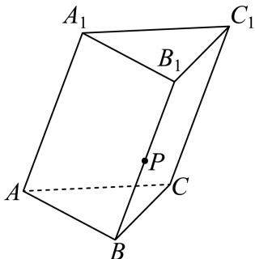

(1) 当 $\angle A _ { 1 } A C = { \frac { \pi } { 3 } }$ 时，求三棱锥 $A - A _ { 1 } P C$ 的体积；

(2) 当 $\angle A _ { 1 } A C = { \frac { \pi } { 2 } }$ 时，求平面 $A _ { 1 } P C$ 与平面 $A _ { 1 } B _ { 1 } C _ { 1 }$ 夹角的余弦值的最大值

#### 答案

(1) 1

(2) $\frac { \sqrt { 2 } } { 2 }$

#### 解析（保留源稿）

(1) （1）分别取AC和 $A _ { 1 } ($ C的中点T，Q，连接 $B T , T Q , P Q , A Q , A P ,$ 由面面垂直的性质可得$B T \perp$ 平面 $A A _ { 1 } C _ { 1 } C _ { : }$ ，进而证明 $A _ { 1 } C \bot$ 平面 $A P Q$ ，可求得 $A A _ { 1 } , A C$ ，利用 $V _ { A - A _ { 1 } P C } = V _ { B - A _ { 1 } A C }$ 可求体积；

（ ）方法一：分别取 和 $A _ { 1 } C _ { 1 }$ 的中点为 $O , O _ { 1 }$ ，建立空间直角坐标系，求得平面 $A _ { 1 } P C$ 和平面 $A _ { 1 } B _ { 1 } C _ { 1 }$ 的一个法向量，利用向量法可求得 $\left| \cos { \vec { u } } \right.$ ,→v $\Big \vert = \frac { \Big \vert \vec { u } \cdot \vec { v } \Big \vert } { \Big \vert \vec { u } \Big \vert \Big \vert \vec { v } \Big \vert }$ ，进而可求最大值．方法二：延长 $A _ { 1 } P _ { \cdot }$ 交直线AB于点M，连接CM，过点A作 $A H \bot M C$ 于点H，$\angle A H A _ { 1 } = \theta$ 为所求两平面夹角，求解即可如图，分别取AC和 $A _ { 1 }$ C的中点T，Q，连接 $B T , T Q , P Q , A Q , A P$ 因为平面 $A A _ { 1 } C _ { 1 } C \bot$ 平面 $A B C ,$ ，且平面 $A A _ { 1 } C _ { 1 } C \cap$ 平面 $A B C = A C$ 又 $\triangle A B C$ 为等边三角形，T为AC的中点，

$B T \bot A C$ ，即 $B T \perp$ 平面 $A A _ { 1 } C _ { 1 } C _ { : }$ ，则 $B T \bot A _ { 1 } C$ $\lambda = \frac { 1 } { 2 }$ ，则P为 $B B _ { 1 }$ 的中点，则 $Q T / / B P , Q T = B P$ 故四边形 $B T Q P .$ 为平行四边形，则 $| Q P / / B T , P Q \bot A _ { 1 } C$ ．又 $A P \bot A _ { 1 } C ,$ ，且 $A P \cap P Q = P$ 则 $A _ { 1 } C \bot$ 平面 $A P Q ,$ 则 $A Q \bot A _ { 1 } C ,$ ，又Q为 $A _ { 1 } C$ 的中点，则有 $A A _ { 1 } = A C = 2$ 故 $V _ { A - A _ { 1 } P C } = V _ { P - A _ { 1 } A C } = V _ { B - A _ { 1 } A C } = { \frac { 1 } { 3 } } S _ { \triangle { A A _ { 1 } C } } \cdot B T = { \frac { 1 } { 3 } } \times { \frac { 1 } { 2 } } \times 2 \times 2 \sin { \frac { \pi } { 3 } } \times { \sqrt { 3 } } = 1$ 方法一：当 $\angle A _ { 1 } A C = { \frac { \pi } { 2 } }$ 时，三棱柱 $A B C - A _ { 1 } B _ { 1 } C _ { 1 }$ 为正三棱柱，分别取AC和 $A _ { 1 } C _ { 1 }$ 的中点为 $\mathcal { O } , O _ { 1 }$ ，则 $O B , O C , O O _ { 1 }$ 两两互相垂直，${ \downarrow \downarrow } O ^ { \sharp }$ 原点，分别以 $O B , O C , O O _ { 1 }$ 为x，y，z轴建立空间直角坐标系，如图所示由（1）知 $A A _ { 1 } = A B = 2$ ，则 $A _ { 1 } \left( 0 , - 1 , 2 \right) , C \left( 0 , 1 , 0 \right)$ ，由 $\vec { B P } = \lambda \vec { B B _ { 1 } }$ 得 $P \left( { \sqrt { 3 } } , 0 , 2 \lambda \right)$

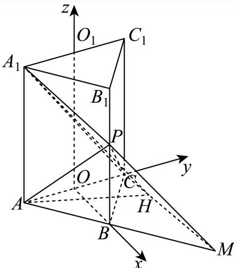

取平面 $A _ { 1 } B _ { 1 } C _ { 1 }$ 的法向量为 $\vec { u } = ( 0 , 0 , 1 )$ ，设平面 $A _ { 1 } P C$ 的法向量为 $\vec { v } = ( x , y , z )$ 9设平面 $A _ { 1 } P C {  }$ 平面 $A _ { 1 } B _ { 1 } C _ { 1 }$ 的夹角为θ，易得 $\stackrel {  } { A _ { 1 } C } = ( 0 , 2 , - 2 ) , \stackrel {  } { C P } = ( \sqrt { 3 } , - 1 , 2 \lambda )$ ，则 $\{ \begin{array} { l l } { { \stackrel {  } { A _ { 1 } C } } \cdot { \stackrel {  } { v } } = 2 y - 2 z = 0 ~ , } \\ { { \stackrel {  } { C P } } \cdot { \stackrel {  } { v } } = { \sqrt { 3 } } x - y + 2 \lambda z = } \end{array} $ 0，$\stackrel { \wedge } { \prec } z = 1$ ，则 $| y = 1 , x = { \frac { 1 - 2 \lambda } { \sqrt { 3 } } }$ ，即 ${ \vec { v } } = \left( { \frac { 1 - 2 \lambda } { \sqrt { 3 } } } , 1 , 1 \right)$ 则 $\left| \cos { \vec { u } } , { \vec { v } } \right| = { \frac { \left| { \vec { u } } \cdot { \vec { v } } \right| } { \left| { \vec { u } } \right| \left| { \vec { v } } \right| } } = { \frac { 1 } { \sqrt { { \frac { \left( 1 - 2 \lambda \right) ^ { 2 } } { 3 } } + 1 + 1 } } } ,$ 当 $\lambda = \frac { 1 } { 2 }$ 时，cosθ取最大值 $\frac { \sqrt { 2 } } { 2 }$ 故当 $\lambda = \frac { 1 } { 2 }$ ，即P为棱 $B _ { 1 } B ^ { \scriptscriptstyle \mathsf { r } }$ 中点时，平面 $A _ { 1 } P C ^ { \underline { { t } } }$ 与平面 $A _ { 1 } B _ { 1 } C _ { 1 }$ 夹角的余弦值取最大值 $\frac { \sqrt { 2 } } { 2 }$ 方法二：由（1）知 $A A _ { 1 } = A B = 2$ 延长 $A _ { 1 } P _ { \cdot }$ 交直线AB于点M，连接CM，过点A作 $A H \bot M C$ 于点H，连接 $A _ { 1 } H$ 因为 $A A _ { 1 } \bot$ 平面ABC， $M C \subset$ 平面 $A B C$ ，所以 $A A _ { 1 } \bot M C$ 又因为 $A A _ { 1 } \cap A H = A , A A _ { 1 } , A H \subset \bar { \textrm { \ i } }$ 平面 $A A _ { 1 } H$ ，所以 $M C \bot$ 平面 $H A A _ { 1 }$ 1又因为 $A _ { 1 } H \subset$ 平面 $H A A _ { 1 }$ ，所以 $M C \bot A _ { 1 } H$

所以 $\angle A H A _ { 1 } = \theta$ 为所求两平面夹角，且 $\tan \theta = { \frac { A _ { 1 } A } { A H } }$ ，

又 $A H \leq A C ,$ ，故当且仅当点H与点C重合时，tanθ有最小值1，

由余弦函数单调性知cosθ有最大值 $\frac { \sqrt { 2 } } { 2 }$ ，此时 $B M = B C = A B = 2 , \lambda = \frac { 1 } { 2 } .$

(2) 同(1)题详解

---

---

### 002 · 原第17题

**来源：** S014 · 上海市南洋模范中学 · 高三 · 2025-2026 · 期中 · 原第17题

**考点说明：** 空间向量：点到平面的距离（法向量）；空间向量：直线与平面的夹角

如图，在四棱锥 $P-ABCD$ 中，底面 $ABCD$ 是正方形，$PD\perp$ 底面 $ABCD$，$PD=AB=1$，$E$ 是 $PC$ 的中点．

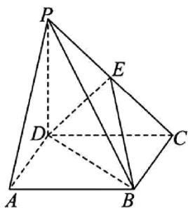

(1) 求点 $P$ 到平面 $EDB$ 的距离；

(2) 求直线 $PB$ 与平面 $EDB$ 的夹角的正弦值．

#### 答案

(1) $\dfrac{\sqrt3}{3}$　(2) $\dfrac13$

#### 解析（保留源稿）

因为底面 $ABCD$ 是正方形，故 $AD\perp CD$；又 $PD\perp$ 底面 $ABCD$，$AD,CD\subset$ 平面 $ABCD$，故 $PD\perp AD$，$PD\perp CD$。

以 $D$ 为原点，分别以 $DA,DC,DP$ 为 $x,y,z$ 轴建立空间直角坐标系：

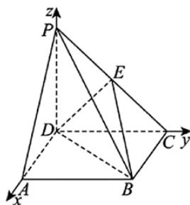

由 $PD=AB=1$ 得 $D(0,0,0)$，$A(1,0,0)$，$B(1,1,0)$，$C(0,1,0)$，$P(0,0,1)$；$E$ 为 $PC$ 中点，故 $E\left(0,\dfrac12,\dfrac12\right)$。

于是 $\overrightarrow{DE}=\left(0,\dfrac12,\dfrac12\right)$，$\overrightarrow{DB}=(1,1,0)$。设平面 $EDB$ 的法向量 $\vec n=(x,y,z)$，则

$$
\begin{cases}\dfrac12y+\dfrac12z=0\\[4pt]x+y=0\end{cases}
$$

取 $x=1$ 得 $\vec n=(1,-1,1)$，$\vert\vec n\vert=\sqrt3$。

(1) $\overrightarrow{PD}=(0,0,-1)$，$\overrightarrow{PD}\cdot\vec n=-1$，故点 $P$ 到平面 $EDB$ 的距离

$$
d=\dfrac{\left\vert\overrightarrow{PD}\cdot\vec n\right\vert}{\vert\vec n\vert}=\dfrac{1}{\sqrt3}=\dfrac{\sqrt3}{3}.
$$

(2) $\overrightarrow{PB}=(1,1,-1)$，$\left\vert\overrightarrow{PB}\right\vert=\sqrt3$，$\overrightarrow{PB}\cdot\vec n=-1$。设直线 $PB$ 与平面 $EDB$ 的夹角为 $\theta$，则

$$
\sin\theta=\dfrac{\left\vert\overrightarrow{PB}\cdot\vec n\right\vert}{\left\vert\overrightarrow{PB}\right\vert\cdot\vert\vec n\vert}=\dfrac{1}{\sqrt3\cdot\sqrt3}=\dfrac13.
$$

---

---

### 003 · 原第18题

**来源：** S010 · 上海市吴淞中学 · 高三 · 2025-2026 · 期中 · 原第18题

**考点说明：** 构造平行四边形证明线面平行，建立线面角关系求动点位置。

如图，四边形 $ABCD$ 为长方形，$PA\perp$ 平面 $ABCD$，$AB=AP=2$，$AD=3$。

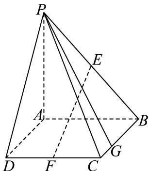

(1) 若 $E$、$F$ 分别是 $PB$、$CD$ 的中点，求证：$EF\mathbin{//}$ 平面 $PAD$；

(2) 边 $BC$ 上是否存在点 $G$，使得直线 $PG$ 与平面 $PAD$ 所成的角的大小为 $30^{\circ}$？若存在，求 $BG$ 长；若不存在，说明理由。

#### 答案

(1) 证明见解析

(2) 存在，$BG=2\sqrt{2}$

#### 解析（保留源稿）

(1)

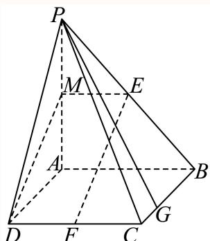

法一：取 $AP$ 中点 $M$，连接 $EM$、$DM$，$\because ME\mathbin{//}AB$，$DF\mathbin{//}AB$，$\therefore ME\mathbin{//}DF$。

$\therefore ME=\dfrac{1}{2}AB$，$DF=\dfrac{1}{2}AB$，$\therefore ME=DF$，∴ 四边形 $DFEM$ 为平行四边形，$\therefore EF\mathbin{//}DM$。

$\because DM\subset$ 平面 $PDA$，$EF$ 在平面 $PDA$ 外，$\therefore EF\mathbin{//}$ 平面 $PDA$。

法二：如图建立空间直角坐标系，

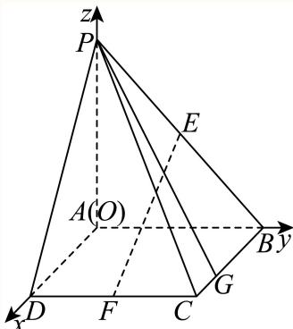

则 $D(3,0,0)$，$B(0,2,0)$，$P(0,0,2)$，$F(3,1,0)$，$E(0,1,1)$，$C(3,2,0)$，

$\therefore \overrightarrow{EF}=(3,0,-1)$，易知平面 $PAD$ 的一个法向量 $\vec{n}=(0,1,0)$，

$\therefore \overrightarrow{EF}\cdot\vec{n}=0$，且 $EF$ 在平面 $PDA$ 外，$\therefore EF\mathbin{//}$ 平面 $PDA$。

(2)

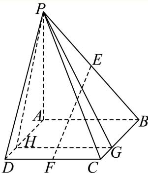

法一：作 $GH\perp AD$，垂足为 $H$，连接 $PH$。$\because PA\perp$ 平面 $ABCD$，$GH\subset$ 平面 $ABCD$，$\therefore PA\perp GH$，又 $AD,PA$ 为平面 $PAD$ 内两条相交直线，$\therefore GH\perp$ 平面 $PAD$。

∴ 直线 $PG$ 与平面 $PAD$ 所成的角为 $\angle GPH=30^{\circ}$，

$\therefore \dfrac{HG}{PH}=\tan30^{\circ}=\dfrac{1}{\sqrt{3}}$，$\therefore PH=2\sqrt{3}$。

$\therefore BG=AH=\sqrt{PH^{2}-PA^{2}}=\sqrt{12-4}=2\sqrt{2}$。

∴ 边 $BC$ 上存在点 $G$，使得直线 $PG$ 与平面 $PAD$ 所成的角为 $30^{\circ}$，$BG=2\sqrt{2}$。

法二：设 $BG=t\ (0\le t\le 3)$，则 $G(t,2,0)$，$\overrightarrow{PG}=(t,2,-2)$，易知平面 $PAD$ 的一个法向量 $\vec{n}=(0,1,0)$。

设 $\overrightarrow{PG}$ 与 $\vec{n}$ 的夹角为 $\varphi$，则 $\sin30^{\circ}=\vert\cos\varphi\vert=\dfrac{2}{\sqrt{t^{2}+8}}$，解得 $t=2\sqrt{2}$。

∴ 边 $BC$ 上存在点 $G$，使得直线 $PG$ 与平面 $PAD$ 所成的角为 $30^{\circ}$，$BG=2\sqrt{2}$。

---

---

### 004 · 原第17题

**来源：** S006 · 上海市嘉定区第一中学 · 高三 · 2025-2026 · 期中 · 原第17题

**考点说明：** 面面垂直的性质定理与棱锥的体积；空间直角坐标系下二面角的向量求法

在三棱锥 $P-ABC$ 中，平面 $PAC\perp$ 平面 $ABC$，$PA=AC=CP=2$，$AB=BC=\sqrt{2}$。

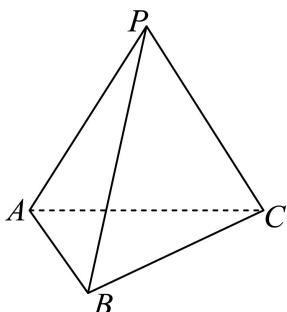

(1) 若 $O$ 是棱 $AC$ 的中点，证明：$BO\perp$ 平面 $PAC$，并求三棱锥 $B-OPA$ 的体积；

(2) 求二面角 $B-PC-A$ 的大小。

#### 答案

(1) 证明过程见解析，体积为 $\dfrac{\sqrt{3}}{6}$

(2) $\arccos\dfrac{\sqrt{21}}{7}$

#### 解析（保留源稿）

(1) 连接 $BO$，因为 $AB=BC=\sqrt{2}$，所以 $BO\perp AC$。因为平面 $PAC\perp$ 平面 $ABC$，交线为 $AC$，$BO\subset$ 平面 $ABC$，

所以 $BO\perp$ 平面 $PAC$。

因为 $PA=AC=CP=2$，所以 $PO\perp AC$，$AO=1$，$PO=\sqrt{AP^{2}-AO^{2}}=\sqrt{3}$。

故 $S_{\triangle OPA}=\dfrac{1}{2}\cdot OP\cdot AO=\dfrac{1}{2}\times\sqrt{3}\times1=\dfrac{\sqrt{3}}{2}$。

又 $AB=\sqrt{2}$，由勾股定理得 $BO=\sqrt{AB^{2}-AO^{2}}=\sqrt{2-1}=1$，又 $BO\perp$ 平面 $PAC$，

所以三棱锥 $B-OPA$ 的体积 $V=\dfrac{1}{3}S_{\triangle OPA}\cdot BO=\dfrac{1}{3}\times\dfrac{\sqrt{3}}{2}\times1=\dfrac{\sqrt{3}}{6}$。

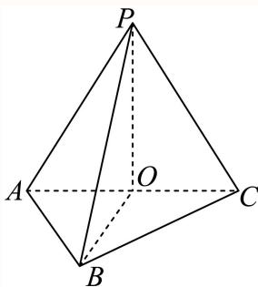

(2) 由（1）知，$BO\perp$ 平面 $PAC$，$OC,OP\subset$ 平面 $PAC$，所以 $BO\perp OC$，$BO\perp OP$，又 $PO\perp AC$，故 $OB,OC,OP$ 两两垂直。

以 $O$ 为坐标原点，$OB,OC,OP$ 所在直线分别为 $x,y,z$ 轴，建立空间直角坐标系，则

$B(1,0,0)$，$P(0,0,\sqrt{3})$，$C(0,1,0)$，$A(0,-1,0)$，

$\overrightarrow{BP}=(-1,0,\sqrt{3})$，$\overrightarrow{PC}=(0,1,-\sqrt{3})$。

设平面 $BPC$ 的一个法向量为 $\vec{m}=(x,y,z)$，则

$\begin{cases}\vec{m}\cdot\overrightarrow{BP}=-x+\sqrt{3}z=0\\ \vec{m}\cdot\overrightarrow{PC}=y-\sqrt{3}z=0\end{cases}$，令 $z=1$ 得 $x=y=\sqrt{3}$，故 $\vec{m}=(\sqrt{3},\sqrt{3},1)$。

又平面 $PCA$ 的一个法向量为 $\vec{n}=(1,0,0)$，

$\cos\langle\vec{m},\vec{n}\rangle=\dfrac{\vec{m}\cdot\vec{n}}{\vert\vec{m}\vert\cdot\vert\vec{n}\vert}=\dfrac{(\sqrt{3},\sqrt{3},1)\cdot(1,0,0)}{\sqrt{3+3+1}}=\dfrac{\sqrt{3}}{\sqrt{7}}=\dfrac{\sqrt{21}}{7}$。

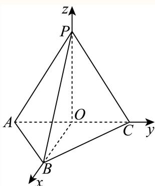

由图可知，二面角 $B-PC-A$ 为锐角，故二面角 $B-PC-A$ 的大小为 $\arccos\dfrac{\sqrt{21}}{7}$。

---

---

### 005 · 原第19题

**来源：** S041 · 上海市六校期中联考 · 高三 · 2025-2026 · 期中 · 原第19题

**考点说明：** 线面垂直的判定（半圆柱中的垂直关系）；空间直角坐标系、法向量、二面角与点到平面的距离

如图所示的几何体是一个半圆柱，点P是半圆弧BC上一动点（点P与点B，C不重合），E为弧BC的中点， $A B = A D = 4$

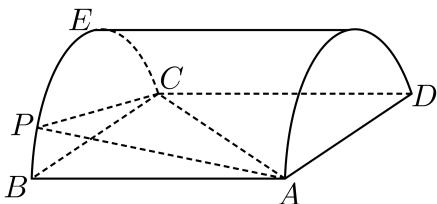

(1) 证明： $P A \bot P C ;$

(2) 若平面PAC与平面CDE所成的锐二面角的平面角为45∘，求此时点D到平面PAC的距离.

#### 答案

(1) 证明见解析 (2) $\frac { 8 } { 3 }$

#### 解析（保留源稿）

(1) 连接BP，在半圆柱中，因为AB⊥平面PBC，PC ⊂平面 $P B C$ 所以 $A B \bot P C ,$ 又因为BC是直径，所以 $P B \bot P C$ 又PB， $A B \subset$ 平面PAB， $A B \cap P B = B$ ，所以 $P C \bot$ 平面 $P A B .$ 又 $P A \subset$ 平面 $P A B _ { \mathrm { i } }$ ，所以 $P C \bot P A$

(2) 依题意可知，以线段BC的中点O为坐标原点，D $\sqrt { O B } \ , \overrightarrow { B A } \ , \overrightarrow { O E }$ 为x， y， z轴的正方向建立如图所示的空间直角坐标系

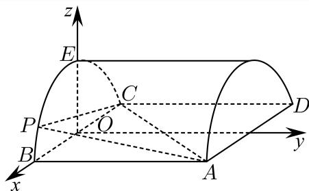

则E(0，0，2)， C(−2，0，0)， B(2，0，0)， D(−2，4，0)， A(2，4，0)，连接 $\mathrm { O P }$ 设 $\angle B O P = \theta ( 0 < \theta < \pi )$ ，则 $P ( 2 \cos \theta \ , \ 0 \ , \ 2 \sin \theta )$

所以 $\overrightarrow { \cdot C E } = ( 2 \mathit { \textbf { , } } 0 \mathit { \textbf { , } } 2 ) \mathit { \textbf { , } } \overrightarrow { C D } = ( 0 \mathit { \textbf { , } } 4 \mathit { \textbf { , } } 0 )$

设平面CDE的一个法向量为 $\vec { \vert n \vert } = \left( x _ { 1 } \ , y _ { 1 } \ , z _ { 1 } \right)$ ，

所以 $\{ { \stackrel {  } { n } } \cdot { \vec { C E } } = 0  \qquad \quad \quad \quad \quad \quad \quad \quad \quad \quad \quad \quad \quad \quad \quad \quad \quad \quad \quad \quad \quad \quad \quad \quad \quad \quad \quad \quad \quad \quad \quad \quad \quad \quad \quad \quad \quad \quad \quad \quad \quad \quad \quad \quad \quad \quad \quad \quad \quad \quad \quad \quad \quad \quad \quad \quad \quad \quad \quad \quad \quad \quad \quad \quad \quad \quad \quad \quad \quad \quad \quad \quad \quad \quad \quad \quad \quad \quad \quad \quad \quad \quad \quad \quad \quad \quad \quad \quad \quad \quad \quad \quad \quad \quad \quad \quad \quad \quad \quad \quad \quad \quad \quad \quad \quad \quad \quad \quad \quad \quad \quad \quad \quad \quad \quad \quad \quad \quad \quad \quad \quad \quad \quad \quad \quad \quad \quad \quad \quad \quad \quad \quad \quad \quad \quad \quad \quad \quad \quad \quad \quad \quad \quad \quad \quad \quad \quad \quad \quad \quad \quad \quad \quad \quad \quad \quad \quad \quad \quad \quad \quad \quad \quad \quad \quad \quad \quad \quad \quad \quad \quad \quad \quad \quad \quad \quad \quad \quad \quad \quad \quad \quad \quad \quad \quad \quad \quad \quad \quad \quad \quad \quad \quad \quad \quad \quad \quad \quad \quad \quad \quad \quad \quad \quad \quad \quad \quad \quad \quad \quad \quad \quad \quad \quad \quad \quad \quad \quad \quad \quad \quad \quad \quad \quad \quad \quad \quad \quad \quad \quad \quad \quad \quad \quad \quad \quad \quad \quad \quad \quad \quad \quad \quad \quad \quad \quad \quad \quad \quad \quad \quad \quad \quad \quad \quad \quad \quad \quad \quad \quad \quad \quad \quad \quad \quad \quad \quad \quad \quad \quad \quad \quad \quad \quad \quad \quad \quad \quad \quad \quad \quad \quad \quad \quad \quad \quad \quad \quad \quad \quad \quad \quad \quad \quad \quad \quad \quad \quad \quad \quad \quad \quad \quad \quad \quad \quad \quad \quad \quad \quad \quad \quad \quad \quad \quad \quad \quad \quad \quad \quad \quad \quad \quad \quad \quad \quad \quad \quad \quad \quad \quad \quad \quad \quad \quad \quad \quad \quad \quad \quad \quad \quad \quad \quad \quad \quad \quad \quad \quad \quad \quad \quad \quad \quad \quad \quad \quad \quad \quad \quad \ u \ u \ u \ u \ u \ u \ u \ u $ 则 $\left\{ { 2 x _ { 1 } + 2 z _ { 1 } = 0 \atop 4 y _ { 1 } = 0 } \right.$ 令 $x _ { 1 } = 1$ ，则 $y _ { 1 } = 0$ $z _ { 1 } = - 1$

所 $\overrightarrow { \lambda n } = ( 1 ~ , ~ 0 ~ , ~ - ~ 1 )$

设 $\overrightarrow { m } = ( x _ { 2 } \ , y _ { 2 } \ , z _ { 2 } )$ 为平面PCA的一个法向量，

$$
\overrightarrow {C P} = (2 \cos \theta + 2, 0, 2 \sin \theta), \overrightarrow {C A} = (4, 4, 0)
$$

所以 $\left\{ \begin{array} { l l } { { \overrightarrow { m } } \cdot { \overrightarrow { C P } } = ( 2 { \mathrm { c o s } } \theta + 2 ) x _ { 2 } + 2 { \mathrm { s i n } } \theta \cdot z _ { 2 } = 0 } \\ { \qquad { \overrightarrow { m } } \cdot { \overrightarrow { C A } } = 4 x _ { 2 } + 4 y _ { 2 } = 0 } \end{array} \right.$ $\stackrel { \wedge } { \prec } x _ { 2 } = 1$ ，则 $| y _ { 2 } = - 1$ $z _ { 2 } = { \frac { - \cos \theta - 1 } { \sin \theta } }$ 所以 ${ \overrightarrow { m } } = \left( 1 \ , \ - 1 \ , \ { \frac { - \cos \theta - 1 } { \sin \theta } } \right)$ ，

因为平面PCA与平面CDE所成的锐二面角的平面角为 $4 5 ^ { \circ }$ ，

所以 $\cos 4 5 ^ { \circ } = { \frac { \sqrt { 2 } } { 2 } } = { \frac { \vert { \vec { n } } \cdot { \vec { m } } \vert } { \vert { \vec { m } } \vert \cdot \vert { \vec { n } } \vert } } = { \frac { \left. 1 + { \frac { \cos \theta + 1 } { \sin \theta } } \right. } { { \sqrt { 2 } } \times { \sqrt { 2 + \left( { \frac { \cos \theta + 1 } { \sin \theta } } \right) ^ { 2 } } } } } ,$

令 $\displaystyle { \mathrm { ~ } \mathbf { \tilde { \Gamma } } t = \frac { \cos \theta + 1 } { \sin \theta } ( 0 < \theta < \pi ) }$ ，则 ${ \sqrt { 2 + t ^ { 2 } } } = | 1 + t |$ ，平方化简得 $t = \frac 1 2$

即 $\sin \theta = 2 \cos \theta + 2$ ，又由 $\operatorname { I s i n } ^ { 2 } \theta + \cos ^ { 2 } \theta = 1$ ，可解得 $\cos \theta = - \frac { 3 } { 5 } \sharp \hat { \chi } \mathrm { c o s } \theta = - 1$ （舍去），所以 $P \left( - { \frac { 6 } { 5 } } \ , \ 0 \ , \ { \frac { 8 } { 5 } } \right)$ ，所以平面PCA的一个法向量m $= \left( 1 \ , \ - 1 \ , \ - \ \frac { 1 } { 2 } \right)$ ，且$\overrightarrow { C D } = ( 0 \mathrm { ~ , ~ } 4 \mathrm { ~ , ~ } 0 )$

所以点D到平面PCA的距离 $h = \frac { | \vec { m } \cdot \overrightarrow { C D } | } { | \vec { m } | } = \frac { 4 } { \sqrt { \frac { 9 } { 4 } } } = \frac { 8 } { 3 } .$

---

---

### 006 · 原第17题

**来源：** S050 · 上海市市北中学 · 高三 · 2025-2026 · 期中 · 原第17题

**考点说明：** 空间向量法证明线面垂直；空间向量法求点到平面的距离

在正四棱柱 $A B C D - A _ { 1 } B _ { 1 } C _ { 1 } D _ { 1 }$ 中， $A B = 2 B B _ { 1 } = 2 \qquad $ , P为 $B _ { 1 } C _ { 1 }$ 的中点

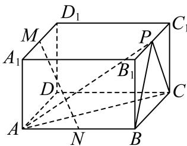

(1) 取 $A _ { 1 } D _ { 1 }$ 中点M, AB中点N，求证：MN⊥平面APC

(2) 求点B到平面APC的距离

#### 答案

(1) 证明见解析

(2) $\frac { 2 { \sqrt { 3 } } } { 3 }$

#### 解析（保留源稿）

(1) 建立如图所示的空间直角坐标系，

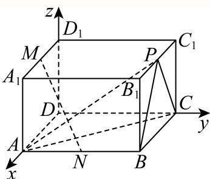

则 A(2,0,0)，C(0,2,0)，B(2,2,0)，P(1,2,1)，M(1,0,1)，N(2,1,0)，

所以 $\overrightarrow{AC}=(-2,2,0)$，$\overrightarrow{AP}=(-1,2,1)$。

设平面 APC 的法向量为 $\vec{n}=(x_{0},y_{0},z_{0})$，则

$$\begin{cases}\vec{n}\cdot\overrightarrow{AP}=0\\ \vec{n}\cdot\overrightarrow{AC}=0\end{cases}\ \Rightarrow\ \begin{cases}-2x_{0}+2y_{0}=0\\ -x_{0}+2y_{0}+z_{0}=0\end{cases}$$

令 $x_{0}=1$，解得 $y_{0}=1$，$z_{0}=-1$，∴ $\vec{n}=(1,1,-1)$。

又 $\overrightarrow{MN}=(1,1,-1)=\vec{n}$，所以 $MN\perp$ 平面 $APC$。

(2) 平面 APC 的法向量 $\vec{n}=(1,1,-1)$，$\overrightarrow{AB}=(0,2,0)$，

∴点 B 到平面 APC 的距离

$$d=\frac{\left\vert \vec{n}\cdot\overrightarrow{AB}\right\vert}{\vert\vec{n}\vert}=\frac{2}{\sqrt{3}}=\frac{2\sqrt{3}}{3}.$$

---

---

### 007 · 原第18题

**来源：** S016 · 上海市徐汇中学 · 高三 · 2025-2026 · 期中 · 原第18题

**考点说明：** 面面平行的判定（中位线构造两组平行线）；空间向量法求直线与平面所成角

如图，在四棱锥 $P - A B C D$ 中，PA⊥底面ABCD，底面ABCD为直角梯形， $A B \bot A D , B C / / A D$ $A D = 2 B C = 2 P A = 2$ $A B = 1$ ，E，F，G分别为线段AD，DC，PB的中点.

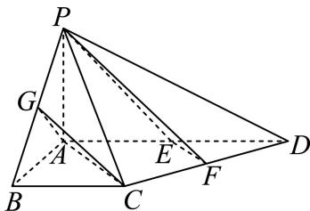

(1) 证明：平面 $P E F / / .$ 平面 $G A C$ ；

(2) 求直线GC与平面PCD所成角的正弦值.

#### 答案

(1) 证明见解析

(2) $\frac { 1 } { 6 }$

#### 解析（保留源稿）

(1) 连接 EC，设 EB 与 AC 相交于点 O，如图。

因为 $BC\parallel AD$，且 $BC=\dfrac{1}{2}AD=AE$，$AB\perp AD$，所以四边形 $ABCE$ 为矩形，所以 O 为 EB 的中点；又因为 G 为 PB 的中点，所以 $OG$ 为 $\triangle PBE$ 的中位线，即 $OG\parallel PE$。

因为 $OG\not\subset$ 平面 PEF，$PE\subset$ 平面 PEF，所以 $OG\parallel$ 平面 PEF。

因为 E、F 分别为线段 AD、DC 的中点，所以 $EF\parallel AC$。因为 $AC\not\subset$ 平面 PEF，$EF\subset$ 平面 PEF，所以 $AC\parallel$ 平面 PEF。

因为 $OG\subset$ 平面 GAC，$AC\subset$ 平面 GAC，$AC\cap OG=O$，所以平面 $PEF\parallel$ 平面 GAC。

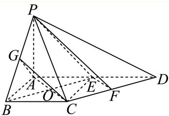

(2) 因为 $PA\perp$ 底面 ABCD，$AB\subset$ 平面 ABCD，$AD\subset$ 平面 ABCD，所以 $PA\perp AB$，$PA\perp AD$；因为 $AB\perp AD$，所以 $PA,AB,AD$ 两两互相垂直。

以 A 为原点，$AB,AD,AP$ 所在的直线分别为 $x$ 轴、$y$ 轴、$z$ 轴，建立空间直角坐标系，如图所示：

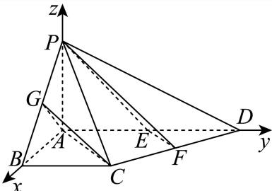

则 $A(0,0,0)$，$G\left(\dfrac{1}{2},0,\dfrac{1}{2}\right)$，$C(1,1,0)$，$D(0,2,0)$，$P(0,0,1)$，

所以

$$\overrightarrow{GC}=\left(\frac{1}{2},1,-\frac{1}{2}\right),\quad \overrightarrow{PC}=(1,1,-1),\quad \overrightarrow{PD}=(0,2,-1).$$

设平面 PCD 的法向量为 $\vec{n}=(x,y,z)$，则

$$\begin{cases}\vec{n}\cdot\overrightarrow{PD}=0\\ \vec{n}\cdot\overrightarrow{PC}=0\end{cases},\quad \text{所以}\ \begin{cases}2y-z=0\\ x+y-z=0\end{cases}.$$

令 $y=1$，可得 $z=2$，$x=1$，所以 $\vec{n}=(1,1,2)$。

设直线 GC 与平面 PCD 所成角为 $\theta$，则

$$\sin\theta=\frac{\left\vert \vec{n}\cdot\overrightarrow{GC}\right\vert}{\vert\vec{n}\vert\left\vert\overrightarrow{GC}\right\vert}=\frac{\left\vert \dfrac{1}{2}+1-1\right\vert}{\sqrt{6}\times\sqrt{\left(\dfrac{1}{2}\right)^{2}+1^{2}+\left(-\dfrac{1}{2}\right)^{2}}}=\frac{\dfrac{1}{2}}{\sqrt{6}\times\sqrt{\dfrac{3}{2}}}=\frac{1}{6},$$

所以直线 GC 与平面 PCD 所成角的正弦值为 $\dfrac{1}{6}$。

---

---

### 008 · 原第18题

**来源：** S024 · 上海市曹杨第二中学 · 高三 · 年份待核 · 开学考 · 原第18题

**考点说明：** 矩形底面四棱锥中利用垂直关系证线面垂直，并求二面角余弦。

**题目**　如图，在四棱锥 $P-ABCD$ 中，底面 $ABCD$ 为矩形，$PD\perp$ 平面 $ABCD$，$PD=AD=2,AB=4$。点 $E$ 在线段 $AB$ 上，且 $BE=\dfrac14AB$。

(1) 求证：$CE\perp$ 平面 $PBD$；

(2) 求二面角 $P-CE-A$ 的余弦值。

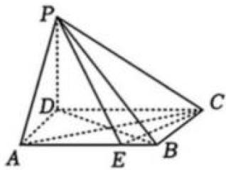

#### 答案

(1) 证明见解析；(2) $\boxed{\dfrac{4\sqrt{21}}{21}}$。

#### 解析（保留源稿）

建立直角坐标系：$D(0,0,0),A(0,2,0),B(4,2,0),C(4,0,0),P(0,0,2)$，则 $E(3,2,0)$。有
$$
\overrightarrow{CE}=(-1,2,0),\quad \overrightarrow{DB}=(4,2,0),\quad \overrightarrow{DP}=(0,0,2).
$$
于是 $\overrightarrow{CE}\cdot\overrightarrow{DP}=0$ 且 $\overrightarrow{CE}\cdot\overrightarrow{DB}=0$，故 $CE\perp$ 平面 $PBD$。

取平面 $PCE$ 与平面 $ACE$ 的法向量，计算夹角得
$$
\cos\theta=\frac{4\sqrt{21}}{21}.
$$

---

### 009 · 原第18题

**来源：** S029 · 上海市杨浦高级中学 · 高三 · 年份待核 · 摸底考 · 原第18题

**考点说明：** 直三棱柱中用中位线证线面平行，再由体积求棱高和线面角正弦。

（本题满分14分，第1小题满分6分，第2小题满分8分）

如图，直三棱柱 $ABC-A_1B_1C_1$ 中，$AB\perp AC$，$AB=AC=4$，$D,E$ 分别为 $AB,A_1C_1$ 的中点。

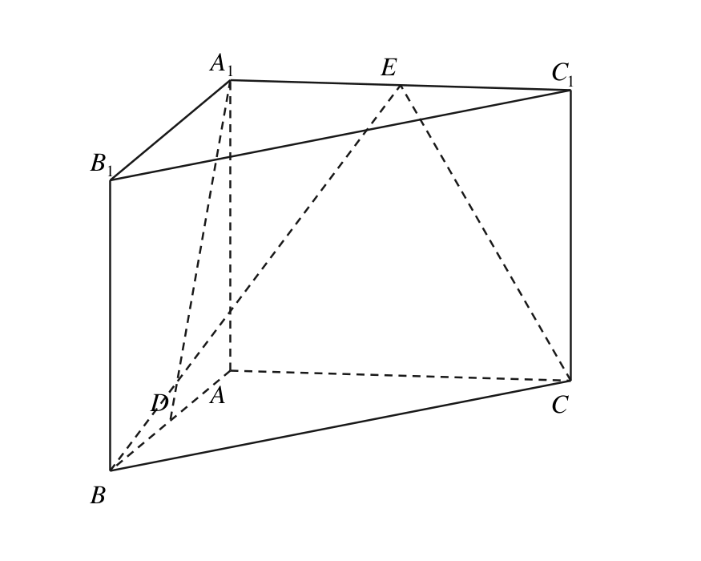

（1）证明：$A_1D\parallel$ 平面 $BCE$；

（2）若三棱锥 $A-EBC$ 的体积为 $\dfrac{40}3$，求直线 $AC$ 与平面 $ABE$ 所成角的正弦值。

#### 答案

（1）证明见解析；（2）$\frac5{\sqrt{29}}$。

**核心考点：** 构造中位线并由体积确定棱高。

**易卡点：** 平行线与平面条件不完整；线面角误用余弦。

**关联考点：** 直三棱柱；线面平行；空间向量。

#### 解析（保留源稿）

第(1)问：取 $BC$ 中点 $F$。在底面三角形中 $DF\parallel AC$ 且 $DF=AC/2$；上底面 $A_1E\parallel AC$ 且 $A_1E=AC/2$。故四边形 $A_1DFE$ 为平行四边形，$A_1D\parallel EF$。由于 $EF\subset$ 平面 $BCE$ 且 $A_1D$ 不在该平面内，得 $A_1D\parallel$ 平面 $BCE$。

第(2)问：以 $A$ 为原点，取 $B=(4,0,0)$、$C=(0,4,0)$、$A_1=(0,0,h)$、$E=(0,2,h)$。三棱锥 $A-EBC$ 的体积为 $8h/3=40/3$，故 $h=5$。平面 $ABE$ 的一个法向量为 $(0,-5,2)$，$AC$ 方向为 $(0,1,0)$。所成角的正弦为 $5/\sqrt{29}$。

---

### 010 · 原第18题

**来源：** S056 · 上海市格致中学 · 高三 · 2025-2026 · 期中 · 原第18题

**考点说明：** 线面垂直的判定（综合面面垂直的性质）；二面角的平面角与解直角三角形

如图，在四棱锥P−ABCD中，底面ABCD为正方形，侧面PAB是正三角形，侧面PAB⊥底面 $ABCD$，E是PB的中点.

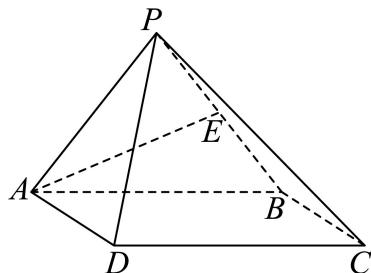

(1) 求证：AE⊥平面PBC；

(2) 求侧面PCD与底面ABCD所成二面角的正切值.

#### 答案

(1) 证明见解析 (2) $\dfrac{\sqrt{3}}{2}$

#### 解析（保留源稿）

(1) 因为 $\triangle PAB$ 是正三角形，且E是PB的中点，所以 $AE\perp PB$。又底面 $ABCD$ 是正方形，所以 $AB\perp BC$。又因为平面 $PAB\perp$ 平面 $ABCD$，且平面 $PAB\cap$ 平面 $ABCD=AB$，$BC\subset$ 平面 $ABCD$，所以 $BC\perp$ 平面PAB。又 $AE\subset$ 平面 $PAB$，所以 $BC\perp AE$。由 $AE\perp PB$，$AE\perp BC$，$BC\cap PB=B$，$BC,PB\subset$ 平面 $PBC$，所以 $AE\perp$ 平面 $PBC$；

(2) 如图，取AB的中点M，CD的中点N，

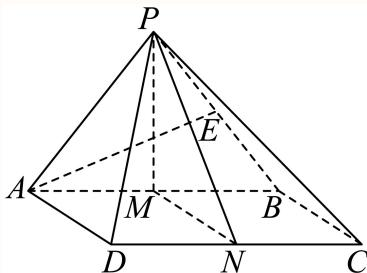

连接 $PM,PN,MN$。因为 $\triangle PAB$ 是正三角形，所以 $PM\perp AB$。又因为平面 $PAB\perp$ 平面 $ABCD$，且平面 $PAB\cap$ 平面 $ABCD=AB$，$PM\subset$ 平面 $PAB$，所以 $PM\perp$ 平面 $ABCD$，$CD\subset$ 平面 $ABCD$，故 $PM\perp CD$。由题意可知 $MN\perp CD$，$PM\cap NM=M$，$PM,NM\subset$ 平面 $PMN$，故 $CD\perp$ 平面 $PMN$。又 $PN\subset$ 平面 $PMN$，故 $CD\perp PN$，故 $\angle PNM$ 为平面 $PCD$ 与面ABCD所成二面角的平面角。设 $AB=MN=a$，则 $PM=\dfrac{\sqrt{3}}{2}a$，$\tan\angle PNM=\dfrac{PM}{MN}=\dfrac{\dfrac{\sqrt{3}}{2}a}{a}=\dfrac{\sqrt{3}}{2}$。综上所述：侧面 $PCD$ 与底面 $ABCD$ 所成二面角的正切值为 $\dfrac{\sqrt{3}}{2}$。

---

---

### 011 · 原第17题

**来源：** S012 · 上海市行知中学 · 高三 · 2025-2026 · 期中 · 原第17题

**考点说明：** 线面垂直的判定（圆锥的性质＋勾股定理逆定理）；空间直角坐标系的建立与法向量法求点到平面的距离

如图，圆锥 $SO$ 中，$P$、$Q$ 为底面圆上两点，$SO=2\sqrt{2}$，且 $\triangle SQP$ 是边长为 4 的等边三角形．

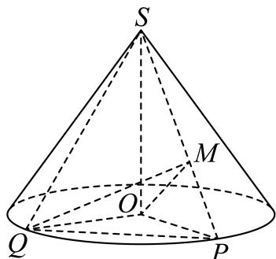

(1) 证明：$OQ\bot$ 平面 $SOP$；

(2) 若 $\overrightarrow{SM}=\dfrac{2}{3}\overrightarrow{SP}$，求点 $S$ 到平面 $MOQ$ 的距离．

#### 答案

(1) 证明见解析

(2) $\dfrac{4\sqrt{10}}{5}$

#### 解析（保留源稿）

(1) 圆锥的高 $SO\bot$ 平面 $OPQ$，$OQ,OP\subset$ 平面 $OPQ$，故 $SO\bot OQ$，$SO\bot OP$．

在 $\mathrm{Rt}\triangle SOQ$ 中，$SQ=4$，$SO=2\sqrt{2}$，则

$$
OQ=\sqrt{SQ^{2}-SO^{2}}=\sqrt{16-8}=2\sqrt{2}.
$$

同理 $OP=2\sqrt{2}$．由于 $\triangle SQP$ 是边长为 4 的等边三角形，故 $PQ=4$．

在 $\triangle POQ$ 中，

$$
OP^{2}+OQ^{2}=\left(2\sqrt{2}\right)^{2}+\left(2\sqrt{2}\right)^{2}=8+8=16=PQ^{2},
$$

故 $OQ\bot OP$．

又 $SO\bot OQ$，$OQ\bot OP$，$SO\cap OP=O$，且 $SO,OP\subset$ 平面 $SOP$，所以 $OQ\bot$ 平面 $SOP$．

(2) 由 (1) 知 $SO\bot OQ$，$SO\bot OP$，$OQ\bot OP$．

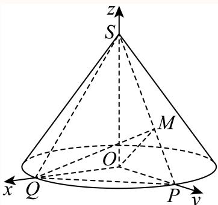

如图所示，以 $O$ 为原点，$\overrightarrow{OQ}$、$\overrightarrow{OP}$、$\overrightarrow{OS}$ 分别为 $x$、$y$、$z$ 轴正方向建立空间直角坐标系 $O-xyz$，则

$$
Q\left(2\sqrt{2},0,0\right),\qquad P\left(0,2\sqrt{2},0\right),\qquad S\left(0,0,2\sqrt{2}\right).
$$

由

$$
\overrightarrow{SM}=\frac{2}{3}\overrightarrow{SP}=\frac{2}{3}\left(0,2\sqrt{2},-2\sqrt{2}\right)=\left(0,\frac{4\sqrt{2}}{3},-\frac{4\sqrt{2}}{3}\right),
$$

得

$$
M=S+\overrightarrow{SM}=\left(0,\frac{4\sqrt{2}}{3},\frac{2\sqrt{2}}{3}\right),
$$

故 $\overrightarrow{OM}=\left(0,\dfrac{4\sqrt{2}}{3},\dfrac{2\sqrt{2}}{3}\right)$，$\overrightarrow{OQ}=\left(2\sqrt{2},0,0\right)$．

设平面 $MOQ$ 的一个法向量 $\vec{n}=(x,y,z)$，则

$$
\begin{cases}\vec{n}\cdot\overrightarrow{OM}=\dfrac{4\sqrt{2}}{3}y+\dfrac{2\sqrt{2}}{3}z=0,\\[6pt] \vec{n}\cdot\overrightarrow{OQ}=2\sqrt{2}x=0,\end{cases}
$$

由 $x=0$ 及 $2y+z=0$，可取 $\vec{n}=(0,1,-2)$．

又 $\overrightarrow{OS}=\left(0,0,2\sqrt{2}\right)$，设点 $S$ 到平面 $MOQ$ 的距离为 $d$，则

$$
d=\frac{\left\vert\vec{n}\cdot\overrightarrow{OS}\right\vert}{\vert\vec{n}\vert}=\frac{\vert 0\times 0+1\times 0+(-2)\times 2\sqrt{2}\vert}{\sqrt{0^{2}+1^{2}+(-2)^{2}}}=\frac{4\sqrt{2}}{\sqrt{5}}=\frac{4\sqrt{10}}{5}.
$$

故点 $S$ 到平面 $MOQ$ 的距离为 $\dfrac{4\sqrt{10}}{5}$．

---

---

### 012 · 原第18题

**来源：** S026 · 上海市长征中学 · 高三 · 2025-2026 · 期中 · 原第18题

**考点说明：** 线面平行的判定定理与性质定理；面面垂直的判定（先证线面垂直）

已知四棱锥S−ABCD的底面是正方形，SA⊥平面ABCD

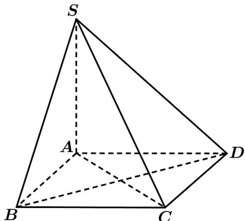

（Ⅰ）设平面 $S B C \cap$ 平面SAD = l，求证： $l / / B C ;$

（Ⅱ）求证：平面 $S A C \bot$ 平面SBD

#### 答案

（Ⅰ）证明见解析；（Ⅱ）证明见解析.

#### 解析（保留源稿）

（Ⅰ）由 $B C / / A D ^ { \prime }$ 得线面平行，再由线面平行的性质定理得线线平行；

（Ⅱ）证明BD⊥平面SAC后可得面面垂直

证明：（Ⅰ）因为 $B C / / A D _ { ; }$ 4 $B C \notin$ 平面SAD，AD ⊂平面SAD，所以 $B C / /$ 平面SAD， 而平面SBC⋂平面SAD = l，BC ⊂平面SBC，所以 $l / / B C .$

（Ⅱ）因为SA⊥平面ABCD，BD ⊂平面ABCD，所以 $S A \bot B D$

因为四棱锥 $S - A B C D$ 的底面是正方形，所以 $B D \bot A C$ ，而SA与AC相交，SA与AC都在平面C内，所以BD⊥平面SAC，

又BD ⊂平面SBD，所以平面 $S A C \bot$ 平面SBD

---

---

### 013 · 原第18题

**来源：** S047 · 上海市闵行中学 · 高三 · 2025-2026 · 期中 · 原第18题

**考点说明：** 建系后用向量法证明线面平行；向量法求直线与平面所成角

> **校订提示**
>
> 源稿解析末句“直线 PB 与平面 A 所成的角的正切值”漏字，应为“平面 ABCD”。

> 下列正文保留原转录；与本提示冲突的文字或公式不作为有效依据。

如图，在四棱锥 $P - A B C D$ 中，底面ABCD是边长为a的正方形，侧面 $P A D \perp$ 底面ABCD，且$P A = P D = { \frac { \sqrt { 2 } } { 2 } } a .$ ，设 $E , F ^ { , }$ 分别为 $P C , B D$ 的中点

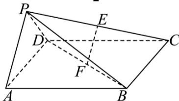

(1) 证明：直线 $E F / /$ 平面 $P A D$

(2) 求直线PB与平面ABCD所成的角的正切值

#### 答案

(1) 证明见解析

(2) $\frac { \sqrt { 5 } } { 5 }$

#### 解析（保留源稿）

(1) 取AD中点O，连接 $P O , F O$ ，

在四棱锥 $P - A B C D ^ { \circ }$ 中， $P A = P D = { \frac { \sqrt { 2 } } { 2 } } a$ ，则 $P O \bot A D$

由 $P A ^ { 2 } + P D ^ { 2 } = A D ^ { 2 }$ ，则 $P A \bot P D$ ，有 $P O = { \frac { 1 } { 2 } } A D = { \frac { a } { 2 } }$

又平面 $P A D \perp$ 底面ABCD，平面PAD∩底面 $A B C D = A D , \ P O \subset \ P \ P \ P A D$

$\therefore P O \bot$ 平面ABCD，OA,OF ⊂平面ABCD，则 $P O \bot O A , P O \bot O F$

又E,F分别为PC,BD的中点，底面ABCD是边长为a的正方形，

则 $O F / / A B , A B \bot O A$

所以 $O A , O P , O F$ 两两垂直，以O为原点，分别以OA,OF,OP所在直线为x轴，y轴，z轴，建立空间直角坐标系，

$$
P \left(0, 0, \frac {a}{2}\right), B \left(\frac {a}{2}, a, 0\right), C \left(- \frac {a}{2}, a, 0\right), E \left(- \frac {a}{4}, \frac {a}{2}, \frac {a}{4}\right), F \left(0, \frac {a}{2}, 0\right),
$$

则 $\overrightarrow { E F } = \left( \frac { a } { 4 } , 0 , - \frac { a } { 4 } \right)$

因为 $O A \bot O F , O P \bot O F , O A \cap O P = O , O A , O F \subset$ 平面 $P A D$ ，所以 $O F \bot$ 平面 $P A D$ 所以平面PAD的法向量为 $\overrightarrow { O F } = \left( 0 , \frac { a } { 2 } , 0 \right)$

因为 $\overrightarrow { 1 O F } \cdot \overrightarrow { E F } = 0$ ，且 $E F \not \subset$ 平面 $P A D$ 4

所以 $E F / /$ 平面 $P A D$ ；

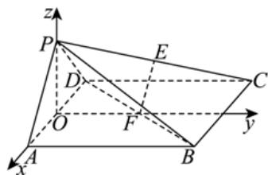

(2) 由（1）知：− ${ \overrightarrow { P B } } = \left( { \frac { a } { 2 } } , a , - { \frac { a } { 2 } } \right)$ ，因为 $P O \bot$ 平面 $A B C D$

所以 $\overrightarrow { O P } = \left( 0 , 0 , \frac { a } { 2 } \right)$ 是平面ABCD的法向量，

设直线PB与平面ABCD所成的角为θ，

$$
\text {则} \sin \theta = \left| \cos \left\langle \overrightarrow {P B}, \overrightarrow {O P} \right\rangle \right| = \left| \frac {\overrightarrow {P B} \cdot \overrightarrow {O P}}{\left| \overrightarrow {P B} \right| \left| \overrightarrow {O P} \right|} \right| = \frac {\frac {a}{2}}{\sqrt {\frac {3}{2} a ^ {2}}} = \frac {\sqrt {6}}{6},
$$

$\therefore \cos \theta = \sqrt { 1 - \left( \frac { \sqrt { 6 } } { 6 } \right) ^ { 2 } } = \frac { \sqrt { 3 0 } } { 6 }$ ，故 $\tan \theta = { \frac { \sqrt { 5 } } { 5 } }$

∴直线PB与平面A 所成的角的正切值为 $\frac { \sqrt { 5 } } { 5 }$

---

---

### 014 · 原第17题

**来源：** S003 · 华东师范大学第二附属中学 · 高三 · 2025-2026 · 期中 · 原第17题

**考点说明：** 线面垂直的判定与面面垂直的判定；空间直角坐标系、平面法向量与线面角

如图，在三棱锥 $P-ABC$ 中，$BC\perp PC$，$PA\perp$ 平面 $ABC$。

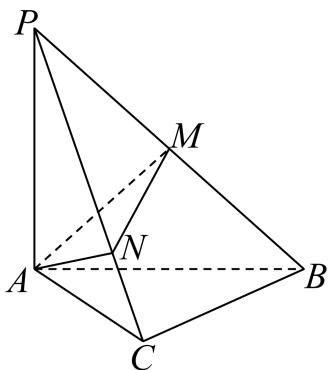

(1) 求证：平面 $PAC\perp$ 平面 $PBC$；

(2) 若 $AC=BC=PA=2$，$M$ 是 $PB$ 的中点，点 $N$ 在线段 $PC$ 上，且 $PN=2NC$，求直线 $BC$ 与平面 $AMN$ 所成角的余弦值。

#### 答案

(1) 证明见解析　(2) $\dfrac{\sqrt{30}}{6}$

#### 解析（保留源稿）

(1) 由 $PA\perp$ 平面 $ABC$，$BC\subset$ 平面 $ABC$，故 $PA\perp BC$。

又 $BC\perp PC$，$PA\cap PC=P$，$PA,PC\subset$ 平面 $PAC$，

则 $BC\perp$ 平面 $PAC$，又 $BC\subset$ 平面 $PBC$，故平面 $PAC\perp$ 平面 $PBC$。

(2) 由 $BC\perp$ 平面 $PAC$，$AC\subset$ 平面 $PAC$，故 $BC\perp AC$。

故可以 $C$ 为原点，建立如图所示空间直角坐标系 $C-xyz$，

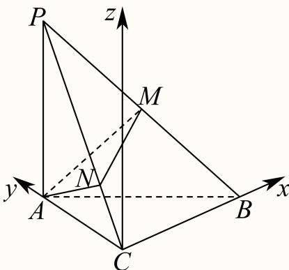

则 $C(0,0,0)$、$A(0,2,0)$、$B(2,0,0)$、$P(0,2,2)$，则 $M(1,1,1)$。

则 $\overrightarrow{CB}=(2,0,0)$，$\overrightarrow{AM}=(1,-1,1)$，$\overrightarrow{PC}=(0,-2,-2)$，$\overrightarrow{AP}=(0,0,2)$。

由 $PN=2NC$，则 $\overrightarrow{PN}=\dfrac{2}{3}\overrightarrow{PC}=\left(0,-\dfrac{4}{3},-\dfrac{4}{3}\right)$，

$$
\overrightarrow{AN}=\overrightarrow{AP}+\overrightarrow{PN}=\overrightarrow{AP}+\dfrac{2}{3}\overrightarrow{PC}=\left(0,-\dfrac{4}{3},\dfrac{2}{3}\right).
$$

设平面 $AMN$ 的法向量为 $\vec m=(x,y,z)$，

则有 $\begin{cases}\vec m\cdot\overrightarrow{AM}=x-y+z=0\\[4pt]\vec m\cdot\overrightarrow{AN}=-\dfrac{4}{3}y+\dfrac{2}{3}z=0\end{cases}$。

取 $y=1$，则 $z=2$，$x=-1$，即 $\vec m$ 可取 $(-1,1,2)$。

设直线 $BC$ 与平面 $AMN$ 所成角为 $\theta$，则

$$
\sin\theta=\dfrac{\vert\overrightarrow{CB}\cdot\vec m\vert}{\vert\overrightarrow{CB}\vert\vert\vec m\vert}=\dfrac{2}{2\times\sqrt{6}}=\dfrac{\sqrt{6}}{6},
$$

则 $\cos\theta=\sqrt{1-\sin^{2}\theta}=\sqrt{1-\dfrac{1}{6}}=\dfrac{\sqrt{30}}{6}$。

所以直线 $BC$ 与平面 $AMN$ 所成角的余弦值为 $\dfrac{\sqrt{30}}{6}$。

---

---

### 015 · 原第17题

**来源：** S039 · 华东师范大学附属东昌中学 · 高三 · 2025-2026 · 期中 · 原第17题

**考点说明：** 线面垂直的判定（正方形对角线垂直＋线面垂直性质）；空间直角坐标系、平面法向量与点到平面的距离

> **校订提示**
>
> 源稿在 `## 三、解答题` 之后**缺“17”题号**，直接给出四棱锥题干，随后才是 `18`；依题号严格递增与上下文，补为第 17 题。

> 下列正文保留原转录；与本提示冲突的文字或公式不作为有效依据。

在四棱锥 $P-ABCD$ 中，底面是边长为 2 的正方形，$PA\perp$ 底面 $ABCD$，$E$ 为 $BC$ 的中点，$PC$ 与底面所成的角为 $\arctan\dfrac{\sqrt{2}}{2}$。

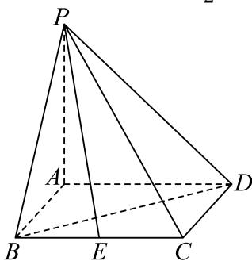

(1) 求证：$BD\perp PC$；

(2) 求点 $E$ 到平面 $BDP$ 的距离。

#### 答案

(1) 证明见解析　(2) $\dfrac{\sqrt{3}}{3}$

#### 解析（保留源稿）

(1) 因为底面是正方形，所以 $AC\perp BD$。

因为 $PA\perp$ 底面 $ABCD$，$BD\subset$ 底面 $ABCD$，所以 $PA\perp BD$。

因为 $AC\cap PA=A$，$AC,PA\subset$ 平面 $PAC$，所以 $BD\perp$ 平面 $PAC$。

因为 $PC\subset$ 平面 $PAC$，所以 $BD\perp PC$。

(2) 连接 $AC$，则 $\angle PCA$ 即为 $PC$ 与底面所成的角。

由题意 $\tan\angle PCA=\dfrac{PA}{AC}=\dfrac{\sqrt{2}}{2}$，因为 $AC=2\sqrt{2}$，所以 $PA=2$。

以 $A$ 为坐标原点，$\overrightarrow{AB}$、$\overrightarrow{AD}$、$\overrightarrow{AP}$ 分别为 $x,y,z$ 轴的正方向，建系如图，

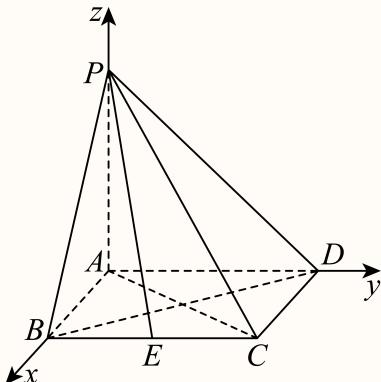

$$
B(2,0,0),\quad D(0,2,0),\quad P(0,0,2),\quad E(2,1,0);
$$

$$
\overrightarrow{BD}=(-2,2,0),\quad \overrightarrow{PB}=(2,0,-2),\quad \overrightarrow{BE}=(0,1,0).
$$

设 $\vec n=(x,y,z)$ 是平面 $PBD$ 的一个法向量，则

$$
\begin{cases}\vec n\cdot\overrightarrow{BD}=0\\[4pt]\vec n\cdot\overrightarrow{PB}=0\end{cases}\ \Longrightarrow\ \begin{cases}-2x+2y=0\\[4pt]2x-2z=0\end{cases}
$$

令 $x=1$，得 $y=z=1$，即 $\vec n=(1,1,1)$。

点 $E$ 到平面 $BDP$ 的距离为

$$
\dfrac{\left\vert\vec n\cdot\overrightarrow{BE}\right\vert}{\vert\vec n\vert}=\dfrac{1}{\sqrt{3}}=\dfrac{\sqrt{3}}{3}.
$$

---

---

### 016 · 原第17题

**来源：** S030 · 同济大学第一附属中学 · 高三 · 2025-2026 · 期中 · 原第17题

**考点说明：** 线面垂直的判定（直径所对圆周角＋母线垂直底面）；线面角的射影法

如图，$AB$ 是圆柱底面圆的一条直径，$AB=2$，$PA$ 是圆柱的母线，$PA=3$，点 $C$ 是圆柱底面圆周上的点，$\angle ABC=30^{\circ}$．

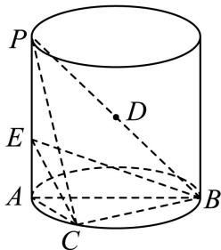

(1) 求证：$BC\perp$ 平面 $PAC$；

(2) 若点 $E$ 在 $PA$ 上且 $EA=\dfrac13PA$，求 $BE$ 与平面 $PAC$ 所成角的大小．

#### 答案

(1) 证明见解析　(2) $\arctan\dfrac{\sqrt6}{2}$（或 $\arcsin\dfrac{\sqrt{15}}{5}$、$\arccos\dfrac{\sqrt{10}}{5}$）

#### 解析（保留源稿）

(1) 因为 $PA$ 是圆柱的母线，所以 $PA\perp$ 底面 $ABC$；又 $BC\subset$ 平面 $ABC$，故 $PA\perp BC$。

因为 $AB$ 为底面圆的直径，$C$ 在圆周上，所以 $\angle ACB=90^{\circ}$，即 $AC\perp BC$。

又 $PA\cap AC=A$，$PA,AC\subset$ 平面 $PAC$，所以 $BC\perp$ 平面 $PAC$。

(2) 由 (1) 知 $BC\perp$ 平面 $PAC$，故 $EC$ 是 $BE$ 在平面 $PAC$ 内的射影，$\angle BEC$ 即为 $BE$ 与平面 $PAC$ 所成的角。

由 $PA=3$、$EA=\dfrac13PA$ 得 $AE=1$；由 $AB=2$、$\angle ABC=30^{\circ}$ 得

$$
AC=AB\sin30^{\circ}=1,\qquad BC=AB\cos30^{\circ}=\sqrt3.
$$

在 $\mathrm{Rt}\triangle EAC$ 中 $EC=\sqrt{AE^{2}+AC^{2}}=\sqrt2$；在 $\mathrm{Rt}\triangle ECB$ 中 $EB=\sqrt{EC^{2}+CB^{2}}=\sqrt5$。

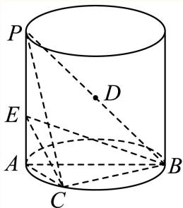

所以

$$
\tan\angle BEC=\dfrac{BC}{EC}=\dfrac{\sqrt3}{\sqrt2}=\dfrac{\sqrt6}{2},
$$

即 $BE$ 与平面 $PAC$ 所成角为 $\arctan\dfrac{\sqrt6}{2}$。

（等价地，$\sin\angle BEC=\dfrac{BC}{EB}=\dfrac{\sqrt{15}}{5}$，$\cos\angle BEC=\dfrac{EC}{EB}=\dfrac{\sqrt{10}}{5}$。）

---

---

### 017 · 原第17题

**来源：** S005 · 复旦大学附属中学 · 高三 · 年份待核 · 考试名称待核 · 原第17题

**考点说明：** 直角梯形底面四棱锥中证明垂直关系，并以空间向量求线面角。

如图，在四棱锥 $P-ABCD$ 中，平面 $PAB\perp$ 平面 $ABCD$，$AD\parallel BC$，$\angle ABC=\frac\pi2$，$PA=PB=3$，$BC=1$，$AB=2$，$AD=3$，点 $O$ 是 $AB$ 的中点。

(1) 求证：$PO\perp CD$；

(2) 求直线 $CP$ 与平面 $POD$ 所成角的正弦值。

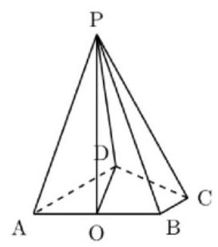

#### 答案

(1) 见解析；(2) $\frac25$

【破题眼】$PA=PB$ 且 $O$ 是 $AB$ 中点，先拿到 $PO\perp AB$；再由面面垂直推出 $PO\perp$ 底面。

#### 解析（保留源稿）

(1) 因为 $PA=PB$，$O$ 是 $AB$ 的中点，所以 $PO\perp AB$。又平面 $PAB\perp$ 平面 $ABCD$，交线为 $AB$，且 $PO\subset$ 平面 $PAB$、$PO\perp AB$，所以 $PO\perp$ 平面 $ABCD$。而 $CD\subset$ 平面 $ABCD$，故 $PO\perp CD$。

(2) 建立坐标系。取 $B=(0,0,0)$，$A=(2,0,0)$，$C=(0,1,0)$。由于 $AD\parallel BC$ 且 $AD=3$，取 $D=(2,3,0)$，$O=(1,0,0)$。由 $PA=PB=3$，$AB=2$，得 $PO=\sqrt{3^2-1^2}=2\sqrt2$，所以 $P=(1,0,2\sqrt2)$。

直线 $CP$ 的方向向量为 $\overrightarrow{CP}=(1,-1,2\sqrt2)$。下面找平面 $POD$ 的一个法向量 $\vec n=(a,b,c)$。因为 $\vec n\perp\overrightarrow{OP}=(0,0,2\sqrt2)$，所以 $c=0$；又 $\vec n\perp\overrightarrow{OD}=(1,3,0)$，所以 $a+3b=0$。取 $b=1$，得 $\vec n=(-3,1,0)$。

直线与平面所成角的正弦等于方向向量与法向量夹角余弦的绝对值：

$\sin\theta=\frac{|\overrightarrow{CP}\cdot\vec n|}{|\overrightarrow{CP}||\vec n|}=\frac{|1\cdot(-3)+(-1)\cdot1|}{\sqrt{1+1+8}\cdot\sqrt{10}}=\frac4{10}=\frac25$。

【方法总结】立体几何第二问可以直接坐标化。法向量不用记复杂公式，只要让它同时垂直于平面内两条相交直线即可。

【易错点】线面角的正弦要用“直线方向向量与平面法向量夹角余弦”，不是直接求两个向量夹角的正弦。

---

### 018 · 原第17题

**来源：** S031 · 上海外国语大学附属外国语学校松江云间中学 · 高二 · 2025-2026 · 期中 · 原第17题

**考点说明：** 正方体中借助平面交线证明点共线，并证明两条直线异面。

> **校订提示**
>
> 题干“$BP$ 与 $HG$ 相交于点 $Q$”中的 $BP$ 应为 $EF$：由解析 $Q\in EF\subset$ 平面 $ABCD$、$Q\in HG\subset$ 平面 $CDD_1C_1$ 可确认相交的是 $EF$ 与 $HG$。

> 下列正文保留原转录；与本提示冲突的文字或公式不作为有效依据。

如图，已知 $E, F, G, H$ 分别是正方体 $ABCD - A_{1}B_{1}C_{1}D_{1}$ 的棱 $AB, BC, CC_{1}, C_{1}D_{1}$ 的中点，且 $BP$ 与 $HG$ 相交于点 $Q$ .

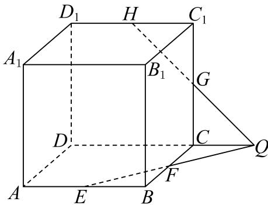

(1) 求证: 点 $Q$ 在直线 $DC$ 上;

(2) 求证: $EF$ 与 $A_{1}B_{1}$ 是异面直线.

#### 答案

(1) 证明见解析

(2) 证明见解析

#### 解析（保留源稿）

(1) 平面 $ABCD \cap$ 平面 $CDD_{1}C_{1} = DC,$

由于 $Q \in EF \subset$ 平面ABCD, $Q \in HG \subset$ 平面 $CDD_{1}C_{1}$ ,

所以 $Q \in DC$ ，也即点 $Q$ 在直线 $DC$ 上.

(2) 假设EF与 $A_{1}B_{1}$ 不是异面直线.

则 $EF$ 与 $A_{1}B_{1}$ 是共面直线，又 $E$ 在直线 $A_{1}B_{1}$ 外，

则过E与直线 $A_{1}B_{1}$ 有唯一平面 $BAA_{1}B_{1}$ ，所以可得 $F\in$ 平面 $BAA_{1}B_{1}$ ,

这与 $F$ 在平面 $BAA_{1}B_{1}$ 外矛盾，故 $EF$ 与 $A_{1}B_{1}$ 是异面直线.

---

---

### 019 · 原第19题

**来源：** S031 · 上海外国语大学附属外国语学校松江云间中学 · 高二 · 2025-2026 · 期中 · 原第19题

**考点说明：** 半球几何体中利用面面垂直与等体积转化求点到平面的距离。

如图，AB是半球的直径，O为球心，AB=4，M，N依次是半圆上的两个三等分点，P是半球面上一点，且 $PN\perp MB$ .

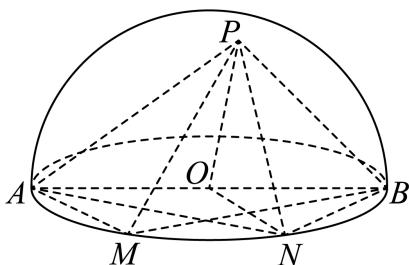

(1) 证明: 平面 $PBM \perp$ 平面 $PON$ ;

(2) 若点 $P$ 在底面圆内的射影恰在 $BM$ 上，求点 $M$ 到平面 $PAB$ 的距离.

#### 答案

(1) 证明见解析;

(2) $\frac{2\sqrt{15}}{5}$

#### 解析（保留源稿）

(1) 证明：连接 $OM, MN$ ，如图， $M, N$ 是半圆 $\widehat{AB}$ 上的两个三等分点，

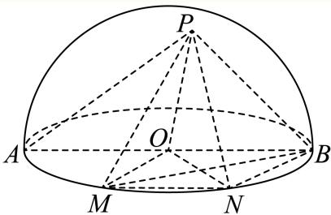

则有 $\angle MON=\angle NOB=60^{\circ}$ ,

$$
\because O M = O B = O N = 2,
$$

$\therefore \triangle MON, \triangle NOB$ 都是正三角形.

$$
\therefore M N = N B = O B = O M,
$$

四边形OMNB是菱形， $ON \perp MB,$

∵PN⊥MB, PN∩ON=N, PN、ON平面PON,

$\therefore MB \perp$ 平面 $PON, BM \subset$ 平面 $PBM$ .

∴平面PBM⊥平面PON.

(2) 由(1)知， $MB \perp$ 平面PON，

所以平面 $PON \perp$ 平面OMNB，平面 $PON \cap$ 平面OMNB=ON，

则点P在底面圆内的射影在ON上，

又∵点P在底面圆内的射影在BM上，

∴点P在底面圆内的射影是ON与MB的交点Q，

∴ $PQ = \sqrt{PO^{2} - OQ^{2}} = \sqrt{4 - 1} = \sqrt{3}$ ,

故 $PB = \sqrt{PQ^{2} + BQ^{2}} = \sqrt{3 + 3} = \sqrt{6}$ 在 $\triangle AOQ$ 中，由余弦定理，可得 $AQ^{2}=AO^{2}+OQ^{2}-2AO\times OQ\times\cos120^{\circ}=2^{2}+1^{2}+2=7,$ 故 $AQ=\sqrt{7}$ ，故 $PA=\sqrt{10}$ 在 $\triangle PAB$ 中， $\cos\angle PAB=\frac{PA^{2}+AB^{2}-PB^{2}}{2\times PA\times AB}=\frac{10+16-6}{2\times\sqrt{10}\times4}=\frac{\sqrt{10}}{4},$ 故 $\sin\angle PAB=\frac{\sqrt{6}}{4},$ 故 $S_{\triangle PAB}=\frac{1}{2}\times PA\times AB\times\sin\angle PAB=\frac{1}{2}\times\sqrt{10}\times4\times\frac{\sqrt{6}}{4}=\sqrt{15}.$ 由 $V_{P-ABM}=V_{M-PAB}$ ，可得 $\frac{1}{3}\cdot S_{\triangle PAB}\cdot d_{M-PAB}=\frac{1}{3}\cdot S_{\triangle AMB}\cdot PQ,$ 即 $\frac{1}{3}\times\sqrt{15}\times d_{M-PAB}=\frac{1}{3}\times2\sqrt{3}\times\sqrt{3}$ ，所以 $\sqrt{15}d_{M-PAB}=6,$ 点M到平面PAB的距离为 $d_{M-PAB}=\frac{2\sqrt{15}}{5}.$

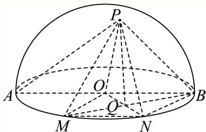

【点睛】

---

---

### 020 · 原第20题

**来源：** S031 · 上海外国语大学附属外国语学校松江云间中学 · 高二 · 2025-2026 · 期中 · 原第20题

**考点说明：** 正方体截面的周长与面积；截面形状与参数范围；截面分割与体积比

在棱长为1的正方体 $ABCD-A_{1}B_{1}C_{1}D_{1}$ 中，E是BC的中点，F,G分别是CD, $DD_{1}$ 上的动点.考查过E,F,G三点的平面截正方体所得的截面：

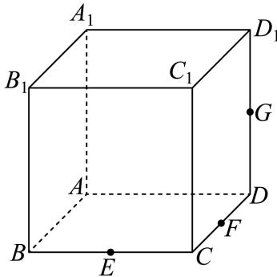

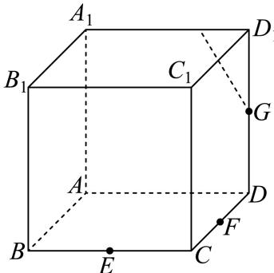

(1) 当 $F$ 是 $CD$ 的中点且 $G$ 是 $DD_{1}$ 的中点时, 直接写出截面的周长和面积;

(2) 当 $\frac{DF}{DC} = \frac{1}{3}$ 时，若截面为六边形，求 $\frac{DG}{DD_1}$ 的取值范围；

(3) 当 $G$ 是 $DD_{1}$ 的中点且截面为五边形时, 是否存在点 $F$ , 使得截面将正方体分为体积比1:2的两个部分, 若存在, 求出 $\frac{DF}{DC}$ 的值; 若不存在, 说明理由.

#### 答案

(1) 周长为 $3\sqrt{2}$ ，面积为 $\frac{3\sqrt{3}}{4}$ ;

(2) $\frac{DG}{DD_1} \in \left(\frac{1}{5}, \frac{1}{2}\right)$

(3) 存在, $\frac{DF}{DC} = 3\sqrt{2} - 4$ 或 $\frac{DF}{DC} = 5 - 3\sqrt{2}$

#### 解析（保留源稿）

(1) 作图：取 $A_{1}B_{1}, A_{1}D_{1}, BB_{1}$ 中点，连接这六个点即可得到截面，

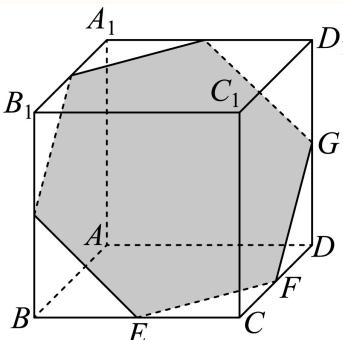

由图可知截面是边长为 $\frac{\sqrt{2}}{2}$ 的正六边形，

∴周长为 $3\sqrt{2}$ ，面积为 $\frac{3\sqrt{3}}{4}$ ;

(2) 分别找出截面为六边形的两种临界情况，分别如下图所示: 情况①

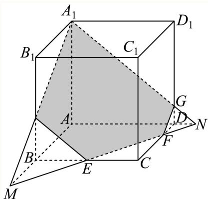

∵E为BC中点，∴BM=CF= $\frac{2}{3}$ AB，即AM= $\frac{5}{3}$ AB,

$$
\because \frac {G N}{A _ {1} N} = \frac {N F}{M N} = \frac {D F}{A M} = \frac {\frac {1}{3} C D}{\frac {5}{3} A B} = \frac {1}{5},
$$

$$
\therefore \frac {D G}{D D _ {1}} = \frac {G N}{A _ {1} N} = \frac {1}{5},
$$

情况②

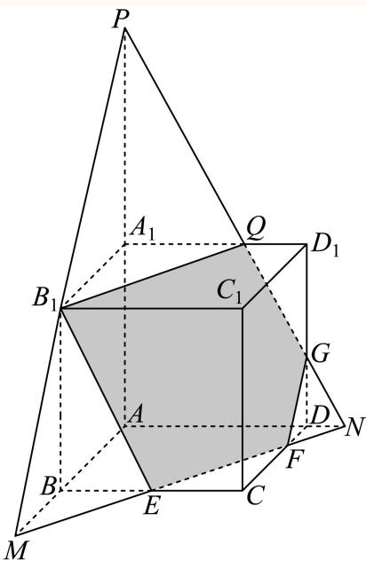

∵E为BC中点，∴BM=CF= $\frac{2}{3}$ AB，即AM= $\frac{5}{3}$ AB,

$$
\because \frac {G N}{P N} = \frac {N F}{M N} = \frac {D F}{A M} = \frac {\frac {1}{3} C D}{\frac {5}{3} A B} = \frac {1}{5},
$$

$\because \frac{BB_{1}}{PA} = \frac{MB}{AM} = \frac {2}{5}$ 即 $PA = \frac{5}{2} BB_{1} = \frac{5}{2} DD_{1}$

$$
\therefore \frac {D G}{D D _ {1}} = \frac {D G}{\frac {2}{5} A P} = \frac {5}{2} \frac {D G}{A P} = \frac {5}{2} \times \frac {1}{5} = \frac {1}{2},
$$

故 $\frac{DG}{DD_1} \in \left( \frac{1}{5}, \frac{1}{2} \right)$

(3) (1) 如图, 截面与 $A_{1}D_{1}, B_{1}C_{1}$ 相较于点 $M, N$ , 延长 $MG, AD$ 相较于点 $Q$ , 连接 $EQ$ 交 $CD$ 与点 $F$ ,

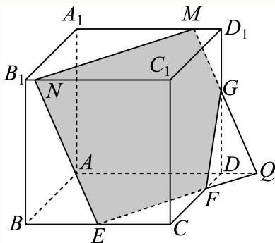

设 $DF = \lambda (\lambda \in (0,1))$ ， $\because \frac{DQ}{CE} = \frac{DF}{CF} = \frac{\lambda}{1 - \lambda},\therefore DQ = \frac{\lambda}{2 - 2\lambda},$

∵G为 $DD_{1}$ 中点，∴ $MD_{1}=DQ=\frac{\lambda}{2-2\lambda}$ ,

延长NE, GF, $CC_{1}$ 相交于点P，延长NM, FG, $C_{1}D_{1}$ 相交于点O,

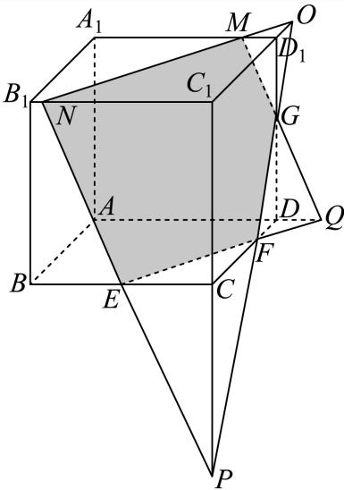

∵G为 $DD_{1}$ 中点，∴ $OD_{1}=DF=\lambda,$

又 $\because\frac{OD_{1}}{OC_{1}}=\frac{MD_{1}}{NC_{1}}=\frac{\lambda}{1+\lambda}=\frac{\frac{\lambda}{2-2\lambda}}{NC_{1}},\therefore NC_{1}=\frac{1+\lambda}{2-2\lambda},$

$$
\because \frac {P C}{P C _ {1}} = \frac {E C}{N C _ {1}} = \frac {P C}{P C + 1} = \frac {\overline {{2}}}{1 + \lambda}, \therefore P C = \frac {1 - \lambda}{2 \lambda},
$$

正方体被截得的其中一个多面体体积为V,

则 $V = V_{N - C_1OP} - V_{E - CFP} - V_{M - ODG},$

$$
\frac {1}{3} = \frac {1}{3} \times \frac {1 + \lambda}{2 - 2 \lambda} \times \frac {1}{2} \times (1 + \lambda) \times \frac {1 + \lambda}{2 \lambda} - \frac {1}{3} \times \frac {1}{2} \times \frac {1}{2} \times (1 - \lambda) \times \frac {1 - \lambda}{2 \lambda} - \frac {1}{3} \times \frac {\lambda}{2 - 2 \lambda}
$$

$$
1 = \frac {(1 + \lambda) ^ {3}}{8 \lambda - 8 \lambda^ {2}} - \frac {(1 - \lambda) ^ {2}}{8 \lambda} - \frac {\lambda^ {2}}{8 - 8 \lambda}
$$

整理得 $\lambda^2 + 8\lambda - 2 = 0$ ，解得 $\lambda = \pm 3\sqrt{2} - 4$

$\because \lambda \in (0,1), \therefore \lambda = 3\sqrt{2} - 4,$

即 $\frac{DF}{DC} = \lambda = 3\sqrt{2} - 4,$

(2) 如图:

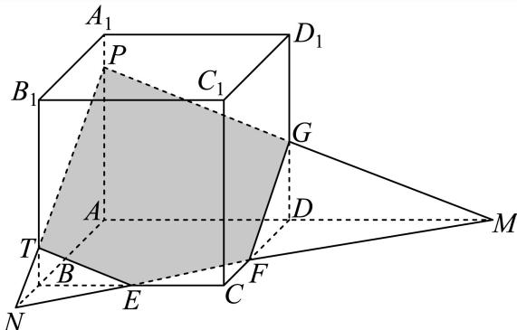

∵点E为BC中点，∴NB=CF,

∵点G为 $DD_{1}$ 中点，∴ $DG=\frac{1}{2}$ ,

设 $DF = \mu$ （ $\mu \in (0,1)$ ），则 $NB = CF = 1 - \mu, AN = 2 - \mu$

又∵ $\frac{DF}{AN}=\frac{DM}{AM}$ ，即 $\frac{\mu}{2-\mu}=\frac{DM}{DM+1}$ ，∴ $DM=\frac{\mu}{2-2\mu}$ ， $AM=DM+1=\frac{2-\mu}{2-2\mu}$

$\because \frac{GD}{AP} = \frac{DM}{AM}$ 即 $\frac{GD}{AP} = \frac{\mu}{2 - \mu},\therefore AP = \frac{2 - \mu}{2\mu},$

$\because \frac{BT}{AP} = \frac{NB}{AN}$ 即 $\frac{BT}{\frac{2 - \mu}{2\mu}} = \frac{1 - \mu}{2 - \mu},\therefore BT = \frac{1 - \mu}{2\mu}$

其中一个多面体体积为 $V$

则 $V = V_{P - AMN} - V_{T - BNE} - V_{G - DFM}$

$$
\frac {1}{3} = \frac {1}{3} \times \frac {2 - \mu}{2 \mu} \times \frac {1}{2} \times \frac {2 - \mu}{2 - 2 \mu} \times (2 - \mu) - \frac {1}{3} \times \frac {1 - \mu}{2 \mu} \times \frac {1}{2} \times \frac {1}{2} \times (1 - \mu) - \frac {1}{3} \times \frac {1}{2} \times \frac {1}{2}
$$

$$
\times \mu \times \frac {\mu}{2 - 2 \mu}
$$

$$
8 u - 8 u ^ {2} = (2 - \mu) ^ {3} - (1 - \mu) ^ {3} - \mu^ {3}
$$

化简得 $\mu^3 - 11\mu^2 + 17\mu - 7 = 0$ ，即 $(\mu - 1)(\mu^2 - 10\mu + 7) = 0$

$\therefore \mu = 1$ 或 $\mu = 5 \pm 3\sqrt{2}$ , $\because \mu \in (0,1)$ ,

$$
\therefore \mu = 5 - 3 \sqrt {2},
$$

即 $\frac{DF}{DC} = \mu = 5 - 3\sqrt{2}$

综上所述，这样的点存在， $\frac{DF}{DC} = 3\sqrt{2} -4$ 或 $\frac{DF}{DC} = 5 - 3\sqrt{2}$

---

---

### 021 · 原第18题

**来源：** S009 · 上海大学附属中学 · 高二 · 2025-2026 · 期中 · 原第18题

**考点说明：** 空间线面垂直关系证明后，求直线与平面的夹角。

18 解答题 3次作答 正确率 88%

如图，已知AB⊥平面BCD， $B C \bot C D$

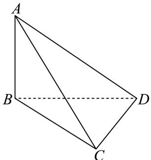

(1) 求证：平面 $A C D \perp$ 平面ABC;

(2) 若 $A B = 1 , C D = B C = 2$ ，求直线AD与平面ABC所成的角的大小.

#### 答案

(1) 证明见解析

(2) $\arcsin { \frac { 2 } { 3 } }$

#### 解析（保留源稿）

(1) 证明：AB⊥平面BCD, $C D \subset$ 平面BCD，则 $A B \bot C D$ 又BC⊥CD, AB, BC ⊂平面ABC, $A B \cap B C = B$ ，则 $C D \perp$ 平面ABC,因为 $\lceil C D \subset$ 平面 $A C D _ { \mathrm { { i } } }$ ，所以平面 $A C D \perp$ 平面ABC;

(2) 因为CD⊥平面ABC，所以∠CAD为直线 $A D \mathrm { . }$ 与平面ABC所成的角，

因为 $B C = C D = 2$ $\angle B C D = 9 0 ^ { \circ }$ ，所以 $B D = 2 \sqrt { 2 }$ 2

$A B \bot$ 平面BCD, $B D \subset$ 平面BCD，则 $A B \bot B D , A B = 1$ ，则 $A D = { \sqrt { A B ^ { 2 } + B D ^ { 2 } } } = 3$

Rt △ACD中, $\sin \angle C A D = { \frac { C D } { A D } } = { \frac { 2 } { 3 } } ,$

即直线 $A D ^ { \perp }$ 与平面ABC所成的角为 $\arcsin { \frac { 2 } { 3 } }$

---

### 022 · 原第19题

**来源：** S009 · 上海大学附属中学 · 高二 · 2025-2026 · 期中 · 原第19题

**考点说明：** 圆柱中求异面直线所成角，并研究两平面夹角的范围。

19 解答题

如图过圆柱 $O O _ { 1 }$ 轴的截面 $A B B _ { 1 } A _ { 1 }$ 是边长为2的正方形，C是圆柱底而圆周上与A、B不重合的一动点，Q是母线 $C C _ { 1 }$ 的中点.

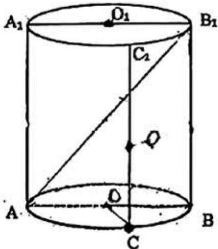

(1) 若 $\angle C O B = \frac { \pi } { 3 }$ ，求异面直线 $; O Q$ 与 $A B _ { 1 }$ 所成的角；

(2) 求过 $A , Q , B _ { 1 }$ 三点的平面与平面ABC所成的锐二面角的范围.

#### 答案

(1) $\operatorname { a r c c o s } { \frac { 3 } { 4 } }$

(2) $\left[ { \frac { \pi } { 4 } } , { \frac { \pi } { 2 } } \right)$

#### 解析（保留源稿）

(1) 以点O为原点，直线OB, $O O _ { 1 }$ 分别为y，z轴，

过O于AB垂直的直线为x轴，建立空间直角坐标系，如图所示.

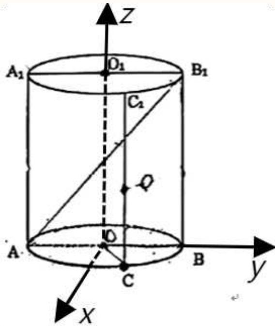

则 $O ( 0 , 0 , 0 )$ , B(0,1, 0), $A ( 0 , - 1 , 0 )$ ， $O _ { 1 } ( 0 , 0 , 2 )$ 2 $B _ { 1 } ( 0 , 1 , 2 )$ ，

设 $\angle C O B = \theta .$ 则 $C ( \sin \theta , \cos \theta , 0 )$ $C _ { 1 } ( \sin \theta , \cos \theta , 2 )$ $Q ( \sin \theta , \cos \theta , 1 )$

当 $\angle C O B = \frac { \pi } { 3 }$ 时， $\overrightarrow { O Q } = \left( \frac { \sqrt { 3 } } { 2 } , \frac { 1 } { 2 } , 1 \right)$ 2 $\overrightarrow { A B _ { 1 } } = ( 0 , 2 , 2 )$

设异面直线 $O Q \Xi A B _ { 1 }$ 所成的角为α，从而 $\cos \alpha = { \frac { \left| { \overrightarrow { O Q } } \cdot { \overrightarrow { A B _ { 1 } } } \right| } { \left| { \overrightarrow { O Q } } \right| \cdot \left| { \overrightarrow { A B _ { 1 } } } \right| } } = { \frac { 0 + 1 + 2 } { { \sqrt { 2 } } \cdot 2 { \sqrt { 2 } } } } = { \frac { 3 } { 4 } }$

因此，异面直线 $_ { D Q }$ $A B _ { 1 }$ 所成的角为 $\operatorname { a r c c o s } { \frac { 3 } { 4 } }$ 。

(2)由（1）知 $\overrightarrow { A Q } = ( \sin \theta , 1 + \cos \theta , 1 )$ $\overrightarrow { A B _ { 1 } } = ( 0 , 2 , 2 )$

易得平面ABC的一个法向量为 $\vec { \cal J } \vec { m } = ( 0 , 0 , 1 )$

设平面 $A Q B _ { 1 }$ 的一个法向量为 $\vec { \mid n } = ( x , y , z )$

则 $\left\{ \begin{array} { l l } { \overrightarrow { A Q } \cdot \overrightarrow { n } = x \sin \theta + y \left( \cos \theta + 1 \right) + z = 0 } \\ { \overrightarrow { A B _ { 1 } } \cdot \overrightarrow { n } = 2 y + 2 z = 0 } \end{array} , \right.$ $\widehat { \asymp } z = \sin \theta$ $\overbrace { 1 \exists n } = ( \cos \theta , - \sin \theta , \sin \theta )$

设平面 $A Q B _ { 1 }$ 与平面ABC所成的锐二面角的大小为β,

则cosβ= cos m, n 二 n √1 + sin 2 二 1sinsin2 二 1- 1 + sin20

由C是圆柱底而圆周上与A、B不重合的一动点知， $\sin \theta \neq 0$ ，则 $\sin ^ { 2 } \theta \in ( 0 , 1 ]$

则 $1 + \sin ^ { 2 } \theta \in ( 1 , 2 ]$ ，所以 ${ \frac { 1 } { 1 + \sin ^ { 2 } \theta } } \in \left[ { \frac { 1 } { 2 } } , 1 \right)$ ，所以 $\lfloor - { \frac { 1 } { 1 + \sin ^ { 2 } \theta } } \in \left( 0 , { \frac { 1 } { 2 } } \right]$ 2

所以 $\cos \beta { \in } \ \left( 0 , \frac { \sqrt { 2 } } { 2 } \right]$ ，又 $\beta \in \left( 0 , \frac { \pi } { 2 } \right)$ ，所以 $\beta \in \left[ { \frac { \pi } { 4 } } , { \frac { \pi } { 2 } } \right)$

即锐二面角的范围为 $\left[ { \frac { \pi } { 4 } } , { \frac { \pi } { 2 } } \right)$

---

### 023 · 原第17题

**来源：** S046 · 上海市七宝中学浦江分校 · 高二 · 2025-2026 · 期中 · 原第17题

**考点说明：** 空间定比分点的坐标与向量模，利用数量积计算三角形面积。

> **校订提示**
>
> 原 PDF 第15页第（1）问求的是 $\lvert\overrightarrow{DP}\rvert$，转录漏模号；成品题干已恢复。结果 $\overrightarrow{DP}=(1,-2,-1/3)$，模为 $\sqrt{46}/3$。

> 下列正文保留原转录；与本提示冲突的文字或公式不作为有效依据。

在空间直角坐标系中，已知 $A ( 0 , 1 , 4 ) , B ( 3 , - 2 , - 1 ) , D ( 1 , 1 , 1 )$

(1) 若点P满足 $\stackrel { \longrightarrow } { A P } = \stackrel { \longrightarrow } { 2 P B } ,$ 求 $\lvert\overrightarrow{DP}\rvert$

(2) 求 $\triangle A B D$ 的面积.

#### 答案

(1) $\left| \overrightarrow { D P } \right| = \frac { \sqrt { 4 6 } } { 3 }$

(2) $\frac { \sqrt { 1 0 6 } } { 2 }$

#### 解析（保留源稿）

(1) 设点 $P \left( x , y , z \right)$ ，因为 $A ( 0 , 1 , 4 ) , B ( 3 , - 2 , - 1 ) , D ( 1 , 1 , 1 ) , \overrightarrow { A P } = 2 \overrightarrow { P B } ,$

所以 $( x , y - 1 , z - 4 ) = 2 \left( 3 - x , - 2 - y , - 1 - z \right)$

则 $\left\{ \begin{array} { l l } { x = 2 \left( 3 - x \right) } \\ { y - 1 = 2 \left( - 2 - y \right) } \\ { z - 4 = 2 \left( - 1 - z \right) } \end{array} \right.$ ，解得 $\left\{ { \begin{array} { l } { x = 2 } \\ { y = - 1 } \\ { z = { \cfrac { 2 } { 3 } } } \end{array} } \right.$ ，所以点 $P \left( 2 , - 1 , { \frac { 2 } { 3 } } \right)$

所以 $\overrightarrow { D P } = \left( 1 , - 2 , - \frac { 1 } { 3 } \right)$ ，故 $\left| { \overrightarrow { D P } } \right| = { \sqrt { 1 ^ { 2 } + ( - 2 ) ^ { 2 } + \left( - { \frac { 1 } { 3 } } \right) ^ { 2 } } } = { \frac { \sqrt { 4 6 } } { 3 } } .$

(2) 由已知得 $\overrightarrow { A B } = ( 3 , - 3 , - 5 ) , \overrightarrow { A D } = ( 1 , 0 , - 3 )$ ，则

$$
A B \cdot { \overrightarrow { A D } } = 3 \times 1 + ( - 3 ) \times 0 + ( - 5 ) \times ( - 3 ) = 1 8 ,
$$

$$
{ \overrightarrow { A B } } { \Bigg | } = { \sqrt { 3 ^ { 2 } + \left( - 3 \right) ^ { 2 } + \left( - 5 \right) ^ { 2 } } } = { \sqrt { 4 3 } } , \ \left| { \overrightarrow { A D } } \right| = { \sqrt { 1 ^ { 2 } + 0 + \left( - 3 \right) ^ { 2 } } } = { \sqrt { 1 0 } } ,
$$

所以 $\cos \angle B A D = { \frac { { \overrightarrow { A B } } \cdot { \overrightarrow { A D } } } { \left| { \overrightarrow { A B } } \right| \left| { \overrightarrow { A D } } \right| } } = { \frac { 1 8 } { { \sqrt { 4 3 } } \times { \sqrt { 1 0 } } } } = { \frac { 1 8 } { { \sqrt { 4 3 0 } } } }$ ，则 $\angle B A D$ 为锐角，

所以 $\sin \angle B A D$ 二 ${ \sqrt { 1 - \left( { \frac { 1 8 } { \sqrt { 4 3 0 } } } \right) ^ { 2 } } } = { \sqrt { \frac { 5 3 } { 2 1 5 } } } ,$

因此 $S _ { \triangle A B D } = \frac { 1 } { 2 } \left| \overrightarrow { A B } \right| \left| \overrightarrow { A D } \right| \sin \angle B A D = \frac { 1 } { 2 } \times \sqrt { 4 3 } \times \sqrt { 1 0 } \times \sqrt { \frac { 5 3 } { 2 1 5 } } = \frac { \sqrt { 1 0 6 } } { 2 } ,$ 故 $\triangle A B D$ 的面积为 $\frac { \sqrt { 1 0 6 } } { 2 }$

---

---

### 024 · 原第18题

**来源：** S046 · 上海市七宝中学浦江分校 · 高二 · 2025-2026 · 期中 · 原第18题

**考点说明：** 正四棱锥中用中位线证明线面平行，并求直线与底面所成角。

> **校订提示**
>
> 第（2）问答案乱码恢复为 $\arcsin(\sqrt3/3)$，由投影直角三角形确定。

> 下列正文保留原转录；与本提示冲突的文字或公式不作为有效依据。

如图，在四棱锥 $P - A B C D ^ { \mathrm { \scriptscriptstyle 1 } }$ 中，底面ABCD为正方形，PA⊥平面ABCD，M为PC中点.

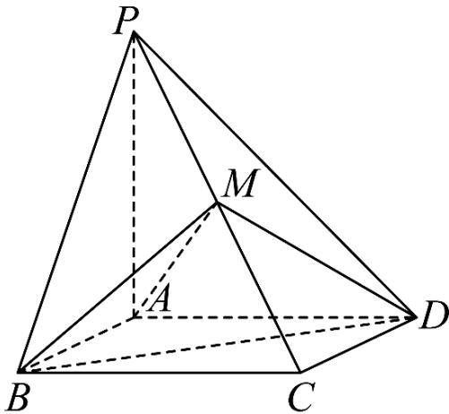

(1) 求证: $P A / / \mp$ 面 $M B D$

(2) 若 $A B = P A = 1$ ，求直线AM与平面ABCD所成角的大小.

#### 答案

(1) 证明见解析

(2) √3 arcsin 3

#### 解析（保留源稿）

(1) 如图，连接 $A C ,$ 交BD于点O，连接MO.

因为四边形 $A B C D$ 为正方形，则点O为AC的中点，

由已知点M为PC的中点，所以 $P A / / M O$

又因为PA ¢平面 $M B D$ ，MO ⊂平面 $M B D$ ，所以 $P A / /$ 平面 $M B D$

(2) 由已知 $\lvert P A \perp$ 平面ABCD，四边形ABCD为正方形，且 $A B = P A = 1$ 2

又由（1）可知 $| P A / / M O \rangle$ ，所以 $M O \bot$ 平面ABCD，点O为垂足，

所以 $\triangle M O A$ 为直角三角形， $\angle O A M$ 即为直线AM与平面ABCD所成角的平面角.

因为 $M O = { \frac { 1 } { 2 } } P A = { \frac { 1 } { 2 } } , A C = { \sqrt { A B ^ { 2 } + B C ^ { 2 } } } = { \sqrt { 1 ^ { 2 } + 1 ^ { 2 } } } = { \sqrt { 2 } } ,$

AO 12 AC 12 ×√2 √2   
2

所以 $A M = { \sqrt { A O ^ { 2 } + M O ^ { 2 } } } = { \sqrt { \left( { \frac { { \sqrt { 2 } } } { 2 } } \right) ^ { 2 } + \left( { \frac { 1 } { 2 } } \right) ^ { 2 } } } = { \frac { \sqrt { 3 } } { 2 } } ,$

所以 $\sin \angle O A M = { \frac { M O } { A M } } = { \frac { \frac { 1 } { 2 } } { \frac { \sqrt { 3 } } { 2 } } } = { \frac { \sqrt { 3 } } { 3 } }$ ，则 $\angle O A M = \arcsin { \frac { \sqrt { 3 } } { 3 } }$

综上，直线 $A M$ 与平面ABCD所成角的大小为 $\arcsin { \frac { \sqrt { 3 } } { 3 } }$

---

---

### 025 · 原第19题

**来源：** S046 · 上海市七宝中学浦江分校 · 高二 · 2025-2026 · 期中 · 原第19题

**考点说明：** 线面垂直证明；最大体积位置的表面积；折线路径最短

> **校订提示**
>
> 第（3）问展开后“三角形是直角三角形”的表述不准确，末句结果损坏。可在展开图取 $C=(-1,0),D=(1,2)$，连接所得线段在高1处与公共棱相交，最短值为 $2\sqrt2$，且交点在线段内。

> 下列正文保留原转录；与本提示冲突的文字或公式不作为有效依据。

如图，AB是圆柱的底面直径且AB= 2,PA是圆柱的母线且 $P A = 4$ ，点C是圆柱底面圆周上的点.

(1) 求证：BC⊥平面PAC;

(2) 当三棱锥P- ABC体积最大时，求三棱锥P-ABC的表面积;

(3) 若 $A C = 1 , D$ 是PB的中点，点E在线段PA上，求 $C E + E D$ 的最小值.

#### 答案

(1) 证明见解析；

(2) $8 + 2 { \sqrt { 2 } }$

(3) $2 { \sqrt { 2 } } .$

#### 解析（保留源稿）

(1)

因为PA⊥平面ABC, $B C \subset$ 平面 $A B C _ { \mathrm { { i } } }$ 所以 $P A \bot B C$

又因为 $A B$ 是底面直径，所以 $A C \bot B C$

又因为 $A C \cap P A = A , A C , P A \subset { \overline { { \Psi } } } \overrightarrow { \mathbb { H } } P A C .$

所以 $B C \bot$ 平面 $P A C$

(2) 当三棱锥 $P - A B C$ 体积最大时， $\triangle A B C$ 的面积要取到最大，即 $A C = B C$

因为 $A B = 2 , P A = 4$ ，所以 $S _ { \triangle A B C } = \frac { 1 } { 2 } \times \sqrt { 2 } \times \sqrt { 2 } = 1$

因为 $B C \bot$ 平面PAC, $P C \subset$ 平面 $P A C ,$ 所以 $B C \bot P C$

即 $S _ { \triangle P B C } = \frac { 1 } { 2 } \times \sqrt { 2 } \times \sqrt { 1 6 + 2 } = 3 ,$

$$
S _ { \triangle P A C } = \frac { 1 } { 2 } \times \sqrt { 2 } \times 4 = 2 \sqrt { 2 } , S _ { \triangle P A B } = \frac { 1 } { 2 } \times 2 \times 4 = 4 ,
$$

所以三棱锥 $P - A B C$ 的表面积为

$$
S _ { \triangle A B C } + S _ { \triangle P B C } + S _ { \triangle P A C } + S _ { \triangle P A B } = 1 + 3 + 2 \sqrt { 2 } + 4 = 8 + 2 \sqrt { 2 } ;
$$

(3)

由 $A C = 1 , A B = 2 , P A = 4$ ，把 $\triangle P A C .$ 与 $\triangle P A B$ 展开成共面图形，如上面右图可知 $| C E + E D \ge C D$ ，下面计算CD的长度，

在直角三角形 $\triangle P A B ^ { \scriptscriptstyle \perp }$ 中， $\cos \angle P B A = { \frac { A B } { P B } } = { \frac { 2 } { \sqrt { 4 ^ { 2 } + 2 ^ { 2 } } } } = { \frac { \sqrt { 5 } } { 5 } }$

在直角三角形 $\triangle C D B ^ { \iota }$ 中， $B C = 2 + 1 = 3 , B D = { \frac { 1 } { 2 } } P B = { \sqrt { 5 } } ,$

由余弦定理得： $C D ^ { 2 } = 3 ^ { 2 } + { \sqrt { 5 } } ^ { 2 } - 2 \times 3 \times { \sqrt { 5 } } \times { \frac { \sqrt { 5 } } { 5 } } = 8 ,$

所以 $C D = 2 { \sqrt { 2 } } .$ 即 $| C E + E D$ 的最小值为 ${ \sqrt { 2 } } { \sqrt { 2 } } .$

---

---

### 026 · 原第20题

**来源：** S046 · 上海市七宝中学浦江分校 · 高二 · 2025-2026 · 期中 · 原第20题

**考点说明：** 圆锥侧面积；异面直线所成角；等高锥体截面比与线面角

如图，等高的正三棱锥P-ABC与圆锥SO的底面都在平面M上，且圆O过点A，又圆O的直径 $\mathrm { A D \perp B C }$ ，垂足为E，设圆锥SO的底面半径为1，圆锥体积为 ${ \frac { \sqrt { 3 } } { 3 } } \pi$

(1)求圆锥的侧面积;

(2)求异面直线 $\mathbf { A B } \varXi \mathbf { S D }$ 所成角的大小;

(3)若平行于平面M的一个平面N截得三棱锥与圆锥的截面面积之比为 $\frac { \sqrt { 3 } } { \pi }$ ，求三棱锥的侧棱PA与底面ABC所成角的大小.

#### 答案

(1) 2π; (2) $\operatorname { a r c c o s } { \frac { \sqrt { 3 } } { 4 } } .$ (3) $\arctan { \frac { 3 } { 2 } }$

#### 解析（保留源稿）

(1) 设圆锥高为h，母线长为l

由圆锥体积得： ${ \frac { 1 } { 3 } } \pi \times 1 ^ { 2 } \times h = { \frac { \sqrt { 3 } } { 3 } } \pi$ ∴ $h = { \sqrt { 3 } }$ ∴ $l = { \sqrt { 1 + 3 } } = 2$

.圆锥的侧面积： $S = 2 \pi$

(2) 作 ${ \cal D } F / / A B$ 交圆锥底面圆于点F，连接 $A F _ { \mathrm { { i } } }$ $S F$

则 $\angle S D F$ 即为异面直线 $A B { \stackrel {  } { \ F } } S D$ 所成角

由题意知： $\angle A D F = \angle E A B = { \frac { 1 } { 2 } } \angle C A B = { \frac { \pi } { 6 } }$ , AF⊥DF

√3 ∴DF = AD = √3, 又SD = SF = 2 2

$$
\therefore \cos \angle S D F = { \frac { 2 ^ { 2 } + { \sqrt { 3 } } ^ { 2 } - 2 ^ { 2 } } { 2 \times { \sqrt { 3 } } \times 2 } } = { \frac { \sqrt { 3 } } { 4 } } \qquad \therefore \angle S D F = \operatorname { a r c c o s } { \frac { \sqrt { 3 } } { 4 } }
$$

即异面直线 $A B \cdot$ 与SD所成角为： $\operatorname { a r c c o s } { \frac { \sqrt { 3 } } { 4 } }$

(3)·平行于平面M的一个平面N截得三棱锥与圆锥的截面面积之比为 $\frac { \sqrt { 3 } } { \pi }$

S△ABC √3 ∴S△ABC = √3 ∴Soo π

又 $S _ { \triangle A B C } = \frac { 1 } { 2 } A B ^ { 2 } \times \sin \frac { \pi } { 3 } = \sqrt { 3 }$ $. A B = 2 .$ ，即 $\triangle A B C$ 为边长为2的等边三角形

设Q为 $\triangle A B C$ 的中心，连接 $P Q$ ，则 $A Q = { \frac { 2 } { 3 } } A E = { \frac { 2 } { 3 } } \times { \sqrt { 4 - 1 } } = { \frac { 2 { \sqrt { 3 } } } { 3 } }$

三棱锥P- ABC为正三棱锥∴ $P Q \bot \overrightarrow { \Psi } \overrightarrow { \mathbb { H } } A B C$

$\therefore \angle P A Q$ 即为侧棱PA与底面 $A B C$ 所成角

$$
\therefore \tan \angle P A Q = { \frac { P Q } { A Q } } = { \frac { \sqrt { 3 } } { \frac { 2 { \sqrt { 3 } } } { 3 } } } = { \frac { 3 } { 2 } } \therefore \angle P A Q = \arctan { \frac { 3 } { 2 } }
$$

即侧棱PA与底面ABC所成角为： $\arctan { \frac { 3 } { 2 } }$

本题考查圆锥侧面积的求解、异面直线所成角的求解、直线与平面所成角的求解.解决立体几何中的角度问题的关键是能够通过平移找到异面直线所成角、通过找到直线在平面内的投影，得到线面角.

---

---

### 027 · 原第21题

**来源：** S046 · 上海市七宝中学浦江分校 · 高二 · 2025-2026 · 期中 · 原第21题

**考点说明：** 异面直线垂直；线面垂直的参数条件；等体积与点面距离

> **校订提示**
>
> 第（2）问原解析交点应为 $AC\cap CC_1=C$，不是 $C_1$。两条垂直条件均给出 $m^2=8$，保留正棱长。第（3）问先得到 $\lambda=1/3,1$，再按不含端点排除1。

> 下列正文保留原转录；与本提示冲突的文字或公式不作为有效依据。

如图，长方体 $A B C D - A _ { 1 } B _ { 1 } C _ { 1 } D _ { 1 }$ 中， $A B = m , A D = A A _ { 1 } = 2$ ，点M是棱CD的中点.

(1) 求异面直线 $B _ { 1 } C$ 与 $A C _ { 1 } \sharp$ 成的角的大小；

(2) 是否存在实数m，使得直线 $A C _ { 1 }$ 与平面 $B M D _ { 1 }$ 垂直？并说明理由：

(3) 若 $m = 2$ . 设P是线段 $A C _ { 1 }$ 上的一点(不含端点)，满足 ${ \frac { A P } { A C _ { 1 } } } = \lambda$ ，求λ的值，使得三棱锥$B _ { 1 } - C D _ { 1 } C _ { 1 } .$ 与三棱锥 $B _ { 1 } - C D _ { 1 } .$ P的体积相等.

#### 答案

(1) $9 0 ^ { \circ }$

(2) $m = 2 \sqrt { 2 }$ ，理由见解析；

(3) $\lambda = \frac { 1 } { 3 }$

#### 解析（保留源稿）

(1)

连接 $B _ { 1 } C \ , \ B C _ { 1 }$ ，由四边形 $B C C _ { 1 } B _ { 1 }$ 为正方形，可得 $B _ { 1 } C \bot B C _ { 1 }$ 2

在长方体 $A B C D - A _ { 1 } B _ { 1 } C _ { 1 } D _ { 1 }$ 中， $A B \bot$ 平面 $B C C _ { 1 } B _ { 1 }$

又 $B _ { 1 } C \subset \overline { { \mathbf { \Gamma } } }$ 平面 $B C C _ { 1 } B _ { 1 }$ ，所以 $B _ { 1 } C \bot A B$

因为 $A B \cap B C _ { 1 } = B$ $A B , B C _ { 1 }$ C平面 $A B C _ { 1 }$ ，所以 $B _ { 1 } C \bot$ 平面 $A B C _ { 1 }$

又 $A C _ { 1 } \subset \mp$ 面 $A B C _ { 1 }$ ，所以 $B _ { 1 } C \bot A C _ { 1 }$

即异面直线 $B _ { 1 } C$ 与 $A C _ { 1 }$ 所成的角的大小为90°；

(2)

存在实数 $m = 2 { \sqrt { 2 } }$ ，使得直线 $A C _ { 1 }$ 与平面 $B M D _ { 1 }$ 垂直．理由如下：

连结 $A C , D C _ { 1 }$ ，当 $m = 2 \sqrt { 2 } |$ 时， $C M = { \sqrt { 2 } }$

因为 $B C = 2$ ，所以 ${ \frac { A B } { B C } } = { \frac { B C } { C M } } = { \sqrt { 2 } }$ ，所以Rt $\triangle A B C \sim \mathrm { R t } \triangle B C M$

则 $\angle C A B = \angle M B C$

所以 $\angle M B C + \angle A C B = \angle C A B + \angle A C B = 9 0 ^ { \circ }$ ，即 $A C \bot B M$

在长方体 $A B C D - A _ { 1 } B _ { 1 } C _ { 1 } D _ { 1 }$ 中， $C C _ { 1 } \bot \mp \overrightarrow { \sf { H } } A B C D$

又 $B M \subset$ 平面 $A B C D$ ，所以 $C C _ { 1 } \bot B M$

因为 $A C \cap C C _ { 1 } = C _ { \mathrm { { 1 } } }$ ，所以 $B M \perp$ 平面 $A C C _ { 1 }$

又 $A C _ { 1 } \subset \overline { { \dag } }$ 面 $A C C _ { 1 }$ ，所以 $B M \bot A C _ { 1 }$

同理可证 $D _ { 1 } M \bot A C _ { 1 }$ ，又 $D _ { 1 } M \cap B M = M , D _ { 1 } M , B M \subset$ 平面 $B M D _ { 1 }$

所以直线 $A C _ { 1 \bot }$ 平面 $B M D _ { 1 }$

(3)

当 $m = :$ 2时，这个长方体就变成正方体，如图建立空间直角坐标系，

则D1 (0, 0, 2), B1 (2, 2, 2), C (0, 2, 0), C1 (0, 2, 2), A (2, 0, 0),

则CD1 = (0, −2, 2), CB1 = (2, 0, 2), C1A = (2, −2, −2) , C1B1 = (2,0, 0),

因为

$$
\begin{array} { r l } & { \overrightarrow { C D _ { 1 } } \cdot \overrightarrow { C _ { 1 } A } = ( 0 , - 2 , 2 ) \cdot ( 2 , - 2 , - 2 ) = 4 - 4 = 0 , \overrightarrow { C B _ { 1 } } \cdot \overrightarrow { C _ { 1 } A } = ( 2 , 0 , 2 ) \cdot ( 2 , - 2 , - 2 ) = 4 - 4 } \\ & { \stackrel { } { = } 0 } \end{array}
$$

所 $| \chi | \overrightarrow { { \cal C D } _ { 1 } } \bot \overrightarrow { { \cal C } _ { 1 } A } \ , \overrightarrow { { \cal C B } _ { 1 } } \bot \overrightarrow { { \cal C } _ { 1 } A }$

则平面 $B _ { 1 } D _ { 1 } C$ 的法向量就是 $\overrightarrow { C _ { 1 } A } = ( 2 , - 2 , - 2 )$

所以点 $C _ { 1 }$ 到平面 $B _ { 1 } D _ { 1 } C$ 的距离为

$$
d = \left| \frac { \overrightarrow { C _ { 1 } A } \cdot \overrightarrow { C _ { 1 } B _ { 1 } } } { \left| \overrightarrow { C _ { 1 } A } \right| } \right| = \left| \frac { \left( 2 , - 2 , - 2 \right) \cdot \left( 2 , 0 , 0 \right) } { \left| \left( 2 , - 2 , - 2 \right) \right| } \right| = \frac { 4 } { \sqrt { 4 + 4 + 4 } } = \frac { 2 \sqrt { 3 } } { 3 } ,
$$

因为三棱锥 $B _ { 1 } - C D _ { 1 } C _ { 1 } \bot$ 三棱锥 $B _ { 1 } - C D _ { 1 } F$ 的体积相等，

即三棱锥 $C _ { 1 } - C D _ { 1 } B _ { 1 } \Xi$ 三棱锥 $P - C D _ { 1 } B _ { 1 }$ 的体积相等，

所以点P到平面 $B _ { 1 } D _ { 1 } C$ 的距离 $\varXi$ 点 $C _ { 1 }$ 到平面 $B _ { 1 } D _ { 1 } C$ 的距离相等，

则D1P = AP − AD1 = λAC1 − AD1 = λ (−2,2,2) − (−2,0,2) = (−2λ + 2,2λ, 2λ − 2),

所以点P到平面 $B _ { 1 } D _ { 1 } C$ 的距离为

$$
d = \left| \frac { \overrightarrow { C _ { 1 } A } \cdot \overrightarrow { D _ { 1 } P } } { \left| \overrightarrow { C _ { 1 } A } \right| } \right| = \left| \frac { \left( 2 , - 2 , - 2 \right) \cdot \left( - 2 \lambda + 2 , 2 \lambda , 2 \lambda - 2 \right) } { \left| \left( 2 , - 2 , - 2 \right) \right| } \right| = \frac { \left| - 1 2 \lambda + 8 \right| } { 2 \sqrt { 3 } } = \frac { 2 \sqrt { 3 } } { 3 } ,
$$

解得 $\lambda = \frac { 1 } { 3 }$ 或 $\lambda = 1$ ，因为 $P .$ 是线段 $A C _ { 1 }$ 上的一点(不含端点)，所以λ $= \frac { 1 } { 3 }$ 即 ${ \frac { A P } { A C _ { 1 } } } = { \frac { 1 } { 3 } }$

---

### 028 · 原第19题

**来源：** S044 · 上海市复旦中学 · 高二 · 2025-2026 · 期中 · 原第19题

**考点说明：** 长方体中用向量证明线面平行，并求二面角的正弦值。

如图，在长方体 $ABCD - A_{1}B_{1}C_{1}D_{1}$ 中， $AB = AD = 3$ ， $AA_{1} = 6$ ， $E$ 为 $AA_{1}$ 的中点.

(1) 求证: $A_{1} C //$ 平面 $BDE$ ;

(2) 求二面角 $A - DE - B$ 的正弦值.

#### 答案

(1) 证明见解析

(2) $\frac{\sqrt{6}}{3}$

#### 解析（保留源稿）

(1) 连接 $AC$ ，设 $BD \cap AC = F$ ，连接 $EF$ ，因为平面 $ABCD$ 为正方形，所以 $F$ 为 $AC$ 的中点，

在 $\triangle CAA_{1}$ 中， $E$ 为 $AA_{1}$ 的中点，所以 $EF//A_{1}C$ ，

又 $EF \subset$ 平面BDE, $A_{1}C \not\subset$ 平面BDE,

所以 $A_{1}C //$ 平面BDE.

(2) 因为 $AD = AE = 3, AB = AB, \angle BAE = \angle BAD = 90^\circ$ 所以 Rt $\triangle BAE$ 与 Rt $\triangle BAD$ 全等，所以 $BE = BD$ ，又 $AD = AE$ ，取 DE 的中点为 M，连接 AM, BM，则有 $AM \perp DE$ ， $BM \perp DE$ ，所以 $\angle BMA$ 为二面角 A - DE - B 的平面角，因为 $BA \perp$ 平面 $ADD_1A_1$ ， $AM \subset$ 平面 $ADD_1A_1$ ，所以 $BA \perp AM$ ，在 Rt $\triangle BAM$ 中， $AB = 3, AM = \frac{1}{2}DE = \frac{1}{2}\sqrt{3^2 + 3^2} = \frac{3\sqrt{2}}{2}$ ，所以 $BM = \sqrt{AB^2 + AM^2} = \sqrt{9 + \frac{9}{2}} = \frac{3\sqrt{6}}{2}$ ，所以 $\sin \angle BMA = \frac{BA}{BM} = \frac{3}{\frac{3\sqrt{6}}{2}} = \frac{\sqrt{6}}{3}$ ，所以二面角 A - DE - B 的正弦值为 $\frac{\sqrt{6}}{3}$ .

---

---

### 029 · 原第20题

**来源：** S044 · 上海市复旦中学 · 高二 · 2025-2026 · 期中 · 原第20题

**考点说明：** 数量积与叉乘的定义计算；叉乘的反交换律；叉乘模与三角形面积

三阶行列式是解决复杂代数运算的算法，其运算法则如下所示：

$$
\left| \begin{array}{c c c} a _ {1} & a _ {2} & a _ {3} \\ b _ {1} & b _ {2} & b _ {3} \\ c _ {1} & c _ {2} & c _ {3} \end{array} \right| = a _ {1} b _ {2} c _ {3} + a _ {2} b _ {3} c _ {1} + a _ {3} b _ {1} c _ {2} - a _ {3} b _ {2} c _ {1} - a _ {2} b _ {1} c _ {3} - a _ {1} b _ {3} c _ {2};
$$

若 $\vec{a} \times \vec{b} = \left| \begin{array}{ccc}\vec{i} & \vec{j} & \vec{k}\\ x_1 & y_1 & z_1\\ x_2 & y_2 & z_2 \end{array} \right|$ ，则称 $\vec{a} \times \vec{b}$ 为空间向量 $\vec{a}$ 与 $\vec{b}$ 的叉乘，其中 $\vec{a} = x_1\vec{i} +y_1\vec{j} +z_1\vec{k}$ （$x_{1},y_{1},z_{1}\in \mathbf{R})$ ， $\vec{b} = x_2\vec{i} +y_2\vec{j} +z_2\vec{k}$ （ $x_{2},y_{2},z_{2}\in R)$ ， $\{\vec{i},\vec{j},\vec{k}\}$ 为单位正交基底：以 $O$ 为坐标原点，分别以 $\vec{i}$ ， $\vec{j}$ ， $\vec{k}$ 的方向为 $x$ 轴、 $y$ 轴、 $z$ 轴的正方向建立空间直角坐标系：已知 $A$ ， $B$ 是空间直角坐标系中异于 $O$ 的两点：

(1) 若 $A(1,2,1)$ , $B(0,-1,1)$ :

①求 $\overrightarrow{OA}$ 与 $\overrightarrow{OB}$ 的数量积 $\overrightarrow{OA}\cdot\overrightarrow{OB};$

②根据题中的定义，求 $\overrightarrow{OA} \times \overrightarrow{OB};$

(2) 化简: $\overrightarrow{OA} \times \overrightarrow{OB} + \overrightarrow{OB} \times \overrightarrow{OA};$

(3) 记 $\triangle AOB$ 的面积为 $S_{\triangle AOB}$ ，证明： $S_{\triangle AOB} = \frac{1}{2} |\overrightarrow{OA} \times \overrightarrow{OB}|$ .

#### 答案

(1) ① $\overrightarrow{OA} \cdot \overrightarrow{OB} = -1$ , ② $\overrightarrow{OA} \times \overrightarrow{OB} = (3, -1, -1)$ ;

(2) $\overrightarrow{OA} \times \overrightarrow{OB} + \overrightarrow{OB} \times \overrightarrow{OA} = \overrightarrow{0};$

(3) 证明见解析

#### 解析（保留源稿）

(1) ①因为 $A(1,2,1), B(0,-1,1)$ ,

所以 $\overrightarrow{OA}=(1,2,1),\overrightarrow{OB}=(0,-1,1)$ ,

$$
\text {所以} \overrightarrow {O A} \cdot \overrightarrow {O B} = 1 \times 0 + 2 \times (- 1) + 1 \times 1 = - 1
$$

②因为 $A(1,2,1)$ , $B(0,-1,1)$ ,

所以

$$
\overrightarrow {O A} \times \overrightarrow {O B} = \left| \begin{array}{c c c} \overrightarrow {i} & \overrightarrow {j} & \overrightarrow {k} \\ 1 & 2 & 1 \\ 0 & - 1 & 1 \end{array} \right| = 2 \overrightarrow {i} + \overrightarrow {0} + (- 1) \overrightarrow {k} - \overrightarrow {0} - \overrightarrow {j} - (- 1) \overrightarrow {i} = 3 \overrightarrow {i} - \overrightarrow {j} - \overrightarrow {k} = (3, - 1, - 1)
$$

(2) 设 $A(x_{1},y_{1},z_{1}), B(x_{2},y_{2},z_{2})$

$$
\begin{array}{r l} & {\text {则} \overrightarrow {O A} \times \overrightarrow {O B} = y _ {1} z _ {2} \overrightarrow {i} + z _ {1} x _ {2} \overrightarrow {j} + x _ {1} y _ {2} \overrightarrow {k} - x _ {2} y _ {1} \overrightarrow {k} - z _ {2} x _ {1} \overrightarrow {j} - y _ {2} z _ {1} \overrightarrow {i}} \\ & {= (y _ {1} z _ {2} - y _ {2} z _ {1}, z _ {1} x _ {2} - z _ {2} x _ {1}, x _ {1} y _ {2} - x _ {2} y _ {1}),} \end{array}
$$

将 $x_{2}$ 与 $x_{1}$ 交换， $y_{2}$ 与 $y_{1}$ 交换， $z_{2}$ 与 $z_{1}$ 交换，可得

$$
\overrightarrow {O B} \times \overrightarrow {O A} = (y _ {2} z _ {1} - y _ {1} z _ {2}, z _ {2} x _ {1} - z _ {1} x _ {2}, x _ {2} y _ {1} - x _ {1} y _ {2}),
$$

$$
\text {   故   } \overrightarrow {O A} \times \overrightarrow {O B} + \overrightarrow {O B} \times \overrightarrow {O A} = (0, 0, 0) = \overrightarrow {0}.
$$

(3) 因为

$$
\begin{array}{l} \sin \angle A O B = \sqrt {1 - \cos^ {2} \angle A O B} = \sqrt {1 - \frac {\left(\overrightarrow {O A} \cdot \overrightarrow {O B}\right) ^ {2}}{\left| \overrightarrow {O A} \right| ^ {2} \left| \overrightarrow {O B} \right| ^ {2}}} = \\ \frac {\sqrt {\left| \overrightarrow {O A} \right| ^ {2} \left| \overrightarrow {O B} \right| ^ {2} - \left(\overrightarrow {O A} \cdot \overrightarrow {O B}\right) ^ {2}}}{\left| \overrightarrow {O A} \right| \left| \overrightarrow {O B} \right|} \end{array}
$$

$$
\text {故} S _ {\triangle A O B} = \frac {1}{2} \left| \overrightarrow {O A} \right| \left| \overrightarrow {O B} \right| \cdot \sin \angle A O B = \frac {1}{2} \sqrt {\left| \overrightarrow {O A} \right| ^ {2} \left| \overrightarrow {O B} \right| ^ {2}} - \left(\overrightarrow {O A} \cdot \overrightarrow {O B}\right) ^ {2},
$$

要证 $S_{\triangle AOB} = \frac{1}{2}\left|\overrightarrow{OA} \times \overrightarrow{OB}\right|$ ，只需证 $\left|\overrightarrow{OA} \times \overrightarrow{OB}\right| = \sqrt{\left|\overrightarrow{OA}\right|^2\left|\overrightarrow{OB}\right|^2 - \left(\overrightarrow{OA} \cdot \overrightarrow{OB}\right)^2}$

需证 $\left|\overrightarrow{OA} \times \overrightarrow{OB}\right|^2 = \left|\overrightarrow{OA}|^2 |\overrightarrow{OB}|^2 - \left(\overrightarrow{OA} \cdot \overrightarrow{OB}\right)^2\right.$ .

$$
\overrightarrow {O A} = (x _ {1}, y _ {1}, z _ {1}), \overrightarrow {O B} = (x _ {2}, y _ {2}, z _ {2}),
$$

$$
\overrightarrow {O A} \times \overrightarrow {O B} = (y _ {1} z _ {2} - y _ {2} z _ {1}, z _ {1} x _ {2} - z _ {2} x _ {1}, x _ {1} y _ {2} - x _ {2} y _ {1}),
$$

可得 $|\overrightarrow{OA} \times \overrightarrow{OB}|^2 = (y_1 z_2 - y_2 z_1)^2 + (z_1 x_2 - z_2 x_1)^2 + (x_1 y_2 - x_2 y_1)^2,$

$$
| \overrightarrow {O A} | ^ {2} = x _ {1} ^ {2} + y _ {1} ^ {2} + z _ {1} ^ {2}, | \overrightarrow {O B} | ^ {2} = x _ {2} ^ {2} + y _ {2} ^ {2} + z _ {2} ^ {2}, \left(\overrightarrow {O A} \cdot \overrightarrow {O B}\right) ^ {2} = (x _ {1} x _ {2} + y _ {1} y _ {2} + z _ {1} z _ {2}) ^ {2}
$$

$$
\begin{array}{r l} & {\text {所以} \left| \overrightarrow {O A} | ^ {2} \right| \overrightarrow {O B} | ^ {2} - \left(\overrightarrow {O A} \cdot \overrightarrow {O B}\right) ^ {2} = \left(x _ {1} ^ {2} + y _ {1} ^ {2} + z _ {1} ^ {2}\right) \left(x _ {2} ^ {2} + y _ {2} ^ {2} + z _ {2} ^ {2}\right) - \left(x _ {1} x _ {2} + y _ {1} y _ {2} + z _ {1} z _ {2}\right) ^ {2}} \\ & {= x _ {1} ^ {2} x _ {2} ^ {2} + x _ {1} ^ {2} y _ {2} ^ {2} + x _ {1} ^ {2} z _ {2} ^ {2} + y _ {1} ^ {2} x _ {2} ^ {2} + y _ {1} ^ {2} y _ {2} ^ {2} + y _ {1} ^ {2} z _ {2} ^ {2} + z _ {1} ^ {2} x _ {2} ^ {2} + z _ {1} ^ {2} y _ {2} ^ {2} + z _ {1} ^ {2} z _ {2} ^ {2} - x _ {1} ^ {2} x _ {2} ^ {2} - y _ {1} ^ {2} y _ {2} ^ {2}} \\ & {- z _ {1} ^ {2} z _ {2} ^ {2} - 2 x _ {1} x _ {2} y _ {1} y _ {2} - 2 x _ {1} x _ {2} z _ {1} z _ {2} - 2 y _ {1} y _ {2} z _ {1} z _ {2}} \\ & {= x _ {1} ^ {2} y _ {2} ^ {2} + x _ {1} ^ {2} z _ {2} ^ {2} + y _ {1} ^ {2} x _ {2} ^ {2} + y _ {1} ^ {2} z _ {2} ^ {2} + z _ {1} ^ {2} x _ {2} ^ {2} + z _ {1} ^ {2} y _ {2} ^ {2} - 2 x _ {1} x _ {2} y _ {1} y _ {2} - 2 x _ {1} x _ {2} z _ {1} z _ {2} - 2 y _ {1} y _ {2} z _ {1} z _ {2}} \\ & {= \left(y _ {1} ^ {2} z _ {2} ^ {2} - 2 y _ {1} y _ {2} z _ {1} z _ {2} + z _ {1} ^ {2} y _ {2} ^ {2}\right) + \left(z _ {1} ^ {2} x _ {2} ^ {2} - 2 x _ {1} x _ {2} z _ {1} z _ {2} + x _ {1} ^ {2} z _ {2} ^ {2}\right) + \left(x _ {1} ^ {2} y _ {2} ^ {2} - 2 x _ {1} x _ {2} y _ {1} y _ {2} + y _ {1} ^ {2} x _ {2} ^ {2}\right)} \\ & {= \left(y _ {1} z _ {2} - y _ {2} z _ {1}\right) ^ {2} + \left(z _ {1} x _ {2} - z _ {2} x _ {1}\right) ^ {2} + \left(x _ {1} y _ {2} - x _ {2} y _ {1}\right) ^ {2}} \end{array}
$$

即 $\left|\overrightarrow{OA} \times \overrightarrow{OB}\right|^2 = \left|\overrightarrow{OA}\right|^2\left|\overrightarrow{OB}\right|^2 - \left(\overrightarrow{OA} \cdot \overrightarrow{OB}\right)^2$ ，从而 $S_{\triangle AOB} = \frac{1}{2}\left|\overrightarrow{OA} \times \overrightarrow{OB}\right|$ ，得证.

---

---

### 030 · 原第21题

**来源：** S044 · 上海市复旦中学 · 高二 · 2025-2026 · 期中 · 原第21题

**考点说明：** 解直角三角形求线段长；线面角；翻折中的轨迹与最值

如图1, 在 $\triangle ABC$ 中, $AB = BC = \sqrt{3}$ , $\angle BAC = 30^{\circ}$ , $D$ 是线段 $AC$ 上一点, 且 $BD \perp AB$ , 将 $\triangle BCD$ 沿着 $BD$ 翻折至 $\triangle BPD$ , 得到如图2所示的三棱锥 $P - ABD$ , 记二面角 $P - BD - A$ 的大小为 $\alpha$ ;

图1

图2

(1) 求 $BD$ 的长度;

(2) 当 $\alpha = \frac{\pi}{2}$ 时，求直线 $AP$ 与平面 $ABD$ 所成角的正切值；

(3) 当 $\frac{\pi}{3} \leq \alpha \leq \frac{2\pi}{3}$ 时，在翻折的过程中：

①求点P的运动轨迹的长度;

②求线段AP长的取值范围.

#### 答案

(1) 1;

(2) $\frac{\sqrt{7}}{7}$

(3) ① $\frac{\sqrt{3}\pi}{6}$ ; ② $\left[\frac{3\sqrt{2}}{2}, \frac{\sqrt{30}}{2}\right]$

#### 解析（保留源稿）

$$
A B = \sqrt {3}, \angle B A C = 3 0 ^ {\circ}, B D \bot A B,
$$

故 $BD = AB\tan 30^{\circ} = \sqrt{3} \times \frac{\sqrt{3}}{3} = 1;$

(2) 当 $\alpha = \frac{\pi}{2}$ 时，平面 BPD⊥ 平面 ABD，交线为 BD，

过点P作PE⊥BD交BD的延长线于点E，连接AE，

由于 $PE \subset$ 平面BPD，故 $PE \perp$ 平面ABD，则AE即为AP在平面ABD上的投影，

所以 $\angle PAE$ 即为直线 $AP$ 与平面ABD的所成角，

其中 $AE \subset$ 平面ABD，故 $PE \perp AE,$

由于 $\angle PBD = \angle ABC - \angle ABD = \frac{\pi}{6}$ ，故 $PE = PB\sin \frac{\pi}{6} = \frac{\sqrt{3}}{2}$ ， $BE = PB\cos \frac{\pi}{6} = \frac{3}{2}$ ，

由勾股定理得 $AE=\sqrt{AB^{2}+BE^{2}}=\frac{\sqrt{21}}{2},\quad\tan\angle PAE=\frac{PE}{AE}=\frac{\sqrt{7}}{7},$

直线AP与平面ABD所成角的正切值为 $\frac{\sqrt{7}}{7}$ ;

(3) ①当 $\frac{\pi}{3} \leq \alpha \leq \frac{2\pi}{3}$ 时，

在翻折的过程中，点P的运动轨迹为以E为圆心， $PE=\frac{\sqrt{3}}{2}$ 为半径的圆弧，其中圆心角为 $\frac{2\pi}{3}-\frac{\pi}{3}=\frac{\pi}{3}$ ，故点P的运动轨迹的长度为 $\frac{\pi}{3}\cdot\frac{\sqrt{3}}{2}=\frac{\sqrt{3}\pi}{6}$ ；②如图，当 $\frac{\pi}{3}\leq\alpha\leq\frac{2\pi}{3}$ 时，记点P在平面ABD上的投影为F，连接EF，则 $EF\perp BE$ ，又 $PE\perp BD$ ，故 $\angle PEF$ 即为二面角P-BD-A的平面角，

故 $\angle PEF = \alpha$ ，则 $PF = PE\sin \alpha = \frac{\sqrt{3}}{2}\sin \alpha ,EF = PE\cos \alpha = \frac{\sqrt{3}}{2}\cos \alpha ,$

过点 $F$ 作 $FG \perp AB$ ，并交 $AB$ 于点 $G$ ，则 $FG = BE = \frac{3}{2}$ ， $BG = EF$

$$
A G = A B - B G = \sqrt {3} - E F = \sqrt {3} - \frac {\sqrt {3}}{2} \cos \alpha ,
$$

$$
A F ^ {2} = A G ^ {2} + F G ^ {2} = \left(\sqrt {3} - \frac {\sqrt {3}}{2} \cos \alpha\right) ^ {2} + \frac {9}{4} = \frac {3}{4} \cos^ {2} \alpha - 3 \cos \alpha + \frac {2 1}{4},
$$

$$
A P ^ {2} = A F ^ {2} + P F ^ {2} = \frac {3}{4} \cos^ {2} \alpha - 3 \cos \alpha + \frac {2 1}{4} + \frac {3}{4} \sin^ {2} \alpha = - 3 \cos \alpha + 6,
$$

因为 $\frac{\pi}{3} \leq \alpha \leq \frac{2\pi}{3}$ ，所以 $-\frac{1}{2} \leq \cos \alpha \leq \frac{1}{2}, A P^2 = -3\cos \alpha + 6 \in \left[\frac{9}{2}, \frac{15}{2}\right]$ ，

$$
4 P \in \left[ \frac {3 \sqrt {2}}{2}, \frac {\sqrt {3 0}}{2} \right]
$$

---

### 031 · 原第17题

**来源：** S054 · 上海市大同中学 · 高二 · 2025-2026 · 期中 · 原第17题

**考点说明：** 圆锥中由体积确定母线倾角，再利用面面平行证明线面平行。

如图，P是圆锥的顶点，O是底面圆心，AB是底面直径，且 $A B = 2$

(1)若圆锥的体积大小为 ${ \frac { \sqrt { 3 } } { 3 } } \pi _ { ; }$ 求母线所在直线与圆锥的轴所成角的大小;

(2) 已知Q是母线PA的中点，点C,D在底面圆周上，且弧AC的长为 ${ \frac { \pi } { 3 } } , \ C D / / A B$ 设点M在线段OC上，证明：直线 $Q M / /$ 平面PBD.

#### 答案

(1) $\frac { \pi } { 6 }$

(2) 证明见解析

#### 解析（保留源稿）

(1) 由题可知，圆锥的底面半径为1，故圆锥的体积 $\{ V = \frac 1 3 \pi r ^ { 2 } h = \frac 1 3 \pi h = \frac { \sqrt 3 } { 3 } \pi$ 解得圆锥的高 $h = { \sqrt { 3 } } .$

设母线所在直线与圆锥的轴所成角为θ $\left( 0 < \theta < { \frac { \pi } { 2 } } \right)$ ，则有 $\tan \theta = { \frac { r } { h } } = { \frac { \sqrt { 3 } } { 3 } }$ ，故 $\theta = \frac { \pi } { 6 }$

(2)  

由题知在 $\triangle A B P ^ { \scriptscriptstyle \uparrow }$ 中， $A Q = Q P , A O = O B$ ，故 $. O Q / / B P$

又 $O Q \not \subset$ 平面 $P B D , B P \subset$ 平面 $P B D$ ，则 $O Q / / \overline { { \Psi } } \overline { { \mathbb { H } } } P B D$

由于 $\widehat { A C }$ 的长为 $\frac { \pi } { 3 }$ ，底面圆半径是1，则 $\angle A O C = { \frac { \pi } { 3 } }$ ，又 $C D / / A B$ ，则 $\angle O C D = \frac { \pi } { 3 }$

又 $O C = O D$ ，则 $\triangle O C D$ 为等边三角形，则 $C D = 1$ 2

于是 $C D / / B O$ 且 $C D = O B$ ，则四边形 $O B D C$ 是平行四边形，故 $O C / / B D$

又 $O C \notin$ 平面 $P B D , B D \subset$ 平面 $P B D$ ，故 $O C / /$ 平面 $P B D$

又 $O C \cap O Q = O , O C , O Q$ C平面 $Q O C$

所以平面 $Q O C / /$ 平面 $P B D$

又 $M \in O C$ ，则 $Q M \subset \hat { \mathfrak { \Gamma } }$ 平面 $Q O C$

故 $Q M / /$ 平面 $P B D$ ，得证.

---

---

### 032 · 原第18题

**来源：** S054 · 上海市大同中学 · 高二 · 2025-2026 · 期中 · 原第18题

**考点说明：** 空间向量证线线垂直；空间向量求直线角；线段上定距离点

> **校订提示**
>
> 第（3）问原 PDF 第13页写“棱 C′D”，该指定对象实际为侧面对角线，按线段 C′D 理解，不改成 C′D′；距离目标是平面 B′MN。以 C 为原点，平面 $x+y=1$，$E=(\lambda,0,1-\lambda)$，$0\le\lambda\le1$。由距离式得 $\lambda=2/3$，故 $C′E=2\sqrt2/3$。

> 下列正文保留原转录；与本提示冲突的文字或公式不作为有效依据。

如图，已知正方体 $A B C D - A ^ { \prime } B ^ { \prime } C ^ { \prime } D ^ { \prime }$ 的棱长为1，点M、N分别是 $B B ^ { \prime }$ 和 $| C A ^ { \prime }$ 的中点.

(1) 求证: $M N \bot B B ^ { \prime }$

(2) 求直线 $B C ^ { \prime }$ 和 $M N$ 所成角的大小;

(3） 棱C'D上是否存在一点E，使得E到平面 $C ^ { \prime } D$ $B ^ { \prime } M N$ 的距离为 ${ \frac { \sqrt { 2 } } { 6 } } ?$ 若存在，请求出线段 $C ^ { \prime } .$ E的长度，若不存在，请说明理由.

#### 答案

(1) 证明见解析

(2) $6 0 ^ { \circ }$

(3) 存在, $C ^ { \prime } E = \frac { 2 \sqrt { 2 } } { 3 }$

#### 解析（保留源稿）

(1) 如图所示，以C为坐标原点， $C D , C B , C C ^ { \prime }$ 分别为x,y,z轴建立空间直角坐标系，

$$
B \left( 0 , 1 , 0 \right) , C \left( 0 , 0 , 0 \right) , D \left( 1 , 0 , 0 \right) , A ^ { \prime } \left( 1 , 1 , 1 \right) , B ^ { \prime } \left( 0 , 1 , 1 \right) , C ^ { \prime } \left( 0 , 0 , 1 \right) , D ^ { \prime } \left( 0 , 0 , 1 \right)
$$

因为点M、N分别是BB'和CA'的中点，则 $M \left( 0 , 1 , { \frac { 1 } { 2 } } \right) , N \left( { \frac { 1 } { 2 } } , { \frac { 1 } { 2 } } , { \frac { 1 } { 2 } } \right)$

可得 $\overrightarrow { \cdot M N } = \left( \frac { 1 } { 2 } , - \frac { 1 } { 2 } , 0 \right) , \overrightarrow { B B ^ { \prime } } = ( 0 , 0 , 1 )$

因为 $\overrightarrow { M N } \cdot \overrightarrow { B B ^ { \prime } } = \frac { 1 } { 2 } - \frac { 1 } { 2 } + 0 = 0$ ，所以 $M N \bot B B ^ { \prime }$

(2)由（1）可知: $\overrightarrow { M N } = \left( \frac { 1 } { 2 } , - \frac { 1 } { 2 } , 0 \right) , \overrightarrow { B C ^ { \prime } } = ( 0 , - 1 , 1 )$

设直线 $B C ^ { \prime }$ 和MN所成角的大小θ，则 $0 ^ { \circ } \leq \theta \leq 6 0 ^ { \circ }$

M·BC' 1 则cos θ = COS MN, BC' 二 二 2 12 M BC' √2 ×√2 2

可得 $\theta = 6 0 ^ { \circ }$ ，所以直线BC'和MN所成角的大小为60°.

(3）由（1）可知： $\overrightarrow { M N } = \left( \frac { 1 } { 2 } , - \frac { 1 } { 2 } , 0 \right) , \overrightarrow { M B ^ { \prime } } = \left( 0 , 0 , \frac { 1 } { 2 } \right) , \overrightarrow { B ^ { \prime } C ^ { \prime } } = ( 0 , - 1 , 1 ) , \overrightarrow { C ^ { \prime } D } = ( 1 , 0 , - 1 )$

设平面 $B ^ { \prime } M N$ 的法向量为 $\vec { \mid n } = ( x , y , z )$ ，则 $\left\{ \begin{array} { l l } { { \displaystyle { \vec { n } } \cdot { \overrightarrow { M N } } = { \frac { 1 } { 2 } } x - { \frac { 1 } { 2 } } y = 0 } } \\ { { \displaystyle { \vec { n } } \cdot { \overrightarrow { M B ^ { \prime } } } = { \frac { 1 } { 2 } } z = 0 } } \end{array} \right. \nonumber$

设 $x = 1$ ，则 $y = 1 , z = 0$ ，可得 $\vec { \mathsf { \Pi } } _ { \vec { \mathsf { F } } } \vec { n } = ( 1 , 1 , 0 )$

设 $\overrightarrow { C ^ { \prime } E } = \lambda \overrightarrow { C ^ { \prime } D } = \left( \lambda , 0 , - \lambda \right)$ $\lambda \in [ 0 , 1 ]$ ，可得 $\overrightarrow { B ^ { \prime } E } = \overrightarrow { B ^ { \prime } C ^ { \prime } } + \overrightarrow { C ^ { \prime } E } = \lambda \overrightarrow { C ^ { \prime } D } = ( \lambda , - 1 , - \lambda )$

因为点E到平面 $B ^ { \prime } M N$ 的距离为 ${ \frac { \left| { \overrightarrow { B ^ { \prime } E } } \cdot { \overrightarrow { n } } \right| } { \left| { \overrightarrow { n } } \right| } } = { \frac { \left| \lambda - 1 \right| } { \sqrt { 2 } } } = { \frac { \sqrt { 2 } } { 6 } }$ ，解得 $\lambda = \frac { 2 } { 3 }$ 或 $\lambda = \frac 4 3$ (舍去),

所以存在点E， $C ^ { \prime } E = { \frac { 2 } { 3 } } C ^ { \prime } C = { \frac { 2 { \sqrt { 2 } } } { 3 } }$

---

---

### 033 · 原第19题

**来源：** S054 · 上海市大同中学 · 高二 · 2025-2026 · 期中 · 原第19题

**考点说明：** 面面垂直推出线面垂直；直线与平面夹角；二面角正切

如图，平面 $A B C D \bot$ 平面 $A D E F ,$ 四边形ADEF是正方形， $B C / / A D$

$$
\angle B A D = \angle C D A = 4 5 ^ { \circ } , C D = 2 , A D = 4 { \sqrt { 2 } } .
$$

(1) 证明：CD⊥平面 $A B F$

(2) 求直线CD和平面BEF所成角的大小;

(3) 求二面角 $B - E F - A$ 的正切值.

#### 答案

(1) 证明见解析

(2) 2√34 arcsin 17

(3) $\frac 1 4$

#### 解析（保留源稿）

(1) 由题可知，四边形 $A B C D$ 为梯形，且 $B C / / A D , \ \because \angle B A D = \angle C D A = 4 5 ^ { \circ }$

∴直线 $A B , D C$ 相交，设它们交于点 $P , ~ \therefore \angle D P A = 9 0 ^ { \circ }$

即 $A B \bot C D$ ∵四边形 $A D E F$ 是正方形， $\therefore A F \bot A D$ ，又平面 $A B C D \bot$ 平面 $A D E F$ 平面$4 B C D \cap { \vec { \mathbf { \Lambda } } }$ 平面 $A D E F = A D$ $A F \subset \bar { \Sigma }$ 平面 $A D E F$ ，

故 $\{ F \bot \overrightarrow { \Psi }$ 面 $A B C D$ ，又 $C D \subset { \overline { { \mathcal { \Lambda } } } }$ 面 $A B C D , \therefore A F \bot C D$

又 $\therefore A B \cap A F = A , A B , A F \subset$ 平面 $A B F , ~ { \therefore } C D { \perp }$ 平面 $A B F$

(2) 设O是线段AD的中点，且 $\triangle A P D$ 是以AD为底边的等腰直角三角形，

可知 $P O \bot A D$ ，由平面 $A B C D \bot$ 平面 $A D E F ,$ 它们的交线为 $A D ,$ 且 $P O \subset$ 平面 $A B C D$ ，故$P O \bot$ 平面 $A D E F ,$ 设M是线段 $E F$ 的中点，则 $\partial M \subset \overline { { \Omega } }$ 平面ADEF，可得 $P O \bot O M$ 2 $\times O , M$ 是正方形 $A D E F$ 的对边 $A D , E F$ 的中点，可得 $A D \bot O M$

因此可以以O为原点，！ $\mathcal { X } \mathcal { O } D , O M , O P \mathcal { H } x , y ,$ z轴建立如图的空间直角坐标系，

则 $| \overrightarrow { E F } = \left( - 4 \sqrt { 2 } , 0 , 0 \right) , \overrightarrow { B F } = \left( - \sqrt { 2 } , 4 \sqrt { 2 } , - \sqrt { 2 } \right)$

设 $\overrightarrow { \cdot n } = ( x , y , z )$ 是平面BEF的一个法向量，

则有 $\left\{ \begin{array} { l l } { \Vec { n } \cdot \overrightarrow { E F } = \left( - 4 \sqrt { 2 } \right) x = 0 } \\ { \Vec { n } \cdot \overrightarrow { B F } = x \cdot \left( - \sqrt { 2 } \right) + 4 y \cdot \sqrt { 2 } - \sqrt { 2 } z = 0 } \end{array} \right.$ ，解得 $\left\{ { \begin{array} { l } { x = 0 } \\ { y = { \frac { 1 } { 4 } } } \\ { z = 1 } \end{array} } \right.$

故 $\vec { \tau { n } } = \bigg ( 0 , \frac { 1 } { 4 } , 1 \bigg ) , \overrightarrow { C D } = \bigg ( \sqrt { 2 } , 0 , - \sqrt { 2 } \bigg )$ ，设直线CD和平面所成角为θ，

CD 2√34 则sin θ = cos < CD, n > 二 CD|.n 17

则直线CD和平面BEF所成角大小为 $\arcsin { \frac { 2 { \sqrt { 3 4 } } } { 1 7 } }$

(3) 易知 $\overrightarrow { 1 O P } = \left( 0 , 0 , 2 \sqrt { 2 } \right)$ 是平面ADEF的一个法向量，所以二面角 $B - E F - { \cal { L } }$ 4的余弦值为 ${ \frac { \left| { \vec { n } } \cdot { \overrightarrow { O P } } \right| } { \left| { \vec { n } } \cdot { \overrightarrow { O P } } \right| } } = { \frac { 4 \cdot 2 { \sqrt { 2 } } } { { \sqrt { 1 7 } } \cdot 2 { \sqrt { 2 } } } } = { \frac { 4 } { \sqrt { 1 7 } } }$ 其正弦值为 $\frac { 1 } { \sqrt { 1 7 } }$ 故二面角 $B - E F - A$ 的正切值为 $\frac 1 4$

---

---

### 034 · 原第20题

**来源：** S054 · 上海市大同中学 · 高二 · 2025-2026 · 期中 · 原第20题

**考点说明：** 三棱锥侧面展开最短路；内切圆锥表面积体积比；定体积三棱锥表面积最小

> **校订提示**
>
> 第（2）问面积体积比严格大于 $6\sqrt3$，是可趋近下界而非可取得最小值。第（3）问不沿用前问底边为1的条件；令 $t=1/\cos\theta>1$，优化在 $t=3$ 取到，故 $\cos\theta=1/3$。

> 下列正文保留原转录；与本提示冲突的文字或公式不作为有效依据。

已知正三棱锥 $P - A B C$

(1) 若该三棱锥的侧棱长为a，且两两所成角为 $\frac { \pi } { 9 }$ ，设质点W自A出发依次沿着三个侧面移动环绕一周直至回到出发点A，求质点移动路程的最小值;

(2)若该三棱锥的底面边长为1，侧棱与底面所成的角为 $\alpha \left( 0 < \alpha < { \frac { \pi } { 2 } } \right)$ ，试用α表示以P为顶点，三角形ABC内切圆为底面的圆锥的表面积S(α)和体积V(α)，并证明 ${ \frac { S \left( \alpha \right) } { V \left( \alpha \right) } } > 6 { \sqrt { 3 } }$

(3)若该锥体的体积为定值V，设O为点P在底面的投影，点O到AB的距离为x， $O M \bot A B$ 于点M，连接得 $\angle P M O = \theta \left( 0 < \theta < \frac { \pi } { 2 } \right)$ ．求出当三棱锥的表面积S最小时，角θ的余弦值.

#### 答案

(1) a

(2) $S \left( \alpha \right) = \frac { \left( 1 + \sqrt { 4 \tan ^ { 2 } \alpha + 1 } \right) \pi } { 1 2 }$ $V \left( \alpha \right) = \frac { \sqrt { 3 } \pi } { 1 0 8 } \tan \alpha$ 证明见解析； (3) $\frac 1 3$

#### 解析（保留源稿）

(1) 如图沿侧棱PA将三棱锥的侧面展开如图，

则 $A A ^ { \prime }$ 即为质点移动路程的最小值，

由题意可得: $\angle A P B = \angle B P C = \angle C P A = { \frac { \pi } { 9 } } .$

所以 $\angle A P A = { \frac { \pi } { 3 } } , P A = P A = 1$ ，则 $\triangle A P A ^ { \prime }$ 是等边三角形，

则 $A ^ { \prime } A = a ,$ 所以质点移动路程的最小值为a.

(2) 设三棱锥的高为 $h , \triangle A B C | $ 切圆的半径为r，圆锥的母线为l,

$$
| | \boldsymbol { r } = \frac { 2 S _ { \triangle A B C } } { 1 + 1 + 1 } = \frac { 2 \times \frac { \sqrt { 3 } } { 4 } \times 1 ^ { 2 } } { 3 } = \frac { \sqrt { 3 } } { 6 } , h = \frac { \sqrt { 3 } } { 3 } \tan \alpha , l = \sqrt { r ^ { 2 } + h ^ { 2 } } = \sqrt { \frac { 4 \tan ^ { 2 } \alpha + 1 } { 1 2 } } ,
$$

则圆锥的表面积 $S \left( \alpha \right) = \pi r ^ { 2 } + \pi r l = \frac { \left( 1 + \sqrt { 4 \tan ^ { 2 } \alpha + 1 } \right) \pi } { 1 2 } ,$

圆锥的体积 $V \left( \alpha \right) = \frac { 1 } { 3 } \pi r ^ { 2 } h = \frac { \sqrt { 3 } \pi } { 1 0 8 } \tan \alpha$

所以 ${ \frac { S \left( \alpha \right) } { V \left( \alpha \right) } } = 3 { \sqrt { 3 } } \left( { \frac { 1 } { \tan \alpha } } + { \sqrt { 4 + { \frac { 1 } { \tan ^ { 2 } \alpha } } } } \right)$ ，因为 $\tan \alpha > 0$ ，故 ${ \frac { 1 } { \tan \alpha } } > 0 , { \frac { 1 } { \tan ^ { 2 } \alpha } } > 0$

故 $\sqrt { 4 + \frac { 1 } { \tan ^ { 2 } \alpha } } > \sqrt { 4 } = 2 .$ 故 $\frac { 1 } { \tan \alpha } + \sqrt { 4 + \frac { 1 } { \tan ^ { 2 } \alpha } } > 2$

故 $\frac { S \left( \alpha \right) } { V \left( \alpha \right) } > 3 \sqrt { 3 } \times 2 = 6 \sqrt { 3 } .$ 得证.

(3) 依题意得， $O M = x , \angle P M O = \theta ( 0 ^ { \circ } < \theta < 9 0 ^ { \circ } )$ ，连接OA,

因 $P - A B C$ 为正三棱锥，OM⊥AB，

则O为等边 $\triangle A B C$ 的中心，M为AB中点， $\angle O A M = 3 0 ^ { \circ }$ 2

所以 $\mathcal { O } A = 2 x , A B = 2 \sqrt { 3 } x , C M = 3 x , S _ { \triangle A B C } = 1 \times 2 \sqrt { 3 } x \cdot 3 x = 3 \sqrt { 3 } x ^ { 2 } .$

因 $P O \bot$ 平面 $A B C , A B C$ 平面ABC，则 $P O \bot A B$

又 ${ \cal O } M \bot A B , P O \cap { \cal O } M = { \cal O } , P O , { \cal O } M \subset$ 平面 $P O M$ ，则AB⊥平面 $P O M$

又 $P M \subset$ 平面POM，则 $A B \bot P M .$ 在Rt △POM中， $\frac { { \cal O } M } { M P } = \cos \theta ,$

所以 $M P = { \frac { O M } { \cos \theta } } = { \frac { x } { \cos \theta } }$ 则S△PAB = −AB· PM = − × 2√3x· cos θ x √3x2 cos θ

所以三棱锥的表面积 $S = S _ { \triangle A B C } + 3 S _ { \triangle P A B } = 3 \sqrt { 3 } x ^ { 2 } + \frac { 3 \sqrt { 3 } x ^ { 2 } } { \cos \theta } = 3 \sqrt { 3 } x ^ { 2 } \left( 1 + \frac { 1 } { \cos \theta } \right)$

因为 $\frac { P O } { O M } = \tan \theta ;$ 所以 $P O = O M \cdot \tan \theta = x \cdot \tan \theta$

所以三棱锥的体积 $| V = { \frac { 1 } { 3 } } \cdot 3 { \sqrt { 3 } } x ^ { 2 } \cdot x \cdot \tan \theta = { \sqrt { 3 } } x ^ { 3 } \tan \theta$ 所 $\mathbb { C } \lambda x ^ { 3 } = \frac { V } { \sqrt { 3 } \tan \theta } ,$

$$
S ^ { 3 } = 8 1 { \sqrt { 3 } } x ^ { 6 } { \left( 1 + { \frac { 1 } { \cos \theta } } \right) } ^ { 3 } = 8 1 { \sqrt { 3 } } { \left( { \frac { V } { \sqrt { 3 } \tan \theta } } \right) } ^ { 2 } \cdot { \left( 1 + { \frac { 1 } { \cos \theta } } \right) } ^ { 3 }
$$

$$
= 2 7 { \sqrt { 3 } } V ^ { 2 } { \frac { 1 } { \tan ^ { 2 } \theta } } \cdot \left( 1 + { \frac { 1 } { \cos \theta } } \right) ^ { 3 } .
$$

令 ${ \frac { 1 } { \cos \theta } } = t ,$ 则 $\tan ^ { 2 } \theta = { \frac { \sin ^ { 2 } \theta } { \cos ^ { 2 } \theta } } = { \frac { 1 - \cos ^ { 2 } \theta } { \cos ^ { 2 } \theta } } = t ^ { 2 }$ -1,又 $0 ^ { \circ } < \theta < 9 0 ^ { \circ }$ ，所以t $> 1$

$$
\mathcal { S } ^ { 3 } = 2 7 \sqrt { 3 } V ^ { 2 } \frac { \left( 1 + t \right) ^ { 3 } } { t ^ { 2 } - 1 } = 2 7 \sqrt { 3 } V ^ { 2 } \frac { \left( 1 + t \right) ^ { 2 } } { t - 1 } = 2 7 \sqrt { 3 } V ^ { 2 } \frac { \left( t - 1 \right) ^ { 2 } + 4 \left( t - 1 \right) + 4 } { t - 1 }
$$

$$
= 2 7 \sqrt { 3 } V ^ { 2 } \left( t - 1 + \frac { 4 } { t - 1 } + 4 \right) \geq 2 7 \sqrt { 3 } V ^ { 2 } \left( 2 \sqrt { t - 1 \cdot \frac { 4 } { t - 1 } } + 4 \right) = 2 7 \sqrt { 3 } V ^ { 2 } \left( 2 \times 2 + 4 \right)
$$

$$
= 2 1 6 { \sqrt { 3 } } V ^ { 2 } ,
$$

当且仅当 $t - 1 = \frac { 4 } { t - 1 }$ 即 $t = 3 , \cos \theta = { \frac { 1 } { 3 } }$ 时等号成立，

又 $S ^ { 3 }$ 取得最小值时，S取得最小值，

所以体积一定时，该三棱锥侧面与底面所成的二面角的平面角的余弦值 $\cos \theta = { \frac { 1 } { 3 } }$ 时，其表面积最小.

---

### 035 · 原第18题

**来源：** S025 · 上海市曹杨第二中学 · 高二 · 2025-2026 · 期中 · 原第18题

**考点说明：** 圆锥的侧面积计算，以及中点与底面平行线构造线面平行证明。

如图，P是圆锥的顶点，O是底面圆心，AB是底面直径，且 $A B = 2$

(1)若直线PA与圆锥底面的所成角为 $\frac { \pi } { 3 }$ ，求圆锥的侧面积;

(2) 已知Q是母线PA的中点，点C、D在底面圆周上，且弧AC的长为 ${ \frac { \pi } { 3 } } , \ C D / / A B .$ 设点M在线段OC上，证明：直线 $Q M / /$ 平面PBD.

#### 答案

(1) 2π

(2) 证明见解析

#### 解析（保留源稿）

(1) 由题知, $\angle P A B = { \frac { \pi } { 3 } }$ ，即轴截面 $\triangle A B P$ 是等边三角形，故 $P A = A B = 2$ 底面周长为 $2 \pi \times 1 = 2 \pi$ ，则侧面积为： $\frac 1 2 \times 2 \times 2 \pi = 2 \pi ;$

(2) 由题知 $A Q = Q P , A O = O B$ ，则根据中位线性质， $Q O / / P B$

又 $Q O \notin$ 平面PBD，PB⊂平面 $P B D$ ，则 $Q O / /$ 平面PBD

由于 ${ \widehat { A C } } = { \frac { \pi } { 3 } }$ ，底面圆半径是1，则 $\angle A O C = { \frac { \pi } { 3 } }$ ，又 $C D / / A B$ ，则 $\angle O C D = \frac { \pi } { 3 }$

又 $O C = O D$ ，则 $\triangle O C D$ 为等边三角形，则 $C D = 1$

于是 $C D / / B O$ 且 $C D = O B$ ，则四边形OBDC是平行四边形，故 $O C / / B D$

又 $O C \notin$ 平面PBD，BD ⊂平面PBD，故 $O C / /$ 平面PBD.

又 ${ \cal O } { \cal C } \cap { \cal O } { \cal Q } = { \cal O } , { \cal O } { \cal C } , { \cal O } { \cal Q } \subset$ 平面 $Q O C$

根据面面平行的判定，于是平面 $Q O C / /$ 平面PBD,

又 $M \in O C ,$ 则 $Q M \subset$ 平面QOC，则 $Q M / /$ 平面PBD

---

---

### 036 · 原第20题

**来源：** S025 · 上海市曹杨第二中学 · 高二 · 2025-2026 · 期中 · 原第20题

**考点说明：** 棱锥中的线线垂直证明；空间向量法求点面距离；线面角条件与参数范围

已知四棱锥 $P - A B C D$ 的底面ABCD为梯形， $A B / / C D$ ，$A D \bot D C$ ，$A B = A D = 1$ ，$C D = 2$ ，$P D \perp$ 平面ABCD.

(1) 求证: $B C \bot P B$

(2) 若点B到平面APC的距离为 $\frac { 4 } { 9 }$ ，求四棱锥 $P - A B C D$ 的高；

(3) 若在棱PD上存在一点Q，使得直线BQ与平面APC所成角为 $\frac { \pi } { 6 }$ ，求四棱锥P－ABCD的高的取值范围.

#### 答案

(1)证明见解析;

(2) 8;

(3) $\left[ { \frac { 2 { \sqrt { 1 3 } } } { 1 3 } } , + \infty \right)$

#### 解析（保留源稿）

(1) 如图连接BD，作CD的中点E，连接BE,

因为底面ABCD为梯形， $A B / / C D , ~ A D \bot D C$ ，所以 $A D \bot A B$

又 $A B = A D = 1 , \ C D = 2 ,$

所以 $B E \bot C D , B E = C E = E D = 1 , B D = \sqrt { 2 } ,$

$B C = \sqrt { B E ^ { 2 } + C E ^ { 2 } } = \sqrt { 2 } ,$ 所以 $B C ^ { 2 } + B D ^ { 2 } = C D ^ { 2 }$ ，所以 $B C \bot B D$ 。

又 $P D \bot$ 平面 $A B C D , B C \subset$ 平面 $A B C D ,$ 所以 $P D \bot B C$ 。

又BD∩PD = D，BD, PD ⊂平面 $P B D$ ，所以 $B C \bot$ 平面 $P B D$

又 $P B \subset$ 平面 $P B D$ ，所以 $B C \bot P B$

(2) 由（1）知， $D P$ 即为所求的四棱锥 $P - A B C D$ 的高，且 $D A , D C , D P$ 两两相互垂直．建立如图所示空间直角坐标系 $D - x y z$ ，则

$A ( 1 , 0 , 0 ) , B ( 1 , 1 , 0 ) , C ( 0 , 2 , 0 ) , D ( 0 , 0 , 0 )$ ,设 $D P = a ( a > 0 )$ ，则 $P ( 0 , 0 , a )$

所以 $\overrightarrow { A P } = ( - 1 , 0 , a ) , \overrightarrow { A C } = ( - 1 , 2 , 0 ) , \overrightarrow { A B } = ( 0 , 1 , 0 )$

设平面 APC 的一个法向量为 $\vec { n } = ( x , y , z )$ ，则

$\left\{ { \begin{array} { l } { \overrightarrow { n } \cdot { \overrightarrow { A P } } = 0 } \\ { \overrightarrow { n } \cdot { \overrightarrow { A C } } = 0 } \end{array} } \right.$ ,即 $\left\{ { \begin{array} { l } { - x + a z = 0 } \\ { - x + 2 y = 0 } \end{array} } \right.$ 取 $x = 2 a$ ，则 $y = a , z = 2$ 所以 $\vec { n } = ( 2 a , a , 2 )$

所以点 B到平面APC的距离 $d = { \frac { | { \vec { n } } \cdot { \overrightarrow { A B } } | } { | { \vec { n } } | } } = { \frac { | a | } { \sqrt { 4 a ^ { 2 } + a ^ { 2 } + 4 } } } = { \frac { | a | } { \sqrt { 5 a ^ { 2 } + 4 } } } = { \frac { 4 } { 9 } }$ ，解得$a = 8$

即所求的四棱锥 P－ ABCD 的高为 8；

(3)如图，设 $P ( 0 , 0 , a ) ( a > 0 ) , Q ( 0 , 0 , \lambda a ) ( 0 \leq \lambda \leq 1 )$ ，则 $\overrightarrow { B Q } = \left( - 1 , - 1 , \lambda a \right)$

由（2）知，平面APC的一个法向量为 $\vec { n } = ( 2 a , a , 2 )$ ，则

$$
\cos \langle { \vec { n } } , { \overrightarrow { B Q } } \rangle = { \frac { { \vec { n } } \cdot { \overrightarrow { B Q } } } { \vert { \vec { n } } \vert \vert { \overrightarrow { B Q } } \vert } } = { \frac { - 2 a - a + 2 \lambda a } { { \sqrt { 4 a ^ { 2 } + a ^ { 2 } + 4 } } { \sqrt { 2 + ( \lambda a ) ^ { 2 } } } } } = { \frac { - 3 a + 2 \lambda a } { { \sqrt { 5 a ^ { 2 } + 4 } } { \sqrt { 2 + ( \lambda a ) ^ { 2 } } } } }
$$

因为直线 $B Q$ 与平面APC所成角为 $\frac { \pi } { 6 }$

所以 ${ \frac { \left| - 3 a + 2 \lambda a \right| } { { \sqrt { 5 a ^ { 2 } + 4 } } { \sqrt { 2 + \left( \lambda a \right) ^ { 2 } } } } } = \sin { \frac { \pi } { 6 } } = { \frac { 1 } { 2 } }$ 化简得 $\frac { \left( 2 \lambda - 3 \right) ^ { 2 } } { 2 + \left( \lambda a \right) ^ { 2 } } = \frac { 5 } { 4 } + \frac { 1 } { a ^ { 2 } }$

构造函数 $f \left( \lambda \right) = \frac { \left( 2 \lambda - 3 \right) ^ { 2 } } { 2 + a ^ { 2 } \lambda ^ { 2 } } ( 0 \leq \lambda \leq 1 )$

由函数 $g ( \lambda ) = ( 2 \lambda - 3 ) ^ { 2 }$ 在 $[ 0 , 1 ]$ 上单调递减，且 $0 < 1 \leq g ( \lambda ) \leq 9 ,$

又 $h ( \lambda ) = a ^ { 2 } \lambda ^ { 2 } + 2$ 在 $[ 0 , 1 ]$ 上单调递增，且 $0 < 2 \leq h ( \lambda ) \leq a ^ { 2 } + 2$

所以 $f \left( \lambda \right) = \frac { ( 2 \lambda - 3 ) ^ { 2 } } { 2 + a ^ { 2 } \lambda ^ { 2 } }$ 在[0,1]上单调递减，则有 $f \left( 1 \right) \leq \frac { 5 } { 4 } + \frac { 1 } { a ^ { 2 } } \leq f \left( 0 \right)$

即 $\frac { 1 } { 2 + a ^ { 2 } } \leq \frac { 5 } { 4 } + \frac { 1 } { a ^ { 2 } } \leq \frac { 9 } { 2 }$ 化简得 $\left\{ { \begin{array} { l } { 5 a ^ { 4 } + 1 0 a ^ { 2 } + 8 \geq 0 } \\ { a ^ { 2 } \geq { \frac { 4 } { 1 3 } } } \end{array} } \right.$ 解得 $a \in \left[ { \frac { 2 { \sqrt { 1 3 } } } { 1 3 } } , + \infty \right)$

即四棱锥 $P - A B C D$ 的高的取值范围是 $\left[ { \frac { 2 { \sqrt { 1 3 } } } { 1 3 } } , + \infty \right)$

---

---

### 037 · 原第17题

**来源：** S017 · 上海市第二中学 · 高二 · 2025-2026 · 期中 · 原第17题

**考点说明：** 正四棱柱中证明异面直线，并用空间坐标求两直线夹角。

> **校订提示**
>
> 原解析应为底面 ABCD 是正方形，不能错称侧面 $A_1ABB_1$ 是正方形；平移后的角应为 $\angle FBC_1$。独立向量核验余弦为 $8/\sqrt{85}$。

> 下列正文保留原转录；与本提示冲突的文字或公式不作为有效依据。

在正四棱柱 $A B C D - A _ { 1 } B _ { 1 } C _ { 1 } D _ { 1 } \forall$ ，底面边长为1，体积为2，E为AB的中点，证明： $A _ { 1 } E .$ 与 $C _ { 1 } B$ 是异面直线，并求出它们所成的角的大小（结果用反三角函数值表示）.

#### 答案

见解析， $\operatorname { a r c c o s } { \frac { 8 { \sqrt { 8 5 } } } { 8 5 } }$

#### 解析（保留源稿）

根据异面直线所成角的定义作出平行直线，转化为平面角进行求解即可.

解：根据已知条件， $C _ { 1 } C _ { . }$ 为正四棱柱A $B C D - A _ { 1 } B _ { 1 } C _ { 1 } D _ { 1 }$ 的高

底面四边形 $A _ { 1 } A B B _ { 1 }$ 是正方形，且面积为1，

故由 $\vert V = S h = 2$ ，可得 $C _ { 1 } C = 2$

假设 $A _ { 1 } E  C _ { 1 } B$ 不是异面直线，则它们在同一平面内，

由于点A1、E、B在平面 $A _ { 1 } A B B _ { 1 }$ 内，则点 $C _ { 1 }$ 也在平面 $A _ { 1 } A B B _ { 1 }$ 内，这是不可能的，

故 $A _ { 1 } E {  } C _ { 1 }$ B是异面直线.

$A _ { 1 } B _ { 1 }$ 的中点为F，连接 $B F , \ B C _ { 1 }$

所以 $B F / / A _ { 1 } E$ ，则 $\angle E B C _ { 1 }$ 或其补角，即为异面直线 $A _ { 1 } E  C _ { 1 } B$ 所成的角.

在 $\Delta B F C _ { 1 }$ $B C _ { 1 } = \sqrt { 5 }$ $B F = { \frac { \sqrt { 1 7 } } { 2 } } , F C _ { 1 } = { \frac { \sqrt { 5 } } { 2 } }$

由余弦定理得 $\cos \angle F B C _ { 1 } = { \frac { 5 + { \frac { 1 { \overline { { 7 } } } } { 4 } } - { \frac { 5 } { 4 } } } { 2 { \sqrt { 5 } } \times { \frac { \sqrt { 1 7 } } { 2 } } } } = { \frac { 8 { \sqrt { 8 5 } } } { 8 5 } } > 0 ,$

即 $\angle F B C _ { 1 } = \operatorname { a r c c o s } { \frac { 8 { \sqrt { 8 5 } } } { 8 5 } }$

所以异面直线 $A _ { 1 } E \cdot$ 与 $C _ { 1 } B _ { \prime }$ 所成的角的大小为 $\operatorname { a r c c o s } { \frac { 8 { \sqrt { 8 5 } } } { 8 5 } }$ 2

本题主要考查异面直线所成角的求解，根据定义作出平行直线转化为平面角结合余弦定理是解决本题的关键，属于中档题

---

---

### 038 · 原第18题

**来源：** S017 · 上海市第二中学 · 高二 · 2025-2026 · 期中 · 原第18题

**考点说明：** 圆柱内三棱锥体积计算，并求直线与底面所成角。

如图，已知点P在圆柱 $O O _ { 1 }$ 的底面圆O上，AB为圆O的直径，圆柱 $O O _ { 1 }$ 的侧面积为16π， $O A = 2$ 2$\angle A O P = { 1 2 0 } ^ { \circ }$

(1) 求三棱锥 $A _ { 1 } - A P .$ B的体积;

(2) 求直线 $A _ { 1 } P _ { \ l }$ 与底面PAB所成角的大小.

#### 答案

(1) $V = \frac { 8 \sqrt { 3 } } { 3 }$ (2) $\arctan { \frac { 2 { \sqrt { 3 } } } { 3 } }$

#### 解析（保留源稿）

(1）根据侧面积公式计算圆柱的高，在底面中，根据等腰三角形知识求出 $\mathrm { A P , ~ B P }$ ，带入棱锥的体积公式计算体积;

(2)在 ${ \mathrm { R t } } \triangle { \mathrm { A A } } _ { 1 } { \mathrm { P } }$ 中计算 $\angle \mathrm { A _ { 1 } P A }$

解：(1)由题意， $S _ { \{ \flat \parallel \} } = 2 \pi \cdot 2 \cdot A A _ { 1 } = 1 6 \pi$ ，解得 $A A _ { 1 } = 4$

在 $\triangle \mathrm { A O P } ^ { | }$ 中， $O A = O P = 2$ $\angle A O P = 1 2 0 ^ { \circ }$ ，所以 $A P = 2 { \sqrt { 3 } }$

在 $\triangle \mathrm { B O P } ^ { \mathrm { t } }$ 中， $O B = O P = 2$ $\angle B O P = 6 0 ^ { \circ }$ ，所以 $B P = 2$

V = 1-3 × S∆APB × AA1 = 13 X 1×2√3×2×4= 8√3. 3

(2)因为 $A A _ { 1 } \bot$ 底面 $P A B ,$ 所以 $\angle A P A _ { 1 }$ 是直线 $A _ { 1 } P _ { \cdot }$ 与底面PAB所成的角，

在 $\mathrm { R t } \triangle A P A _ { 1 }$ 中， $\tan \angle A P A _ { 1 } = { \frac { A A _ { 1 } } { A P } } = { \frac { 4 } { 2 { \sqrt { 3 } } } } = { \frac { 2 { \sqrt { 3 } } } { 3 } } , \angle A P A _ { 1 } = \arctan { \frac { 2 { \sqrt { 3 } } } { 3 } }$

即直线 $A _ { 1 } P _ { - } ^ { I }$ 与底面PAB所成角的大小为 $\arctan { \frac { 2 { \sqrt { 3 } } } { 3 } }$

本题考查了棱锥的体积计算，直线与平面所成角的计算，属于中档题.

---

---

### 039 · 原第21题

**来源：** S017 · 上海市第二中学 · 高二 · 2025-2026 · 期中 · 原第21题

**考点说明：** 双正棱锥组合体中证明线线垂直，并求二面角与点面距离。

如图，某建筑物的基本单元可近似地按以下方法构作：先在地平面α内作菱形ABCD，边长为1，$\angle B A D = 6 0 ^ { \circ }$ ，再在α的上方，分别以 $\triangle A B D \ H \triangle C B D$ 为底面安装上相同的正棱锥 $P - A B D .$ 与$Q - C B D , \angle A P B = 9 0 ^ { \circ }$

(1) 求证: $P Q \bot B D$

(2) 求二面角 $P - B D - Q$ 的余弦值;

(3) 求点P到平面QBD的距离.

#### 答案

(1) 答案见解析

(2) $\frac 1 3$

(3) $\frac { \sqrt { 2 } } { 3 }$

#### 解析（保留源稿）

(1) 如图，作 $P O _ { 1 } \bot$ 面 $A B C D$ 于点 $O _ { 1 } , \ Q O _ { 2 } .$ L面 $A B C D$ 于点 $O _ { 2 }$

且 $B D \subset$ 面 $A B C D$ ，故 $P O _ { 1 } \bot B D$

因 $P - A B D$ 与 $Q - C B D$ 均为正三棱锥，

所以 $\smash { \mathcal { O } _ { 1 3 } } \rvert \to \lvert \boldsymbol { O } _ { 2 } \rvert$ 分别为正 $\triangle A B D .$ 、正 $\triangle C B D$ 的中 ${ \mathrm { , L } } ( { \mathrm { ) } } .$

所 $\perp \lambda O _ { 1 } O _ { 2 } \perp B D$ ，且 $P O _ { 1 } \cap O _ { 1 } O _ { 2 } = O _ { 1 }$ 9

则 $B D \perp$ 面 $P O _ { 1 } O _ { 2 } Q$ ，且 $P Q \subset$ 面 $P O _ { 1 } O _ { 2 } Q$

故 $P Q \bot B D .$

(2)

如图,

取 $B D |$ 的中点R，联结 $P R , \ Q R ,$

因为 ${ \mathrm { \Delta } B D \perp \overrightarrow { \mathrm { H } } P O _ { 1 } O _ { 2 } Q } , { \mathrm { \Delta } P R } , { \mathrm { \Delta } Q R } \mathrm { \large ~ \subset ~ } \overrightarrow { \mathrm { H } } P O _ { 1 } O _ { 2 } Q$

故 $B D \bot P R , B D \bot Q R .$

故 $\angle P R Q$ 即为二面角 $P - B D - Q$ 的平面角.

菱形 $A B C D$ ，边长为1, $\angle A P B = 9 0 ^ { \circ }$

故 $\triangle P A B$ 是等腰直角三角形， $P A = { \frac { \sqrt { 2 } } { 2 } }$

且 $A R = A B \sin 6 0 ^ { \circ } = { \frac { \sqrt { 3 } } { 2 } }$

$$
A O _ { 1 } = { \frac { 2 } { 3 } } A R = { \frac { \sqrt { 3 } } { 3 } } , R O _ { 1 } = { \frac { 1 } { 3 } } A R = { \frac { \sqrt { 3 } } { 6 } } { \stackrel {  } { \mathbb { H } } } P O _ { 1 } = { \sqrt { P A ^ { 2 } - A O _ { 1 } ^ { 2 } } } = { \frac { \sqrt { 6 } } { 6 } } ,
$$

故 $P R = \sqrt { R O _ { 1 } ^ { 2 } + P O _ { 1 } ^ { 2 } } = \frac { 1 } { 2 }$ ,同理 $Q R = { \frac { 1 } { 2 } }$

且 $P Q = O _ { 1 } O _ { 2 } = 2 R O _ { 1 } = { \frac { \sqrt { 3 } } { 3 } }$

1 2 1-2 2 √3 2 故cos ∠PRQ = PR2 + QR2 – PQ2 二2 十 3 二 1-3 2PR·QR 2 × 12 X 1-2

故二面角 $P - B D - Q$ 的余弦值为 $\frac 1 3$

(3) 如图,作 $P H \bot R Q$ 于点H.

又 $B D \perp$ 面 $P O _ { 1 } O _ { 2 } Q$ $P H \subset \overrightarrow { \mathbb H P O _ { 1 } O _ { 2 } Q }$ ，从而，

$B D \bot P H$ ，且 $B D \cap R Q = R$

所以 $P H \bot$ 平面 $Q B D$

故 $P H$ 即为点P到平面 $Q B D$ 的距离，

由（2）知 $\mathrm { l c o s } \angle P R Q = \frac { 1 } { 3 }$

$$
P H = P R \sin \angle P R Q = { \frac { 1 } { 2 } } { \sqrt { 1 - \left( { \frac { 1 } { 3 } } \right) ^ { 2 } } } = { \frac { \sqrt { 2 } } { 3 } } .
$$

---

### 040 · 原第17题

**来源：** S018 · 上海市第五十四中学 · 高二 · 2025-2026 · 期中 · 原第17题

**考点说明：** 用平行线传递性证明四点共面；异面直线所成角的平移法

在正方体 $ABCD - A_{1}B_{1}C_{1}D_{1}$ 中， $E$ 为棱 $B_{1}C_{1}$ 的中点， $F$ 为棱 $D_{1}C_{1}$ 的中点

(1) 求证: $E 、 F 、 B 、 D$ 四点共面;

(2) 求异面直线EF与 $AD_{1}$ 所成角的大小.

#### 答案

(1) 证明见解析. (2) $\frac{\pi}{3}$

#### 解析（保留源稿）

(1) 根据三角形中位线定理和平行线的传递性, 可证 $EF \parallel BD$ , 即可推证结论;

(2) 由直线间的平行关系, 可得异面直线EF与 $AD_{1}$ 所成角就是角 $\angle AD_{1}B_{1}$ .

(1) 连接 $B_{1}D_{1}$ ,

∵ E 为棱 $B_{1}C_{1}$ 的中点, F 为棱 $D_{1}C_{1}$ 的中点, ∴ $EF // B_{1}D_{1}$

∵正方体ABCD-A\_{1}B\_{1}C\_{1}D\_{1},∴BB\_{1}=DD\_{1},BB\_{1}//DD\_{1}

∴四边形 $BB_{1}D_{1}D$ 是平行四边形,∴ $BD//B_{1}D_{1}$ ,

$\therefore BD // EF, BD, EF$ 确定一平面.

$\therefore E 、 F 、 B 、 D$ 四点共面；

(2) 由 (1) 得: $EF \parallel B_{1}D_{1}$

$\therefore \angle AD_{1}B_{1}$ 或补角为异面直线 $EF$ 与 $AD_{1}$ 所成角，

在 $\Delta AD_{1}B_{1}$ 中， $AD_{1} = D_{1}B_{1} = B_{1}A,\therefore \angle AD_{1}B_{1} = \frac{\pi}{3}$

∴异面直线EF与 $AD_{1}$ 所成角为 $\frac{\pi}{3}$ .

本题考查点共面,关键要对确定平面的条件要熟练掌握;考查空间角,空间角用几何法求,要体现作、证、算三步骤.

---

---

### 041 · 原第18题

**来源：** S018 · 上海市第五十四中学 · 高二 · 2025-2026 · 期中 · 原第18题

**考点说明：** 线面垂直的判定；二面角的平面角与由体积反求高

如图，在四棱锥P-ABCD中，PA⊥底面ABCD，AB⊥AD，点E在线段AD上，且CE//AB.

(1) 求证: $CE \perp$ 平面 $PAD$ ;

(2) 若四棱锥 $P - ABCD$ 的体积为 $\frac{5}{6}$ , $AB = 1$ , $AD = 3$ , $CD = \sqrt{2}$ , $\angle CDA = 45^{\circ}$ , 求二面角 $P - CE - A$ 的大小.

#### 答案

(1) 证明见解析

(2) $\arctan \frac{1}{2}$

#### 解析（保留源稿）

(1) 由 $PA \perp$ 底面ABCD, CE⊂平面ABCD, 得 $PA \perp CE$ ,

由 $AB \perp AD, CE // AB$ ，得 $CE \perp AD$ ，而 $PA \cap AD = A, PA, AD \subset$ 平面PAD，

所以CE⊥平面PAD.

(2) 由（1）知， $CE \perp$ 平面PAD，而 $PE \subset$ 平面PAD，则 $CE \perp PE$ ，又 $CE \perp AE$ ，

因此 $\angle PEA$ 是二面角P-CE-A的平面角，

在Rt $\triangle ECD$ 中， $DE = CD\cos 45^{\circ} = 1, CE = CD\sin 45^{\circ} = 1,$

显然CE = AB = 1, AB // CE，四边形ABCE为矩形，于是BC = AE = 2,

而四棱锥P-ABCD的体积 $V_{P-ABCD}=\frac{1}{3}S_{ABCD}\cdot PA=\frac{1}{3}\times\frac{1}{2}(2+3)\times1\cdot PA=\frac{5}{6}$ ，解得PA=1,

在Rt $\triangle PAE$ 中， $\tan\angle PEA=\frac{PA}{AE}=\frac{1}{2}$ ，因此 $\angle PEA=\arctan\frac{1}{2}$ ,

所以二面角 $P - CE - A$ 的大小为 $\arctan{\frac{1}{2}}$ .

---

---

### 042 · 原第19题

**来源：** S018 · 上海市第五十四中学 · 高二 · 2025-2026 · 期中 · 原第19题

**考点说明：** 圆台的体积公式；球与圆台的内接与轴截面建模

宁化农村做饭常用一种叫饭甑的容器，随着时代的变化，饭甑也走向小型化，制作材料也有部分变化。如图所示，这种饭甑都是用杉木制作的，木桶可以看作一个圆台，其尺寸如下：桶口直径为30 cm，桶底直径为24 cm，桶高为24 cm，

  
24cm

(1) 求该饭甑木桶的容积；(不计容器的厚度)

(2) 若要做一个球形容器，把该饭甑放入容器内，求当该容器半径最小时，球心到饭甑底部的距离？（不计容器的厚度）

#### 答案

(1) $4392\pi (\mathrm{cm}^3)$

(2) $\frac{219}{16} (\mathrm{cm})$

#### 解析（保留源稿）

(1) 由圆台体积公式可知

$$
V = \frac {1}{3} \cdot h \cdot \left(S _ {\text {下}} + S _ {\text {上}} + \sqrt {S _ {\text {下}} S _ {\text {上}}}\right) = \frac {1}{3} \times 2 4 \times \left(2 2 5 \pi + 1 4 4 \pi + \sqrt {2 2 5 \pi \cdot 1 4 4 \pi}\right) = 4 3 9 2 \pi ,
$$

所以该饭甑木桶的容积为 $4392\pi (\mathrm{cm}^3)$

(2)

如图所示，设球半径为R，球心距离下底面的距离为d，

可得 $\left\{\begin{aligned}R^{2}&=15^{2}+(24-d)^{2}\\ R^{2}&=12^{2}+d^{2}\end{aligned}\right.$ ，解得 $d=\frac{219}{16}$

所以该容器半径最小时，球心到饭甑底部的距离为 $\frac{219}{16}$ (cm).

---

---

### 043 · 原第20题

**来源：** S018 · 上海市第五十四中学 · 高二 · 2025-2026 · 期中 · 原第20题

**考点说明：** 直线与平面所成角的定位；空间向量法求点到平面的距离；空间向量与存在性判断

> **校订提示**
>
> 解析两处把所设法向量误称为“平面 $AA_1C_1C$ 的法向量”；由 $\vec m\perp\overrightarrow{AB}$、$\vec m\perp\overrightarrow{AA_1}$ 判定，它实为侧面 $AA_1B_1B$ 的法向量，第 (2)、(3) 问的答案不受影响。

> 下列正文保留原转录；与本提示冲突的文字或公式不作为有效依据。

如图，在三棱柱 $ABC-A_{1}B_{1}C_{1}$ 中，底面ABC是以AC为斜边的等腰直角三角形.侧面 $AA_{1}C_{1}C$ 为菱形，点 $A_{1}$ 在底面上的投影为AC的中点D，且AB=2.

(1) 求直线 $AA_{1}$ 与底面ABC所成角大小;

(2) 求点 $C$ 到侧面 $AA_{1}B_{1}B$ 的距离;

(3) 在线段 $A_{1}B_{1}$ 上是否存在点 $E$ ，使得直线 $DE$ 与侧面 $AA_{1}B_{1}B$ 所成角的正弦值为 $\frac{\sqrt{6}}{7}$ ? 若存在，请求出 $A_{1}E$ 的长；若不存在，请说明理由.

#### 答案

(1) $\frac{\pi}{3}$

(2) $\frac{2\sqrt{42}}{7}$

(3) 存在， $A_{1}E = 1$

#### 解析（保留源稿）

(1)

因为点 $A_{1}$ 在底面上的投影为AC的中点D，所以 $A_{1}D\perp$ 面ABC，

所以直线 $AA_{1}$ 与底面ABC所成角就是 $\angle DAA_{1}$ ,

因为侧面 $AA_{1}C_{1}C$ 为菱形，AC的中点是D，所以 $AD=\frac{1}{2}AA_{1}$

所以 $\cos \angle DAA_{1} = \frac{1}{2}$ ，则 $\angle DAA_{1} = \frac{\pi}{3}$

(2)

如图所示, 底面 $A B C$ 是以 $A C$ 为斜边的等腰直角三角形, 点 $A _ {1}$ 在底面上的投影为 $A C$ 的中点 $D$ ,

所以以D为坐标原点，以DB, DC, $DA_{1}$ 分别为x, y, z轴，建立空间直角坐标系，

底面ABC是以AC为斜边的等腰直角三角形，AB=2，所以 $BD=\sqrt{2}$ ， $AC=2\sqrt{2}$

因为侧面 $AA_{1}C_{1}C$ 为菱形， $\angle DAA_{1}=\frac{\pi}{3}$ ，所以 $A_{1}D=\sqrt{6}$ .

可得 $A(0, -\sqrt{2}, 0), A_1(0, 0, \sqrt{6}), B(\sqrt{2}, 0, 0), B_1(\sqrt{2}, \sqrt{2}, \sqrt{6}), C(0, \sqrt{2}, 0)$ ,

所以 $\overrightarrow{CB} = (\sqrt{2}, -\sqrt{2}, 0), \overrightarrow{AB} = (\sqrt{2}, \sqrt{2}, 0), \overrightarrow{AA_1} = (0, \sqrt{2}, \sqrt{6})$

设平面 $AA_{1}C_{1}C$ 的法向量 $\overrightarrow{m}=(a,b,c)$ ,

则 $\left\{\begin{aligned}\overrightarrow{m}\cdot\overrightarrow{AB}&=0\\ \overrightarrow{m}\cdot\overrightarrow{AA_{1}}&=0\end{aligned}\right.$ ，即 $\left\{\begin{aligned}\sqrt{2}a+\sqrt{2}b&=0\\\sqrt{2}b+\sqrt{6}c&=0\end{aligned}\right.$

令 $a = 1$ ，解得 $b = -1, c = \frac{\sqrt{3}}{3}$ ，即平面 $AA_{1}C_{1}C$ 的一个法向量 $\vec{m} = \left(1, -1, \frac{\sqrt{3}}{3}\right)$

则点 $C$ 到侧面 $AA_{1}B_{1}B$ 的距离为 $\frac{\left|\overrightarrow{m}\cdot\overrightarrow{CB}\right|}{\left|\overrightarrow{m}\right|} = \frac{\left|\sqrt{2} + \sqrt{2}\right|}{\sqrt{1 + 1 + \frac{1}{3}}} = \frac{2\sqrt{42}}{7}.$

(3)

设 $\overrightarrow{A_1E} = \overrightarrow{\lambda A_1B_1}(0\leq \lambda \leq 1)$ ，由（2）可知

$$
\overrightarrow {A _ {1} E} = \lambda \overrightarrow {A _ {1} B _ {1}} = \lambda \overrightarrow {A B} = \lambda (\sqrt {2}, \sqrt {2}, 0) = (\sqrt {2} \lambda , \sqrt {2} \lambda , 0),
$$

则 $\overrightarrow{DE} = \overrightarrow{DA_1} +\overrightarrow{A_1E} = (0,0,\sqrt{6}) + (\sqrt{2}\lambda ,\sqrt{2}\lambda ,0) = (\sqrt{2}\lambda ,\sqrt{2}\lambda ,\sqrt{6}),$

由（2）可知平面 $AA_{1}C_{1}C$ 的一个法向量 $\vec{m}=\left(1,-1,\frac{\sqrt{3}}{3}\right)$ ,

设直线 $DE$ 与侧面 $AA_{1}B_{1}B$ 所成角为 $\alpha$ ，则

$$
\sin \alpha = \left| \cos < \overrightarrow {m}, \overrightarrow {D E} > \right| = \frac {\left| \overrightarrow {m} \cdot \overrightarrow {D E} \right|}{\left| \overrightarrow {m} \right| \left| \overrightarrow {D E} \right|} = \frac {\left| \sqrt {2} \lambda - \sqrt {2} \lambda + \sqrt {6} \cdot \frac {\sqrt {3}}{3} \right|}{\left| 2 \lambda^ {2} + 2 \lambda^ {2} + 6 \right| \left| 1 + 1 + \frac {1}{3} \right|},
$$

可得 $\frac{\left|\sqrt{2}\lambda - \sqrt{2}\lambda + \sqrt{6} \cdot \frac{\sqrt{3}}{3}\right|}{\left|2\lambda^2 + 2\lambda^2 + 6\right|\left|1 + 1 + \frac{1}{3}\right|} = \frac{\sqrt{6}}{7}$ ，解得 $\lambda^2 = \frac{1}{4}$ ，

因为 $0 \leq \lambda \leq 1$ ，所以 $\lambda = \frac{1}{2}$ ，即 $\overrightarrow{A_1E} = \frac{1}{2}\overrightarrow{A_1B_1}$ ，所以 $\left|\overrightarrow{A_1E}\right| = 1$ .

---

---

### 044 · 原第21题

**来源：** S018 · 上海市第五十四中学 · 高二 · 2025-2026 · 期中 · 原第21题

**考点说明：** 离散曲率定义与各面内角和；离散曲率的单点计算与几何推理；二面角与线面角的正切最值

离散曲率是刻画空间弯曲性的重要指标．设P为多面体Γ的一个顶点，定义多面体Γ在点P处的离散曲率为 $\Phi_{P}=1-\frac{1}{2\pi}(\angle Q_{1}PQ_{2}+\angle Q_{2}PQ_{3}+\cdots+\angle Q_{k-1}PQ_{k}+Q_{k}PQ_{1})$ ，其中 $Q_{i}(i=1,2,\cdots,k,k\geq3)$ 为多面体Γ的所有与点P相邻的点，且平面 $Q_{1}PQ_{2}$ ，平面 $Q_{2}PQ_{3},\cdots$ ，平面 $Q_{k-1}PQ_{k}$ ，平面 $Q_{k}PQ_{1}$ 为多面体 $\Gamma$ 的所有以P为公共点的面．已知平面多边形ABCDE的外接圆圆心O为AD与BE的交点，如图①，且 $AB = AE = \sqrt{2}CD = 2$ ，将△EAD沿AD翻折到△PAD如图②，连接PB, PC.

  
图①

  
图②

(1) 求四棱锥 $P - ABCD$ 在各个顶点处的离散曲率的和;

(2) 已知直线 $PB$ 与直线 $CD$ 所成角的余弦值为 $\frac{\sqrt{6}}{4}$ .

①求四棱锥P-ABCD在顶点A处的离散曲率;

②设 $Q$ 为线段 $PD$ 上的动点（不包括端点）， $QA$ 与平面 $ABCD$ 所成角为 $\alpha$ ，二面角 $Q - AC - D$ 的平面角为 $\beta$ ，其中 $\alpha, \beta \in \left(0, \frac{\pi}{2}\right)$ ，求 $\tan (\beta - \alpha)$ 的最大值.

#### 答案

(1) 2

(2) ① $\frac{7}{12}$ ; ② $\frac{\sqrt{2}}{4}$

#### 解析（保留源稿）

(1) 因为 $\triangle PAB, \triangle PBC, \triangle PCD, \triangle PAD$ 内角和均为 $\pi$ , 四边形 $ABCD$ 内角和为 $2\pi$ , 则四棱锥 $P - ABCD$ 在各顶点处的离散曲率和为

$\Phi_P + \Phi_A + \Phi_B + \Phi_C + \Phi_D = 5 - \frac{1}{2\pi} (\pi \times 4 + 2\pi) = 2;$

(2) ① 过点B作BF//CD交AD于F，连接PF，

则 $\angle PBF$ 即为直线 $PB$ 与直线 $CD$ 所成角或其补角，

因 $AB = AE = \sqrt{2} CD = 2$ ，平面多边形ABCDE的外接圆圆心O为AD与BE的交点，则圆O的直径 $BE = 2\sqrt{2}$ ，连接OC，则易得等边三角形OCD，故有 $\angle ADC = 60^{\circ}$ 所以 $OP = OB = \sqrt{2}$ ， $\angle OFB = \angle OFP = 60^{\circ}$ ，所以 $PF = BF = \frac{\sqrt{2}}{\sin 60^{\circ}} = \frac{2\sqrt{6}}{3}$ 在△PBF中，因cos∠PBF= $\frac{\frac{1}{2}PB}{BF} = \frac{\sqrt{6}}{4}$ ，解得 $PB = \frac{\sqrt{6}}{2}\times \frac{2\sqrt{6}}{3} = 2.$ 即 $AP = AB = PB$ ，可得： $\angle PAB = \frac{\pi}{3}$

则得 $\Phi_A = 1 - \frac{1}{2\pi} (\angle PAD + \angle BAD + \angle PAB) = 1 - \frac{1}{2\pi}\left(\frac{\pi}{4} \times 2 + \frac{\pi}{3}\right) = \frac{7}{12},$

即四棱锥P-ABCD在顶点A处的离散曲率为 $\frac{7}{12}$

②因为 $OP\perp AD, OB\perp AD$ ，所以 $\angle POB$ 为二面角P-AD-B的平面角，

因为 $OP^{2}+OB^{2}=PB^{2}$ ，所以 $\angle POB=\frac{\pi}{2}$ ，则平面 $PAD\perp$ 平面ABCD.

过Q作 $QG\perp AD$ 于G，过G作 $GH\perp AC$ 于H，连接QH，

因 $QG \subset$ 平面PAD，平面 $PAD \cap$ 平面ABCD = AD，故 $QG \perp$ 平面ABCD，因 $AC \subset$ 平面ABCD，则 $QG \perp AC$ ，

又 $QG \cap GH = G, QG, GH \subset$ 平面QGH，则 $AC \perp$ 平面QGH，

因 $QH \subset$ 平面QGH，则 $AC \perp QH$ ，故 $\angle QAG$ 为QA与平面ABCD所成角，

$\angle QHG$ 为二面角Q-AC-D的平面角，则 $\angle QAG=\alpha,\angle QHG=\beta,$

因为 $\tan \alpha = \frac{QG}{AG},\tan \beta = \frac{QG}{GH}$ ，所以 $\frac{\tan\alpha}{\tan\beta} = \frac{GH}{AG} = \sin \angle DAC = \frac{1}{2},$

则得 $\tan \beta = 2\tan \alpha$ ，因 $0 < \alpha < \frac{\pi}{4}$ ，则 $0 < \tan \alpha < 1,$

$$
\tan (\beta - \alpha) = \frac {\tan \beta - \tan \alpha}{1 + \tan \beta \cdot \tan \alpha} = \frac {\tan \alpha}{1 + 2 \tan^ {2} \alpha} = \frac {1}{\frac {1}{\tan \alpha} + 2 \tan \alpha} \leq \frac {1}{2 \sqrt {2}};
$$

当且仅当 $\tan \alpha = \frac{\sqrt{2}}{2}$ , $\tan \beta = \sqrt{2}$ 时, 等号成立.

则 $\tan (\beta -\alpha)$ 的最大值为 $\frac{\sqrt{2}}{4}$

---

### 045 · 原第17题

**来源：** S019 · 上海市西南位育中学 · 高二 · 2025-2026 · 期中 · 原第17题

**考点说明：** 圆柱内利用垂直关系证明线线垂直，并确定线面角。

如图，在圆柱中，底面直径AB等于母线AD，点E在底面的圆周上，点F在线段DE上.

(1) 求证: AF⊥BE;

(2) 若点E是 $\widehat{AB}$ 的中点，求直线DE与平面ABD所成角的大小.

#### 答案

(1) 证明见解析

(2) $\arctan \frac{\sqrt{5}}{5}$

#### 解析（保留源稿）

(1) 连接 $BE, AE$ ，则 $BE \perp AE$ ，又 $\because DA \perp$ 平面 $ABE$ ，而 $BE \subset$ 平面 $ABE$ , $\therefore BE \perp DA$ ，又 $AE \cap DA = A, AE, DA \subset$ 平面 $ADE$ , $\therefore BE \perp$ 平面 $ADE$ ，又 $\because AF \subset$ 平面 $ADE$ , $\therefore BE \perp AF$ ;

(2) 设 $H$ 是 $AB$ 中点, 连接 $EH, DH$ , 因为点 $\mathrm{E}$ 是 $\widehat{AB}$ 的中点, 则 $EH \perp AB$ , 平面 $ABCD \cap$ 平面 $ABE = AB$ , 平面 $ABCD \perp$ 平面 $ABE$ , $EH \subset$ 平面 $ABE$ $\therefore EH \perp$ 平面 $ABCD$ , $\therefore \angle EDH$ 是直线 $DE$ 与平面 $ABCD$ 所成的角. 设正方形 $ABCD$ 的边长为 $a$ , 则 $EH = \frac{1}{2} a$ , $DH = \frac{\sqrt{5}}{2} a$ , $\therefore \tan \angle EDH = \frac{EH}{DH} = \frac{\sqrt{5}}{5}$ , $\therefore \angle EDH = \arctan \frac{\sqrt{5}}{5}$ , $\therefore DE$ 与平面 $ABCD$ 所成的角为 $\arctan \frac{\sqrt{5}}{5}$ .

---

---

### 046 · 原第17题

**来源：** S037 · 上海市进才中学 · 高二 · 2025-2026 · 期中 · 原第17题

**考点说明：** 正四棱锥中用两条垂线证明线面垂直，再求线面角。

如图，在四棱锥P－ABCD中，PA⊥底面ABCD，底面ABCD是正方形， $P A = A B = 1$

(1) 求证：直线BD⊥平面 $P A C$

(2) 求直线PC与平面PBD所成角的大小.

#### 答案

(1) 证明见解析

(2) $\arcsin { \frac { 1 } { 3 } }$

#### 解析（保留源稿）

(1) 证明：∵ PA⊥底面ABCD，BD ⊂平面ABCD,

∴ $P A \bot B D ,$

在正方形 $A B C D ^ { \prime }$ 中， $A C \bot B D$

又AC∩ AP = A， PA ⊂平面PAC，AC ⊂平面 $P A C$

∴BD⊥平面 $P A C ;$

(2)由题意可建立以A为原点，以AB、AD、AP所在直线分别为x轴、y轴、z轴的空间直角坐标系 $A - x y z$ ，如图所示：

因为 $P A = A B = 1$ ,则A(0,0,0), C(1,1,0), B(1,0,0), D(0,1,0), P(0,0,1),

∴PC = (1,1,−1), PB = (1,0,−1), PD = (0,1,−1),

设平面PBD的一个法向量为 $\vec { \vert n } = ( x , y , z )$

则 $\left\{ { \begin{array} { l } { \Vec { n } \cdot \overrightarrow { P B } = x - z = 0 } \\ { \Vec { n } \cdot \overrightarrow { P D } = y - z = 0 } \end{array} } \right. ,$ 取z=1，则 $x = 1 , \ y = 1$

∴平面PBD的一个法向量 $\vec { \jmath _ { n } } = \left( 1 , 1 , 1 \right)$

设直线PC与平面PBD所成的角为α,

$$
| \mathbb { M } \mathbf { \ln } \alpha = | \cos < \overrightarrow { n } , \overrightarrow { P C } > | = \frac { | \overrightarrow { n } \cdot \overrightarrow { P C } | } { | \overrightarrow { n } | \cdot | \overrightarrow { P C } | } = \frac { 1 } { \sqrt { 3 } \times \sqrt { 3 } } = \frac { 1 } { 3 } ,
$$

所以 ${ \mathrm { \Delta } } \alpha = \arcsin { \frac { 1 } { 3 } }$

故直线PC与平面PBD所成的角的的大小为 $\arcsin { \frac { 1 } { 3 } }$

---

---

### 047 · 原第18题

**来源：** S037 · 上海市进才中学 · 高二 · 2025-2026 · 期中 · 原第18题

**考点说明：** 直三棱柱中证明线面平行，并用空间向量求点面距离。

如图，在直三棱柱 $A B C - A _ { 1 } B _ { 1 } C _ { 1 }$ 中， $\angle A B C = 9 0 ^ { \circ }$ ，D为 $C C _ { 1 }$ 的中点，E为AB上一点，且$2 A E = B E$

(1) 证明： $A D / /$ 平面 $B _ { 1 } C E$

(2) 若 $A B = A A _ { 1 } = 6 , B C = 3$ ，求点D到平面 $B _ { 1 } C .$ E的距离.

#### 答案

(1) 证明见解析；

(2) $\frac { 6 { \sqrt { 2 9 } } } { 2 9 }$

#### 解析（保留源稿）

(1) 如图，连接BD交 $B _ { 1 } C$ 于点F，连接 $E F _ { \mathrm { { : } } }$

因为四边形 $B C C _ { 1 } B _ { 1 }$ 为矩形，且D为 $\scriptscriptstyle { \cal C } { \cal C } _ { 1 }$ 的中点，所以 $\frac { B F } { D F } = \frac { B B _ { 1 } } { C D } = 2 .$ 又因为 $B E = 2 A E ,$ 所以 $\frac { B F } { D F } = \frac { B E } { A E } = 2$ ，所以 $E F / / A D$ 因为 $E F \subset { \mathrm { . } }$ 平面 $B _ { 1 } C E$ $A D$ 平面 $B _ { 1 } C E$ ，所以 $A D / / .$ 平面 $B _ { 1 } C E$

(2) 由题知点D到平面 $B _ { 1 } C _ { \cdot }$ E的距离等于点B到平面 $B _ { 1 } C \bot$ E的距离的一半，

过B作 $B G \bot C E .$ ，垂足为G，连接 $B _ { 1 } G$ ，过B作 $B H \bot B _ { 1 } G$ ，垂足为H，

因为 $B B _ { 1 } \bot$ 平面 $A B C$ $C E \subset$ 平面 $A B C$ ，所以 $B B _ { 1 } \bot C E$

又因为 $B G \cap B B _ { 1 } = B , B G \subset \overrightarrow { \Psi } \overrightarrow { \mathbb { H } } B B _ { 1 } G , B B _ { 1 } \subset \overrightarrow { \Psi } \overrightarrow { \mathbb { H } } B B _ { 1 } G ,$

所以 $C E \bot$ 平面 $B B _ { 1 } G$

因为 $B H \subset$ 平面 $B B _ { 1 } G$ ，所以 $C E \bot B H$

又 $C E , B _ { 1 } G \subset$ 平面 $B _ { 1 } C E , \ C E \cap B _ { 1 } G = G ,$

所以 $B H \bot$ 平面 $B _ { 1 } C E$ ，即线段BH为点B到平面 $B _ { 1 } C .$ E的距离.

因为 $\angle A B C = 9 0 ^ { \circ }$ $B E = { \frac { 2 } { 3 } } A B = 4$ $B C = 3$ ，所以 $C E = \sqrt { B E ^ { 2 } + B C ^ { 2 } } = 5$

由几何关系可知 $| B G \cdot C E = B E \cdot B C .$

所以 $B G = \frac { 1 2 } { 5 } , B _ { 1 } G = \sqrt { B G ^ { 2 } + B B _ { 1 } ^ { 2 } } = \frac { 6 \sqrt { 2 9 } } { 5 }$

由几何关系可知 $| B H \cdot B _ { 1 } G = B G \cdot B B _ { 1 }$

所以 $B H = { \frac { 1 2 { \sqrt { 2 9 } } } { 2 9 } }$ ，故点D到 $B _ { 1 } C E$ 的距离为 $\frac { 6 { \sqrt { 2 9 } } } { 2 9 }$

---

---

### 048 · 原第19题

**来源：** S037 · 上海市进才中学 · 高二 · 2025-2026 · 期中 · 原第19题

**考点说明：** 正三棱柱容器体积最值、边角料拼接与内接球体积。

> **校订提示**
>
> 第（2）问不能只由面积相等断言可拼。$x=6$ 时，每块边角料为相邻两边长3、另两边长 $\sqrt3$、角为 $60^\circ,90^\circ,120^\circ,90^\circ$ 的风筝形；边长6的正三角形重心与三边中点相连，恰分成三个全等对应风筝形，故可拼。容球半径还须取 $\min(\sqrt3,\sqrt3/2)=\sqrt3/2$，最大球体积为 $\sqrt3\pi/2$。

> 下列正文保留原转录；与本提示冲突的文字或公式不作为有效依据。

一块边长为12cm的正三角形薄铁片，按如图所示设计方案，裁剪下三个全等的四边形（每个四边形中有且只有一组对角为直角)，然后用余下的部分加工制作成一个“无盖”的正三棱柱（底面是正三角形的直棱柱）形容器

(1)若将加工制作成的这个“无盖”的正三棱柱形容器的容积记为V，请将V表示为关于x的函数，并求V的最大值;

(2)若加工人员为了充分利用边角料，考虑在加工过程中，使用裁剪下的三个四边形材料恰好拼接成这个正三棱柱形容器的“顶盖”，请指出此时x的值；若还需要在该正三棱柱形容器中放入一个金属球体，试求该金属球体的最大体积

#### 答案

(1) $V = - \frac { 1 } { 8 } x ^ { 3 } + \frac { 3 } { 2 } x ^ { 2 } \left( 0 < x < 1 2 \right)$ ，最大值为 $\mathrm { 3 2 c m ^ { 3 } }$

② $x = 6 ; \frac { \sqrt { 3 } \pi } { 2 } \mathrm { c m } ^ { 3 }$

#### 解析（保留源稿）

(1) 如图所示,

$D F = { \frac { 1 2 - x } { 2 } } = 6 - { \frac { x } { 2 } }$ $\therefore \angle E D F = { \frac { \pi } { 6 } } .$ ∴ EF = DF · tan π √3 6- x 3 2

即三棱柱的 ${ \vec { \Xi } } { \vec { h } } = { \frac { \sqrt { 3 } } { 3 } } \left( 6 - { \frac { x } { 2 } } \right)$ ，又棱柱底面积 $S = { \frac { 1 } { 2 } } x ^ { 2 } \cdot \sin { \frac { \pi } { 3 } } = { \frac { \sqrt { 3 } } { 4 } } x ^ { 2 }$

∴三棱柱容器的体积 $V = S h = { \frac { \sqrt { 3 } } { 4 } } x ^ { 2 } \cdot { \frac { \sqrt { 3 } } { 3 } } \left( 6 - { \frac { x } { 2 } } \right) = - { \frac { 1 } { 8 } } x ^ { 3 } + { \frac { 3 } { 2 } } x ^ { 2 } ,$

即所求函数关系式为 $V = - \frac { 1 } { 8 } x ^ { 3 } + \frac { 3 } { 2 } x ^ { 2 } \left( 0 < x < 1 2 \right)$

则则 $V ^ { \prime } = - \frac { 3 } { 8 } x ^ { 2 } + 3 x = - \frac { 3 } { 8 } x \left( x - 8 \right)$ ，当 $0 < x <$ 8时， $V ^ { \prime } > 0$ ，当 $8 < x < 1 2 |$ 时， $V ^ { \prime } < 0$ $V \mathcal { \overline { { 1 } } } \mathbb { E } ( 0 , 8 )$ 上单调递增，在(8,12)上单调递减，故当x=8时，V取得最大值为32.

即 $V = - \frac { 1 } { 8 } x ^ { 3 } + \frac { 3 } { 2 } x ^ { 2 } \left( 0 < x < 1 2 \right)$ ，且V的最大值为3 $3 2 \mathrm { c m } ^ { 3 }$

(2) 减掉的三个四边形材料面积之和为 $3 \times 2 \times { \frac { 1 } { 2 } } \times { \frac { \sqrt { 3 } } { 3 } } { \Big ( } 6 - { \frac { x } { 2 } } { \Big ) } ^ { 2 } = { \sqrt { 3 } } { \Big ( } 6 - { \frac { x } { 2 } } { \Big ) } ^ { 2 }$

则 ${ \sqrt { 3 } } { \Big ( } 6 - { \frac { x } { 2 } } { \Big ) } ^ { 2 } = { \frac { \sqrt { 3 } } { 4 } } x ^ { 2 }$ ，解得： $x = 6 ( \mathrm { c m } )$

·正三棱柱容器底面三角形内切圆半径为 ${ \frac { 1 } { 3 } } \times 6 \times { \frac { \sqrt { 3 } } { 2 } } = { \sqrt { 3 } } ( { \mathrm { c m } } )$ ，又该正三棱柱的高为$\sqrt { 3 } \mathrm { c m }$

若金属球体的体积最大，则直径应与三棱柱的高相等，·球的半径 $R = { \frac { \sqrt { 3 } } { 2 } } \mathrm { c m }$

该金属球体的最大体积 $\vert V ^ { \prime } = \frac { 4 } { 3 } \pi R ^ { 3 } = \frac { \sqrt { 3 } } { 2 } \pi \left( \mathrm { c m ^ { 3 } } \right)$

---

---

### 049 · 原第17题

**来源：** S027 · 上海市长征中学 · 高二 · 2025-2026 · 期中 · 原第17题

**考点说明：** 正方体各面中心构成的正八面体体积计算。并分析相关参数与取值。

如图所示，正方体的棱长为3，试计算以其所有面的中心为顶点的多面体的体积.

#### 答案

$\frac{9}{2}$

#### 解析（保留源稿）

结合图形分析可得以正方体所有面的中心为顶点的多面体是由两个有公共底面的正四棱锥组合而成的八面体,根据棱锥的体积公式可求得其体积.

由题意知，所给的几何体是八面体，它由两个有公共底面的正四棱锥组合而成.

因为正方体的棱长为3，所以四棱锥的高为 $\frac{3}{2}$

因为正方体任意两个相邻的侧面中心间的距离等于其面对角线的一半，即 $\frac{3\sqrt{2}}{2}$ ，所以该正四棱锥底面面积为 $\frac{3\sqrt{2}}{2}\times\frac{3\sqrt{2}}{2}=\frac{9}{2}$ .

所以这个八面体的体积为 $2V_{正四棱锥}=2\times\frac{1}{3}\times\frac{9}{2}\times\frac{3}{2}=\frac{9}{2}$ .

---

---

### 050 · 原第18题

**来源：** S027 · 上海市长征中学 · 高二 · 2025-2026 · 期中 · 原第18题

**考点说明：** 叙述三垂线定理并作辅助线，依据线面垂直性质完成证明。

叙述并证明三垂线定理（要求写出已知、求证、证明过程并画图）；

#### 答案

答案见解析

#### 解析（保留源稿）

由线面垂直的判定定理和性质定理证明即可.

三垂线定理：在平面内的一条直线，如果和这个平面的一条斜线的射影垂直，

那么它也和这条斜线垂直；

已知：如图 $a \subset \alpha, PA$ 、PO分别是平面 $\alpha$ 的垂线、斜线，AO是PO在平面 $\alpha$ 内的射影，且 $a \perp AO$ ;

求证： $a\perp PO.$

证明：∵ $PA \perp \alpha, a \subset \alpha,$

所以 $PA \perp a$ ，又 $AO \perp a$ ， $PA \cap AO = A$ ，PA, AO ⊂ 平面 PAO,

$\therefore a \perp$ 平面 $PAO,$

又∵ $PO \subset$ 平面PAO

$\therefore a \perp PO.$

---

---

### 051 · 原第19题

**来源：** S027 · 上海市长征中学 · 高二 · 2025-2026 · 期中 · 原第19题

**考点说明：** 由中点构造平行线证明面面平行，利用交线性质判定线线平行。

在五面体 $ABCDEF$ 中，面ABCD为平行四边形， $EF//DC$ ，且 $EF=\frac{1}{2}DC$ ，P为棱DC的中点.

(1) $AB$ 的中点为 $M$ , 证明: 平面 $FPM \parallel$ 平面 $ADE$ ;

(2) 请画出过点A, P, F的平面与平面ADE的交线l，证明l//FP.

#### 答案

(1) 证明见解析;

(2) 在平面 AED 内过 A 作直线 l // ED，证明见解析.

#### 解析（保留源稿）

(1) 连接FP, FM, PM,

因为 $EF//DC$ ，且 $EF=\frac{1}{2}DC$ ，ABCD是平行四边形，

$$
E F / / D P
$$

$$
E F = D P
$$

$$
E F P D
$$

$FP \not\subset$ 平面ADE, $DE \subset$ 平面ADE, 所以FP//平面ADE, 同理FM//平面ADE,

$$
F P / / D E
$$

$$
F M / / E A
$$

又 $FP \cap FM = F, FP, FM \subset$ 平面FPM,

所以平面FPM//平面ADE;

(2) 在平面AED内过A作直线l//ED，l即为平面AED和平面AFP的交线；

证明如下:

设平面AED和平面AFP的交线为l

由（1）ED//FP， $ED \subset$ 平面AED， $FP \not\subset$ 平面AED，所以FP//平面AED，

又 $FP \subset$ 平面AFP，平面 $AFP \cap$ 平面AED = l,

所以 $FP//l$ ，所以 $ED//l$ .

---

---

### 052 · 原第20题

**来源：** S027 · 上海市长征中学 · 高二 · 2025-2026 · 期中 · 原第20题

**考点说明：** 圆锥展开与容积计算，并优化圆锥内接圆柱的侧面积。

从一张半径为3的圆形铁皮中裁剪出一块扇形铁皮（如图1阴影部分），并卷成一个深度为h米的圆锥筒（如图2）.若所裁剪的扇形铁皮的圆心角为 $\frac{2\pi}{3}$ rad.

(1) 求圆锥筒的容积;

(2) 在（1）中的圆锥内有一个底面圆半径为 $x$ 的内接圆柱（如图3），求内接圆柱侧面积的最大值以及取最大值时 $x$ 的取值.

#### 答案

(1) $\frac{2\sqrt{2}\pi}{3}$

(2) $\sqrt{2}\pi$ , $\frac{1}{2}$

#### 解析（保留源稿）

(1) (1) 设圆锥筒的半径为 r，容积为 V,

∵所裁剪的扇形铁皮的圆心角为 $\frac{2\pi}{3}$ ,

$\therefore 2\pi r = 3 \times \frac{2\pi}{3}$ , 解得 $r = 1$ ,

$$
\therefore h = \sqrt {9 - r ^ {2}} = 2 \sqrt {2},
$$

$$
\therefore V = \frac {1}{3} S h = \frac {1}{3} \times \pi \times 2 \sqrt {2} = \frac {2 \sqrt {2} \pi}{3}.
$$

∴圆锥筒的容积为 $\frac{2\sqrt{2}\pi}{3}$ .

(2) 设内接圆柱高为 $h$ ，由圆锥内接圆柱的轴截面图，

得 $\frac{x}{1} = \frac{2\sqrt{2} - h}{2\sqrt{2}} \Rightarrow h = 2\sqrt{2}(1 - x)$ ,

所以内接圆柱侧面积

$$
S = 2 \pi x h = 4 \sqrt {2} \pi (- x ^ {2} + x) = - 4 \sqrt {2} \pi \left(x - \frac {1}{2}\right) ^ {2} + \sqrt {2} \pi , 0 <   x <   1,
$$

所以当 $x = \frac{1}{2}$ 时内接圆柱侧面积最大，最大值为 $\sqrt{2}\pi$

(2) 同(1)题详解

---

---

### 053 · 原第21题

**来源：** S027 · 上海市长征中学 · 高二 · 2025-2026 · 期中 · 原第21题

**考点说明：** 三棱柱中证明线面垂直、求二面角，并判断动点线面角条件。

如图，三棱柱 $ABC-A_{1}B_{1}C_{1}$ 中， $AB\perp$ 侧面 $BB_{1}C_{1}C$ ，已知 $\angle BCC_{1}=\frac{\pi}{3}$ ，BC=1，

$AB = C_{1}C = 2,$ 点 $E$ 是棱 $C_{1}C$ 的中点.

(1) 求证: $C_{1} B \perp$ 平面 $A B C$ ;

(2) 求二面角 $A - EB_{1} - A_{1}$ 的余弦值;

(3) 在棱 $CA$ 上是否存在一点 $M$ , 使得 $EM$ 与平面 $A_{1}B_{1}E$ 所成角的正弦值为 $\frac{2\sqrt{11}}{11}$ , 若存在, 求出 $\frac{CM}{CA}$ 的值; 若不存在, 请说明理由.

#### 答案

（1）证明见解析（2） $\frac{2\sqrt{5}}{5}$ （3）存在, $\frac{CM}{CA}=\frac{1}{3}$ 或 $\frac{CM}{CA}=\frac{5}{23}$ .

#### 解析（保留源稿）

(1) 根据线面垂直的判定定理, 即可证得 $C_{1} B \perp$ 平面 $A B C$ .

(2) 以 $B$ 为原点, 分别以 $\overrightarrow{BC}$ , $\overrightarrow{BC_1}$ 和 $\overrightarrow{BA}$ 的方向为 $x$ , $y$ 和 $z$ 轴的正方向建立如图所示的空间直角坐标系, 求得平面 $AB_{1}E$ 和平面 $A_{1}B_{1}E$ 的法向量, 利用向量的夹角公式, 即可求解;

（3）假设存在点 $M$ ，设 $M(x, y, z)$ ，根据 $\overrightarrow{CM} = \lambda \overrightarrow{CA}$ ，得到 $\overrightarrow{EM}$ 的坐标，结合平面 $A_{1}B_{1}E$ 的法向量为列出方程，即可求解.

（1）由题意，因为 $BC = 1$ ， $CC_{1} = 2$ ， $\angle BCC_{1} = \frac{\pi}{3}$ ， $\therefore BC_{1} = \sqrt{3},$

又 $\therefore BC^{2}+BC_{1}^{2}=CC_{1}^{2},\therefore BC_{1}\perp BC,$

∵AB⊥侧面BB1C1C，∴AB⊥BC1.

又∵ $AB\cap BC=B,\quad AB,\quad BC\subset$ 平面ABC

∴直线 $C_{1}B\perp$ 平面ABC.

(2) 以 $B$ 为原点, 分别以 $\overrightarrow{BC}$ , $\overrightarrow{BC_1}$ 和 $\overrightarrow{BA}$ 的方向为 $x$ , $y$ 和 $z$ 轴的正方向建立如图所示的空间直角坐标系,

则有 $A(0,0,2), B_{1}(-1,\sqrt{3},0), E\left(\frac{1}{2}, \frac{\sqrt{3}}{2}, 0\right), A_{1}(-1,\sqrt{3},2)$ ,

设平面 $AB_{1}E$ 的一个法向量为 $\overrightarrow{n}=(x_{1},y_{1},z_{1})$

$$
\overrightarrow {A B _ {1}} = (- 1, \sqrt {3}, - 2), \overrightarrow {A E} = \left(\frac {1}{2}, \frac {\sqrt {3}}{2}, - 2\right)
$$

$$
\because \left\{ \begin{array}{l} {\overrightarrow {n} \cdot \overrightarrow {A B _ {1}} = 0} \\ {\overrightarrow {n} \cdot \overrightarrow {A E} = 0} \end{array} , \right. \therefore \left\{ \begin{array}{l} {- x _ {1} + \sqrt {3} y _ {1} - 2 z _ {1} = 0} \\ {\frac {1}{2} x _ {1} + \frac {\sqrt {3}}{2} y _ {1} - 2 z _ {1} = 0} \end{array} , \text {令} y _ {1} = \sqrt {3}, \text {则} x _ {1} = 1, \therefore \overrightarrow {n} = (1, \sqrt {3}, 1) \right.
$$

设平面 $A_{1}B_{1}E$ 的一个法向量为 $\overrightarrow{m} = (x,y,z),\overrightarrow{A_1B_1} = (0,0, - 2),\overrightarrow{A_1E} = \left(\frac{3}{2}, - \frac{\sqrt{3}}{2}, - 2\right),$

$$
\because \left\{ \begin{array}{l} {\overrightarrow {m} \cdot \overrightarrow {A _ {1} B _ {1}} = 0} \\ {\overrightarrow {m} \cdot \overrightarrow {A _ {1} E} = 0} \end{array} , \therefore \left\{ \begin{array}{l} {- 2 z = 0} \\ {\frac {3}{2} x - \frac {\sqrt {3}}{2} y - 2 z = 0} \end{array} , \text {令} y = \sqrt {3}, \text {则} x = 1, \therefore \overrightarrow {m} = (1, \sqrt {3}, 0) \right., \right.
$$

$$
\left| \overrightarrow {m} \right| = 2, \quad \left| \overrightarrow {n} \right| = \sqrt {5}, \overrightarrow {m} \cdot \overrightarrow {n} = 4, \therefore \cos \left\langle \overrightarrow {m}, \overrightarrow {n} \right\rangle = \frac {\overrightarrow {m} \cdot \overrightarrow {n}}{\left| \overrightarrow {m} \right| \left| \overrightarrow {n} \right|} = \frac {4}{2 \sqrt {5}} = \frac {2 \sqrt {5}}{5}.
$$

设二面角 $A - EB_{1} - A_{1}$ 为 $\alpha$ ，则 $\cos \alpha = \cos \left\langle \overrightarrow{m},\overrightarrow{n}\right\rangle = \frac{2\sqrt{5}}{5}.$

∴设二面角 $A-EB_{1}-A_{1}$ 的余弦值为 $\frac{2\sqrt{5}}{5}$ .

(3) 假设存在点 $M$ ，设 $M(x, y, z)$ ， $\overrightarrow{CM} = \overrightarrow{\lambda CA}$ ， $\lambda \in [0, 1]$ ，

$$
\therefore (x - 1, y, z) = \lambda (- 1, 0, 2), \therefore M (1 - \lambda , 0, 2 \lambda): \overrightarrow {E M} = \left(\frac {1}{2} - \lambda , - \frac {\sqrt {3}}{2}, 2 \lambda\right)
$$

设平面 $A_{1}B_{1}E$ 的一个法向量为 $\vec{m} = (1, \sqrt{3}, 0)$ ,

$$
\therefore \frac {2 \sqrt {1 1}}{1 1} = \frac {\left| \frac {1}{2} - \lambda - \frac {3}{2} \right|}{2 \sqrt {\left(\frac {1}{2} - \lambda\right) ^ {2} + \frac {3}{4}} + 4 \lambda^ {2}}, \text {得} 6 9 \lambda^ {2} - 3 8 \lambda + 5 = 0.
$$

即 $(3\lambda - 1)(23\lambda - 5) = 0, \therefore \lambda = \frac{1}{3}$ 或 $\lambda = \frac{5}{23}, \therefore \frac{CM}{CA} = \frac{1}{3}$ 或 $\frac{CM}{CA} = \frac{5}{23}$ .

本题考查了线面平行的判定与证明，以及空间角的求解问题，意在考查学生的空间想象能力和逻辑推理能力，解答中熟记线面位置关系的判定定理和性质定理，通过严密推理是线面位置关系判定的关键，同时对于立体几何中角的计算问题，往往可以利用空间向量法，通过求解平面的法向量，利用向量的夹角公式求解.

---

### 054 · 原第18题

**来源：** S038 · 上海海洋大学附属大团高级中学 · 高二 · 2025-2026 · 期中 · 原第18题

**考点说明：** 正三棱锥侧面展开图的边长确定与锥体体积计算。

底面边长为2的正三棱锥P-ABC,其表面展开图是三角形 $P_{1}P_{2}P_{3}$ ，如图，求 $\triangle P_{1}P_{2}P_{3}$ 的各边长及此三棱锥的体积V.

#### 答案

边长为4，体积为 $\frac{2\sqrt{2}}{3}$ .

#### 解析（保留源稿）

试题分析：由于展开图是 $\triangle P_{1}P_{2}P_{3}$ ， $A, B, C$ 分别是所在边的中点，根据三角形的性质，

$\triangle P_{1}P_{2}P_{3}$ 是正三角形，其边长为4，原三棱锥的侧棱也是2，要求棱锥的体积需要求出棱锥的高，由于是正棱锥，顶点 $P$ 在底面上的射影是底面 $\triangle ABC$ 的中心，由相应的直角三角形可求得高，得到体积.

试题解析：由题意 $\triangle P_{1}P_{2}P_{3}$ 中 $P_{1}A = P_{3}A$ ， $P_{2}C = P_{3}C$ ， $P_{1}B = P_{2}B$ ，所以 $AB, AC, BC$ 是 $\triangle P_{1}P_{2}P_{3}$ 的中位线，因此 $\triangle P_{1}P_{2}P_{3}$ 是正三角形，且边长为4.

即 $P_{1}P_{2} = P_{1}P_{3} = P_{2}P_{3} = 4$ ，三棱锥 $P - ABC$ 是边长为2的正四面体

∴如右图所示作图，设顶点P在底面ABC内的投影为O，连接BO，并延长交AC于D

∴D为AC中点，O为△ABC的重心，PO⊥底面ABC

$$
\therefore B O = \frac {2}{3} B D = \frac {2 \sqrt {3}}{3}, P O = \frac {2 \sqrt {6}}{3}, V = \frac {1}{3} \cdot \frac {1}{2} \cdot 2 \cdot 2 \cdot \frac {\sqrt {3}}{2} \cdot \frac {2 \sqrt {6}}{3} = \frac {2 \sqrt {2}}{3}
$$

【考点】图象的翻折，几何体的体积.

---

---

### 055 · 原第20题

**来源：** S038 · 上海海洋大学附属大团高级中学 · 高二 · 2025-2026 · 期中 · 原第20题

**考点说明：** 空间向量的基向量表示；直线与平面所成的角；异面直线所成角与参数

如图， $ABCD - A_{1}B_{1}C_{1}D_{1}$ 为正方体，动点 $P$ 在对角线 $BD_{1}$ 上，记 $\frac{|D_1P|}{|D_1B|} = \lambda .$

(1) 用向量 $\overrightarrow{AB}$ 、 $\overrightarrow{AD}$ 、 $\overrightarrow{AA_{1}}$ 表示向量 $\overrightarrow{AC_{1}}$ ;

(2) 若 $\lambda = \frac{1}{2}$ , 求直线 $AP$ 与平面 $PBC$ 所成角的大小;

(3) 若异面直线AP与 $D_{1}B_{1}$ 所成角为 $\frac{\pi}{4}$ ，求 $\lambda$ 的值.

#### 答案

(1) $\overrightarrow{AC_1} = \overrightarrow{AB} +\overrightarrow{AD} +\overrightarrow{AA_1}$

(2) $\theta = \arcsin \frac{\sqrt{6}}{3}$

(3) $\lambda = 1$

#### 解析（保留源稿）

(1) $\overrightarrow{AC_1} = \overrightarrow{AC} +\overrightarrow{CC_1} = \overrightarrow{AB} +\overrightarrow{AD} +\overrightarrow{AA_1};$

(2) 建立如图所示空间直角坐标系，设正方体边长为1,

则有 $A(1,0,0),B(1,1,0),C(0,1,0),D_{1}(0,0,1)$ ，又因为 $\frac{|D_1P|}{|D_1B|} = \lambda ,$

所以 $\overrightarrow{D_1B} = (1,1, - 1),\overrightarrow{D_1P} = (\lambda ,\lambda , - \lambda),$

所以 $\overrightarrow{PA} = \overrightarrow{PD_1} +\overrightarrow{D_1A} = (-\lambda_2, - \lambda ,\lambda) + (1,0, - 1) = (1 - \lambda , - \lambda ,\lambda -1),$

若 $\lambda = \frac{1}{2}$ ，则 $\overrightarrow{PA} = \left(\frac{1}{2}, - \frac{1}{2}, - \frac{1}{2}\right),P\left(\frac{1}{2},\frac{1}{2},\frac{1}{2}\right),$

设平面PBC的法向量为 $\overrightarrow{n}=(x,y,z)$ ,

$$
\overrightarrow {P C} = \left(- \frac {1}{2}, \frac {1}{2}, - \frac {1}{2}\right), \overrightarrow {B C} = (- 1, 0, 0),
$$

所以 $\left\{\begin{aligned}\overrightarrow{n}\cdot\overrightarrow{BC}&=0\\\overrightarrow{n}\cdot\overrightarrow{PC}&=0\end{aligned}\right.$

所以 $\left\{\begin{aligned}-x&=0\\-\frac{1}{2}x+\frac{1}{2}y-\frac{1}{2}z&=0\end{aligned}\right.$

令y=1，则z=1,x=0，所以 $\overrightarrow{n}=(0,1,1)$ ,

设直线AP与平面PBC所成角为 $\theta$ ,

所以 $\sin \theta = \frac{\left|\overrightarrow{PA} \cdot \overrightarrow{n}\right|}{\left|\overrightarrow{PA}\right| \cdot \left|\overrightarrow{n}\right|} = \frac{1}{\sqrt{2} \times \frac{\sqrt{3}}{2}} = \frac{\sqrt{6}}{3}$ ，所以 $\theta = \arcsin \frac{\sqrt{6}}{3}$ ；

(3) 因为异面直线AP与 $D_{1}B_{1}$ 所成角为 $\frac{\pi}{4}$ ， $\overrightarrow{PA}=(1-\lambda,-\lambda,\lambda-1)$ ， $B_{1}(1,1,1)$ ， $D_{1}(0,0,1)$

所以 $\overrightarrow{D_1B_1} = (1,1,0)$ ， $\cos \frac{\pi}{4} = \frac{\left|\overrightarrow{PA}\cdot\overrightarrow{D_1B_1}\right|}{\left|\overrightarrow{PA}\right|\cdot\left|\overrightarrow{D_1B_1}\right|} = \frac{|1 - 2\lambda|}{\sqrt{2}\times\sqrt{2(1 - \lambda)^2 + \lambda^2}} = \frac{\sqrt{2}}{2},$

所以 $\lambda^2 = 1, \lambda = 1$

---

---

### 056 · 原第21题

**来源：** S038 · 上海海洋大学附属大团高级中学 · 高二 · 2025-2026 · 期中 · 原第21题

**考点说明：** 旋转体与多面体的判断；旋转体的截面面积；祖暅原理与体积

在 $xOy$ 平面上，将两个半圆弧 $(x - 1)^2 + y^2 = 1 (x \geq 1)$ 和 $(x - 3)^2 + y^2 = 1 (x \geq 3)$ ，以及两条直线 $y = 1$ 和 $y = -1$ 围成的封闭图形记作 $D$ ，如图中阴影部分，将 $D$ 绕 $y$ 轴旋转一周而成的几何体记作 $\Omega$

(1) 请判断 $\Omega$ 是一个多面体还是旋转体?

(2) 过点 $(0, y)$ 其中 $|y| \leq 1$ ，作 $\Omega$ 的水平截面，求所得截面的面积；

(3) 利用祖暅原理、一个平放的圆柱和一个长方体，求出 $\Omega$ 的体积.

#### 答案

(1) 旋转体

(2) $4\pi \sqrt{1 - y^2} + 8\pi$

(3) $2\pi^{2} + 16\pi$

#### 解析（保留源稿）

(1) 由题可知， $\Omega$ 是旋转体.

(2) 如图，设 $C(0, y)$ ， $|y| \leq 1$ ， $G(1, 0)$ ，

过点C作x轴的平行线分别交两个半圆于点F,D，作GE⊥CD，垂足为E,

则 $|GE|=y,\quad|GF|=1,\quad|FD|=2,$ 故 $|EF|=\sqrt{1-y^{2}},$

所以 $|CF|=1+\sqrt{1-y^{2}}$ ， $|CD|=3+\sqrt{1-y^{2}}$

由题截面的面积为以点C为圆心，以 $|CD|$ 为半径的圆的面积减去以点C为圆心，以 $|CF|$ 为半径的圆的面积，

所以截面的面积为 $\pi \left(3 + \sqrt{1 - y^2}\right)^2 -\pi \left(1 + \sqrt{1 - y^2}\right)^2 = 4\pi \sqrt{1 - y^2} +8\pi .$

(3) 因为几何体为 $\Omega$ 的水平截面的截面积为 $4\pi \sqrt{1 - y^2} + 8\pi$ ，该截面的截面积由两部分组成，

一部分为定值 $8\pi$ ，看作是截一个底面积为 $8\pi$ ，高为2的长方体得到的，

对于 $4\pi\sqrt{1-y^{2}}$ ，看作是把一个半径为1，高为 $2\pi$ 的圆柱平放得到的， $|OB|=|y|$ ， $|OA|=1$ ， $|AB|=\sqrt{1-y^{2}}$ ，如图所示，

这两个几何体与 $\Omega$ 放在一起，根据祖暅原理，每个平行水平面的截面积相等，故它们的体积相等，

所以几何体 $\Omega$ 的体积为 $\pi \cdot 1^2 \cdot 2\pi + 8\pi \times 2 = 2\pi^2 + 16\pi$ .

---

### 057 · 原第17题

**来源：** S048 · 华东师范大学第二附属中学闵行紫竹分校 · 高二 · 2025-2026 · 期中 · 原第17题

**考点说明：** 圆锥中计算三棱锥体积，并求异面直线所成角。并分析相关参数与取值。

如图，圆锥的顶点为P，底面圆为O，底面的一条直径为AB，C为半圆弧AB的中点，E为劣弧CB的中点，已知 $P O = 2 \ , O A = 1$

(1) 求三棱锥 $P - A O C$ 的体积;

(2) 求异面直线PA和OE所成角的大小

#### 答案

(1) $\frac 1 3$

(2) $\operatorname { a r c } \cos { \frac { \sqrt { 1 0 } } { 1 0 } }$

#### 解析（保留源稿）

(1) 因为C为半圆弧AB的中点，所以 $\angle A O C = 9 0 ^ { \circ }$ ，则 $S _ { \triangle A O C } = \frac { 1 } { 2 } \times 1 \times 1 = \frac { 1 } { 2 }$

所以 $V _ { P - A O C } = \frac { 1 } { 3 } S _ { \triangle A O C } \cdot P O = \frac { 1 } { 3 } \times \frac { 1 } { 2 } \times 2 = \frac { 1 } { 3 }$

(2) 因为E为劣弧CB的中点，所以 $\angle B O E = \angle O A C = 4 5 ^ { \mathrm { { o } } }$ ，则 $| O E / / A C$ 2

所以∠PAC的大小即为异面直线PA与OE所成角或其补角的大小，

易知 $P A = P C = { \sqrt { 2 ^ { 2 } + 1 ^ { 2 } } } = { \sqrt { 5 } } , A C = { \sqrt { 1 ^ { 2 } + 1 ^ { 2 } } } = { \sqrt { 2 } } ,$

在 $\triangle P A C \sharp$ ，由余弦定理可得：

$$
\cos \angle P A C = { \frac { P A ^ { 2 } + A C ^ { 2 } - P C ^ { 2 } } { 2 P A \cdot A C } } = { \frac { 5 + 2 - 5 } { 2 \times { \sqrt { 5 } } \times { \sqrt { 2 } } } } = { \frac { \sqrt { 1 0 } } { 1 0 } } ,
$$

所以异面直线PA与OE所成角为 $\operatorname { a r c c o s } { \frac { \sqrt { 1 0 } } { 1 0 } }$

---

---

### 058 · 原第18题

**来源：** S048 · 华东师范大学第二附属中学闵行紫竹分校 · 高二 · 2025-2026 · 期中 · 原第18题

**考点说明：** 四棱柱中证明线线垂直，并求直线与平面所成角的正弦。

如图，四棱柱 $A B C D - A _ { 1 } B _ { 1 } C _ { 1 } D _ { 1 }$ 的底面ABCD为正方形， $D D _ { 1 } \bot$ 平面 ABCD , $A A _ { 1 } = 4 , A B = 2$ ，点E在 $C C _ { 1 }$ 上，且 $C _ { 1 } E = 3 E C$

(1) 求证: $A _ { 1 } C \bot D E$ 。2

(2) 求直线 $D D _ { 1 }$ 与平面BDE所成角的正弦值.

#### 答案

(1) 证明见详解

(2) $\frac { \sqrt { 6 } } { 3 }$

#### 解析（保留源稿）

(1) 以D为原点, $D A , D C , D D _ { 1 }$ 所在的直线为x,y,z轴的正方向建立空间直角坐标系，

$$
B ( 2 , 2 , 0 ) , E ( 0 , 2 , 1 ) , D ( 0 , 0 , 0 ) , A _ { 1 } ( 2 , 0 , 4 ) , C ( 0 , 2 , 0 ) ,
$$

所以 $\overrightarrow { D E } = ( 0 , 2 , 1 ) , \overrightarrow { A _ { 1 } C } = ( - 2 , 2 , - 4 )$

$$
\therefore \overrightarrow { D E } \cdot \overrightarrow { A _ { 1 } C } = 0 \times ( - 2 ) + 2 \times 2 + 1 \times ( - 4 ) = 0 ,
$$

故 $\overrightarrow { D E } \bot \overrightarrow { A _ { 1 } C } .$ 即 $A _ { 1 } C \bot D E$

(2) 因为 $D _ { 1 } \left( 0 , 0 , 4 \right)$ ，所以 $\overrightarrow { D D _ { 1 } } = ( 0 , 0 , 4 )$

因为底面ABCD为正方形，所 $\langle B D \bot A C$

又 $. A A _ { 1 } \bot$ 平面ABCD, $B D \subset { \bar { \mathbf { \Gamma } } }$ 平面 $A B C D$ ，所以 $B D \bot A A _ { 1 }$ 2

又 $A A _ { 1 } , A _ { 1 } C$ γ是平面 $A _ { 1 } A C$ 内两条相交直线，故BD⊥平面 $A _ { 1 } A C$

所以 $B D \bot A _ { 1 } C ,$ 由（1） $A _ { 1 } C \bot D E$ ，又 $B D , D E \subset$ 平面 $B D E$

所以 $A _ { 1 } C \bot$ 平面BDE，即平面BDE的一个法向量为 $\overrightarrow { A _ { 1 } C } = ( - 2 , 2 , - 4 )$

设直线 $D D _ { 1 }$ 与平面BDE所成角为θ,

所以直线 $D D _ { 1 }$ 与平面BDE所成角的正弦值为

$$
\sin \theta = \left| \cos \left. \overrightarrow { A _ { 1 } C } , \overrightarrow { D D _ { 1 } } \right. \right| = \frac { \left| \overrightarrow { A _ { 1 } C } \cdot \overrightarrow { D D _ { 1 } } \right| } { \left| \overrightarrow { A _ { 1 } C } \right| \times \left| \overrightarrow { D D _ { 1 } } \right| } = \frac { \left| 4 \times ( - 4 ) \right| } { \sqrt { 4 + 4 + 1 6 } \times \sqrt { 1 6 } } = \frac { \sqrt { 6 } } { 3 } .
$$

---

---

### 059 · 原第19题

**来源：** S048 · 华东师范大学第二附属中学闵行紫竹分校 · 高二 · 2025-2026 · 期中 · 原第19题

**考点说明：** 圆柱挖去同底圆锥的组合体体积、表面积与批量粉刷费用计算。

如图所示，某模型无下底面，有上底面，其外观是圆柱，底部挖去一个圆锥.已知圆柱与圆锥的底面大小相同，圆柱的底面直径为12cm，高为20cm，圆锥母线长为10cm

(1) 求该模型的体积;

(2)现要用油漆对500个这种模型进行粉刷，油漆费用为每平方米30元，求总费用.

#### 答案

(1) $6 2 4 \pi \mathrm { c m ^ { 3 } }$

(2) $5 0 4 \pi \overline { { \mathcal { T } } } \overline { { \mathrm { U } } }$

#### 解析（保留源稿）

(1)

如图所示，由题可知 $| A B = 1 2 \mathrm { { c m } }$ 19 $P A = P B = 1 0 \mathrm { c m } , \ O O _ { 1 } = 2 0 \mathrm { c m }$

所以在 $\operatorname { R t } \triangle P O A$ 中， $P O = { \sqrt { P A ^ { 2 } - O A ^ { 2 } } } = { \sqrt { 1 0 ^ { 2 } - 6 ^ { 2 } } } = 8 .$

所有该圆柱的体积为 $V _ { \perp \perp \mid t \pm } = O O _ { 1 } \cdot \pi \cdot O A ^ { 2 } = 2 0 \times 3 6 \pi = 7 2 0 \pi \left( { \mathrm { c m } } ^ { 3 } \right)$

截去的圆锥的体积为 $V _ { \perp \perp \mid \# \mathrm { \bf ~ \equiv ~ \frac { 1 } { 3 } } P O \cdot \pi \cdot O A ^ { 2 } } = \frac { 1 } { 3 } \times 8 \times 3 6 \pi = 9 6 \pi \left( \mathrm { c m } ^ { 3 } \right)$

故该模型的体积为 $V = V _ { \perp \mid \ddagger } - V _ { \perp \mid \# \ddagger } = 7 2 0 \pi - 9 6 \pi = 6 2 4 \pi \left( \mathrm { c m } ^ { 3 } \right)$

(2) 由题可知该圆柱的侧面积为 $S _ { 1 } = O O _ { 1 } \cdot 2 \pi \cdot O A = 2 0 \times 1 2 \pi = 2 4 0 \pi \left( \mathrm { c m } ^ { 2 } \right)$

圆柱的上底面的面积为 $S _ { 2 } = \pi \cdot O A ^ { 2 } = 3 6 \pi \left( \mathrm { c m ^ { 2 } } \right)$

圆锥侧面积为 $S _ { 3 } = { \frac { 1 } { 2 } } \cdot P A \cdot 2 \pi \cdot O A = { \frac { 1 } { 2 } } \times 1 0 \times 1 2 \pi = 6 0 \pi \left( { \mathrm { c m } } ^ { 2 } \right)$

故该模型的表面积为 $S = S _ { 1 } + S _ { 2 } + S _ { 3 } = 2 4 0 \pi + 3 6 \pi + 6 0 \pi = 3 3 6 \pi \left( { \mathrm { c m } } ^ { 2 } \right)$

所以油漆的总费用为 $\frac { 3 0 \times 5 0 0 S } { 1 0 ^ { 4 } } = \frac { 3 0 \times 5 0 0 \times 3 3 6 \pi } { 1 0 ^ { 4 } } = \frac { 3 \times 5 \times 3 3 6 \pi } { 1 0 } = 5 0 4 \pi \overrightarrow { \mathrm { Z } } .$

---

---

### 060 · 原第20题

**来源：** S048 · 华东师范大学第二附属中学闵行紫竹分校 · 高二 · 2025-2026 · 期中 · 原第20题

**考点说明：** 翻折几何中证明线面平行、求二面角，并判断动点线面角存在性。

> **校订提示**
>
> 第（3）问线段参数应为 $0\le t\le1$，不能未经检验就写成开区间；两端实际都不符合目标角，故结果仍为 $t=1/3$。

> 下列正文保留原转录；与本提示冲突的文字或公式不作为有效依据。

在梯形ABCD中， $A B / / C D$ $\angle B A D = { \frac { \pi } { 3 } }$ $A B = 2 A D = 2 C D = 4$ ，P为AB的中点，线段 $A C { \stackrel { E } {  } }$ DP交于O点（如图1）将△ACD沿AC折起到△ $. A C D ^ { \prime }$ 位置，使得平面 $D ^ { \prime } A C \bot$ 平面 $B A C$ (如图2).

(1) 求证: $B C / /$ 平面 $P O D ^ { \prime }$

(2) 求二面角 $A - B C - D ^ { \prime }$ 的大小;

(3）线段PD'上是否存在点Q，使得 $C Q$ 与平面 $B C D ^ { \prime } .$ 所成角的余弦值为 ${ \frac { \sqrt { 5 8 } } { 8 } } ?$ 若存在，求出 $\frac { P Q } { P D ^ { \prime } }$ 的值；若不存在，请说明理由.

#### 答案

(1) 证明见解析

(2) $\frac { \pi } { 6 }$

(3) 存在, ${ \frac { P Q } { P D ^ { \prime } } } = { \frac { 1 } { 3 } }$

#### 解析（保留源稿）

(1) 在梯形 $A B C D ^ { \scriptscriptstyle \perp }$ 中， $A B / / C D$ $\angle B A D = { \frac { \pi } { 3 } }$ $A B = 2 A D = 2 C D = 4$ ，P为AB的中点，可得 $\triangle A D P$ 为等边三角形，四边形DPBC为菱形，故 $B C / / O P$ ，而 $O P \subset \mp$ 面POD'，BC 平面 $P O D ^ { \prime }$ $. B C / / \bar { \lambda }$ 平面 $P O D ^ { \prime }$

(2)由（1）得BC = 2, $\angle A B C = { \frac { \pi } { 3 } } , A B = 4$ ，故 $A C \bot B C , A C \bot D P$ 而平面 $D ^ { \prime } A C \bot$ 平面BAC，平面D'AC∩平面 $B A C = A C , D ^ { \prime } O \subset$ 平面 ${ \cal D } ^ { \prime } A C , { \cal D } ^ { \prime } O \bot A C ,$ $\therefore D ^ { \prime } O _ { - }$ L平面 $B A C ,$ $\therefore O A , O P , O D ^ { \prime }$ 两两垂直，如图所示建立空间直角坐标系，则 $D ^ { \prime } ( 0 , 0 , 1 ) , C \left( - \sqrt { 3 } , 0 , 0 \right) , B \left( - \sqrt { 3 } , 2 , 0 \right)$ D' = (−√3,0, −1), CB = (0,2,0),设平面BCD'的一个法向量为 $\vec { \vert n \vert } = ( x , y , z )$ 则 $\left\{ { \begin{array} { l } { - { \sqrt { 3 } } x - z = 0 } \\ { 2 y = 0 } \end{array} } \right.$ ，取 $x = 1 \acute { \iota } \overrightarrow { \overrightarrow { \triangledown } } \acute { n } = \left( 1 , 0 , - \sqrt { 3 } \right)$ 平面ABC的一个法向量为 $\overrightarrow { \mathbfit { J } m } = ( 0 , 0 , 1 )$ 2故 $\cos \theta = { \frac { | { \vec { m } } \cdot { \vec { n } } | } { | { \vec { m } } | \cdot | { \vec { n } } | } } = { \frac { \sqrt { 3 } } { 2 } }$ 二面角 $A - B C - D ^ { \prime }$ 的大小为 $\frac { \pi } { 6 }$

(3) 设 $\frac { P Q } { P D ^ { \prime } } = t , ( 0 < t < 1 )$ ，则 $\overrightarrow { { P Q } } = t \overrightarrow { { P D ^ { \prime } } } , P ( 0 , 1 , 0 ) , \overrightarrow { { P D ^ { \prime } } } = ( 0 , - 1 , 1 )$

的 $\begin{array} { c c c } { { | Q ( 0 , 1 - t , t ) , { \overrightarrow { C Q } } = \Big ( { \sqrt { 3 } } , 1 - t , t \Big ) } } \end{array}$

设平面 $B C D ^ { \prime }$ 的一个法向量为 ${ \vec { \jmath } } { \vec { n } } = \left( 1 , 0 , - { \sqrt { 3 } } \right)$

CQ与平面BCD'所成角的正弦值为 ${ \frac { | { \sqrt { 3 } } - { \sqrt { 3 } } t | } { \sqrt { 3 + ( 1 - t ) ^ { 2 } + t ^ { 2 } } \times { \sqrt { 1 + 3 } } } } = { \sqrt { 1 - { \frac { 5 8 } { 6 4 } } } } = { \frac { \sqrt { 6 } } { 8 } } ,$

化简得 $3 t ^ { 2 } - 7 t + 2 = 0$ ，解得 $\mathbf { \nabla } \cdot t = \frac { 1 } { 3 } ~ \left( t = 2 \hat { \Xi } \frac { \pm } { \Delta } \right)$

故存在 ${ \frac { P Q } { P D ^ { \prime } } } = { \frac { 1 } { 3 } }$ ，使得CQ与平面BCD′所成角的余弦值为 $\frac { \sqrt { 5 8 } } { 8 }$

---

---

### 061 · 原第17题

**来源：** S043 · 复旦大学附属复兴中学 · 高二 · 2025-2026 · 期中 · 原第17题

**考点说明：** 正方体中计算异面直线所成角及二面角。并分析相关参数与取值。

17 解答题 1次作答 正确率 100%如图，在正方体 $A B C D - A _ { 1 } B _ { 1 } C _ { 1 } D _ { 1 }$ 中.

(1) 求异面直线 $A _ { 1 } C$ 和BD所成角的大小；

(2) 求二面角 $B - A _ { 1 } C - D$ 的大小.

#### 答案

(1) $\frac { \pi } { 2 }$

(2) $\frac { \stackrel {  } { 2 } \pi } { 3 }$

#### 解析（保留源稿）

(1)

不妨设正方体边长为1，以D为坐标原点， $\overrightarrow { D A } , \overrightarrow { D C } , \overrightarrow { D D _ { 1 } }$ 分别为 $x , y ,$ z轴正方向建立空间直角坐标系，则 $A _ { 1 } \left( 1 , 0 , 1 \right)$ , C (0, 1, 0), D (0, 0, 0), $B \left( 1 , 1 , 0 \right)$ .

从而 ${ \overrightarrow { | A _ { 1 } C } } = ( - 1 , 1 , - 1 ) , { \overrightarrow { B D } } = ( - 1 , - 1 , 0 )$

由于 $= \overrightarrow { A _ { 1 } C } \cdot \overrightarrow { B D } = 1 - 1 = 0 ,$ 故 $\overrightarrow { A _ { 1 } C } \bot \overrightarrow { B D } .$ 所以异面直线 $A _ { 1 }$ C和BD所成角的大小为 $\frac { \pi } { 2 }$

(2)由（1), $\overrightarrow { D A _ { 1 } } = ( 1 , 0 , 1 ) , ~ \overrightarrow { D C } = ( 0 , 1 , 0 ) , ~ \overrightarrow { C A _ { 1 } } = ( 1 , - 1 , 1 ) , ~ \overrightarrow { C B } = ( 1 , 0 , 0 ) .$

设平面 $D A _ { 1 }$ C的一个法向 $\stackrel { \vartriangle } { \mathbf { E } \boldsymbol { \vec { \mathbf { u } } } } = ( x , y , z )$ ，则 $\left\{ { \begin{array} { l } { { \vec { n } } \cdot { \vec { D A _ { 1 } } } = x + z = 0 } \\ { { \vec { n } } \cdot { \vec { D C } } = y = 0 } \end{array} } \right. .$

令 ${ \boldsymbol { x } } = 1$ ，则z=−1，y=0，古 $\overrightarrow { \chi _ { n } } = ( 1 , 0 , - 1 )$

同理：平面 $B A _ { 1 } C$ 的一个法向量 $\vec { m } = ( 0 , 1 , 1 )$ 2 故$\cos < \overrightarrow { m } , \overrightarrow { n } > = \frac { \overrightarrow { m } \cdot \overrightarrow { n } } { \left| \overrightarrow { m } \right| \left| \overrightarrow { n } \right| } = \frac { - 1 } { \sqrt { 2 } \cdot \sqrt { 2 } } = - \frac { 1 } { 2 } .$

由 $\mathcal { F } \overrightarrow { m } = ( 0 , 1 , 1 )$ 朝向二面角 $B - A _ { 1 } C - D$ 的外部， $\stackrel {  } { n } = ( 1 , 0 , - 1 )$ 朝向二面角 $B - A _ { 1 } C - D$ 的内部，故二面角 $B - A _ { 1 } C - D$ 的余弦值为 $\cos < \vec { m } , \vec { n } > = - \frac { 1 } { 2 }$ 从而其大小为 $\frac { 2 \pi } { 3 }$

---

### 062 · 原第18题

**来源：** S043 · 复旦大学附属复兴中学 · 高二 · 2025-2026 · 期中 · 原第18题

**考点说明：** 矩形底面四棱锥中证明面面垂直，并求点到平面的距离。

18 解答题 25次作答 正确率 65.5%

如图，四棱锥P – ABCD的底面是矩形，PD⊥底面ABCD， PD = DC = 1, $A D = { \sqrt { 2 } } .$ 点M为BC 的中点.

(1) 证明：平面PAM⊥平面PBD;

(2) 求点B到平面PAM的距离.

#### 答案

(1)证明见解析;

(2) ${ \frac { \sqrt { 7 } } { 7 } } .$

#### 解析（保留源稿）

(1) 因为 $P D \perp$ 底面ABCD，AM ⊂平面 $A B C D$ ，所以 $P D \bot A M$

底面为矩形 且 $P D = D C = 1$ 9 $A D = { \sqrt { 2 } }$ ， 则

$$
\tan \angle A B D = \frac { A D } { A B } = \sqrt { 2 } = \frac { A B } { B M } = \cot \angle B A M ,
$$

所以 ${ \mathrm { R t } } \triangle A B D \sim { \mathrm { R t } } \triangle B M A$ ，易知 $| B D \bot A M .$

又 $P D \cap B D = D , P D , B D$ ⊂面PBD，所以AM⊥平面PBD，而AM ⊂平面PAM,所以平面 $P A M \bot$ 平面PBD.

(2) 设AM与BD交于点E，连接PE，过点B作BH垂直于PE交其于点H,

由①知，面PAM⊥面PBD，面 $P A M \cap$ 面 $P B D = P E$ $B H \bot P E$ 且BH ⊂面 $P B D$ 因此BH⊥面PAM，线段BH的长为点B到平面PAM的距离

由 $S _ { \triangle P E B } = \frac { 1 } { 2 } \cdot B E \cdot P D = \frac { 1 } { 2 } \cdot P E \cdot B H$ ，解得 $B H = { \frac { \sqrt { 7 } } { 7 } }$

因此点B到平面PAM的距离为 $\frac { \sqrt { 7 } } { 7 }$

---

### 063 · 原第19题

**来源：** S043 · 复旦大学附属复兴中学 · 高二 · 2025-2026 · 期中 · 原第19题

**考点说明：** 三棱锥中判断垂足与垂心关系，再求直线与平面的夹角。

> **转录文字提示：**第 (2) 问解析中的“PA⊥PF”疑为“PA⊥AF”。原转录保留，使用时应结合投影关系核对。

19 解答题

如图，三棱锥 $P - A B C ^ { \circ }$ 中，底面ABC是正三角形，PA⊥底面ABC， $A G \bot$ 平面 $P B C ,$ 垂足为G.

(1) G是否可能是△PBC的垂心，请说明理由

(2) 若G恰是△PBC的重心，求直线AB与平面PBC所成角的大小.

#### 答案

(1) 不是，理由见解析

(2) $\frac { \pi } { 4 }$

#### 解析（保留源稿）

(1)如图：假设G是△PBC的垂心，则： $B G \bot P C$

又因为 $A G \bot$ 平面PBC, $P C \subset$ 平面 $P B C$

所以 $A G \bot P C$ $\times A G \cap B G = G , A G , B G \subset$ 平面 $A B G$

所以 $P C \bot$ 平面 $A B G$ ，AB ⊂平面ABG,

所以 $P C \bot A B ,$ 又因为 $P A \bot$ 底面 $A B C$

所以 $P A \bot A B ,$ 又 $P A \cap P C = P , P A , P C$ C平面 $P A C _ { : }$

所以 $A B \bot$ 平面 $P A C _ { i }$ 所以 $A B \bot A C ,$ 与底面ABC是正三角形矛盾，

所以G不是 $\triangle P B C$ 的垂心.

(2) 因为 $A G \bot$ 平面 $P B C$

所以 $\angle A B G$ 为所求的 $A B $ 平面PBC所成角大小，

取BC中点F，连结 $A F , P F$

不妨设 $A B = 2 , G F = t .$ 则： $A F = { \sqrt { 3 } } , P G = 2 t , P F = 3 t$

因为 $A G \bot$ 平面 $P B C ,$ 所以： $A G \bot P F$

又因为 $P A \bot$ 底面 $A B C _ { \mathrm { { i } } }$ 所以 $P A \bot P F$ 2

所以在三角形 $P A F$ 中，有 $A F ^ { 2 } = G F \cdot P F = 3 t ^ { 2 }$

所以 $\langle t = 1$ ，所以 $A G = { \sqrt { 2 } }$ 又 $A B = 2$

所以 $\angle A B G = { \frac { \pi } { 4 } }$

所以AB与平面PBC所成角大小为 $\frac { \pi } { 4 }$

---

### 064 · 原第21题

**来源：** S043 · 复旦大学附属复兴中学 · 高二 · 2025-2026 · 期中 · 原第21题

**考点说明：** 斜三棱柱中证明垂直、求二面角，并优化三个线面角正弦和。

> **考点标签说明：**本题为斜三棱柱；(1) 证明线线垂直，(3) 求三个线面角的正弦之和的最大值。

#### 21 解答题 1次作答 正确率 76.7%

如图，在三棱柱 $A B C - A _ { 1 } B _ { 1 } C _ { 1 }$ 中， $A B \bot B C$ $A B \bot A A _ { 1 }$ ， $\angle A _ { 1 } A C = { \frac { 2 \pi } { 3 } }$ ，点M为棱 $C C _ { 1 }$ 的中点，点T是线段BM上的一动点， $A A _ { 1 } = A C = 2 A B = 2$

(1) 证明: $C C _ { 1 } \bot B M$

(2) 求二面角 $B - C C _ { 1 } - A$ 的大小；

(3) 设直线 $A T { \stackrel { E } { \to } }$ 平面 $B _ { 1 } B C C _ { 1 }$ 、平面 $A _ { 1 } A B B _ { 1 }$ 、平面ABC所成角分别为 $\theta _ { 1 } , \ \theta _ { 2 } , \ \theta _ { 3 }$ ，求 $\sin \theta _ { 1 } + \sin \theta _ { 2 } + \sin \theta _ { 3 }$ 的最大值.

#### 答案

(1) 证明见解析

(2) $\arcsin { \frac { \sqrt { 3 } } { 3 } }$

(3) $\frac { { \sqrt { 2 } } + { \sqrt { 3 } } + { \sqrt { 6 } } } { 3 }$

#### 解析（保留源稿）

(1)

如图，因为 $C C _ { 1 } / / A A _ { 1 } , A B \bot A A _ { 1 }$ ，所以 $\langle C C _ { 1 } \bot A B _ { \cdot }$ ，连接 $A M , A C _ { 1 }$

因 $A A _ { 1 } = A C , \angle A C C _ { 1 } = \pi - \angle A _ { 1 } A C = \pi - { \frac { 2 \pi } { 3 } } = { \frac { \pi } { 3 } }$ ，则 $\triangle A C C _ { 1 }$ 为等边三角形又点M为棱 $C C _ { 1 }$ 的中点，故 $A M \bot C C _ { 1 }$ ，因 $A M \cap A B = A , A M , A B \subset$ 平面 $A B M$ 9故 $C C _ { 1 \bot }$ 平面 $A B M$ ，因 $B M \subset \overrightarrow { \mathbb { H } } A B M$ ，故 $C C _ { 1 } \bot B M$

(2)由（1）得： $C C _ { 1 } \bot B M , A M \bot C C _ { 1 }$

则 $\angle A M B$ 即为二面角 $B - C C _ { 1 } - A$ 的平面角

达 $| \triangle A C C _ { 1 }$ 为边长为2的等边三角形，则 $A M = { \frac { \sqrt { 3 } } { 2 } } A C = { \sqrt { 3 } } .$

$$
B B _ { 1 } / / A A _ { 1 } , A B \bot A A _ { 1 }
$$

$$
A B \bot B B _ { 1 }
$$

又因 $A B \bot B C , \ B C \cap B B _ { 1 } = B , B C , B B _ { 1 }$ C平面 $B _ { 1 } B C C _ { 1 }$ ，故 $A B \bot$ 平面 $B _ { 1 } B C C _ { 1 }$ ， $B M \subset$ 平面 $B _ { 1 } B C C _ { 1 }$ ，则 $A B \bot B M$

在Rt $\triangle A B M$ 中， $| \mathbb { X } | \sin \angle A M B = \frac { A B } { A M } = \frac { \sqrt { 3 } } { 3 }$ ，则 $\angle A M B = \arcsin { \frac { \sqrt { 3 } } { 3 } }$

所以二面角 $B - C C _ { 1 } -$ A的大小为 $\arcsin { \frac { \sqrt { 3 } } { 3 } }$

(3)由（1）、（2）得： $B M \bot B B _ { 1 } , B M \bot A B .$ 因 $A B \cap B B _ { 1 } = B , A B , B B _ { 1 } \subset$ 平面 $A _ { 1 } A B B _ { 1 }$ 9则得 $B M \perp$ 平面 $A _ { 1 } A B B _ { 1 }$ ，又 $A B \perp$ 平面 $B B _ { 1 } C _ { 1 } C ,$

则可得 $\mathbf { \partial } \cdot \theta _ { 1 } = \angle A T B , \theta _ { 2 } = \angle T A B$ ，且 $\small . \theta _ { 1 } + \theta _ { 2 } = \frac { \pi } { 2 }$ ，设 $\theta _ { 2 } = \alpha$ ，则 $\theta _ { 1 } = \frac { \pi } { 2 } - \alpha$

过点T作BC的垂线，垂足为H，因 $A B \perp$ 平面 $B B _ { 1 } C _ { 1 } C , T H \subset$ 平面 $B B _ { 1 } C _ { 1 } C _ { \cdot }$ 则 $T H \bot A B$ 因 $A B \cap B C = B , A B , B C \subset$ 平面ABC，故TH⊥平面ABC，所以 $\theta _ { 3 } = \angle T A H$

在Rt $\triangle T A B \#$ $A T = { \frac { 1 } { \cos \alpha } } , B T = \tan \alpha$ 在Rt $\triangle M B C ^ { \vartriangle }$ 中， $\sin \angle M B C = { \frac { M C } { B C } } = { \frac { \sqrt { 3 } } { 3 } }$ 2

在 $\mathrm { R t } \triangle T B H$ 中， $T H = B T \cdot \sin \angle M B C = { \frac { \sqrt { 3 } } { 3 } } \mathrm { t a n } \alpha$ 在 $\mathrm { R t } \triangle A T H$ 中$\sin \theta _ { 3 } = { \frac { T H } { A T } } = { \frac { \sqrt { 3 } } { 3 } } \sin \alpha .$

$$
 \sin \theta _ { 1 } + \sin \theta _ { 2 } + \sin \theta _ { 3 } = \sin ( { \frac { \pi } { 2 } } - \alpha ) + \sin \alpha + { \frac { \sqrt { 3 } } { 3 } } \sin \alpha
$$

$= \left( 1 + { \frac { \sqrt { 3 } } { 3 } } \right) \sin \alpha + \cos \alpha = { \sqrt { \left( 1 + { \frac { \sqrt { 3 } } { 3 } } \right) ^ { 2 } + 1 \cdot \sin \left( \alpha + \varphi \right) } }$ （其中 $\varphi$ 是锐角，满足$\tan \varphi = \frac { 1 } { 1 + \displaystyle \frac { \sqrt { 3 } } { 3 } } )$

由题意，T是线段BM上的一动点，且 $B M = \sqrt { B C ^ { 2 } - C M ^ { 2 } } = \sqrt { 2 }$

在Rt $\triangle A T B ^ { \scriptscriptstyle \perp }$ 中， $0 < B T \leq \sqrt { 2 }$ ，则 $\tan \alpha \in \left( 0 , { \sqrt { 2 } } \right]$

因 $\tan \alpha \leq { \sqrt { 2 } } < 1 + { \frac { \sqrt { 3 } } { 3 } } = { \frac { 1 } { \tan \varphi } } = \tan \left( { \frac { \pi } { 2 } } - \varphi \right)$ 则 $\alpha < \frac { \pi } { 2 } - \varphi$ ，即 $\alpha + \varphi < { \frac { \pi } { 2 } }$ 故当 $\vert \alpha = \arctan \sqrt { 2 }$ 时，即 $\sin \alpha = { \frac { \sqrt { 6 } } { 3 } } , \cos \alpha = { \frac { \sqrt { 3 } } { 3 } }$ 时，$\sin \theta _ { 1 } + \sin \theta _ { 2 } + \sin \theta _ { 3 }$ 取得最大值为 $\left( 1 + { \frac { \sqrt { 3 } } { 3 } } \right) { \frac { \sqrt { 6 } } { 3 } } + { \frac { \sqrt { 3 } } { 3 } } = { \frac { \sqrt { 2 } + { \sqrt { 3 } } + { \sqrt { 6 } } } { 3 } }$

---
