# 解析几何 · 上海数学大题汇编

> 答案和解析沿用源稿，未逐题独立重算；OCR 与原稿疑点仍可能存在。每题计为一道完整大题。

共 41 道。

### 083 · 原第20题

**来源：** S045 · 上海市七宝中学 · 高三 · 2025-2026 · 期中 · 原第20题

**考点说明：** 椭圆的离心率与标准方程（待定系数）；椭圆焦点三角形的周长、内切圆半径与点到直线的距离；椭圆中直线过定点与面积最值

已知椭圆E: ${ \frac { x ^ { 2 } } { a ^ { 2 } } } + { \frac { y ^ { 2 } } { b ^ { 2 } } } = 1 ( a > b > 0 )$ 的离心率为 $\frac { 3 } { 5 }$ ，且经过点 $\left( 3 , \frac { 1 6 } { 5 } \right) . F _ { 1 } , F _ { 2 }$ 是E的左、右焦点.过 $F _ { 2 }$ 的直线l与E交于 $P , Q$ 两点.

(1) 求E的标准方程；

(2) 若 $\triangle F _ { 1 } P Q$ 的内切圆半径为r, $, r = \frac { \sqrt { 3 } } { 1 0 } | P Q |$ ，求l的方程；

(3) 点 $Q \mathrm { \cdot }$ 关于x轴的对称点为 $\scriptstyle { \mathbf { Q } } ^ { \prime }$ ，试问 $\setminus P F _ { 2 } Q ^ { \prime }$ ′的面积是否存在最大值？若存在，求出这个最大值，若不存在，说明理由.

#### 答案

(1) ${ \frac { x ^ { 2 } } { 2 5 } } + { \frac { y ^ { 2 } } { 1 6 } } = 1$

(2) $x - { \sqrt { 2 } } y - 3 = 0 { \not \equiv } { \hat { \chi } } x + { \sqrt { 2 } } y - 3 = 0$

(3) 存在， $\frac { 3 2 } { 5 }$

#### 解析（保留源稿）

(1) $\left\{ \begin{array}{c} { \frac { \sqrt { a ^ { 2 } - b ^ { 2 } } } { a } = { \frac { c } { a } } = { \frac { 3 } { 5 } } } \\ { { \frac { 9 } { a ^ { 2 } } } + { \frac { 1 6 ^ { 2 } } { 2 5 b ^ { 2 } } } = 1 } \end{array}  \right.$ 由题意 ，解得 $\begin{array} { r } { \int a ^ { 2 } = 2 5 } \\ { b ^ { 2 } = 1 6 } \end{array}$

则E的标准方程为 ${ \frac { x ^ { 2 } } { 2 5 } } + { \frac { y ^ { 2 } } { 1 6 } } = 1$

(2) 由 $S _ { \triangle P F _ { 1 } Q } = \frac { 1 } { 2 } r \cdot L _ { \triangle P F _ { 1 } Q }$ ，且 $L _ { \triangle P F _ { 1 } Q } = | P F _ { 1 } | + | P F _ { 2 } | + | F _ { 2 } Q | + | Q F _ { 1 } | = 4 a ,$ 可得 $\quad \ : r = { \frac { 2 S _ { \triangle P F _ { 1 } Q } } { L _ { \triangle P F _ { 1 } Q } } } = { \frac { d \cdot | P Q | } { 2 0 } } = { \frac { \sqrt { 3 } } { 1 0 } } | P Q |$ （其中d为 $F _ { 1 }$ 到直线l的距离）.$d = 2 { \sqrt { 3 } }$ ，设l: $x = m y + 3 , F _ { 1 } \left( - 3 , 0 \right)$ ，由 $d = { \frac { 6 } { \sqrt { m ^ { 2 } + 1 } } } = 2 { \sqrt { 3 } }$ 解得 $m = \pm { \sqrt { 2 } }$ 故l: $x - { \sqrt { 2 } } y - 3 = 0 { \not \equiv } { \hat { \chi } } x + { \sqrt { 2 } } y - 3 = 0 .$

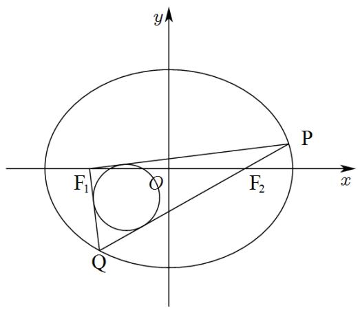

(3) 设 (3) 设 $P \left( x _ { 1 } , y _ { 1 } \right) , Q \left( x _ { 2 } , y _ { 2 } \right)$ ，则 ，则 $Q ^ { \prime } \left( x _ { 2 } , - y _ { 2 } \right)$ 1将l: $x = m y +$ 3代入椭圆方程得 $\big ( 1 6 m ^ { 2 } + 2 5 \big ) y ^ { 2 } + 9 6 m y - 2 5 6 = 0 \mathrm { { _ { \cdot } } }$ 所以 $ y _ { 1 } + y _ { 2 } = \frac { - 9 6 m } { 1 6 m ^ { 2 } + 2 5 } , y _ { 1 } \cdot y _ { 2 } = \frac { - 2 5 6 } { 1 6 m ^ { 2 } + 2 5 }$ 直线PQ′的方程为 $\displaystyle { \lvert y = \frac { y _ { 1 } + y _ { 2 } } { x _ { 1 } - x _ { 2 } } ( x - x _ { 2 } ) - y _ { 2 } }$ ${ \mathfrak { P } } y = 0$ ，得 $x = { \frac { x _ { 1 } y _ { 2 } + x _ { 2 } y _ { 1 } } { y _ { 1 } + y _ { 2 } } }$ 代入直线方程以及韦达定理可得 $x = { \frac { 2 m y _ { 1 } y _ { 2 } + 3 ( y _ { 1 } + y _ { 2 } ) } { y _ { 1 } + y _ { 2 } } } = { \frac { 2 5 } { 3 } }$ 即直线PQ′过定点M $\left( { \frac { 2 5 } { 3 } } , 0 \right)$ ，面积 $\mathsf { S } = \frac { 1 } { 2 } | F _ { 2 } M | \cdot | y _ { 1 } + y _ { 2 } | = \frac { 8 } { 3 } \times 9 6 \left| \frac { 1 } { 1 6 m + \frac { 2 5 } { m } } \right| \le \frac { 3 2 } { 5 } ,$ 当且仅当 $m = \pm \frac { 5 } { 4 }$ 时取等号，故S的最大值为 $\frac { 3 2 } { 5 }$

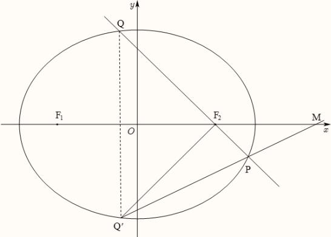

---

---

### 084 · 原第20题

**来源：** S014 · 上海市南洋模范中学 · 高三 · 2025-2026 · 期中 · 原第20题

**考点说明：** 椭圆的离心率与标准方程；直线与椭圆联立、韦达定理与斜率和为定值；解析几何中的面积比与参数取值范围

> **校订提示**
>
> 源稿题干首部粘连了一个重复的题号“20”（写作“20 已知椭圆…”），系题号被 OCR 并入正文；按题序本题为第 20 题，正文中该重复数字已删除。另：源稿 (2)① 解析中的分母一处写作 $x_{3}-3$，应为 $x_{2}-3$。

> 下列正文保留原转录；与本提示冲突的文字或公式不作为有效依据。

已知椭圆 $\dfrac{x^{2}}{a^{2}}+\dfrac{y^{2}}{b^{2}}=1\ (a>b>0)$ 的离心率为 $\dfrac{\sqrt6}{3}$，点 $A(3,1)$ 在椭圆上，直线 $l:x=4$ 与 $x$ 轴交于点 $B$．

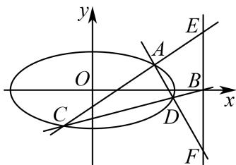

(1) 求椭圆的标准方程；

(2) 过点 $B$ 的直线交椭圆于 $C,D$ 两点（$C$ 在 $D$ 的左侧），直线 $AC,AD$ 分别与直线 $l$ 交于 $E,F$ 两点，直线 $AC,AD$ 的斜率记为 $k_{1},k_{2}$．

① 求证：$k_{1}+k_{2}$ 为定值；

② 点 $G$ 为 $CF$ 中点，若 $S_{\triangle DFG}=\lambda S_{\triangle BDE}$，求实数 $\lambda$ 的取值范围．

#### 答案

(1) $\dfrac{x^{2}}{12}+\dfrac{y^{2}}{4}=1$　(2) ① $k_{1}+k_{2}=-2$（定值）；② $\lambda\in\left(0,\,3+2\sqrt3\right]$

#### 解析（保留源稿）

(1) 由 $e=\dfrac ca=\dfrac{\sqrt6}{3}$ 得 $\dfrac{c^{2}}{a^{2}}=\dfrac23$，即 $1-\dfrac{b^{2}}{a^{2}}=\dfrac23$，故 $a^{2}=3b^{2}$。

又 $A(3,1)$ 在椭圆上，$\dfrac{9}{a^{2}}+\dfrac{1}{b^{2}}=1$，代入得 $\dfrac{9}{3b^{2}}+\dfrac{1}{b^{2}}=\dfrac{4}{b^{2}}=1$，故 $b^{2}=4$，$a^{2}=12$。

所以椭圆的标准方程为 $\dfrac{x^{2}}{12}+\dfrac{y^{2}}{4}=1$。

(2) 由 (1) 知 $A(3,1)$，$B(4,0)$。设直线 $BC$ 的方程为 $y=k(x-4)$，与椭圆联立：

$$
\dfrac{x^{2}}{12}+\dfrac{k^{2}(x-4)^{2}}{4}=1\ \Longrightarrow\ (3k^{2}+1)x^{2}-24k^{2}x+48k^{2}-12=0.
$$

由 $\Delta>0$ 得 $k^{2}<1$。设 $C(x_{1},y_{1})$，$D(x_{2},y_{2})$（$x_{1}<x_{2}<4$），则

$$
x_{1}+x_{2}=\dfrac{24k^{2}}{3k^{2}+1},\qquad x_{1}x_{2}=\dfrac{48k^{2}-12}{3k^{2}+1}.
$$

① 因为 $y_{i}=k(x_{i}-4)$，所以

$$
k_{1}+k_{2}=\dfrac{k(x_{1}-4)-1}{x_{1}-3}+\dfrac{k(x_{2}-4)-1}{x_{2}-3}=2k-(k+1)\left(\dfrac{1}{x_{1}-3}+\dfrac{1}{x_{2}-3}\right)
$$

$$
=2k-\dfrac{(k+1)(x_{1}+x_{2}-6)}{x_{1}x_{2}-3(x_{1}+x_{2})+9}=2k-\dfrac{(k+1)\left(\dfrac{24k^{2}}{3k^{2}+1}-6\right)}{\dfrac{48k^{2}-12}{3k^{2}+1}-\dfrac{72k^{2}}{3k^{2}+1}+9}
$$

$$
=2k-\dfrac{(k+1)(6k^{2}-6)}{3k^{2}-3}=2k-2(k+1)=-2.
$$

故 $k_{1}+k_{2}$ 为定值，定值为 $-2$。

② 由 $E,F$ 在直线 $x=4$ 上，直线 $AC$ 的方程为 $y-1=k_{1}(x-3)$，令 $x=4$ 得 $E(4,k_{1}+1)$；同理 $F(4,k_{2}+1)$。由①知 $y_{E}+y_{F}=k_{1}+k_{2}+2=0$，故 $\vert y_{E}\vert=\vert y_{F}\vert$。

于是

$$
S_{\triangle BDE}=\dfrac12\vert y_{E}\vert(4-x_{2}),\qquad S_{\triangle DFG}=\dfrac12S_{\triangle CDF}=\dfrac14\vert y_{F}\vert(4-x_{1}).
$$

由 $S_{\triangle DFG}=\lambda S_{\triangle BDE}$ 得

$$
\lambda=\dfrac{x_{2}-x_{1}}{2(4-x_{2})}>0.
$$

由上述二次方程解得 $x_{2}=\dfrac{24k^{2}+\sqrt{48(1-k^{2})}}{2(1+3k^{2})}$，$x_{2}-x_{1}=\dfrac{\sqrt{48(1-k^{2})}}{1+3k^{2}}$，代入化简得

$$
\lambda=\dfrac{\sqrt{3(1-k^{2})}}{2-\sqrt{3(1-k^{2})}}.
$$

令 $t=\sqrt{3(1-k^{2})}$，由 $k^{2}<1$ 得 $t\in\left(0,\sqrt3\right]$，则 $\lambda=\dfrac{t}{2-t}$ 在 $\left(0,\sqrt3\right]$ 上单调递增，故

$$
\lambda\in\left(0,\ \dfrac{\sqrt3}{2-\sqrt3}\right]=\left(0,\ 3+2\sqrt3\right].
$$

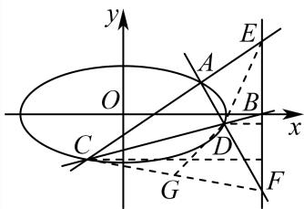

---

---

### 085 · 原第20题

**来源：** S010 · 上海市吴淞中学 · 高三 · 2025-2026 · 期中 · 原第20题

**考点说明：** 直线与椭圆的交点（联立解二次方程）；直线与椭圆联立、韦达定理与斜率和的定值问题；向量垂直条件的代数化与距离取值范围

已知椭圆 $C:\dfrac{x^{2}}{2}+y^{2}=1$ 的右焦点为 $F$，不垂直 $x$ 轴且不过 $F$ 点的直线 $l$ 与椭圆 $C$ 相交于 $A,B$ 两点。

(1) 若直线 $l:y=x+1$，求 $A,B$ 两点坐标；

(2) 若直线 $l$ 经过点 $P(2,0)$，则直线 $FA$、$FB$ 的斜率之和是否为定值？若是，求出该定值；若不是，请说明理由；

(3) 如果 $FA\perp FB$，原点到直线 $l$ 的距离为 $d$，求 $d$ 的取值范围。

#### 答案

(1) $A(0,1)$，$B\left(-\dfrac{4}{3},-\dfrac{1}{3}\right)$

(2) 是，定值为 0

(3) $\left(0,\dfrac{4}{3}\right)$

#### 解析（保留源稿）

(1) 联立 $\begin{cases}y=x+1\\ \dfrac{x^{2}}{2}+y^{2}=1\end{cases}$，得 $\dfrac{3}{2}x^{2}+2x=0$，解得 $x_{1}=0$，$x_{2}=-\dfrac{4}{3}$，则 $A(0,1)$，$B\left(-\dfrac{4}{3},-\dfrac{1}{3}\right)$。

(2) 设直线 $l$ 的方程为 $y=k(x-2)$，$A(x_{1},y_{1})$，$B(x_{2},y_{2})$。

联立 $\begin{cases}y=k(x-2)\\ \dfrac{x^{2}}{2}+y^{2}=1\end{cases}$，得 $(1+2k^{2})x^{2}-8k^{2}x+8k^{2}-2=0$，

所以 $x_{1}+x_{2}=\dfrac{8k^{2}}{1+2k^{2}}$，$x_{1}x_{2}=\dfrac{8k^{2}-2}{1+2k^{2}}$。

又 $F(1,0)$，所以

$k_{FA}+k_{FB}=\dfrac{k(x_{1}-2)}{x_{1}-1}+\dfrac{k(x_{2}-2)}{x_{2}-1}=\dfrac{k(x_{1}-2)(x_{2}-1)+k(x_{2}-2)(x_{1}-1)}{(x_{1}-1)(x_{2}-1)}$

$=\dfrac{2k\,x_{1}x_{2}-3k(x_{1}+x_{2})+4k}{x_{1}x_{2}-(x_{1}+x_{2})+1}=\dfrac{2k\cdot\dfrac{8k^{2}-2}{1+2k^{2}}-3k\cdot\dfrac{8k^{2}}{1+2k^{2}}+4k}{\dfrac{8k^{2}-2}{1+2k^{2}}-\dfrac{8k^{2}}{1+2k^{2}}+1}=\dfrac{16k^{3}-4k-24k^{3}+4k+8k^{3}}{-1+2k^{2}}=0$。

所以直线 $FA$、$FB$ 的斜率之和为定值 0。

(3) 设直线 $l$ 的方程为 $y=kx+b$，$A(x_{3},y_{3})$，$B(x_{4},y_{4})$。

联立 $\begin{cases}y=kx+b\\ \dfrac{x^{2}}{2}+y^{2}=1\end{cases}$，得 $(1+2k^{2})x^{2}+4kbx+2(b^{2}-1)=0$，

$\Delta=16k^{2}b^{2}-8(1+2k^{2})(b^{2}-1)=8(2k^{2}+1-b^{2})>0\ (*)$，$x_{3}+x_{4}=-\dfrac{4kb}{1+2k^{2}}$，$x_{3}x_{4}=\dfrac{2(b^{2}-1)}{1+2k^{2}}$。

因为 $F(1,0)$，所以 $\overrightarrow{FA}=(x_{3}-1,y_{3})$，$\overrightarrow{FB}=(x_{4}-1,y_{4})$。

因为 $FA\perp FB$，所以 $\overrightarrow{FA}\cdot\overrightarrow{FB}=0$，即 $(x_{3}-1)(x_{4}-1)+y_{3}y_{4}=0$，

则 $(x_{3}-1)(x_{4}-1)+(kx_{3}+b)(kx_{4}+b)=0$，即

$$
(k^{2}+1)x_{3}x_{4}+(kb-1)(x_{3}+x_{4})+b^{2}+1=0,
$$

代入韦达结果得

$$
2k^{2}b^{2}-2k^{2}+2b^{2}-2-4k^{2}b^{2}+4kb+b^{2}+2k^{2}b^{2}+1+2k^{2}=0,
$$

所以 $3b^{2}+4kb-1=0$。

若 $b=0$，则 $3b^{2}+4kb-1=0$ 不成立，所以 $b\ne 0$，$k=\dfrac{1-3b^{2}}{4b}$。

代入 $(*)$，可得 $2\left(\dfrac{1-3b^{2}}{4b}\right)^{2}+1-b^{2}>0$，化简得 $\dfrac{b^{4}+2b^{2}+1}{8b^{2}}>0$ 恒成立。

原点 $(0,0)$ 到直线 $l$ 的距离为

$$
d=\frac{\vert b\vert}{\sqrt{1+k^{2}}}=\sqrt{\frac{b^{2}}{\left(\frac{1-3b^{2}}{4b}\right)^{2}+1}}=\sqrt{\frac{16b^{4}}{9b^{4}-6b^{2}+1+16b^{2}}}=\sqrt{\frac{16}{\frac{1}{b^{4}}+\frac{10}{b^{2}}+9}},
$$

$$
\frac{1}{b^{4}}+\frac{10}{b^{2}}+9=\left(\frac{1}{b^{2}}+5\right)^{2}-16>5^{2}-16=9,
$$

$$
d=\sqrt{\frac{16}{\frac{1}{b^{4}}+\frac{10}{b^{2}}+9}}<\sqrt{\frac{16}{9}}=\frac{4}{3},\quad\text{所以}\ 0<d<\frac{4}{3},
$$

所以 $d$ 的取值范围为 $\left(0,\dfrac{4}{3}\right)$。

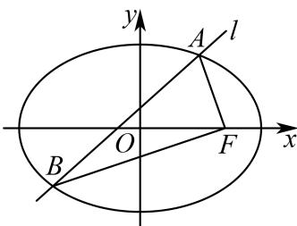

---

---

### 086 · 原第20题

**来源：** S006 · 上海市嘉定区第一中学 · 高三 · 2025-2026 · 期中 · 原第20题

**考点说明：** 双曲线的渐近线方程；双曲线上点的坐标与向量数量积；直线与双曲线联立、斜率和为 0 的对称结构

已知双曲线 $C:\dfrac{x^{2}}{a^{2}}-\dfrac{y^{2}}{a^{2}-1}=1\ (a>1)$。

(1) $a=2$，求双曲线 $C$ 的渐近线方程；

(2) 设 $A_{1},A_{2}$ 为双曲线 $C$ 的左右顶点，双曲线 $C$ 上一点 $E$ 的纵坐标为 1，且 $\overrightarrow{EA_{1}}\cdot\overrightarrow{EA_{2}}=3$，求 $a$ 的值；

(3) 已知点 $A(2,1)$ 在双曲线上，直线 $l$ 交 $C$ 于 $P,Q$ 两点，直线 $AP,AQ$ 的斜率之和为 0，求直线 $l$ 的斜率。

#### 答案

(1) $y=\pm\dfrac{\sqrt{3}}{2}x$

(2) $a=\sqrt{2}$

(3) $-1$

#### 解析（保留源稿）

(1) 当 $a=2$ 时，双曲线 $C$ 的方程为 $\dfrac{x^{2}}{4}-\dfrac{y^{2}}{3}=1$，则双曲线 $C$ 的渐近线方程为 $y=\pm\dfrac{\sqrt{3}}{2}x$。

(2) 由题意 $A_{1}(-a,0)$，$A_{2}(a,0)$，设 $E(x_{0},1)$，则 $\overrightarrow{EA_{1}}=(-a-x_{0},-1)$，$\overrightarrow{EA_{2}}=(a-x_{0},-1)$，

则 $\overrightarrow{EA_{1}}\cdot\overrightarrow{EA_{2}}=(-a-x_{0})(a-x_{0})+1=x_{0}^{2}-a^{2}+1=3$，故 $x_{0}^{2}=a^{2}+2$。

又点 $E(x_{0},1)$ 在双曲线 $C$ 上，则 $\dfrac{a^{2}+2}{a^{2}}-\dfrac{1}{a^{2}-1}=1$，化简得 $a^{2}=2$，又 $a>1$，所以 $a=\sqrt{2}$。

(3) 将点 $A$ 代入双曲线方程得 $\dfrac{4}{a^{2}}-\dfrac{1}{a^{2}-1}=1$，解得 $a^{2}=2$，故双曲线方程为 $\dfrac{x^{2}}{2}-y^{2}=1$。

设直线 $AP$ 斜率为 $k$，则直线 $AQ$ 斜率为 $-k$。直线 $AP$ 方程为 $y=k(x-2)+1$，联立双曲线 $C$ 与直线 $AP$：

$\begin{cases}\dfrac{x^{2}}{2}-y^{2}=1\\ y=k(x-2)+1\end{cases}\Rightarrow(1-2k^{2})x^{2}-4k(1-2k)x-2(1-2k)^{2}-2=0$，

其中 $\begin{cases}1-2k^{2}\ne0\\ \Delta=16(k-1)^{2}>0\end{cases}$，即 $k\ne\pm\dfrac{\sqrt{2}}{2}$ 且 $k\ne1$。

由韦达定理 $x_{A}+x_{P}=\dfrac{4k(1-2k)}{1-2k^{2}}$，又 $x_{A}=2$，则 $x_{P}=\dfrac{4k-4k^{2}-2}{1-2k^{2}}$。

同理以 $-k$ 代 $k$，则 $x_{Q}=\dfrac{-4k-4k^{2}-2}{1-2k^{2}}$，

则 $x_{P}-x_{Q}=\dfrac{8k}{1-2k^{2}}$，$y_{P}-y_{Q}=\bigl[k(x_{P}-2)+1\bigr]-\bigl[-k(x_{Q}-2)+1\bigr]=\dfrac{-8k}{1-2k^{2}}$，

故 $k_{PQ}=\dfrac{y_{P}-y_{Q}}{x_{P}-x_{Q}}=-1$。

---

---

### 087 · 原第20题

**来源：** S041 · 上海市六校期中联考 · 高三 · 2025-2026 · 期中 · 原第20题

**考点说明：** 直线与双曲线相交、向量共线条件；双曲线中两条焦半径的代数化简与等式证明；面积比的化简与基本不等式求最值

已知曲线 $C \colon x ^ { 2 } - y ^ { 2 } = 2$ ，第一象限内点P在曲线C上. $F _ { 1 } ( - 2 , 0 ) , ~ F _ { 2 } ( 2 , 0 )$ ，连接 $P F _ { 2 }$ 并延长与曲线C交于Q点， $\overrightarrow { P F _ { 2 } } = \lambda \overrightarrow { F _ { 2 } Q } \left( \lambda > 0 \right)$ .以P为圆心， $| P F _ { 2 } |$ |为半径的圆与线段 $P F _ { 1 }$ 交于点N，记 $\triangle P F _ { 2 } N$ $\triangle P F _ { 1 }$ Q的面积分别为 $S _ { 1 } , \ S _ { 2 }$

(1) 若λ = 1，求点P的坐标；

(2) 若点P的坐标为 $( x _ { 0 } , y _ { 0 } )$ ，求证 $x _ { 0 } = \frac { | P F _ { 1 } | + | P F _ { 2 } | } { | P F _ { 1 } | - | P F _ { 2 } | }$ ；

(3) 求 $\frac { S _ { 2 } + \lambda S _ { 1 } } { S _ { 1 } }$ 的最小值.

#### 答案

(1) $P \left( 2 , { \sqrt { 2 } } \right)$

(2) 证明见解析

(3) $1 + 2 { \sqrt { 5 } } .$

#### 解析（保留源稿）

(1) 设 $\stackrel { l : } { x } = m y + 2 , P ( x _ { 1 } , y _ { 1 } ) , Q ( x _ { 2 } , y _ { 2 } )$

与 $x ^ { 2 } - y ^ { 2 } = { \mathrm { . } }$ 2联立可得 $\displaystyle { \big ( m ^ { 2 } - 1 \big ) y ^ { 2 } + 4 m y + 2 = 0 , ~ m \neq \pm 1 , }$

$$
\Delta = 1 6 m ^ {2} - 8 (m ^ {2} - 1) = 8 m ^ {2} + 8 > 0, y _ {1} + y _ {2} = - \frac {4 m}{m ^ {2} - 1}, y _ {1} y _ {2} = \frac {2}{m ^ {2} - 1},
$$

因为 $\overrightarrow { P F _ { 2 } } = \overrightarrow { F _ { 2 } Q }$ ，所 $\downarrow \downarrow _ { y _ { 1 } } = - y _ { 2 }$

由 $y _ { 1 } + y _ { 2 } = - { \frac { 4 m } { m ^ { 2 } - 1 } }$ 可得 $m = 0$ ，故 $\cdot y _ { 1 } y _ { 2 } = \frac { 2 } { 0 - 1 } = - 2$

因为P在第一象限，所以 $. y _ { 1 } > 0$ ，解得 $y _ { 1 } = { \sqrt { 2 } } ,$

由l: x = 2得 $P \left( 2 , { \sqrt { 2 } } \right)$ ；

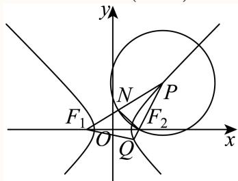

$$
x _ {0} ^ {2} - y _ {0} ^ {2} = 2, \quad x _ {0} > \sqrt {2}, \text {故} y _ {0} ^ {2} = x _ {0} ^ {2} - 2,
$$

$$
\left| P F _ {1} \right| = \sqrt {\left(x _ {0} + 2\right) ^ {2} + y _ {0} ^ {2}} = \sqrt {\left(x _ {0} + 2\right) ^ {2} + x _ {0} ^ {2} - 2} = \sqrt {2} x _ {0} + \sqrt {2},
$$

$$
\left| P F _ {2} \right| = \sqrt {\left(x _ {0} - 2\right) ^ {2} + y _ {0} ^ {2}} = \sqrt {\left(x _ {0} - 2\right) ^ {2} + x _ {0} ^ {2} - 2} = \sqrt {2} x _ {0} - \sqrt {2},
$$

则 ${ \frac { | P F _ { 1 } | } { | P F _ { 2 } | } } = { \frac { x _ { 0 } + 1 } { x _ { 0 } - 1 } }$ ，即 $ { | x _ { 0 } = \frac { { | P F _ { 1 } | + { | P F _ { 2 } | } } } { { | P F _ { 1 } | - { | P F _ { 2 } | } } } ; }$

(3) 由（1）得 $y _ { 1 } + y _ { 2 } = - \frac { 4 m } { m ^ { 2 } - 1 } , y _ { 1 } y _ { 2 } = \frac { 2 } { m ^ { 2 } - 1 } < 0$ ，故 $- 1 < m < 1$

因为 $\overrightarrow { P F _ { 2 } } = \lambda \overrightarrow { F _ { 2 } Q } \left( \lambda > 0 \right)$ ，所 $\lambda y _ { 1 } = - \lambda y _ { 2 }$

当λ = 1时， $m = 0 , P \left( 2 , { \sqrt { 2 } } \right) , F _ { 2 } ( 2 , 0 )$ ，故 $| P F _ { 2 } | = \sqrt { 2 } , | P F _ { 1 } | = 2 a + | P F _ { 2 } | = 3 \sqrt { 2 } ,$

$\left| F _ { 1 } F _ { 2 } \right| = 4$ ，故 $| P F _ { 2 } | ^ { 2 } + | F _ { 1 } F _ { 2 } | ^ { 2 } = | P F _ { 1 } | ^ { 2 }$ ，所以 $P F _ { 2 } \bot F _ { 1 } F _ { 2 }$ ，

$$
\sin \angle F _ {1} P F _ {2} = \frac {\left| F _ {1} F _ {2} \right|}{\left| P F _ {1} \right|} = \frac {4}{3 \sqrt {2}} = \frac {2 \sqrt {2}}{3},
$$

$$
\left| S _ {1} = \frac {1}{2} \right| P F _ {2} | \cdot | P N | \sin \angle F _ {1} P F _ {2} = \frac {1}{2} \times \sqrt {2} \times \sqrt {2} \times \frac {2 \sqrt {2}}{3} = \frac {2 \sqrt {2}}{3},
$$

由对称性可知 $S _ { 2 } = 2 S _ { \triangle P F _ { 1 } F _ { 2 } } = 2 \times { \frac { 1 } { 2 } } S _ { 1 } = 2 \times { \frac { 1 } { 2 } } | P F _ { 2 } | \cdot | F _ { 1 } F _ { 2 } | = 4 \sqrt { 2 } ,$

则 $\frac { S _ { 2 } + \lambda S _ { 1 } } { S _ { 1 } } = \frac { S _ { 2 } + S _ { 1 } } { S _ { 1 } } = \frac { 4 \sqrt { 2 } + \frac { 2 \sqrt { 2 } } { 3 } } { \frac { 2 \sqrt { 2 } } { 3 } } = 7 ,$

当 $\lvert \lambda \ne ]$ 1时， $- \lambda y _ { 2 } + y _ { 2 } = - { \frac { 4 m } { m ^ { 2 } - 1 } } , - \lambda y _ { 2 } ^ { 2 } = { \frac { 2 } { m ^ { 2 } - 1 } } ,$

由 $- \lambda y _ { 2 } + y _ { 2 } = - \frac { 4 m } { m ^ { 2 } - 1 }$ 得 $y _ { 2 } = \frac { 4 m } { \left( \lambda - 1 \right) \left( m ^ { 2 } - 1 \right) } ,$

将其代 $\backslash - \lambda y _ { 2 } ^ { 2 } = { \frac { 2 } { m ^ { 2 } - 1 } }$ 中得 $- \lambda { \frac { 1 6 m ^ { 2 } } { \left( \lambda - 1 \right) ^ { 2 } \left( m ^ { 2 } - 1 \right) ^ { 2 } } } = { \frac { 2 } { m ^ { 2 } - 1 } } ,$

显然，当 $0 < \lambda < 1$ 时， $m < 0$ ，当 $\lambda > 1$ 时， $m > 0 ,$ ，

解得 $: m = - \frac { 1 - \lambda } { \sqrt { 1 + 6 \lambda + \lambda ^ { 2 } } } , y _ { 2 } = - \frac { \sqrt { 1 + 6 \lambda + \lambda ^ { 2 } } } { 2 \lambda } , y _ { 1 } = \frac { \sqrt { 1 + 6 \lambda + \lambda ^ { 2 } } } { 2 } ,$

因为 $\frac { S _ { 2 } } { S _ { 1 } } = \frac { \displaystyle \frac { 1 } { 2 } | P F _ { 1 } | \cdot | P Q | s i n \angle F _ { 1 } P Q } { \displaystyle \frac { 1 } { 2 } | P N | \cdot | P F _ { 2 } | s i n \angle F _ { 1 } P Q } = \frac { | P F _ { 1 } | \cdot | P Q | } { | P F _ { 2 } | ^ { 2 } } ,$

其中 $^ { 1 } m y _ { 1 } = - { \frac { 1 - \lambda } { \sqrt { 1 + 6 \lambda + \lambda ^ { 2 } } } } \cdot { \frac { \sqrt { 1 + 6 \lambda + \lambda ^ { 2 } } } { 2 } } = { \frac { \lambda - 1 } { 2 } } ,$

由（2）知 ${ \frac { | P F _ { 1 } | } { | P F _ { 2 } | } } = { \frac { x _ { 1 } + 1 } { x _ { 1 } - 1 } } = { \frac { m y _ { 1 } + 3 } { m y _ { 1 } + 1 } } = { \frac { \lambda + 5 } { \lambda + 1 } } ,$

又 $\overrightarrow { P F _ { 2 } } = \lambda \overrightarrow { F _ { 2 } Q } \left( \lambda > 0 \right)$ ，故 ${ \frac { | P Q | } { | P F _ { 2 } | } } = { \frac { | P F _ { 2 } | + | F _ { 2 } Q | } { | P F _ { 2 } | } } = { \frac { \lambda + 1 } { \lambda } } ,$

$$
\frac {S _ {2}}{S _ {1}} = \frac {\left| P F _ {1} \right| \cdot \left| P Q \right|}{\left| P F _ {2} \right| ^ {2}} = \frac {\lambda + 5}{\lambda + 1} \cdot \frac {\lambda + 1}{\lambda} = \frac {\lambda + 5}{\lambda},
$$

所以 $\frac { S _ { 2 } + \lambda S _ { 1 } } { S _ { 1 } } = \frac { \lambda + 5 } { \lambda } + \lambda = 1 + \frac { 5 } { \lambda } + \lambda \geq 1 + 2 \sqrt { \frac { 5 } { \lambda } \cdot \lambda } = 1 + 2 \sqrt { 5 } ,$

当且仅当 ${ \frac { 5 } { \lambda } } = \lambda$ ，即λ = √5时等号成立，此时 $m = { \frac { { \sqrt { 5 } } - 1 } { \sqrt { 6 + 6 { \sqrt { 5 } } } } } ,$

由于 $1 + 2 { \sqrt { 5 } } < 7 ,$

故 $\left( { \frac { S _ { 2 } + \lambda S _ { 1 } } { S _ { 1 } } } \right) _ { \operatorname* { m i n } } = 1 + 2 { \sqrt { 5 } } .$

---

---

### 088 · 原第20题

**来源：** S050 · 上海市市北中学 · 高三 · 2025-2026 · 期中 · 原第20题

**考点说明：** 椭圆的定义（折纸情境）与标准方程；直线与椭圆相交、三角形面积；直线与椭圆综合、定点定直线的代数推导

如图所示的折纸又称＂工艺折纸＂，是一种把纸张折成各种不同形状物品的艺术活动，在我国源远流长．某些折纸活动蕴含丰富的数学内容，例如，用半径为4圆形纸片按如下步骤折纸：

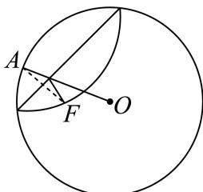

步骤1：设圆心是O，在圆内（除去圆心）取一点，标记为F，且 $| O F | = 2$

步骤2：把纸片折叠，使圆周正好通过F；

步骤3：把纸片展开，于是就留下一条折痕；

步骤4：不停重复步骤2和3，能得到越来越多条的折痕.

这些折痕围成的一个图形.

(1) 以FO所在的直线为x轴，FO的中点M为原点建立平面直角坐标系，求折痕围成的图形的标准方程；

(2) 求经过点O，且与直线FO夹角为 $\frac { \pi } { 4 }$ 的直线交椭圆 $\mp C ,$ D两点，求 $\triangle F C D$ 的面积

(3) 设A, B为椭圆的左右顶点，过右焦点O的直线l交椭圆于M, N两点，直线AM, BN交于T点， 求证T在定直线上，并求出定直线方程.

#### 答案

(1) ${ \frac { x ^ { 2 } } { 4 } } + { \frac { y ^ { 2 } } { 3 } } = 1$

(2) $S _ { \triangle F C D } = \frac { 1 2 \sqrt { 2 } } { 7 }$

(3) 证明见解析， T点在定直线 x = 4上

#### 解析（保留源稿）

(1) 这些折痕围成的图形是一个椭圆．定点 F 到圆心 O 的距离为 2，按上述方法折纸，如图所示

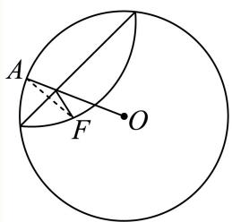

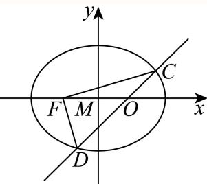

设 $AO$ 与折痕的交点为 P，设 $P(x,y)$，由题意可知

$$\vert PF\vert+\vert PO\vert=\vert QO\vert=4,\quad \vert FO\vert=2<4,$$

所以点 P 是以 F、O 为椭圆的左、右焦点，长轴长为 4 的椭圆上的点，

即 $2a=4$，$2c=2$，所以 $a=2$，$c=1$，$b^{2}=a^{2}-c^{2}=3$，

所以椭圆的标准方程为 $\dfrac{x^{2}}{4}+\dfrac{y^{2}}{3}=1$。

(2) 经过 O 且与直线 FO 夹角为 $\dfrac{\pi}{4}$ 的直线的倾斜角为 $\dfrac{\pi}{4}$ 或 $\dfrac{3\pi}{4}$，由椭圆的对称性，不妨设直线的倾斜角为 $\dfrac{\pi}{4}$，即直线的斜率 $k=1$，又 $O(1,0)$，则直线 $CD\colon y=x-1$。

设 $C(x_{1},y_{1})$，$D(x_{2},y_{2})$，联立

$$\begin{cases}y=x-1\\[2pt] \dfrac{x^{2}}{4}+\dfrac{y^{2}}{3}=1\end{cases}$$

消去 $x$ 得 $7y^{2}+6y-9=0$，

$$\Delta=36+4\times 7\times(-9)=288>0,$$

∴ $y_{1}+y_{2}=-\dfrac{6}{7}$，$y_{1}y_{2}=-\dfrac{9}{7}$，

$$\therefore \vert y_{1}-y_{2}\vert=\sqrt{(y_{1}+y_{2})^{2}-4y_{1}y_{2}}=\sqrt{\left(-\frac{6}{7}\right)^{2}-4\left(-\frac{9}{7}\right)}=\frac{12\sqrt{2}}{7},$$

$$\therefore S_{\triangle FCD}=\frac{1}{2}\times\vert FO\vert\times\vert y_{1}-y_{2}\vert=\frac{1}{2}\times 2\times\frac{12\sqrt{2}}{7}=\frac{12\sqrt{2}}{7}.$$

(3) 证明：显然直线 $l$ 的斜率不为 0，则可设直线 $l$ 的方程为 $x=my+1$，$M(x_{1},y_{1})$，$N(x_{2},y_{2})$。

联立

$$\begin{cases}x=my+1\\[2pt] \dfrac{x^{2}}{4}+\dfrac{y^{2}}{3}=1\end{cases}\ \Rightarrow\ (3m^{2}+4)y^{2}+6my-9=0,$$

此时 $\Delta>0$，由韦达定理得

$$y_{1}+y_{2}=-\frac{6m}{3m^{2}+4},\quad y_{1}y_{2}=-\frac{9}{3m^{2}+4},$$

所以 $y_{1}y_{2}=\dfrac{3}{2m}(y_{1}+y_{2})$。

又 $A(-2,0)$，$B(2,0)$，所以直线 AM 的方程为 $y=\dfrac{y_{1}}{x_{1}+2}(x+2)$　①，

所以直线 BN 的方程为 $y=\dfrac{y_{2}}{x_{2}-2}(x-2)$　②。

联立①②，可得

$$\frac{x+2}{x-2}=\frac{y_{2}(x_{1}+2)}{y_{1}(x_{2}-2)}=\frac{my_{1}y_{2}+3y_{2}}{my_{1}y_{2}-y_{1}}=\frac{\frac{3}{2}(y_{1}+y_{2})+3y_{2}}{\frac{3}{2}(y_{1}+y_{2})-y_{1}}=3,$$

解得 $x=4$，所以 T 点在定直线 $x=4$ 上。

---

---

### 089 · 原第20题

**来源：** S016 · 上海市徐汇中学 · 高三 · 2025-2026 · 期中 · 原第20题

**考点说明：** 椭圆的标准方程与离心率；直线与椭圆相交、三角形面积与斜率方程；椭圆切线方程（新结论）与定值探究

已知 $F _ { \mathrm { 1 } } , \ F _ { \mathrm { 2 } }$ 分别为椭圆 $C : \frac { x ^ { 2 } } { a ^ { 2 } } + \frac { y ^ { 2 } } { b ^ { 2 } } = 1 ( a > b > 0 )$ 的左、右焦点，点 $P \left( { \frac { 2 { \sqrt { 6 } } } { 3 } } , 1 \right)$ 在椭圆C上，离心率为 $\frac { 1 } { 2 }$

(1) 求椭圆C的方程；

(2) 设A为椭圆C的左顶点，过点 $F _ { 2 }$ 的直线l交椭圆C于D、E两点， $S _ { \triangle A D E } = \frac { 1 8 \sqrt { 2 } } { 7 }$ ，求直线l的 方程

(3) 若过椭圆上一点 $P ( x _ { 0 } , y _ { 0 } )$ 的切线方程为 ${ \frac { x _ { 0 } x } { a ^ { 2 } } } + { \frac { y _ { 0 } y } { b ^ { 2 } } } = 1$ ，利用上述结论，设d是从椭圆中心到椭圆在点Q处切线的距离，当Q在椭圆上运动时，判断 $\dot { \tau } d ^ { 2 } \left| Q F _ { 1 } \right| \left| Q F _ { 2 } \right|$ 是否为定值．若是求出定值，若不是说明理由

#### 答案

(1) ${ \frac { x ^ { 2 } } { 4 } } + { \frac { y ^ { 2 } } { 3 } } = 1$

(2) $y = \pm \left( x - 1 \right)$

(3) 为定值，且定值为12，

#### 解析（保留源稿）

(1) 设 $F_{1}(-c,0)$，$F_{2}(c,0)$，由 $e=\dfrac{c}{a}=\dfrac{1}{2}$ 得 $a=2c$。

∵点 $P\left(\dfrac{2\sqrt{6}}{3},1\right)$ 在椭圆 C 上，则

$$\frac{24}{9a^{2}}+\frac{1}{b^{2}}=1.$$

又 $b^{2}=a^{2}-c^{2}$，故得

$$\frac{24}{9a^{2}}+\frac{1}{a^{2}-\left(\dfrac{1}{2}a\right)^{2}}=1,$$

解得 $a=2$，$b=\sqrt{3}$，故椭圆 C 的方程为

$$\frac{x^{2}}{4}+\frac{y^{2}}{3}=1.$$

(2) 由（1）知，$A(-2,0)$，$F_{2}(1,0)$。

若直线 $l$ 的斜率不存在，则 $x=1$，代入椭圆方程可得 $\dfrac{1}{4}+\dfrac{y^{2}}{3}=1$，故 $\vert y\vert=\dfrac{3}{2}$，此时

$$S_{\triangle ADE}=\frac{1}{2}\vert 2y\vert\cdot\vert AF_{2}\vert=\frac{1}{2}\times 3\times 3=\frac{9}{2}\ne\frac{18\sqrt{2}}{7},$$

故直线有斜率。

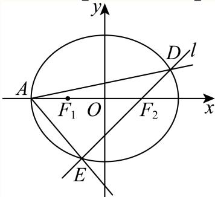

设直线 $l$ 的斜率为 $k$，则 $l$ 的方程为 $y=k(x-1)$。

联立

$$\begin{cases}y=k(x-1)\\[2pt] \dfrac{x^{2}}{4}+\dfrac{y^{2}}{3}=1\end{cases}$$

消去 $y$ 得

$$(4k^{2}+3)x^{2}-8k^{2}x+4k^{2}-12=0\quad \text{①},$$

显然 $\Delta>0$。设 $D(x_{1},y_{1})$，$E(x_{2},y_{2})$，则

$$x_{1}+x_{2}=\frac{8k^{2}}{4k^{2}+3},\quad x_{1}x_{2}=\frac{4k^{2}-12}{4k^{2}+3}.$$

于是

$$\begin{aligned}
S_{\triangle ADE}&=\frac{1}{2}\vert y_{2}-y_{1}\vert\cdot\vert AF_{2}\vert=\frac{1}{2}\times 3\vert k(x_{2}-x_{1})\vert\\
&=\frac{3}{2}\sqrt{k^{2}\left[(x_{1}+x_{2})^{2}-4x_{1}x_{2}\right]}\\
&=\frac{3}{2}\sqrt{k^{2}\left[\left(\frac{8k^{2}}{4k^{2}+3}\right)^{2}-4\cdot\frac{4k^{2}-12}{4k^{2}+3}\right]}\\
&=18\sqrt{\frac{k^{4}+k^{2}}{(4k^{2}+3)^{2}}}=\frac{18\sqrt{2}}{7},
\end{aligned}$$

化简可得

$$17k^{4}+k^{2}-18=0,\quad \text{即}\ (k^{2}-1)(17k^{2}+18)=0,$$

解得 $k=\pm 1$。

所以直线的方程为 $y=\pm(x-1)$。

(3) 依题意，设椭圆上的点 $Q(x_{0},y_{0})$，则过点 $Q(x_{0},y_{0})$ 的切线方程为

$$\frac{x_{0}x}{4}+\frac{y_{0}y}{3}=1,$$

即 $3x_{0}x+4y_{0}y-12=0$，原点到切线的距离为

$$d=\frac{12}{\sqrt{9x_{0}^{2}+16y_{0}^{2}}}=\frac{12}{\sqrt{9x_{0}^{2}+4(12-3x_{0}^{2})}}=\frac{12}{\sqrt{48-3x_{0}^{2}}}.$$

由两点间距离公式可得

$$\vert QF_{1}\vert=\sqrt{(x_{0}+1)^{2}+y_{0}^{2}}=\sqrt{(x_{0}+1)^{2}+3\left(1-\frac{x_{0}^{2}}{4}\right)}=\frac{1}{2}\vert x_{0}+4\vert,$$

同理 $\vert QF_{2}\vert=\dfrac{1}{2}\vert x_{0}-4\vert$，故

$$\vert QF_{1}\vert\vert QF_{2}\vert=\frac{1}{4}\left\vert x_{0}^{2}-16\right\vert=\frac{1}{4}(16-x_{0}^{2}).$$

于是

$$d^{2}\vert QF_{1}\vert\vert QF_{2}\vert=\frac{144}{48-3x_{0}^{2}}\times\frac{1}{4}(16-x_{0}^{2})=\frac{144}{3(16-x_{0}^{2})}\times\frac{16-x_{0}^{2}}{4}=12,$$

故 $d^{2}\vert QF_{1}\vert\vert QF_{2}\vert$ 为定值，且定值为 12。

---

---

### 090 · 原第20题

**来源：** S024 · 上海市曹杨第二中学 · 高三 · 年份待核 · 开学考 · 原第20题

**考点说明：** 椭圆方程待定、椭圆上动点到定点的距离最值及过定点直线证明。

**题目**　已知椭圆 $E:\dfrac{x^2}{a^2}+\dfrac{y^2}{b^2}=1$（$a>b>0$）的长轴长是短轴长的两倍，且过点 $(-\sqrt3,\frac12)$。

(1) 求椭圆方程；

(2) 若 $S(1,0)$，点 $T$ 为椭圆上任意一点，求 $|\overrightarrow{TS}|$ 的最大值与最小值；

(3) 设椭圆下顶点为 $A$，不过点 $A$ 且不垂直于坐标轴的直线 $l$ 交椭圆于 $P,Q$，直线 $AP,AQ$ 分别与 $x$ 轴交于 $M,N$。若 $M,N$ 横坐标之积为 2，证明直线 $l$ 过定点。

#### 答案

(1) $\boxed{\dfrac{x^2}{4}+y^2=1}$；(2) 最小值 $\dfrac{\sqrt6}{3}$，最大值 $3$；(3) 直线过定点 $(0,3)$。

#### 解析（保留源稿）

(1) 长轴长是短轴长的两倍，故 $a=2b$。代入已知点得 $b=1,a=2$。

(2) 设 $T(x_0,y_0)$，则
$$
|TS|^2=(1-x_0)^2+y_0^2=\frac34x_0^2-2x_0+2
=\frac34\left(x_0-\frac43\right)^2+\frac23.
$$
因 $-2\le x_0\le2$，最小值在 $x_0=4/3$ 取得，最大值在 $x_0=-2$ 取得，结论如上。

(3) 设 $l:y=kx+m$，交点为 $P(x_1,y_1),Q(x_2,y_2)$。因 $A=(0,-1)$，有
$$
x_M=\frac{x_1}{y_1+1},\qquad x_N=\frac{x_2}{y_2+1}.
$$
联立直线与椭圆，利用韦达定理：
$$
(4k^2+1)x^2+8kmx+4m^2-4=0.
$$
将 $x_1+x_2,x_1x_2$ 代入 $x_Mx_N=2$，化简得 $m=3$，所以 $l:y=kx+3$ 恒过定点 $(0,3)$。

---

### 091 · 原第20题

**来源：** S029 · 上海市杨浦高级中学 · 高三 · 年份待核 · 摸底考 · 原第20题

**考点说明：** 利用焦点弦确定椭圆方程，并求弦三角形周长范围与定点性质。

（本题满分18分，第1小题满分4分，第2小题满分6分，第3小题满分8分）

已知椭圆 $C:\dfrac{x^2}{a^2}+\dfrac{y^2}{b^2}=1$（$a>b>0$）的左、右焦点分别为 $F_1,F_2$。过点 $F_2$ 作 $x$ 轴的垂线，交椭圆 $C$ 于点 $C,D$，$|CD|=2$，且 $\triangle CF_1D$ 的周长为12。

（1）求椭圆的标准方程；

（2）直线 $y=mx$ 与椭圆交于 $A,B$ 两点，求 $\triangle ABF_2$ 的周长的取值范围；

（3）在 $x$ 轴上是否存在一定点 $P$，使得过点 $P$ 的任意直线与椭圆相交于两点 $M,N$，有 $\dfrac1{|PM|^2}+\dfrac1{|PN|^2}$ 为定值？若存在，求出定点 $P$ 的坐标；若不存在，请说明理由。

#### 答案

（1）$\frac{x^2}9+\frac{y^2}3=1$；（2）$(6+2\sqrt3,12)$；（3）存在，$P=(\pm3/\sqrt2,0)$，定值为 $\frac43$。

**核心考点：** 焦点弦确定椭圆并参数化任意方向。

**易卡点：** 竖直线漏掉；退化三角形端点未说明。

**关联考点：** 椭圆；周长；韦达定理；定值。

#### 解析（保留源稿）

第(1)问：由焦点弦得 $b^2/a=1$。$CF_2=DF_2=1$，$CF_1=DF_1=2a-1$，三角形周长 $2(2a-1)+2=12$，故 $a=3,b^2=3$。椭圆为 $x^2/9+y^2/3=1$，$c=\sqrt6$。

第(2)问：中心对称得 $AF_2+BF_2=AF_2+AF_1=6$。直线 $y=mx$ 的半弦长

$$
r=3\sqrt{\frac{1+m^2}{1+3m^2}}\in(\sqrt3,3].
$$

由于题目求三角形的周长，必须排除 $m=0$ 时 $A,B,F_2$ 共线的退化情形。故 $r<3$，周长范围为

$$
(6+2\sqrt3,12).
$$

**条件说明：** 原题未另写 $m\ne0$。若将“周长”理解为三段长度之和并允许退化情形，则 $m=0$ 时为12，相应范围为 $(6+2\sqrt3,12]$。本版主答按非退化三角形处理，未改动原题条件。

第(3)问：存在 $P=(\pm3/\sqrt2,0)$，定值为 $4/3$。为同时覆盖竖直线，令过 $P=(h,0)$ 的任意直线参数为 $(x,y)=(h,0)+t(u,v)$，其中 $u^2+v^2=1$。交点参数 $t_1,t_2$ 满足

$$
At^2+Bt+C=0,\quad A=\frac{u^2}{9}+\frac{v^2}{3},\quad B=\frac{2hu}{9},\quad C=\frac{h^2}{9}-1.
$$

因 $|PM|^2=t_1^2$、$|PN|^2=t_2^2$，有

$$
\frac1{|PM|^2}+\frac1{|PN|^2}=\frac{B^2-2AC}{C^2}
=\frac{-\frac23(\frac{h^2}{9}-1)+(\frac{8h^2}{81}-\frac49)u^2}{(\frac{h^2}{9}-1)^2}.
$$

与方向无关须 $8h^2/81-4/9=0$，即 $h^2=9/2$，代回为 $4/3$。这两点均在椭圆内部，所以每个方向确有两个不同交点且距离均非零。

---

### 092 · 原第20题

**来源：** S056 · 上海市格致中学 · 高三 · 2025-2026 · 期中 · 原第20题

**考点说明：** 双曲线的渐近线方程与两直线夹角公式；直线与双曲线的位置关系、弦长公式；双曲线中的向量条件与三角恒等证明

双曲线 $C:x^{2}-\dfrac{y^{2}}{b^{2}}=1\ (b>0)$ 的左顶点为A，右焦点为F，点B是双曲线C上一点。

（1）当b = 2时，求双曲线两条渐近线的夹角；

（2）若直线BF的倾斜角为 $\dfrac{\pi}{4}$，与双曲线C的另一交点为D，且 $\vert BD\vert=8$，求b的值；

（3）若 $\overrightarrow{AF}\cdot\overrightarrow{BF}=0$，且 $\left\vert\overrightarrow{AF}\right\vert=\left\vert\overrightarrow{BF}\right\vert$，点E是双曲线C上位于第一象限的动点，求证：$\angle EFA=2\angle EAF.$

#### 答案

（1）$\arctan\dfrac{4}{3}$；（2）$b=\dfrac{\sqrt{6}}{3}$ 或 $\sqrt{2}$；（3）证明见解析

#### 解析（保留源稿）

（1）当b = 2时，求得双曲线C的渐近线方程，结合两直线的夹角公式，即可求解；

（2）设 $F(c,0)$，得到直线BF的方程为 $y=x-c$，代入双曲线的方程，结合弦长公式列出方程，即可求解；

（3）得到点B的纵坐标 $\vert y_{B}\vert=b^{2}$，求得双曲线的方程，设 $E(x_{0},y_{0})$，求得 $\tan\angle EFA=-\dfrac{y_{0}}{x_{0}-2}$，$\tan\angle EAF=\dfrac{y_{0}}{x_{0}+1}$，进而得到 $\tan\angle EFA=\tan 2\angle EAF$，即可得证.

（1）当 $b=2$ 时，双曲线 $C:x^{2}-\dfrac{y^{2}}{4}=1$ 的渐近线方程为 $y=\pm 2x$。

设两条渐近线的夹角为θ，则 $\tan\theta=\dfrac{\vert 2-(-2)\vert}{1+2\times(-2)}=\dfrac{4}{3}$。

所以两条渐近线的夹角为 $\arctan\dfrac{4}{3}$。

（2）设 $F(c,0)$，其中 $c=\sqrt{b^{2}+1}$，则直线BF的方程为 $y=x-c$。

代入双曲线 $C:x^{2}-\dfrac{y^{2}}{b^{2}}=1$，整理得 $(b^{2}-1)x^{2}+2cx-c^{2}-b^{2}=0$。

由题意，可得 $\begin{cases}b^{2}-1\neq 0\\[4pt]\Delta=4c^{2}+4(b^{2}-1)(c^{2}+b^{2})>0,\end{cases}$

$$
B(x_{1},y_{1}),\ D(x_{2},y_{2}),\ x_{1}+x_{2}=\dfrac{2c}{1-b^{2}},\ x_{1}x_{2}=\dfrac{c^{2}+b^{2}}{1-b^{2}}
$$

$$
\vert BD\vert=\sqrt{1+k^{2}}\vert x_{1}-x_{2}\vert=\sqrt{2}\cdot\dfrac{\sqrt{4c^{2}+4(b^{2}-1)(c^{2}+b^{2})}}{\vert b^{2}-1\vert}=8
$$

又由 $c=\sqrt{b^{2}+1}$，即 $\sqrt{2}\cdot\dfrac{\sqrt{4(b^{2}+1)+4(b^{2}-1)(2b^{2}+1)}}{\vert b^{2}-1\vert}=8$，解得 $b=\dfrac{\sqrt{6}}{3}$ 或 $\sqrt{2}$。

（3）由题意 $A(-1,0)$，$F(c,0)$，故点B的纵坐标满足 $\vert y_{B}\vert=b^{2}$。

由 $1+c=b^{2}$，所以 $1+c=c^{2}-1$，所以 $c=2$，$b^{2}=3$，所以双曲线的方程是 $x^{2}-\dfrac{y^{2}}{3}=1$。设 $E(x_{0},y_{0})(x_{0}>0,y_{0}>0)$，则 $\tan\angle EFA=-k_{EF}=-\dfrac{y_{0}}{x_{0}-2}$，$\tan\angle EAF=k_{EA}=\dfrac{y_{0}}{x_{0}+1}$。

$$
\tan 2\angle EAF=\dfrac{2\tan\angle EAF}{1-\tan^{2}\angle EAF}=\dfrac{\dfrac{2y_{0}}{x_{0}+1}}{1-\left(\dfrac{y_{0}}{x_{0}+1}\right)^{2}}=\dfrac{2y_{0}(x_{0}+1)}{(x_{0}+1)^{2}-y_{0}^{2}}
$$

$$
=\dfrac{2y_{0}(x_{0}+1)}{-2x_{0}^{2}+2x_{0}+4}=-\dfrac{y_{0}}{x_{0}-2}
$$

所以 $\tan\angle EFA=\tan 2\angle EAF$。

又因为 $\angle EFA\in\left(0,\dfrac{2\pi}{3}\right)$，$\angle EAF\in\left(0,\dfrac{\pi}{3}\right)$，所以 $\angle EFA=2\angle EAF$。

直线与圆锥曲线的综合问题的求解策略：

对于直线与圆锥曲线的位置关系的综合应用问题，通常联立直线方程与圆锥曲线方程，应用一元二次方程根与系数的关系，以及弦长公式等进行求解，此类问题易错点是复杂式子的变形能力不足，导致错解，能较好的考查考生的逻辑思维能力、运算求解能力。

---

---

### 093 · 原第20题

**来源：** S012 · 上海市行知中学 · 高三 · 2025-2026 · 期中 · 原第20题

**考点说明：** 椭圆基本量与离心率，坐标消元求向量定值，中位线及点到直线距离

> **校订提示**
>
> 源稿第 (3) 问解析中“直线 解析式为”漏字、“$\dot{\iota}d_{2}-d_{1}$”混有乱码；此处按两点式到一般式的化简路径复原为 $4x-2y+n+2=0$，所列依据与结论均与源稿一致。

> 下列正文保留原转录；与本提示冲突的文字或公式不作为有效依据。

已知椭圆 $C:\dfrac{x^{2}}{5}+\dfrac{y^{2}}{4}=1$ 的左、右焦点分别为 $F_{1}$、$F_{2}$，上顶点为 $A$．

(1) 求椭圆 $C$ 的焦距和离心率；

(2) 若点 $P$ 是椭圆 $C$ 上任意一点，判断 $\left\vert\overrightarrow{PF_{1}}\right\vert\cdot\left\vert\overrightarrow{PF_{2}}\right\vert+\overrightarrow{PF_{1}}\cdot\overrightarrow{PF_{2}}$ 是否为定值，并说明理由；

(3) 斜率为 2 的直线与椭圆 $C$ 交于 $B$、$D$ 两点，$AB$ 的中点为 $M$，$AD$ 的中点为 $N$，$F_{2}$ 到直线 $MN$ 的距离为 $d_{1}$，椭圆 $C$ 的右顶点到直线 $MN$ 的距离为 $d_{2}$，试判断 $d_{2}-d_{1}$ 是否为定值？若是，请求出该定值；若不是，请说明理由．

#### 答案

(1) 焦距为 $2$，$e=\dfrac{\sqrt{5}}{5}$

(2) 是定值，理由见解析

(3) 为定值，$\dfrac{10-2\sqrt{5}}{5}$

#### 解析（保留源稿）

(1) 椭圆 $C:\dfrac{x^{2}}{5}+\dfrac{y^{2}}{4}=1$，则 $a=\sqrt{5}$，$b=2$，所以

$$
c=\sqrt{a^{2}-b^{2}}=\sqrt{5-4}=1.
$$

则椭圆 $C$ 的焦距为 $\vert F_{1}F_{2}\vert=2c=2$，离心率

$$
e=\frac{c}{a}=\frac{1}{\sqrt{5}}=\frac{\sqrt{5}}{5}.
$$

(2) 由 (1) 可得 $F_{1}(-1,0)$，$F_{2}(1,0)$．设 $P(x,y)$，则 $y^{2}=4-\dfrac{4x^{2}}{5}$，

$$
\overrightarrow{PF_{1}}=(-1-x,-y),\qquad \overrightarrow{PF_{2}}=(1-x,-y),
$$

所以

$$
\overrightarrow{PF_{1}}\cdot\overrightarrow{PF_{2}}=x^{2}-1+y^{2}=x^{2}-1+4-\frac{4x^{2}}{5}=\frac{x^{2}}{5}+3,
$$

且

$$
\left\vert\overrightarrow{PF_{1}}\right\vert=\sqrt{(x+1)^{2}+y^{2}}=\sqrt{(x+1)^{2}+4-\frac{4x^{2}}{5}}=\sqrt{\frac{x^{2}}{5}+2x+5},
$$

$$
\left\vert\overrightarrow{PF_{2}}\right\vert=\sqrt{(x-1)^{2}+y^{2}}=\sqrt{(x-1)^{2}+4-\frac{4x^{2}}{5}}=\sqrt{\frac{x^{2}}{5}-2x+5}.
$$

所以

$$
\left\vert\overrightarrow{PF_{1}}\right\vert\cdot\left\vert\overrightarrow{PF_{2}}\right\vert=\sqrt{\left(\frac{x^{2}}{5}+2x+5\right)\left(\frac{x^{2}}{5}-2x+5\right)}=\sqrt{\left(\frac{x^{2}}{5}+5\right)^{2}-4x^{2}}=\sqrt{\left(\frac{x^{2}}{5}\right)^{2}-2x^{2}+25}=\sqrt{\left(\frac{x^{2}}{5}-5\right)^{2}}=\left\vert\frac{x^{2}}{5}-5\right\vert.
$$

因为 $P$ 在椭圆上，故 $x^{2}<5$，于是 $\dfrac{x^{2}}{5}-5<0$，从而

$$
\left\vert\overrightarrow{PF_{1}}\right\vert\cdot\left\vert\overrightarrow{PF_{2}}\right\vert=5-\frac{x^{2}}{5}.
$$

所以

$$
\left\vert\overrightarrow{PF_{1}}\right\vert\cdot\left\vert\overrightarrow{PF_{2}}\right\vert+\overrightarrow{PF_{1}}\cdot\overrightarrow{PF_{2}}=5-\frac{x^{2}}{5}+\frac{x^{2}}{5}+3=8,
$$

即 $\left\vert\overrightarrow{PF_{1}}\right\vert\cdot\left\vert\overrightarrow{PF_{2}}\right\vert+\overrightarrow{PF_{1}}\cdot\overrightarrow{PF_{2}}$ 为定值 $8$．

(3) 设椭圆的右顶点为 $E\left(\sqrt{5},0\right)$，直线 $BD$ 的方程为 $y=2x+n$，联立

$$
\begin{cases}y=2x+n,\\[2pt] \dfrac{x^{2}}{5}+\dfrac{y^{2}}{4}=1,\end{cases}
$$

消去 $y$ 得

$$
24x^{2}+20nx+5n^{2}-20=0.
$$

直线与椭圆有交点，故

$$
\Delta=(20n)^{2}-4\times 24\times\left(5n^{2}-20\right)\ge 0,
$$

解得 $-2\sqrt{6}\le n\le 2\sqrt{6}$．

设 $B(x_{1},y_{1})$、$D(x_{2},y_{2})$，由 $\dfrac{y_{1}-y_{2}}{x_{1}-x_{2}}=2$ 得 $y_{1}-y_{2}=2(x_{1}-x_{2})$．

因为 $A(0,2)$，所以

$$
M\left(\frac{x_{1}}{2},\frac{y_{1}+2}{2}\right),\qquad N\left(\frac{x_{2}}{2},\frac{y_{2}+2}{2}\right).
$$

由两点式，直线 $MN$ 的斜率

$$
k_{MN}=\frac{\dfrac{y_{2}+2}{2}-\dfrac{y_{1}+2}{2}}{\dfrac{x_{2}}{2}-\dfrac{x_{1}}{2}}=\frac{y_{2}-y_{1}}{x_{2}-x_{1}}=2,
$$

故直线 $MN$ 的方程为

$$
y-\frac{y_{1}+2}{2}=2\left(x-\frac{x_{1}}{2}\right),
$$

代入 $y_{1}=2x_{1}+n$ 化简得

$$
y=2x+\frac{n+2}{2},\qquad \text{即}\quad 4x-2y+n+2=0.
$$

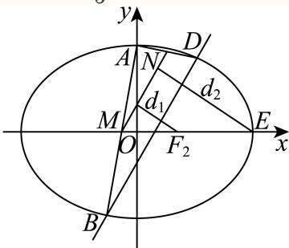

由 $F_{2}(1,0)$、$E\left(\sqrt{5},0\right)$ 得

$$
d_{1}=\frac{\vert 4\times 1-2\times 0+n+2\vert}{\sqrt{4^{2}+(-2)^{2}}}=\frac{\vert 6+n\vert}{2\sqrt{5}},\qquad d_{2}=\frac{\left\vert 4\sqrt{5}-2\times 0+n+2\right\vert}{2\sqrt{5}}=\frac{\left\vert 4\sqrt{5}+2+n\right\vert}{2\sqrt{5}}.
$$

因为 $-2\sqrt{6}\le n\le 2\sqrt{6}$，所以

$$
6+n\ge 6-2\sqrt{6}>0,\qquad 4\sqrt{5}+2+n\ge 4\sqrt{5}+2-2\sqrt{6}>0,
$$

故

$$
d_{2}-d_{1}=\frac{4\sqrt{5}+2+n}{2\sqrt{5}}-\frac{6+n}{2\sqrt{5}}=\frac{4\sqrt{5}-4}{2\sqrt{5}}=\frac{10-2\sqrt{5}}{5},
$$

即 $d_{2}-d_{1}$ 为定值，且定值为 $\dfrac{10-2\sqrt{5}}{5}$．

---

---

### 094 · 原第20题

**来源：** S047 · 上海市闵行中学 · 高三 · 2025-2026 · 期中 · 原第20题

**考点说明：** 椭圆焦点与距离关系，正切和角公式求夹角，韦达定理求距离和的参数范围

> **校订提示**
>
> 源稿题干“已知椭圆 $\because\dfrac{x^{2}}{4}+y^{2}=1$”中的 $\because$ 为转录噪声；据后文“$\Gamma$ 的左焦点”等表述，此处指椭圆 $\Gamma:\dfrac{x^{2}}{4}+y^{2}=1$。

> 下列正文保留原转录；与本提示冲突的文字或公式不作为有效依据。

在平面直角坐标系 $x O y$ 中，已知椭圆 $\because { \frac { x ^ { 2 } } { 4 } } + y ^ { 2 } = 1$ 1的右顶点为A，点P(a,0)、Q(0,t)分别是x轴负半轴、y轴正半轴上的动点.

(1) 若P是Γ的左焦点，且 $| O A | = | P Q |$ ，求t的值；

(2) 设 $t = 2 { \sqrt { 2 } } .$ ，Γ上存在x轴上方一点B.若 $\tan \angle A Q B = 2 { \sqrt { 2 } }$ ，求B的坐标；

(3) 设t = 2，过P的直线l与Γ交于M、N两点(M、N两点不重合)，与y轴交于C且C的纵坐标$y _ { c } > 1$ ，记M与N到直线AQ的距离分别为 $\mid d _ { 1 } , \ d _ { 2 }$ .若存在直线l，满足 $d _ { 1 } + d _ { 2 } = 3 { \sqrt { 2 } }$ 成立，求a的取值范围.

#### 答案

(1) $t = 1$

(2) $B \left( - { \frac { 1 4 } { 9 } } , { \frac { 4 } { 9 } } { \sqrt { 2 } } \right)$

(3) $\left( - { \frac { 5 } { 2 } } , - 1 \right)$

#### 解析（保留源稿）

(1) 因为P与Γ的左焦点重合，故 $P \left( - { \sqrt { 3 } } , 0 \right)$ ，因此 $| O A | = 2$ 又因为 $P \left( - { \sqrt { 3 } } , 0 \right)$ ，而 $| O A | = | P Q |$ 所以 ${ \sqrt { 3 + t ^ { 2 } } } = 2$ ，解得：t = 1(负舍).

(2) 因为 $\tan \angle A Q O = { \frac { \sqrt { 2 } } { 2 } }$ ，又因为 $\tan \angle A Q B = 2 { \sqrt { 2 } } .$ 而 $\tan \angle A Q B = \tan \left( \angle B Q O + \angle A Q O \right) = 2 \sqrt { 2 } ,$ 代入解得 $\tan \angle B Q O = \frac { \sqrt { 2 } } { 2 }$ 若B在第一象限，则0 $< \tan \angle A Q B < \frac { \sqrt { 2 } } { 2 }$ ，故B在第二象限.设 $B ( x _ { 0 } , y _ { 0 } )$ ，而 $\tan \angle B Q O = \frac { - x _ { 0 } } { 2 \sqrt { 2 } - y _ { 0 } } = \frac { \sqrt { 2 } } { 2 } ,$ 整理可得 ${ \frac { \sqrt { 2 } } { 2 } } y _ { 0 } - 2 = x _ { 0 }$ 代入椭圆Γ方程 $x _ { 0 } ^ { 2 } + 4 y _ { 0 } ^ { 2 } = 1$ ，可得： $\frac { 9 } { 2 } y _ { 0 } ^ { 2 } - 2 \sqrt { 2 } y _ { 0 } = 0$ 所以解得 $y _ { 0 } = \frac { 4 } { 9 } \sqrt { 2 } ($ (增根舍去)，所以 $x _ { 0 } = - { \frac { 1 4 } { 9 } }$ 因此 $B \left( - \frac { 1 4 } { 9 } , \frac { 4 } { 9 } \sqrt { 2 } \right)$

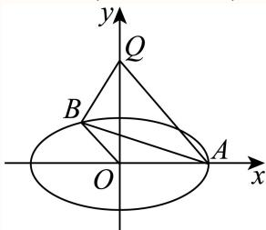

(3) 由题意可知：直线AQ的解析式为 $\ x + y - 2 = 0$ 设直线l的解析式为 $x = m y + a ( m > 0 )$ ，且 $M ( x _ { 1 } , y _ { 1 } ) , \ N ( x _ { 2 } , y _ { 2 } )$ 联立 $\textstyle { \left\{ { \begin{array} { l l } { x = m y + a } \\ { x ^ { 2 } + 4 y ^ { 2 } = 4 } \end{array} } \right. } ,$ 可得 $( m ^ { 2 } + 4 ) y ^ { 2 } + 2 m a y + ( a ^ { 2 } - 4 ) = 0 , \Delta = m ^ { 2 } - a ^ { 2 } + 4 .$ 根据韦达定理， $y _ { 1 } + y _ { 2 } = { \frac { - 2 a m } { m ^ { 2 } + 4 } } , x _ { 1 } + x _ { 2 } = { \frac { 8 a } { m ^ { 2 } + 4 } } .$ 因为M、N两点均在直线AQ的左侧，故 $d _ { 1 } + d _ { 2 } = { \frac { | ( x _ { 1 } + x _ { 2 } ) + ( y _ { 1 } + y _ { 2 } ) - 4 | } { \sqrt { 2 } } } = 3 { \sqrt { 2 } } .$ 又因为 $x _ { 1 } , x _ { 2 } \in [ - 2 , 0 ) , y _ { 1 } , y _ { 2 } \in ( - 1 , 1 )$ )，因此 $( x _ { 1 } + x _ { 2 } ) + ( y _ { 1 } + y _ { 2 } ) - 4 = - 6$ 代入化简可得方程 $m ^ { 2 } - a m + ( 4 + 4 a ) = 0 \quad$ 设 $f ( m ) = m ^ { 2 } - a m + ( 4 + 4 a )$ ，又因为 $| y _ { c } > 1$ ，故 $m \in ( 0 , - a )$

① 若 $- 2 < a < 0$ ，此时直线l与Γ存在两个交点. 若存在 ${ \mathrm { i } m } ^ { \prime } \in ( 0 , - a )$ ，使得 $f ( m ^ { \prime } ) = 0$ 而 $f ( - a ) = a ^ { 2 } + 2 a + 2 > 0$ ，故 $f ( 0 ) < 0 .$

可得 $4 + 4 a < 0$ ，故 $\cdot a < - 1$ ，因此2 $< a < - 1$

② 若 $\dot { a } \le - 2$ ，而此时P在Γ的外部， $m > { \sqrt { a ^ { 2 } - 4 } } .$ ，故 $m \in \left( { \sqrt { a ^ { 2 } - 4 } } , - a \right)$

若存在 $m ^ { \prime } \in \left( \sqrt { a ^ { 2 } - 4 } , - a \right)$ ，使得 $f ( m ^ { \prime } ) = 0 ,$

而 $f ( - a ) = a ^ { 2 } + 2 a + 2 > 0$

故 $f \left( { \sqrt { a ^ { 2 } - 4 } } \right) < 0$ ，可得 $a ^ { 2 } - a { \sqrt { a ^ { 2 } - 4 } } + 4 a < 0$ ，故 $- \frac { 5 } { 2 } < a \leq - 2$

综上所述，a的取值范围为 $| a \in \left( - { \frac { 5 } { 2 } } , - 1 \right)$

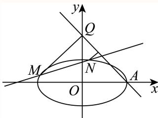

---

---

### 095 · 原第20题

**来源：** S052 · 上海市风华中学 · 高三 · 2025-2026 · 期中 · 原第20题

**考点说明：** 双曲线的标准方程（离心率与过点条件联立）；双曲线中斜率之积为定值（利用点在曲线上作差消元）；直线与双曲线相交的韦达定理、向量垂直的恒成立问题（待定系数＋检验）

已知双曲线 $C:\dfrac{x^2}{a^2}-\dfrac{y^2}{b^2}=1$ 经过点 $(2,3)$，离心率 2，直线 $l$ 交双曲线于 $A$、$B$ 两点。

(1) 求双曲线 $C$ 的方程；

(2) 若 $l$ 过原点，$P$ 为双曲线上异于 $A$、$B$ 的一点，且直线 $PA$、$PB$ 的斜率 $k_{PA}$、$k_{PB}$ 均存在，求证：$k_{PA}\cdot k_{PB}$ 为定值；

(3) 若 $l$ 过双曲线的右焦点 $F_2$，是否存在 $x$ 轴上的点 $M(m,0)$，使得直线 $l$ 绕点 $F_2$ 无论怎么转动，都有 $\overrightarrow{MA}\cdot\overrightarrow{MB}=0$ 成立？若存在，求出 $M$ 的坐标；若不存在，请说明理由。

#### 答案

(1) $C:x^2-\dfrac{y^2}3=1$

(2) 证明见解析

(3) 存在，$(-1,0)$

#### 解析（保留源稿）

(1) 由题意得 $\begin{cases}\dfrac4{a^2}-\dfrac9{b^2}=1\\ \dfrac ca=2\\ c^2=a^2+b^2\end{cases}$，解得 $\begin{cases}a^2=1\\ b^2=3\end{cases}$，则双曲线 $C:x^2-\dfrac{y^2}3=1$。

(2) 证明：设 $A$ 点坐标为 $(x_0,y_0)$，则由对称性知 $B$ 点坐标为 $B(-x_0,-y_0)$。

设 $P(x,y)$，则 $k_{PA}\cdot k_{PB}=\dfrac{y-y_0}{x-x_0}\cdot\dfrac{y+y_0}{x+x_0}=\dfrac{y^2-y_0^2}{x^2-x_0^2}$；

由 $\begin{cases}x^2-\dfrac{y^2}3=1\\ x_0^2-\dfrac{y_0^2}3=1\end{cases}$，得 $y^2-y_0^2=3(x^2-x_0^2)$，

所以 $k_{PA}\cdot k_{PB}=\dfrac{y^2-y_0^2}{x^2-x_0^2}=3$。

(3) 存在。当直线 $l$ 的斜率存在时，设直线 $l$ 方程为 $y=k(x-2)$，与双曲线方程联立消 $y$ 得

$(k^2-3)x^2-4k^2x+4k^2+3=0$，

所以 $\begin{cases}k^2-3\ne0\\ \Delta>0\end{cases}$，得 $k^2\ne3$，且 $\begin{cases}x_1+x_2=\dfrac{4k^2}{k^2-3}\\ x_1x_2=\dfrac{4k^2+3}{k^2-3}\end{cases}$。

设 $A(x_1,y_1)$，$B(x_2,y_2)$，

$\overrightarrow{MA}\cdot\overrightarrow{MB}=(x_1-m)(x_2-m)+y_1y_2=(k^2+1)x_1x_2-(2k^2+m)(x_1+x_2)+m^2+4k^2=\dfrac{3-(4m+5)k^2}{k^2-3}+m^2$。

假设存在实数 $m$，使得 $\overrightarrow{MA}\cdot\overrightarrow{MB}=0$，则 $3(1-m^2)+k^2(m^2-4m-5)=0$ 对任意 $k^2\ne3$ 恒成立，

所以 $\begin{cases}1-m^2=0\\ m^2-4m-5=0\end{cases}$，解得 $m=-1$。

当直线 $l$ 的斜率不存在时，由 $A(2,3)$、$B(2,-3)$ 及 $M(-1,0)$ 知结论也成立。

综上，存在 $M(-1,0)$，使 $\overrightarrow{MA}\cdot\overrightarrow{MB}=0$。

---

---

### 096 · 原第20题

**来源：** S003 · 华东师范大学第二附属中学 · 高三 · 2025-2026 · 期中 · 原第20题

**考点说明：** 椭圆的离心率；直线与椭圆联立、斜率之积条件与定点问题；椭圆焦点弦、面积表示与零点存在性判断

> **校订提示**
>
> 源稿题号行写作“20 20”（题号重复）。另（3）中“P，N 关于原点对称”指 $N$ 与 $P$ 关于原点对称（即 $N=-P$），解析中 $S_{\triangle PQN}=2S_{\triangle POQ}$ 与此一致，据此理解保留原文。

> 下列正文保留原转录；与本提示冲突的文字或公式不作为有效依据。

已知曲线 $C$ 的方程为 $\dfrac{x^{2}}{4}+\dfrac{y^{2}}{3}=1$，曲线 $C$ 的左顶点为 $E$，右焦点为 $F$，动直线 $l$ 与曲线 $C$ 交于 $P$，$Q$ 两点。

(1) 求曲线 $C$ 的离心率；

(2) 设直线 $EP$，$EQ$ 的斜率分别为 $k_{1}$，$k_{2}$，且满足 $k_{1}k_{2}=-\dfrac{9}{4}$，证明直线 $l$ 恒过定点；

(3) 若 $l$ 过点 $F$，且 $P$，$N$ 关于原点对称，是否存在直线 $l$，使得四边形 $OFQN$ 的面积为 $\dfrac{9}{4}$？若存在，求出直线 $l$ 的条数；若不存在，请说明理由。

#### 答案

(1) $\dfrac{1}{2}$　(2) $(-1,0)$　(3) 存在，2 条

#### 解析（保留源稿）

(1) 由曲线 $C$ 的方程 $\dfrac{x^{2}}{4}+\dfrac{y^{2}}{3}=1$ 可得，$a^{2}=4$，$b^{2}=3$，故 $a=2$，$c=\sqrt{a^{2}-b^{2}}=1$，故离心率 $e=\dfrac{c}{a}=\dfrac{1}{2}$。

(2) 由 $E(-2,0)$，设直线 $l:x=my+n$，$P(x_{1},y_{1})$，$Q(x_{2},y_{2})$。

联立 $\begin{cases}x=my+n\\[4pt]\dfrac{x^{2}}{4}+\dfrac{y^{2}}{3}=1\end{cases}$，得 $(3m^{2}+4)y^{2}+6mny+3n^{2}-12=0$。

$$
y_{1}+y_{2}=-\dfrac{6mn}{3m^{2}+4},\quad y_{1}y_{2}=\dfrac{3n^{2}-12}{3m^{2}+4},
$$

$$
k_{1}=\dfrac{y_{1}}{x_{1}+2}=\dfrac{y_{1}}{my_{1}+n+2},\quad k_{2}=\dfrac{y_{2}}{x_{2}+2}=\dfrac{y_{2}}{my_{2}+n+2}.
$$

由 $k_{1}k_{2}=\dfrac{y_{1}y_{2}}{(my_{1}+n+2)(my_{2}+n+2)}=-\dfrac{9}{4}$，代入韦达定理化简可得

$$
\dfrac{3n^{2}-12}{4(n+2)^{2}}=-\dfrac{9}{4},
$$

解得 $n=-1$，则直线 $l$ 过定点 $(-1,0)$。

(3) 满足题意的直线条数有两条，证明如下：

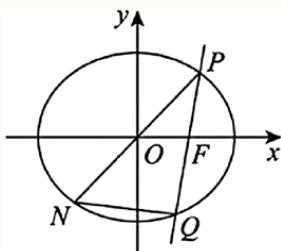

由题意可知直线 $PQ$ 的斜率不为 0，设 $PQ:x=my+1$，$P(x_{1},y_{1})$，$Q(x_{2},y_{2})$，不妨设 $y_{1}>0$，$y_{2}<0$。

联立 $\begin{cases}x=my+1\\[4pt]\dfrac{x^{2}}{4}+\dfrac{y^{2}}{3}=1\end{cases}$ 可得 $(3m^{2}+4)y^{2}+6my-9=0$，即

$$
\begin{cases}y_{1}+y_{2}=-\dfrac{6m}{3m^{2}+4}\quad ①\\[6pt]y_{1}y_{2}=-\dfrac{9}{3m^{2}+4}\quad ②\end{cases}
$$

因为 $N$ 与 $P$ 关于原点对称，所以 $O$ 为 $PN$ 的中点，$S_{\triangle PQN}=2S_{\triangle POQ}$，于是四边形 $OFQN$ 的面积

$$
S=S_{\triangle PQN}-S_{\triangle POF}=2S_{\triangle POQ}-S_{\triangle POF}.
$$

又 $S_{\triangle POQ}=\dfrac{1}{2}\vert y_{1}-y_{2}\vert$，$S_{\triangle POF}=\dfrac{1}{2}OF\cdot y_{1}=\dfrac{1}{2}y_{1}$，所以

$$
S=\dfrac{1}{2}y_{1}-y_{2}=\dfrac{9}{4}.
$$

由此 $y_{1}=2y_{2}+\dfrac{9}{2}$，代入①可得 $y_{1}=-\dfrac{4m}{3m^{2}+4}+\dfrac{3}{2}$，$y_{2}=-\dfrac{2m}{3m^{2}+4}-\dfrac{3}{2}$。

代入②可得 $\left(-\dfrac{4m}{3m^{2}+4}+\dfrac{3}{2}\right)\left(-\dfrac{2m}{3m^{2}+4}-\dfrac{3}{2}\right)=-\dfrac{9}{3m^{2}+4}$，

整理得 $(81m^{3}-36m^{2}+76m-48)m=0$，即 $m=0$ 或 $81m^{3}-36m^{2}+76m-48=0$。

令 $\varphi(m)=81m^{3}-36m^{2}+76m-48$，则 $\varphi'(m)=243m^{2}-72m+76$。

因为 $\Delta=72^{2}-4\times 243\times 76<0$，所以 $\varphi'(m)>0$，即 $\varphi(m)$ 在 $\mathbf{R}$ 上单调递增。

因为 $\varphi(0)=-48<0$，$\varphi(1)=73>0$，由零点存在性定理可知 $\varphi(m)$ 在 $(0,1)$ 上有唯一零点。

加上 $m=0$（即直线 $x=1$）这一条，综上所述，满足题意的直线 $l$ 有两条。

---

---

### 097 · 原第20题

**来源：** S039 · 华东师范大学附属东昌中学 · 高三 · 2025-2026 · 期中 · 原第20题

**考点说明：** 椭圆标准方程的待定系数法（焦点由抛物线给出）；直线与抛物线相交的弦长公式与三角形面积；直线与椭圆联立、韦达定理与等差中项条件

> **校订提示**
>
> 源稿第 20(3) 题解析的概述段写作“设直线 $l:y=k(x-1)$，带入椭圆方程得到 $k^{2}x^{2}-2(k^{2}+2)x+k^{2}=0$”，实为第（2）问与抛物线联立的结果（串行）；详解正文用的是 $y=kx-1$，本成品以详解为准。

> 下列正文保留原转录；与本提示冲突的文字或公式不作为有效依据。

已知椭圆 $\Gamma$ 的中心在坐标原点，且经过点 $\left(1,\dfrac{3}{2}\right)$，它的一个焦点与抛物线 $E:y^{2}=4x$ 的焦点重合，斜率为 $k$ 的直线 $l$ 交抛物线 $E$ 于 $A$、$B$ 两点，交椭圆 $\Gamma$ 于 $C$、$D$ 两点。

（1）求椭圆 $\Gamma$ 的方程；

（2）直线 $l$ 经过点 $F(1,0)$，设点 $P(-1,k)$，且 $\triangle PAB$ 的面积为 $4\sqrt{3}$，求 $k$ 的值；

（3）若直线 $l$ 过点 $M(0,-1)$，设直线 $OC$，$OD$ 的斜率分别为 $k_{1}$，$k_{2}$，且 $\dfrac{1}{k_{1}},\dfrac{2}{k},\dfrac{1}{k_{2}}$ 成等差数列，求直线 $l$ 的方程。

#### 答案

（1）$\dfrac{x^{2}}{4}+\dfrac{y^{2}}{3}=1$　（2）$k=\pm\sqrt{3}$　（3）$y=\pm\dfrac{\sqrt{2}}{2}x-1$

#### 解析（保留源稿）

（1）设椭圆的方程为 $\dfrac{x^{2}}{a^{2}}+\dfrac{y^{2}}{b^{2}}=1\ (a>b>0)$。抛物线 $E:y^{2}=4x$ 的焦点为 $(1,0)$，故 $c=1$。

由题设得 $\begin{cases}\dfrac{1}{a^{2}}+\dfrac{9}{4b^{2}}=1\\[6pt]a^{2}-b^{2}=1\end{cases}$，解得 $\begin{cases}a^{2}=4\\b^{2}=3\end{cases}$。

$\therefore\$椭圆 $\Gamma$ 的方程是 $\dfrac{x^{2}}{4}+\dfrac{y^{2}}{3}=1$。

（2）设直线 $l:y=k(x-1)$，设 $A(x_{1},y_{1})$，$B(x_{2},y_{2})$。

由 $\begin{cases}y=k(x-1)\\y^{2}=4x\end{cases}$ 得 $k^{2}x^{2}-2(k^{2}+2)x+k^{2}=0$，

$$
x_{1}+x_{2}=\dfrac{2(k^{2}+2)}{k^{2}},\quad x_{1}x_{2}=1.
$$

$l$ 与抛物线 $E$ 有两个交点，需 $k\ne 0$，此时 $\Delta=16(k^{2}+1)>0$，

$$
\vert AB\vert=\sqrt{1+k^{2}}\cdot\dfrac{\sqrt{4(k^{2}+2)^{2}-4k^{4}}}{k^{2}}=\dfrac{4(k^{2}+1)}{k^{2}}.
$$

点 $P(-1,k)$ 到 $l:kx-y-k=0$ 的距离 $d=\dfrac{\vert -k-k-k\vert}{\sqrt{k^{2}+1}}=\dfrac{3\vert k\vert}{\sqrt{k^{2}+1}}$。

又 $S_{\triangle PAB}=4\sqrt{3}$，所以

$$
\dfrac{1}{2}\times\dfrac{4(k^{2}+1)}{k^{2}}\times\dfrac{3\vert k\vert}{\sqrt{k^{2}+1}}=4\sqrt{3},
$$

即 $6\sqrt{k^{2}+1}=4\sqrt{3}\vert k\vert$，平方得 $36(k^{2}+1)=48k^{2}$，即 $4k^{2}=3k^{2}+3$，故 $k=\pm\sqrt{3}$。

（3）设直线 $l:y=kx-1$，设 $C(x_{3},y_{3})$，$D(x_{4},y_{4})$。

由 $\begin{cases}y=kx-1\\[4pt]\dfrac{x^{2}}{4}+\dfrac{y^{2}}{3}=1\end{cases}$ 消去 $y$ 得 $(4k^{2}+3)x^{2}-8kx-8=0$。

因为 $M(0,-1)$ 在椭圆内部，所以 $l$ 与椭圆恒有两个交点，且

$$
\begin{cases}x_{3}+x_{4}=\dfrac{8k}{4k^{2}+3}\\[8pt]x_{3}x_{4}=\dfrac{-8}{4k^{2}+3}\end{cases}
$$

由 $\dfrac{1}{k_{1}},\dfrac{2}{k},\dfrac{1}{k_{2}}$ 成等差数列得 $\dfrac{4}{k}=\dfrac{1}{k_{1}}+\dfrac{1}{k_{2}}$。

$$
\dfrac{1}{k_{1}}+\dfrac{1}{k_{2}}=\dfrac{x_{3}}{y_{3}}+\dfrac{x_{4}}{y_{4}}=\dfrac{x_{3}(kx_{4}-1)+x_{4}(kx_{3}-1)}{(kx_{4}-1)(kx_{3}-1)}
$$

$$
=\dfrac{2kx_{3}x_{4}-(x_{3}+x_{4})}{k^{2}x_{3}x_{4}-k(x_{3}+x_{4})+1}=\dfrac{-\dfrac{16k}{4k^{2}+3}-\dfrac{8k}{4k^{2}+3}}{-\dfrac{8k^{2}}{4k^{2}+3}-\dfrac{8k^{2}}{4k^{2}+3}+1}=\dfrac{24k}{12k^{2}-3}.
$$

所以 $\dfrac{4}{k}=\dfrac{24k}{12k^{2}-3}$，即 $4(12k^{2}-3)=24k^{2}$，解得 $k^{2}=\dfrac{1}{2}$，故 $k=\pm\dfrac{\sqrt{2}}{2}$。

所以直线 $l$ 的方程为 $y=\pm\dfrac{\sqrt{2}}{2}x-1$。

---

---

### 098 · 原第20题

**来源：** S030 · 同济大学第一附属中学 · 高三 · 2025-2026 · 期中 · 原第20题

**考点说明：** 椭圆的离心率与标准方程；直线与椭圆相交、向量的定比分点；椭圆的切线与斜率之积为定值

> **校订提示**
>
> 源稿 (2) 题干写作“已知 $C_{1}$ $D,$ $\overrightarrow{DQ}=2\overrightarrow{QE}$”，有缺字与残片；应为“与椭圆 $C_{1}$ 交于 $D,E$ 两点，且 $\overrightarrow{DQ}=2\overrightarrow{QE}$”。

> 下列正文保留原转录；与本提示冲突的文字或公式不作为有效依据。

已知椭圆 $C_{1}:\dfrac{x^{2}}{a^{2}}+\dfrac{y^{2}}{b^{2}}=1\ (a>b>0)$ 的离心率为 $\dfrac{\sqrt2}{2}$，且点 $\left(-2,\sqrt2\right)$ 在椭圆 $C_{1}$ 上．

(1) 求椭圆 $C_{1}$ 的方程；

(2) 过点 $Q(0,1)$ 的直线 $l$ 与椭圆 $C_{1}$ 交于 $D,E$ 两点，且 $\overrightarrow{DQ}=2\overrightarrow{QE}$，求直线 $l$ 的方程；

(3) 点 $P$ 为椭圆 $C_{1}$ 上任意一点，过点 $P$ 作 $C_{1}$ 的切线与圆 $C_{2}:x^{2}+y^{2}=12$ 交于 $A,B$ 两点，设直线 $OA,OB$ 的斜率分别为 $k_{1},k_{2}$．证明：$k_{1}\cdot k_{2}$ 为定值，并求该定值．

#### 答案

(1) $C_{1}:\dfrac{x^{2}}8+\dfrac{y^{2}}4=1$　(2) $l:y=\pm\dfrac{\sqrt{30}}{10}x+1$　(3) $k_{1}\cdot k_{2}$ 为定值 $-\dfrac12$

#### 解析（保留源稿）

(1) 由题意 $\dfrac{c^{2}}{a^{2}}=\dfrac{a^{2}-b^{2}}{a^{2}}=\dfrac12$，故 $a^{2}=2b^{2}$；又点 $\left(-2,\sqrt2\right)$ 在椭圆上，$\dfrac4{a^{2}}+\dfrac2{b^{2}}=1$。

代入得 $\dfrac4{2b^{2}}+\dfrac2{b^{2}}=\dfrac4{b^{2}}=1$，故 $b^{2}=4$，$a^{2}=8$，即

$$
C_{1}:\dfrac{x^{2}}8+\dfrac{y^{2}}4=1.
$$

(2) 若直线 $l$ 的斜率不存在，则 $l:x=0$，此时 $\overrightarrow{DQ}$ 与 $\overrightarrow{QE}$ 共线且长度不等，不合题意，故设 $l:y=tx+1$。

设 $D(x_{1},y_{1})$，$E(x_{2},y_{2})$，$Q(0,1)$，则 $\overrightarrow{DQ}=(-x_{1},1-y_{1})$，$\overrightarrow{QE}=(x_{2},y_{2}-1)$。由 $\overrightarrow{DQ}=2\overrightarrow{QE}$ 得 $x_{1}=-2x_{2}$。

联立 $\begin{cases}y=tx+1\\x^{2}+2y^{2}=8\end{cases}$ 得 $(1+2t^{2})x^{2}+4tx-6=0$，故

$$
x_{1}+x_{2}=\dfrac{-4t}{1+2t^{2}},\qquad x_{1}x_{2}=\dfrac{-6}{1+2t^{2}}.
$$

由 $x_{1}=-2x_{2}$ 得 $-x_{2}=\dfrac{-4t}{1+2t^{2}}$，$-2x_{2}^{2}=\dfrac{-6}{1+2t^{2}}$，消去 $x_{2}$ 得

$$
16t^{2}=6(1+2t^{2})\ \Longrightarrow\ 4t^{2}=6\ \Longrightarrow\ t^{2}=\dfrac3{10},
$$

即 $t=\pm\dfrac{\sqrt{30}}{10}$，故直线 $l$ 的方程为 $y=\pm\dfrac{\sqrt{30}}{10}x+1$。

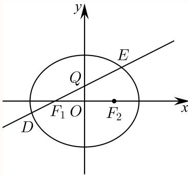

(3) 当切线斜率不存在时，切线为 $x=2\sqrt2$ 或 $x=-2\sqrt2$。若 $x=2\sqrt2$，则 $A\left(2\sqrt2,2\right)$，$B\left(2\sqrt2,-2\right)$，$k_{1}=\dfrac{\sqrt2}2$，$k_{2}=-\dfrac{\sqrt2}2$，$k_{1}k_{2}=-\dfrac12$；$x=-2\sqrt2$ 时同理 $k_{1}k_{2}=-\dfrac12$。

当切线斜率存在时，设切线 $AB:y=kx+m$，与椭圆联立：

$$
\begin{cases}y=kx+m\\x^{2}+2y^{2}=8\end{cases}\ \Longrightarrow\ (1+2k^{2})x^{2}+4kmx+2m^{2}-8=0.
$$

由相切得 $\Delta=16k^{2}m^{2}-4(1+2k^{2})(2m^{2}-8)=0$，化简得 $m^{2}=4+8k^{2}$。

再与圆联立：$x^{2}+(kx+m)^{2}=12$，即 $(1+k^{2})x^{2}+2kmx+m^{2}-12=0$，故

$$
x_{3}+x_{4}=\dfrac{-2km}{1+k^{2}},\qquad x_{3}x_{4}=\dfrac{m^{2}-12}{1+k^{2}}.
$$

于是

$$
k_{1}k_{2}=\dfrac{y_{3}y_{4}}{x_{3}x_{4}}=\dfrac{(kx_{3}+m)(kx_{4}+m)}{x_{3}x_{4}}=\dfrac{k^{2}x_{3}x_{4}+km(x_{3}+x_{4})+m^{2}}{x_{3}x_{4}}
$$

$$
=\dfrac{k^{2}(m^{2}-12)-2k^{2}m^{2}+m^{2}(1+k^{2})}{m^{2}-12}=\dfrac{-12k^{2}+m^{2}}{m^{2}-12}.
$$

代入 $m^{2}=4+8k^{2}$ 得

$$
k_{1}k_{2}=\dfrac{-12k^{2}+4+8k^{2}}{4+8k^{2}-12}=\dfrac{4-4k^{2}}{8k^{2}-8}=-\dfrac12.
$$

综上，$k_{1}\cdot k_{2}$ 为定值，该定值为 $-\dfrac12$。

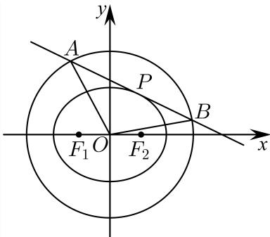

---

---

### 099 · 原第20题

**来源：** S005 · 复旦大学附属中学 · 高三 · 年份待核 · 考试名称待核 · 原第20题

**考点说明：** 椭圆焦点三角形周长、动点数量积与垂直弦面积条件。

已知椭圆 $C:\frac{x^2}{9}+\frac{y^2}{8}=1$，点 $O$ 为坐标原点，椭圆的右顶点为 $A$，左右焦点分别为 $F_1,F_2$，点 $E$ 为椭圆在 $x$ 轴上方的一个动点。

(1) 求椭圆 $C$ 的焦距与 $\triangle EF_1F_2$ 的周长；

(2) 若 $\overrightarrow{EA}\cdot\overrightarrow{EF_1}=\frac94$，求点 $E$ 到 $x$ 轴的距离；

(3) 过点 $F_1$ 作斜率为 $k$ 的直线 $l$ 交 $y$ 轴正半轴于点 $P$，点 $P$ 位于椭圆内，直线 $l$ 与椭圆 $C$ 交于 $G,H$ 两点，记 $\triangle OGH,\triangle OF_1P$ 的面积分别为 $S_1,S_2$，求 $\frac{S_1}{S_2}$ 的取值范围。

#### 答案

(1) 焦距为 $2$，周长为 $8$；(2) $\sqrt6$；(3) $(\frac95,6)$

【破题眼】第 (3) 问别硬算两个三角形。$G,H$ 在同一条直线上，先用“底乘高”把面积比化简。

#### 解析（保留源稿）

(1) 椭圆中 $a=3$，$b=2\sqrt2$，所以 $c=\sqrt{a^2-b^2}=1$。焦距 $2c=2$。又椭圆上点满足 $EF_1+EF_2=2a=6$，所以 $\triangle EF_1F_2$ 的周长为 $EF_1+EF_2+F_1F_2=6+2=8$。

(2) 设 $E=(x,y)$，$y>0$。右顶点 $A=(3,0)$，左焦点 $F_1=(-1,0)$。则 $\overrightarrow{EA}=(3-x,-y)$，$\overrightarrow{EF_1}=(-1-x,-y)$。

点积为 $(3-x)(-1-x)+y^2=x^2-2x-3+y^2$。由椭圆方程得 $y^2=8-\frac89x^2$，所以点积 $=\frac19x^2-2x+5$。令其等于 $\frac94$，得 $\frac19x^2-2x+\frac{11}{4}=0$，解得 $x=\frac32$（另一个根不在椭圆范围内）。于是 $y^2=8-\frac89\cdot\frac94=6$，点 $E$ 到 $x$ 轴的距离为 $\sqrt6$。

(3) $F_1=(-1,0)$，直线 $l$ 为 $y=k(x+1)$。它交 $y$ 轴正半轴于 $P=(0,k)$，且 $P$ 在椭圆内，所以 $0<k<2\sqrt2$。

设 $G(x_1,k(x_1+1))$，$H(x_2,k(x_2+1))$。先算 $S_2$：$OF_1=1$，$OP=k$，所以 $S_2=\frac12\cdot1\cdot k=\frac k2$。

再算 $S_1$。线段 $GH$ 在直线 $y=k(x+1)$ 上，长度为 $\sqrt{1+k^2}|x_1-x_2|$。原点 $O$ 到直线 $y=kx+k$ 的距离为 $\frac{k}{\sqrt{1+k^2}}$。所以 $S_1=\frac12\cdot\sqrt{1+k^2}|x_1-x_2|\cdot\frac{k}{\sqrt{1+k^2}}=\frac k2|x_1-x_2|$。

因此 $\frac{S_1}{S_2}=|x_1-x_2|$。

联立 $y=k(x+1)$ 与 $\frac{x^2}{9}+\frac{y^2}{8}=1$，得 $(8+9k^2)x^2+18k^2x+9k^2-72=0$。两根差的绝对值为 $|x_1-x_2|=\frac{\sqrt\Delta}{8+9k^2}$，其中 $\Delta=2304(k^2+1)$。

因此 $\frac{S_1}{S_2}=\frac{48\sqrt{k^2+1}}{9k^2+8}$。令 $u=k^2$，因为 $0<k<2\sqrt2$，所以 $0<u<8$。为避免根号干扰，比较平方：$\left(\frac{S_1}{S_2}\right)^2=\frac{2304(u+1)}{(9u+8)^2}$。设 $F(u)=\frac{u+1}{(9u+8)^2}$，则 $F'(u)=\frac{-9u-10}{(9u+8)^3}<0$，所以原式随 $u$ 增大而减小。

当 $u$ 越接近 $0$ 时，$\frac{S_1}{S_2}$ 越接近 $\frac{48}{8}=6$；当 $u$ 越接近 $8$ 时，$\frac{S_1}{S_2}$ 越接近 $\frac{48\cdot3}{80}=\frac95$。但 $u$ 不能等于 $0$ 或 $8$，所以两个端点都取不到，取值范围为 $(\frac95,6)$。

【方法总结】解析几何面积题先找“底”和“高”。这里 $G,H$ 同在直线 $l$ 上，用 $GH$ 作底，原点到直线 $l$ 的距离作高，面积会自动化简。

【易错点】$P$ 在椭圆内给的是 $0<k<2\sqrt2$，端点不能取，所以最终区间也是开区间。

---

### 100 · 原第18题

**来源：** S031 · 上海外国语大学附属外国语学校松江云间中学 · 高二 · 2025-2026 · 期中 · 原第18题

**考点说明：** 由向量数量积确定圆的轨迹方程，并求圆的切线方程。

已知 $A(1,2), B(3,6)$ ，动点 $P$ 满足 $\overrightarrow{PA} \cdot \overrightarrow{PB} = -4$ ，设动点 $P$ 的轨迹为曲线 $C$ .

(1) 求曲线 $C$ 的标准方程;

(2) 求过点 $A(1,2)$ 且与曲线 $C$ 相切的直线的方程.

#### 答案

(1) $(x - 2)^{2} + (y - 4)^{2} = 1$

(2) $x = 1$ 或 $3x - 4y + 5 = 0$

#### 解析（保留源稿）

(1) 设 $P(x, y)$ , 则 $\overrightarrow{PA} = (1 - x, 2 - y), \overrightarrow{PB} = (3 - x, 6 - y)$ ,

故 $\overrightarrow{PA}\cdot\overrightarrow{PB}=(1-x)(3-x)+(2-y)(6-y)=-4,$

化简整理得 $(x-2)^{2}+(y-4)^{2}=1,$

故曲线C的标准方程为 $(x-2)^{2}+(y-4)^{2}=1;$

(2) 曲线 $C$ 是以 $C(2,4)$ 为圆心，1为半径的圆，

当过点A(1,2)的直线斜率不存在时，直线方程为x=1，

此时 $C(2,4)$ 到x=1的距离为1，故x=1与圆C相切，满足要求，

当过点 $A(1,2)$ 的直线斜率存在时，设切线方程为 $y - 2 = k(x - 1)$ ，即 $kx - y + 2 - k = 0$

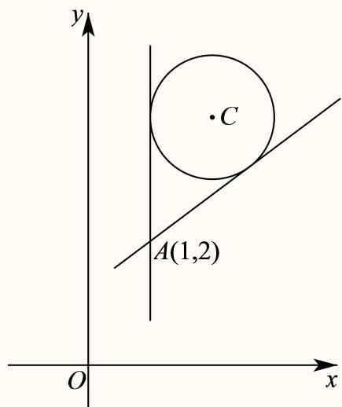

圆心 $C(2,4)$ 到 $kx - y + 2 - k = 0$ 的距离 $d = \frac{|2k - 4 + 2 - k|}{\sqrt{1 + k^2}} = 1,$

解得 $k=\frac{3}{4}$ ，故切线方程为 $\frac{3}{4}x-y+2-\frac{3}{4}=0$ ，即 $3x-4y+5=0$ ，

综上，过点A(1,2)且与曲线C相切的直线方程为x=1或 $3x-4y+5=0$ .

---

---

### 101 · 原第21题

**来源：** S031 · 上海外国语大学附属外国语学校松江云间中学 · 高二 · 2025-2026 · 期中 · 原第21题

**考点说明：** 双曲线的渐近线与离心率；直线与椭圆、线段长最值；直线与椭圆、斜率关系与最值

已知曲线C: $(3 - 2m^{2})x^{2} - 4my^{2} = 4 (m \in \mathbf{R})$ .

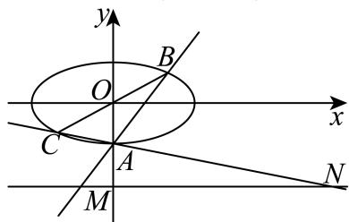

(1) 若曲线C为双曲线，且渐近线方程为 $y=\pm\frac{\sqrt{3}}{3}x$ ，求曲线C的离心率；

(2) 若 $m = -1$ ，过点 $A(0, -1)$ 的直线与直线 $y = -2$ 交于点 $\mathrm{M}$ ，与椭圆交于 $\mathrm{B}$ ，点 $\mathrm{B}$ 关于原点的对称点为 $\mathrm{C}$ ，直线AC交直线 $y = -2$ 于点 $\mathrm{N}$ ，求线段MN的长的最小值；

(3) 若曲线C为焦点在x轴上的椭圆，且 $P\left(1,\frac{\sqrt{3}}{2}\right)$ 在曲线C上．点A、B在曲线C上（P、A、B互不重合），若直线PA与PB的斜率存在且互为相反数，求线段AB的长的最大值.

#### 答案

(1) $\frac{2\sqrt{3}}{3}$ 或 2

(2) 4

(3) $\sqrt{13}$

#### 解析（保留源稿）

(1) 因为曲线 $C: (3 - 2m^2)x^2 - 4my^2 = 4 (m \in \mathbf{R})$ 为双曲线,

若焦点在x轴上，则 $\frac{x^{2}}{\frac{4}{3-2m^{2}}}-\frac{y^{2}}{\frac{1}{m}}=1$ ，且 $\left\{\begin{aligned}\frac{1}{m}>0\\ \frac{4}{3-2m^{2}}>0\end{aligned}\right.$ ，解得 $0<m<\frac{\sqrt{6}}{2}$

又渐近线方程为 $y=\pm\frac{\sqrt{3}}{3}x$ ，则 $\frac{\frac{1}{m}}{4}=\frac{1}{3}$ ，即 $6m^{2}+4m-9=0$ ，解得

$$
m = \frac {- 2 + \sqrt {5 8}}{6} \text {或} m = \frac {- 2 - \sqrt {5 8}}{6} (\text {舍去}),
$$

此时曲线C的离心率 $e=\sqrt{1+\left(\frac{\sqrt{3}}{3}\right)^{2}}=\frac{2\sqrt{3}}{3}$ ;

若焦点在 $y$ 轴上，则 $\frac{y^2}{-\frac{1}{m}} -\frac{x^2}{- \frac{4}{3 - 2m^2}} = 1$ ，且 $\left\{ \begin{array}{l} - \frac{1}{m} >0\\ -\frac{4}{3 - 2m^2} >0 \end{array} \right.$ 解得 $-\frac{\sqrt{6}}{2} < m < 0,$ 又渐近线方程为 $y = \pm \frac{\sqrt{3}}{3} x,$

则 $\frac{-\frac{1}{m}}{-\frac{4}{3 - 2m^2}} = \frac{1}{3}$ ，即 $6m^2 + 4m - 9 = 0$ ，解得 $m = \frac{-2 + \sqrt{58}}{6}$ （舍去）或

$$
m = \frac {- 2 - \sqrt {5 8}}{6}
$$

此时曲线 $C$ 的离心率 $e = \sqrt{1 + \left(\sqrt{3}\right)^2} = 2,$

综上可得曲线C的离心率为 $\frac{2\sqrt{3}}{3}$ 或2.

(2) 当 $m = -1$ 时曲线 $C: \frac{x^2}{4} + y^2 = 1$ ,

依题意，直线AB的斜率必存在（否则点A, C重合，不合题意），可设其方程为y = kx - 1 ( $k \neq 0$ ),

联立 $\left\{\begin{aligned}y&=kx-1\\ \frac{x^{2}}{4}+y^{2}&=1\end{aligned}\right.$ ，消去y并整理得 $(1+4k^{2})x^{2}-8kx=0,$

解得 $x_{B} = \frac{8k}{1 + 4k^{2}}$ ，则 $y_{B} = kx_{B} - 1 = \frac{8k^{2}}{1 + 4k^{2}} -1 = \frac{4k^{2} - 1}{1 + 4k^{2}}$ ，即 $B\left(\frac{8k}{1 + 4k^2},\frac{4k^2 - 1}{1 + 4k^2}\right)$

因为点 $B$ 关于原点的对称点为 $C$ ，所以 $C\left(-\frac{8k}{1 + 4k^2},\frac{1 - 4k^2}{1 + 4k^2}\right),$

此时 $k_{AC}=\frac{\frac{1-4k^{2}}{1+4k^{2}}+1}{-\frac{8k}{1+4k^{2}}}=-\frac{1}{4k}$ ，故直线AC的方程为 $y=-\frac{x}{4k}-1$

当 $y = -2$ 时，解得 $x = 4k$ ，即 $N(4k, - 2)$ ，又易得 $M\left(-\frac{1}{k}, - 2\right)$ ，则 $|MN| = \left|4k + \frac{1}{k}\right|$

则 $|MN|^{2}=16k^{2}+8+\frac{1}{k^{2}}$ ，因为 $16k^{2}>0,\quad\frac{1}{k^{2}}>0$ ，则 $16k^{2}+\frac{1}{k^{2}}\geq2\sqrt{16k^{2}\cdot\frac{1}{k^{2}}}=8,$

当且仅当 $16k^{2}=\frac{1}{k^{2}}$ ，即 $k=\pm\frac{1}{2}$ 时，等号成立，

所以当 $k=\pm\frac{1}{2}$ 时， $|MN|^{2}$ 取得最小值为16，故 $|MN|$ 的最小值为4.

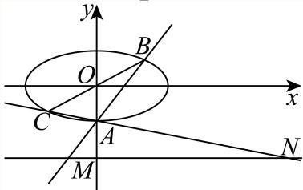

(3) 依题意 $(3 - 2m^2) \times 1^2 - 4m \times \left(\frac{\sqrt{3}}{2}\right)^2 = 4$ ，解得 $m = -1$ 或 $m = -\frac{1}{2}$ ，

当m=-1时曲线C: $\frac{x^{2}}{4}+y^{2}=1$ ，为焦点在x轴上的椭圆，符合题意；

当 $m = -\frac{1}{2}$ 时曲线 $C: \frac{x^2}{\frac{8}{5}} + \frac{y^2}{2} = 1$ ，为焦点在y轴上的椭圆，不符合题意；

依题意，可设直线 $PA$ 的方程为 $y = k(x - 1) + \frac{\sqrt{3}}{2} (k\neq 0),$

联立 $\left\{ \begin{array}{l} y = k(x - 1) + \frac{\sqrt{3}}{2} \\ \frac{x^2}{4} + y^2 = 1 \end{array} \right.$ 得 $(4k^2 + 1)x^2 + (4\sqrt{3}k - 8k^2)x + 4k^2 - 4\sqrt{3}k - 1 = 0,$

$\Delta = \left(4\sqrt{3} k - 8k^2\right)^2 - 4\left(4k^2 + 1\right)\left(4k^2 - 4\sqrt{3} k - 1\right) = 4\left(2\sqrt{3} k + 1\right)^2 > 0$ 可得 $k \neq -\frac{\sqrt{3}}{6}$ ,

$x_{P} = 1$ ，则 $x_{P} + x_{A} = -\frac{4\sqrt{3}k - 8k^{2}}{4k^{2} + 1}$ ，解得 $x_{A} = \frac{4k^{2} - 4\sqrt{3}k - 1}{4k^{2} + 1},$

因直线PA与PB的斜率存在且互为相反数，故直线PB的斜率为-k，同理可得

$$
x _ {B} = \frac {4 k ^ {2} + 4 \sqrt {3} k - 1}{4 k ^ {2} + 1},
$$

$$
\left| x _ {A} - x _ {B} = - \frac {8 \sqrt {3} k}{4 k ^ {2} + 1}, y _ {A} - y _ {B} = k \left(x _ {A} + x _ {B} - 2\right) = - \frac {4 k}{4 k ^ {2} + 1}, \right.
$$

$$
| A B | = \sqrt {(x _ {A} - x _ {B}) ^ {2} + (y _ {A} - y _ {B}) ^ {2}} = \frac {4 \sqrt {1 3} | k |}{4 k ^ {2} + 1} = \frac {4 \sqrt {1 3}}{4 | k | + \frac {1}{| k |}} \leq \frac {4 \sqrt {1 3}}{2 \sqrt {4 | k | \cdot \frac {1}{| k |}}} = \sqrt {1 3},
$$

当且仅当 $4|k| = \frac{1}{|k|}$ ，即 $k = \pm \frac{1}{2}$ 时等号成立，经检验符合 $\Delta > 0$ ，所以线段AB的长的最大值为 $\sqrt{13}$ .

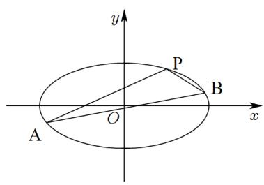

---

### 102 · 原第20题

**来源：** S009 · 上海大学附属中学 · 高二 · 2025-2026 · 期中 · 原第20题

**考点说明：** 椭圆上点的焦点向量数量积，以及过焦点弦与面积条件求直线。

20 解答题 3次作答 正确率 93.3%

已知椭圆Γ: ${ \frac { x ^ { 2 } } { 4 } } + y ^ { 2 } = 1$ 的左、右焦点分别为 $F _ { 1 } , F _ { 2 }$ ，过 $F _ { 2 }$ 的直线l与椭圆Γ交于A、B两点.

(1) 求 $\triangle F _ { 1 } A .$ B的周长:

(2) 已知点M是椭圆Γ上第一象限的点且 $\overrightarrow { M F _ { 1 } } \cdot \overrightarrow { M F _ { 2 } } = - \frac { 5 } { 4 }$ ，求点M的坐标；

(3) 过点 $F _ { 2 }$ 且与l垂直的直线交椭圆于C、D两点，若四边形ACBD的面积为 $\frac { 4 } { 3 }$ ，求直线l的方程；

#### 答案

(1) 8

(2) $\left( 1 , { \frac { \sqrt { 3 } } { 2 } } \right)$ M

(3) $y = \sqrt { 2 } x - \sqrt { 6 }$ 或 $y = - \sqrt { 2 } x + \sqrt { 1 }$ 6或 $y = { \frac { \sqrt { 2 } } { 2 } } x - { \frac { \sqrt { 6 } } { 2 } }$ 或 $y = - { \frac { \sqrt { 2 } } { 2 } } x + { \frac { \sqrt { 6 } } { 2 } }$

#### 解析（保留源稿）

(1） 因为椭圆Γ: ${ \frac { x ^ { 2 } } { 4 } } + y ^ { 2 } = 1$ ，所以 $\ a = 2 , c = { \sqrt { 3 } } .$

由椭圆几何定义得 $\triangle F _ { 1 } A$ B的周长

$$
C _ { \triangle F _ { 1 } A B } = | F _ { 1 } A | + | F _ { 1 } B | + | A B | = | F _ { 1 } A | + | F _ { 1 } B | + | F _ { 2 } A | + | F _ { 2 } B | = 4 a = 8 .
$$

(2) 由题意，设 ${ \frac { \ i } { \it M } } ( x _ { 0 } , y _ { 0 } ) , { \frac { x _ { 0 } ^ { 2 } } { 4 } } + y _ { 0 } ^ { 2 } = 1 , x _ { 0 } > 0 , y _ { 0 } > 0 _ { }$

故有 $\overrightarrow { M F _ { 1 } } \cdot \overrightarrow { M F _ { 2 } } = \overrightarrow { | M O | ^ { 2 } } - \Bigg | \overrightarrow { O F _ { 1 } } \Bigg | ^ { 2 } = x _ { 0 } ^ { 2 } + y _ { 0 } ^ { 2 } - 3 = - \frac { 5 } { 4 } ,$

解得 $\cdot x _ { 0 } = 1 , y _ { 0 } = { \frac { \sqrt { 3 } } { 2 } }$ 所以点M的坐标为 $\left( 1 , { \frac { \sqrt { 3 } } { 2 } } \right)$

(3) 当l斜率不存在或l斜率为0时，得 $S _ { A B C D } = { \frac { 1 } { 2 } } | A B | \times | C D | = { \frac { 1 } { 2 } } \times 4 \times { \frac { 2 } { 2 } } = 2$ 与条件矛盾舍去，

故l斜率存在且不为0时，

$$
\ P \ / \chi _ { \ / Z \ / B } = k \left( x - \sqrt { 3 } \right) , A \left( x _ { 1 } , y _ { 1 } \right) , B \left( x _ { 2 } , y _ { 2 } \right) , y _ { \ / C D } = - \frac { 1 } { k } \Big ( x - \sqrt { 3 } \Big ) ,
$$

$$
{ \left\{ \begin{array} { l l } { y = k \left( x - { \sqrt { 3 } } \right) } \\ { x ^ { 2 } + 4 y ^ { 2 } - 4 = 0 } \end{array} \right. } ,
$$

$$
\left( 1 + 4 k ^ { 2 } \right) x ^ { 2 } - 8 { \sqrt { 3 } } k ^ { 2 } x + 1 2 k ^ { 2 } - 4 = 0 \Rightarrow { \left\{ \begin{array} { l l } { x _ { 1 } + x _ { 2 } = { \cfrac { 8 { \sqrt { 3 } } k ^ { 2 } } { 1 + 4 k ^ { 2 } } } , } \\ { x _ { 1 } x _ { 2 } = { \cfrac { 1 2 k ^ { 2 } - 4 } { 1 + 4 k ^ { 2 } } } } \end{array} \right. }
$$

故

$$
\left| A B \right| = { \sqrt { 1 + k ^ { 2 } } } { \sqrt { \left( x _ { 1 } + x _ { 2 } \right) ^ { 2 } - 4 x _ { 1 } x _ { 2 } } } = { \sqrt { 1 + k ^ { 2 } } } \cdot { \sqrt { \left( { \frac { 8 { \sqrt { 3 } } k ^ { 2 } } { 1 + 4 k ^ { 2 } } } \right) ^ { 2 } - 4 \cdot { \frac { 1 2 k ^ { 2 } - 4 } { 1 + 4 k ^ { 2 } } } } } = { \sqrt { 1 - ( { \frac { 1 2 k ^ { 2 } } { 1 + 4 k ^ { 2 } } } ) ^ { 2 } - 4 \cdot { \frac { 1 2 k ^ { 2 } } { 1 + 4 k ^ { 2 } } } } } .
$$

$$
\frac { 4 \left( k ^ { 2 } + 1 \right) } { 1 + 4 k ^ { 2 } }
$$

同理 $| C D | = \frac { 4 \left( 1 + k ^ { 2 } \right) } { k ^ { 2 } + 4 }$

所以SABCD = #|AB|·|CD| = (k2(1+(1(+4k2) 43 ⇒k=±或±√2,

故直线方程为 $\vert y = { \sqrt { 2 } } x - { \sqrt { 6 } } { \overrightarrow { \exists } } { \hat { \zeta } } y = - { \sqrt { 2 } } x + { \sqrt { 6 } } { \overrightarrow { \Xi } } { \hat { \chi } } y = { \frac { { \sqrt { 2 } } } { 2 } } x - { \frac { { \sqrt { 6 } } } { 2 } } { \overrightarrow { \Xi } } { \hat { \chi } } y = - { \frac { { \sqrt { 2 } } } { 2 } } x + { \frac { { \sqrt { 6 } } } { 2 } } .$

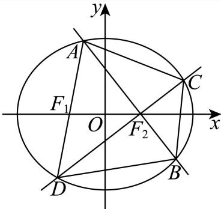

---

### 103 · 原第21题

**来源：** S009 · 上海大学附属中学 · 高二 · 2025-2026 · 期中 · 原第21题

**考点说明：** 最小覆盖圆；四点最小覆盖圆；连续图形最小覆盖圆

#### 21 解答题

在平面几何中，通常将完全覆盖某平面图形且直径最小的圆，称为该平面图形的最小覆盖圆．最小覆盖圆满足以下性质：①线段AB的最小覆盖圆就是以AB为直径的圆；②锐角三角形ABC的最小覆盖圆就是其外接圆． 已知x，y满足方程 $x ^ { 2 } + y ^ { 4 } = 4 ;$ 记其构成的平面图形为W，平面图形W为中心对称图形，A (0, t)，B(2,0), $C \left( 0 , { \sqrt { 2 } } \right)$ ，D(-2,0)为平面图形W上不同的四点.

(1) 求实数t的值及三角形ABC的最小覆盖圆的方程;

(2) 求四边形ABCD的最小覆盖圆的方程;

(3) 求平面图形W的最小覆盖圆的方程.

#### 答案

(1) $x ^ { 2 } + y ^ { 2 } - x - 2 = 0$

(2) $x ^ { 2 } + y ^ { 2 } = 4$

(3) $x ^ { 2 } + y ^ { 2 } = { \frac { 1 7 } { 4 } }$

#### 解析（保留源稿）

(1) 因为点A的坐标满足 $x ^ { 2 } + y ^ { 4 } = 4$ ，则 $t ^ { 4 } = 4$ ，解得 $t = - \sqrt { 2 } \overrightarrow { \sf u } \overrightarrow { \sf u } t = \sqrt { 2 }$ (舍)，故A $\left( 0 , - { \sqrt { 2 } } \right)$

设 $\triangle A B C$ 的外接圆的方程为 $x ^ { 2 } + y ^ { 2 } + D x + E y + F = 0$ ，则 $\left\{ { \begin{array} { l } { 2 - { \sqrt { 2 } } E + F = 0 } \\ { 2 + { \sqrt { 2 } } E + F = 0 { \mathrm { : } } } \\ { 4 + 2 D + F = 0 } \end{array} } \right.$ 解得$\left\{ \begin{array} { l l } { D = - 1 } \\ { E = 0 } \\ { F = - 2 } \end{array} \right. ,$

故 $\triangle A B C$ 的外接圆的方程为 $x ^ { 2 } + y ^ { 2 } - x - 2 = 0$ ，又 $\triangle A B C$ 是锐角三角形，

所以 $\triangle A B C$ 的最小覆盖圆的方程为 $x ^ { 2 } + y ^ { 2 } - x - 2 = 0$

(2) 因为线段BD的最小覆盖圆是以BD为直径的圆，所以线段BD的最小覆盖圆的方程为$x ^ { 2 } + y ^ { 2 } = 4$ ，又 $| O A | = | O C | = { \sqrt { 2 } } < 2$

故点A，C在圆 $x ^ { 2 } + y ^ { 2 } = 4$ 内，所以四边形ABCD的最小覆盖圆的方程为 $x ^ { 2 } + y ^ { 2 } = 4$

(3) 因为平面图形W是中心对称图形，设 $P \left( \boldsymbol { a } , \boldsymbol { b } \right)$ 是平面图形W上的一点，

$$
| O P | ^ { 2 } = a ^ { 2 } + b ^ { 2 } = - b ^ { 4 } + b ^ { 2 } + 4 = - \bigg ( b ^ { 2 } - \frac { 1 } { 2 } \bigg ) ^ { 2 } + \frac { 1 7 } { 4 } \Big ( - \sqrt { 2 } \leq b \leq \sqrt { 2 } \Big ) ,
$$

当 $b ^ { 2 } = { \frac { 1 } { 2 } }$ ，即 $b = \pm { \frac { \sqrt { 2 } } { 2 } }$ 时， $| O P |$ 取得最大值 $\frac { \sqrt { 1 7 } } { 2 }$

故平面图形W的最小覆盖圆的方程为 $x ^ { 2 } + y ^ { 2 } = { \frac { 1 7 } { 4 } }$

---

### 104 · 原第17题

**来源：** S008 · 上海市奉贤中学 · 高二 · 2025-2026 · 期中 · 原第17题

**考点说明：** 圆心与切点条件确定圆方程，结合弦长和点斜式求直线方程。

> **校订提示**
>
> 第(2)问答案栏“$y = 0 \not \exists \not \times 4 x + 3 y + 4 = 0$”中的符号系转录噪声，正确为 $y = 0$ 或 $4x + 3y + 4 = 0$。

> 下列正文保留原转录；与本提示冲突的文字或公式不作为有效依据。

已知圆C的圆心在直线 $x - y - 5 = 0$ 上且与y轴相切于点 $M ( 0 , - 2 )$

(1) 求圆C的标准方程;

(2) 若直线l过点P(-1,0)且被圆C截得的弦长为2 ${ \sqrt { 5 } } ,$ 求直线1的方程.

#### 答案

(1) $( x - 3 ) ^ { 2 } + ( y + 2 ) ^ { 2 } = 9$

(2) $y = 0$ 或 $4 x + 3 y + 4 = 0$

#### 解析（保留源稿）

(1) 解：圆C的圆心在直线 $x - y - 5 = 0$ 上且与y轴切于点 $M ( 0 , - 2 )$ 9可设圆心坐标为 $C \left( \boldsymbol { a } , \boldsymbol { b } \right)$ ，则 $\left\{ { a - b - 5 = 0 \atop b = - 2 } \right.$ 解得 $a = 3 , b = - 2 ,$ 所以圆 $\iota \dot { \Sigma } C ( 3 , - 2 )$ ，半径 $r = | M C | = \sqrt { ( 0 - 3 ) ^ { 2 } + ( - 2 + 2 ) ^ { 2 } } = 3 .$ 故圆的方程为 $( x - 3 ) ^ { 2 } + ( y + 2 ) ^ { 2 } = 9 .$

(2) 解：由直线l过点P(-1,0)且被圆C截得的弦长为 $2 { \sqrt { 5 } } ,$

根据圆的弦长公式，可得 $l = 2 \sqrt { r ^ { 2 } - d ^ { 2 } }$ ，即2 $\sqrt { 5 } = 2 \sqrt { 9 - d ^ { 2 } }$ ，解得d = 2,

当l的斜率不存在时，l的方程为 $\textstyle | x = - 1$ ，此时d = 4不满足条件；

当l的斜率存在时，设直线l的斜率为k，则方程为 $\begin{array} { r } { | y = k ( x + 1 ) } \end{array}$ ，即 $\ : \mathcal { k } x - y + k = 0 \ :$

可得 $d = \frac { | 3 k + 2 + k | } { \sqrt { k ^ { 2 } + 1 } } = 2 .$ 解得 $k = 0 \not \equiv { \hat { \chi } } k = - { \frac { 4 } { 3 } } .$

所以直线方程为 $y = 0 \not \exists \not \in 4 x + 3 y + 4 = 0 .$

---

---

### 105 · 原第20题

**来源：** S008 · 上海市奉贤中学 · 高二 · 2025-2026 · 期中 · 原第20题

**考点说明：** 圆外切线长与夹角、圆系过定点及公共弦直线的定点问题。

已知圆 $M \colon x ^ { 2 } + ( y - 4 ) ^ { 2 } = 4$ ，直线l的方程 $x - 2 y = 0$ ，点P是直线l上一动点，过点P作圆的切线PA、PB，切点分别为A、B.

(1) 当P的横坐标为 $\frac { 1 6 } { 5 }$ 时，求 $\angle A P B$ 的大小;

(2) 求证：经过A、P、M三点的圆N必过定点，并求出所有定点的坐标；

(3) 求证：直线AB必过定点，并求出该定点的坐标.

#### 答案

(1) $6 0 ^ { \circ }$

(2)证明见解析，定点(0,4)、 $\left( { \frac { 8 } { 5 } } , { \frac { 4 } { 5 } } \right)$

(3)证明见解析，定点为 $\left( { \frac { 1 } { 2 } } , 3 \right)$

#### 解析（保留源稿）

(1) 将 $x = { \frac { 1 6 } { 5 } }$ 代入方程 $x - 2 y = 0 \boxed { \mathsf { H } } \uparrow \overleftrightarrow { \mathsf { H } } y = \frac { 8 } { 5 }$ ，即点 $P \left( { \frac { 1 6 } { 5 } } , { \frac { 8 } { 5 } } \right)$

圆 $M \colon x ^ { 2 } + \left( y - 4 \right) ^ { 2 } = 4$ 的圆心为 $M \left( 0 , 4 \right)$ ，半径为 $\mid r = 2$

由平面内两点间的距离公式可得 $| P M | = \sqrt { \left( \frac { 1 6 } { 5 } - 0 \right) ^ { 2 } + \left( \frac { 8 } { 5 } - 4 \right) ^ { 2 } } = 4 ,$

因为直线PA切圆M于点A，则 $A M \bot P A$

因为 $| A M | = r = 2 = { \frac { 1 } { 2 } } | P M |$ 且 $\angle A P M$ 为锐角，故 $\angle A P M = 3 0 ^ { \circ }$ ，故 $\angle A P B = 2 \angle A P M = 6 0 ^ { \circ }$

(2) 设 $P \left( 2 b , b \right)$ ，因为 $\angle M A P = 9 0 ^ { \circ }$ ，所以圆N的一条直径为 $M P ;$ 且点 $N \left( b , { \frac { b + 4 } { 2 } } \right)$

圆N的半径为 $| M N | = { \sqrt { b ^ { 2 } + \left( { \frac { b + 4 } { 2 } } - 4 \right) ^ { 2 } } } = { \sqrt { b ^ { 2 } + { \frac { \left( b - 4 \right) ^ { 2 } } { 4 } } } }$

故圆N的方程为 $( x - b ) ^ { 2 } + \left( y - { \frac { b + 4 } { 2 } } \right) ^ { 2 } = { \frac { 4 b ^ { 2 } + ( b - 4 ) ^ { 2 } } { 4 } }$

即 $( 2 x + y - 4 ) b - ( x ^ { 2 } + y ^ { 2 } - 4 y ) = 0 ,$

由 ${ \left\{ \begin{array} { l l } { 2 x + y - 4 = 0 } \\ { x ^ { 2 } + y ^ { 2 } - 4 y = 0 } \end{array} \right. }$ 解得 $\left\{ { x = 0 \atop y = 4 } \right.$ 或 $\left\{ { x = \frac { 8 } { 5 } } , \right.$

所以圆N经过定点(0,4)和 $\left( { \frac { 8 } { 5 } } , { \frac { 4 } { 5 } } \right)$

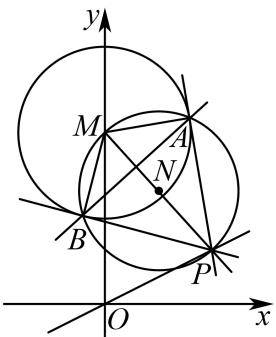

(3) 因为 $| P A | ^ { 2 } = | P M | ^ { 2 } - 4 = 4 b ^ { 2 } + ( b - 4 ) ^ { 2 } - 4 = 5 b ^ { 2 } - 8 b + 1 2 ,$

所以以点P为圆心，半径为 $| P A |$ 的圆P的方程为 $( x - 2 b ) ^ { 2 } + ( y - b ) ^ { 2 } = 5 b ^ { 2 } - 8 b + 1 2 ,$ 即 $\begin{array} { r } { 1 x ^ { 2 } + y ^ { 2 } - 4 b x - 2 b y + 8 b - 1 2 = 0 , } \end{array}$

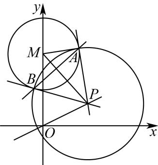

直线 $A B ^ { \prime } { \overline { { \operatorname { I } } } }$ 视为圆P与圆M公共弦所在的直线，

将圆 $P \colon x ^ { 2 } + y ^ { 2 } - 4 b x - 2 b y + 8 b - 1 2 =$ 0的方程与圆 $M : x ^ { 2 } + y ^ { 2 } - 8 y + 1 2 = 0$ 的方程作差，

可得直线AB的方程为b $( 2 x + y - 4 ) + ( 1 2 - 4 y ) = 0$

由 $\left\{ { \begin{array} { l l } { 2 x + y - 4 = 0 } \\ { 1 2 - 4 y = 0 } \end{array} } \right.$ 得 $\left\{ x = \frac { 1 } { 2 } \right.$ 故直线AB过定点 $\left( { \frac { 1 } { 2 } } , 3 \right)$

---

---

### 106 · 原第18题

**来源：** S021 · 上海市宜川中学 · 高二 · 2025-2026 · 期中 · 原第18题

**考点说明：** 圆与直线相切条件及相交弦端点向量数量积求半径。

已知圆 $C:x^{2}+y^{2}-2x+t=0$ ，直线 $l:2x+y=0$ .

(1) 若直线 $l$ 与圆 $C$ 相切，求实数 $t$ 的值；

(2) 直线l与圆C相交于A、B两点，且 $\overrightarrow{OA}\cdot\overrightarrow{OB}=-1$ ，求圆C的半径r.

#### 答案

(1) $t = \frac{1}{5}$ ;

(2) $r = \sqrt{2}.$

#### 解析（保留源稿）

(1) 由圆 $C$ 的一般方程 $x^{2} + y^{2} - 2x + t = 0$ 可得标准方程 $(x - 1)^{2} + y^{2} = 1 - t$ ，则 $1 - t > 0$ ，即 $t < 1$ .

所以圆心 $C(1,0)$ 到直线 $l:2x + y = 0$ 的距离 $d = \frac{|2 + 0|}{\sqrt{2^2 + 1^2}} = \frac{2\sqrt{5}}{5},$

因为直线l与圆C相切，所以 $d^{2}=1-t=\frac{4}{5}$ ，解得 $t=\frac{1}{5}$ ，满足t<1.

所以， $t = \frac{1}{5}$

(2) 由题意，联立 $\left\{ \begin{array}{l} 2x + y = 0 \\ x^2 + y^2 - 2x + t = 0 \end{array} \right.$ 可得 $5x^{2} - 2x + t = 0$

设 $A(x_{1},y_{1}),B(x_{2},y_{2})$ ,

则 $\Delta = 4 - 20t > 0$ ，解得 $t < \frac{1}{5}$

根据韦达定理可得 $x_{1}+x_{2}=\frac{2}{5},x_{1}x_{2}=\frac{t}{5},$

则 $\overrightarrow{OA} \cdot \overrightarrow{OB} = x_1x_2 + y_1y_2 = x_1x_2 + (-2x_1)(-2x_2) = 5x_1x_2 = t = -1,$

所以 $t = -1$ ，满足 $t < \frac{1}{5}$

所以，圆C的半径r满足 $r^{2}=1-t=2$ ，故 $r=\sqrt{2}$ .

---

---

### 107 · 原第21题

**来源：** S021 · 上海市宜川中学 · 高二 · 2025-2026 · 期中 · 原第21题

**考点说明：** 椭圆的离心率；直线与椭圆相交下的定值证明；定值条件与三角形面积最值

已知椭圆 $\Gamma: \frac{x^2}{4} + y^2 = 1$ 的左，右焦点分别为 $F_{1}$ 、 $F_{2}$ ，直线 $l: y = kx + m (m \neq 0)$ 与椭圆 $\Gamma$ 交于 M、N 两点，（点 M 在点 N 的上方），与 y 轴交于点 E.

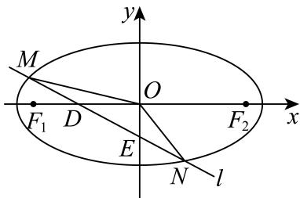

(1) 求椭圆 $\Gamma$ 的离心率e;

(2) 若直线l过点D(-1,0)时，设 $\overrightarrow{EM}=\lambda\overrightarrow{DM},\quad\overrightarrow{EN}=\mu\overrightarrow{DN}$ ，求证： $\lambda+\mu$ 为定值，并求出该值；

(3) 当k为何值时， $|OM|^{2}+|ON|^{2}$ 恒为定值，并求此时三角形MON面积的最大值.

#### 答案

(1) $e=\frac{\sqrt{3}}{2};$

(2) 证明见解析，定值为 $\frac{8}{3}$ ;

(3) $k=\pm\frac{1}{2}$ ，此时三角形 MON 面积的最大值为 1.

#### 解析（保留源稿）

(1) 由 $\Gamma: \frac{x^2}{4} + y^2 = 1$ ，则 $a = 2, b = 1$ ，故 $c = \sqrt{3}$ ，所以离心率 $e = \frac{c}{a} = \frac{\sqrt{3}}{2}$ ;

(2) 由题设，联立 $l: y = k(x + 1)$ 与 $\Gamma: \frac{x^2}{4} + y^2 = 1$ 得， $(4k^2 + 1)x^2 + 8k^2x + 4k^2 - 4 = 0,$

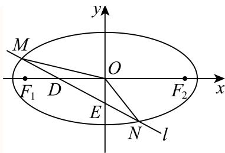

设 $M(x_{1},y_{1}),N(x_{2},y_{2})$ ，则 $x_{1} + x_{2} = -\frac{8k^{2}}{4k^{2} + 1},x_{1}x_{2} = \frac{4k^{2} - 4}{4k^{2} + 1},$

因为 $\overrightarrow{EM}=\lambda\overrightarrow{DM},\overrightarrow{EN}=\mu\overrightarrow{DN}$ ，所以 $x_{1}=\lambda(x_{1}+1),x_{2}=\mu(x_{2}+1)$

$$
\Rightarrow \lambda + \mu = \frac {x _ {1}}{x _ {1} + 1} + \frac {x _ {2}}{x _ {2} + 1} = 2 - \frac {x _ {1} + x _ {2} + 2}{x _ {1} x _ {2} + x _ {1} + x _ {2} + 1} = 2 - \frac {- \frac {8 k ^ {2}}{4 k ^ {2} + 1} + 2}{\frac {4 k ^ {2} - 4}{4 k ^ {2} + 1} - \frac {8 k ^ {2}}{4 k ^ {2} + 1} + 1} = 2 + \frac {2}{3} = \frac {8}{3}
$$

(3) 由题设，联立 $\left\{ \begin{array}{l} y = kx + m \\ x^2 + 4y^2 = 4 \end{array} \right.$ ，消元得 $(4k^2 + 1)x^2 + 8kmx + 4m^2 - 4 = 0$ ，设 $M(x_1, y_1), N(x_2, y_2)$ ，

当 $\Delta = 64k^2 m^2 - 16(4k^2 + 1)(m^2 - 1) > 0$ ，即 $4k^{2} - m^{2} + 1 > 0$ 时，则

$$
x _ {1} + x _ {2} = - \frac {8 k m}{4 k ^ {2} + 1}, x _ {1} x _ {2} = \frac {4 m ^ {2} - 4}{4 k ^ {2} + 1},
$$

$$
\begin{array}{l} x _ {1} ^ {2} + x _ {2} ^ {2} = (x _ {1} + x _ {2}) ^ {2} - 2 x _ {1} x _ {2} = \left(- \frac {8 k m}{4 k ^ {2} + 1}\right) ^ {2} - 2 \times \frac {4 m ^ {2} - 4}{4 k ^ {2} + 1} = \\ \frac {8 (4 k ^ {2} m ^ {2} - m ^ {2} + 4 k ^ {2} + 1)}{(4 k ^ {2} + 1) ^ {2}} \end{array}
$$

$$
\begin{array}{l} {\text {则} | O M | ^ {2} + | O N | ^ {2} = x _ {1} ^ {2} + 1 - \frac {x _ {1} ^ {2}}{4} + x _ {2} ^ {2} + 1 - \frac {x _ {2} ^ {2}}{4}} \\ {= 2 + \frac {3}{4} \left(x _ {1} ^ {2} + x _ {2} ^ {2}\right) = 2 + \frac {2 4 k ^ {2} m ^ {2} - 6 m ^ {2} + 2 4 k ^ {2} + 6}{\left(4 k ^ {2} + 1\right) ^ {2}} = 2 + \frac {6 m ^ {2} \left(4 k ^ {2} - 1\right) + 6 \left(4 k ^ {2} + 1\right)}{\left(4 k ^ {2} + 1\right) ^ {2}},} \end{array}
$$

当 $|OM|^{2}+|ON|^{2}$ 为定值时，即与 $m^{2}$ 无关，故 $4k^{2}-1=0$ ，得 $k=\pm\frac{1}{2}$

$$
| M N | = \sqrt {k ^ {2} + 1} \sqrt {\left(x _ {1} + x _ {2}\right) ^ {2} - 4 x _ {1} x _ {2}} = 4 \sqrt {k ^ {2} + 1} \times \frac {\sqrt {4 k ^ {2} + 1 - m ^ {2}}}{1 + 4 k ^ {2}} = \sqrt {5} \times \sqrt {2 - m ^ {2}},
$$

又点O到直线l的距离 $d=\frac{|m|}{\sqrt{1+k^{2}}}=\frac{2|m|}{\sqrt{5}}$ ,

$$
S _ {\triangle M O N} = \frac {1}{2} \times d \times | M N | = | m | \cdot \sqrt {2 - m ^ {2}} \leq \frac {m ^ {2} + 2 - m ^ {2}}{2} = 1,
$$

当且仅当 $|m| = \sqrt{2 - m^2}$ ，即 $m = \pm 1$ 时，等号成立，

经检验，此时 $\Delta>0$ 成立，所以 $\triangle MON$ 面积的最大值为1.

---

### 108 · 原第17题

**来源：** S025 · 上海市曹杨第二中学 · 高二 · 2025-2026 · 期中 · 原第17题

**考点说明：** 圆关于直线的对称方程，以及圆外一点的切线方程。

已知圆 $C : { \left( x - 2 \right) } ^ { 2 } + { \left( y + 4 \right) } ^ { 2 } = 1 6 .$

(1) 求圆C关于直线x = 3的对称圆的方程;

(2) 过点 $\left( - 2 , - { \frac { 8 } { 3 } } \right)$ 作圆C的切线，求切线的方程.

#### 答案

(1) $\left( x - 4 \right) ^ { 2 } + \left( y + 4 \right) ^ { 2 } = 1 6 ;$

(2) x = −2或 4x − 3y = 0

#### 解析（保留源稿）

(1) 圆 $C : \left( x - 2 \right) ^ { 2 } + \left( y + 4 \right) ^ { 2 } = 1 6$ 的圆心为(2,-4)，半径为4，(2, -4)关于直线x = 3对称点为(4, -4),圆C关于直线x = 3的对称圆的方程为 $\left( x - 4 \right) ^ { 2 } + \left( y + 4 \right) ^ { 2 } = 1 6 ;$

(2) 当过点 $\left( - 2 , - { \frac { 8 } { 3 } } \right)$ 的直线斜率不存在时，方程为 $x = - 2$

此时圆心(2,-4)到x=−2的距离为4，等于半径，故满足要求;

当过点 $\left( - 2 , - { \frac { 8 } { 3 } } \right)$ 的直线斜率存在时，设为 $y + { \frac { 8 } { 3 } } = k \left( x + 2 \right)$

由题意得 ${ \frac { \biggl | - 4 + { \frac { 8 } { 3 } } - k ( 2 + 2 ) \biggr | } { \sqrt { 1 + k ^ { 2 } } } } = 4$ ，解得 $k = \frac 4 3$

故直线方程为 $y + \frac 8 3 = \frac 4 3 ( x + 2 )$ ，即 $4 x - 3 y = 0$

综上，切线方程为 $x = - 2$ 或 $4 x - 3 y = 0$

---

---

### 109 · 原第19题

**来源：** S025 · 上海市曹杨第二中学 · 高二 · 2025-2026 · 期中 · 原第19题

**考点说明：** 椭圆的方程与离心率；椭圆上动点到定点的最值

已知 $a > 1$ ，椭圆 $C : { \frac { x ^ { 2 } } { a ^ { 2 } } } + y ^ { 2 } = 1$

(1) 若椭圆C的两个焦点和一个短轴顶点构成面积为2的三角形，求椭圆C的方程和离心率e;

(2) 设点P的坐标为(2,0)，Q为椭圆C上的动点，若Q为椭圆C右顶点时， $| P Q |$ 取到最小值，求a的取值范围.

#### 答案

(1) ${ \frac { x ^ { 2 } } { 5 } } + y ^ { 2 } = 1 \ , \ e = { \frac { 2 { \sqrt { 5 } } } { 5 } }$

(2) $\left( 1 , 1 + { \sqrt { 2 } } \right]$

#### 解析（保留源稿）

(1) 由椭圆方程 $C : { \frac { x ^ { 2 } } { a ^ { 2 } } } + y ^ { 2 } = 1$ 得 $b = 1$ 设焦点为 $F _ { 1 } , F _ { 2 }$ ,短轴顶点为B,则 $S _ { B F _ { 1 } F _ { 2 } } = \frac { 1 } { 2 } \times 2 c \times b = 2$ ，即 $c = 2$ ，所以 $a = { \sqrt { b ^ { 2 } + c ^ { 2 } } } = { \sqrt { 5 } }$ ，所以椭圆方程为 ${ \frac { x ^ { 2 } } { 5 } } + y ^ { 2 } = 1$ ，离心率 $e = { \frac { c } { a } } = { \frac { 2 } { \sqrt { 5 } } } = { \frac { 2 { \sqrt { 5 } } } { 5 } }$

(2) 设 $Q \left( x , y \right)$ 则 ${ \frac { x ^ { 2 } } { a ^ { 2 } } } + y ^ { 2 } = 1$ ，即 $y ^ { 2 } = 1 - { \frac { x ^ { 2 } } { a ^ { 2 } } } , x \in [ - a , a ]$

$$
| P Q | ^ { 2 } = ( x - 2 ) ^ { 2 } + y ^ { 2 } = ( x - 2 ) ^ { 2 } + 1 - { \frac { x ^ { 2 } } { a ^ { 2 } } } = \left( 1 - { \frac { 1 } { a ^ { 2 } } } \right) x ^ { 2 } - 4 x + 5
$$

令 $f ( x ) = \left( 1 - \frac { 1 } { a ^ { 2 } } \right) x ^ { 2 } - 4 x + 5 , x \in [ - a , a ]$

因为 $a > 1$ ，所以 $1 - { \frac { 1 } { a ^ { 2 } } } > 0 ,$ 所以 $f \left( x \right)$ 为开口朝上的抛物线，对称轴为 $x = { \frac { 2 a ^ { 2 } } { a ^ { 2 } - 1 } } .$

因为Q为椭圆C右顶点时，$|PQ|$ 取到最小值，所以当 $x = a$ 时，f(x)有最小值；

所以 $a \leq \frac { 2 a ^ { 2 } } { a ^ { 2 } - 1 }$ ，即 $a \left( a ^ { 2 } - 2 a - 1 \right) \leq 0$

因为 $a > 1$ ，所以 $a ^ { 2 } - 2 a - 1 \leq 0 .$ 解得 $1 - { \sqrt { 2 } } \leq a \leq 1 + { \sqrt { 2 } } ,$

又因为a > 1，所以 $1 < a \leq 1 + { \sqrt { 2 } }$ ，所以a的取值范围是 $\left( 1 , 1 + { \sqrt { 2 } } \right]$

---

---

### 110 · 原第21题

**来源：** S025 · 上海市曹杨第二中学 · 高二 · 2025-2026 · 期中 · 原第21题

**考点说明：** 抛物线定义求焦半径；抛物线中的向量条件与范围；抛物线四边形的斜率范围

已知抛物线Γ： $y ^ { 2 } = 4 x$ 的焦点为F.

(1) 若点 $D \left( x _ { 0 } , 2 { \sqrt { 5 } } \right)$ 在抛物线Γ上，求|DF|的值;

(2) 设m、 $n \in \mathrm { R }$ ，直线 $A B : x = m y + n$ 与抛物线Γ交于 $A \left( x _ { 1 } , y _ { 1 } \right) , B \left( x _ { 2 } , y _ { 2 } \right)$ 两点，若抛物线上存在点 $C \left( x _ { 3 } , y _ { 3 } \right)$ 满足 $\overrightarrow { F A } + \overrightarrow { F B } + \overrightarrow { F C } = \overrightarrow { 0 } ,$ 求证： $x _ { 3 } < 2 ;$

(3) 设四边形MNPQ的顶点均在抛物线Γ上，直线 $M N$ 过抛物线Γ的焦点 $F ,$ 对角线MP、NQ交于点(3,0)，若点M的横坐标的取值范围是 $\left[ { \frac { 1 } { 2 } } , 2 \right]$ ，求直线PQ斜率的取值范围.

#### 答案

(1) 6;

(2) 证明见解析;

(3) $\left( - \infty , - { \frac { 2 { \sqrt { 2 } } } { 3 } } \right] \cup \left[ { \frac { 2 { \sqrt { 2 } } } { 3 } } , + \infty \right)$

#### 解析（保留源稿）

(1) 点 $D \left( x _ { 0 } , 2 \sqrt { 5 } \right)$ 在抛物线 $y ^ { 2 } = 4 x$ 上，代入得 $\left( 2 { \sqrt { 5 } } \right) ^ { 2 } = 4 x _ { 0 } , x _ { 0 } = 5$ 抛物线 $y ^ { 2 } = 4 x$ 的焦点为 $F \left( 1 , 0 \right)$ ，准线为 $x = - 1$ 由抛物线定义，抛物线上点到焦点的距离等于到准线的距离，故 $| D F | = x _ { 0 } + 1 = 5 + 1 = 6$

(2) 抛物线的焦点为F(1,0)，由 $\overrightarrow { F A } + \overrightarrow { F B } + \overrightarrow { F C } = \overrightarrow { 0 } .$

$$
( x _ { 1 } - 1 + x _ { 2 } - 1 + x _ { 3 } - 1 , y _ { 1 } + y _ { 2 } + y _ { 3 } ) = ( 0 , 0 ) , x _ { 1 } + x _ { 2 } + x _ { 3 } = 3 , y _ { 1 } + y _ { 2 } + y _ { 3 } = 0
$$

$$
A B : x = m y + n , y ^ { 2 } = 4 x
$$

$$
y ^ { 2 } - 4 m y - 4 n = 0
$$

故 $y _ { 1 } + y _ { 2 } = 4 m , x _ { 1 } + x _ { 2 } = m \left( y _ { 1 } + y _ { 2 } \right) + 2 n = 4 m ^ { 2 } + 2 n$

因此 $x _ { 3 } = 3 - ( x _ { 1 } + x _ { 2 } ) = 3 - 4 m ^ { 2 } - 2 n , y _ { 3 } = - ( y _ { 1 } + y _ { 2 } ) = - 4 m .$

因 $C \left( x _ { 3 } , y _ { 3 } \right)$ 在抛物线上，故 $y _ { 3 } ^ { 2 } = 4 x _ { 3 } , 1 6 m ^ { 2 } = 4 \big ( 3 - 4 m ^ { 2 } - 2 n \big ) , n = \frac { 3 } { 2 } - 4 m ^ { 2 } .$

直线AB与抛物线有两交点，判别式 $\Delta = 1 6 m ^ { 2 } + 1 6 n > 0$

代入n得： $1 6 m ^ { 2 } + 1 6 \left( { \frac { 3 } { 2 } } - 4 m ^ { 2 } \right) > 0 , - 4 8 m ^ { 2 } + 2 4 > 0 , m ^ { 2 } < { \frac { 1 } { 2 } }$

又 $x _ { 3 } = 4 m ^ { 2 }$ ，故 $x _ { 3 } = 4 m ^ { 2 } < 4 \times { \frac { 1 } { 2 } } = 2 .$

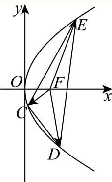

(3) 设 $M \left( x _ { 4 } , y _ { 4 } \right) , N \left( x _ { 5 } , y _ { 5 } \right)$

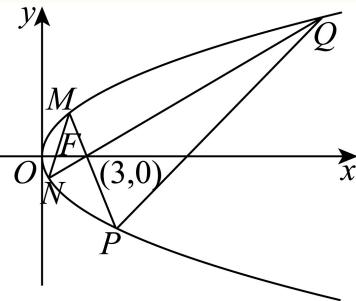

设直线MN的方程为 $x = m _ { M N } y + 1$

由 $\left\{ { \begin{array} { l } { x = m _ { M N } y + 1 } \\ { y ^ { 2 } = 4 x } \end{array} } \right.$ 消去x并化简得 $y ^ { 2 } - 4 m _ { M N } y - 4 = 0$

$\Delta = 1 6 m _ { M N } ^ { 2 } + 1 6 > 0$ ，则 $y _ { 4 } y _ { 5 } = - 4$

则 $y _ { 5 } = - { \frac { 4 } { y _ { 4 } } } , \ x _ { 5 } = { \frac { y _ { 5 } ^ { 2 } } { 4 } } = { \frac { 4 } { y _ { 4 } ^ { 2 } } } = { \frac { 4 } { 4 x _ { 4 } } } = { \frac { 1 } { x _ { 4 } } }$ ，故 $N \left( { \frac { 1 } { x _ { 4 } } } , - { \frac { 4 } { y _ { 4 } } } \right)$

直线 $M P$ 过 $( 3 , 0 )$ ，联立 $x = k y + 3$ 与抛物线 $y ^ { 2 } = 4 x$ ，得 $y ^ { 2 } - 4 k y - 1 2 = 0$

故 $y _ { 4 } y _ { P } = - 1 2 ,$ $y _ { P } = - { \frac { 1 2 } { y _ { 4 } } }$ $x _ { P } = { \frac { 9 } { x _ { 4 } } }$ ，即 $P \left( { \frac { 9 } { x _ { 4 } } } , - { \frac { 1 2 } { y _ { 4 } } } \right)$

同理，直线NQ过(3,0)，得 $y _ { 5 } y _ { Q } = - 1 2 , y _ { Q } = 3 y _ { 4 } , x _ { Q } = 9 x _ { 4 }$ ，即 $Q \left( 9 x _ { 4 } , 3 y _ { 4 } \right)$

直线PQ的斜率： $k = { \frac { 3 y _ { 4 } - \left( - { \frac { 1 2 } { y _ { 4 } } } \right) } { 9 x _ { 4 } - { \frac { 9 } { x _ { 4 } } } } } = { \frac { 4 y _ { 4 } } { 3 \left( y _ { 4 } ^ { 2 } - 4 \right) } } ,$

令 $t = y _ { 4 } ^ { 2 } = 4 x _ { 4 } , x _ { 4 } \in \left[ \frac { 1 } { 2 } , 2 \right] , t \in [ 2 , 8 ]$ ，则 $k = { \frac { 4 { \sqrt { t } } } { 3 \left( t - 4 \right) } }$

令 $u = \sqrt { t } \in \left[ \sqrt { 2 } , 2 \sqrt { 2 } \right]$ ，则 $k = \frac { 4 } { 3 \left( u - \displaystyle \frac { 4 } { u } \right) } .$

函数 $u - { \frac { 4 } { u } }$ 在 $\left[ { \sqrt { 2 } } , 2 { \sqrt { 2 } } \right]$ 上递增：

当 $u \in \left[ { \sqrt { 2 } } , 2 \right)$ (即 $t \in [ 2 , 4 )$ ) 时， $u - \frac { 4 } { u } \in \left[ - \sqrt { 2 } , 0 \right)$ ，故 $k \in \left( - \infty , - \frac { 2 \sqrt { 2 } } { 3 } \right]$

当 $u \in \left( 2 , 2 { \sqrt { 2 } } \right]$ (即 $t \in ( 4 , 8 ]$ ) 时， $u - \frac { 4 } { u } \in \left( 0 , \sqrt { 2 } \right]$ ，故 $k \in \left[ \frac { 2 \sqrt { 2 } } { 3 } , + \infty \right)$

综上所述，k的取值范围是 $\left( - \infty , - { \frac { 2 { \sqrt { 2 } } } { 3 } } \right] \cup \left[ { \frac { 2 { \sqrt { 2 } } } { 3 } } , + \infty \right)$

---

### 111 · 原第18题

**来源：** S033 · 上海市松江二中 · 高二 · 2025-2026 · 期中 · 原第18题

**考点说明：** 由离心率和曲线上点确定双曲线方程，再用焦点弦长公式求弦长。

已知双曲线C: ${ \frac { x ^ { 2 } } { a ^ { 2 } } } - { \frac { y ^ { 2 } } { b ^ { 2 } } } = 1 ( a > 0 \ , \ b > 0 )$ 的离心率为√3， $P \left( 3 , 2 { \sqrt { 3 } } \right)$ 为C上一点.

(1) 求C的方程;

(2) 过C的右焦点且倾斜角为30°的直线l交C于M，N两点，O为坐标原点，求MN的长度.

#### 答案

(1) ${ \frac { x ^ { 2 } } { 3 } } - { \frac { y ^ { 2 } } { 6 } } = 1 ;$

(2) $\frac { 1 6 { \sqrt { 3 } } } { 5 }$

#### 解析（保留源稿）

(1) ${ \left\{ \begin{array} { l l } { { \cfrac { 3 ^ { 2 } } { a ^ { 2 } } } - { \cfrac { \left( 2 { \sqrt { 3 } } \right) ^ { 2 } } { b ^ { 2 } } } = 1 } \\ { e = { \cfrac { c } { a } } = { \sqrt { 3 } } } \\ { a ^ { 2 } + b ^ { 2 } = c ^ { 2 } } \end{array} \right. }$ 由题得: 解得 $a ^ { 2 } = 3 \ , b ^ { 2 } = 6$

所以双曲线C的方程为： ${ \frac { x ^ { 2 } } { 3 } } - { \frac { y ^ { 2 } } { 6 } } = 1$

(2)设 $M \left( x _ { 1 } , y _ { 1 } \right) , N \left( x _ { 2 } , y _ { 2 } \right)$

如图所示:由题得直线l的方程为 $y = { \frac { \sqrt { 3 } } { 3 } } ( x - 3 )$

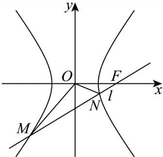

联立得： $\left\{ { \begin{array} { l } { { \displaystyle { \frac { x ^ { 2 } } { 3 } } } - { \frac { y ^ { 2 } } { 6 } } = 1 } \\ { { \displaystyle y = { \frac { \sqrt { 3 } } { 3 } } ( x - 3 ) } } \end{array} } \right.$ 整理得： $5 x ^ { 2 } + 6 x - 2 7 = 0$

所以 $x _ { 1 } = - 3 ; x _ { 2 } = { \frac { 9 } { 5 } }$

所以 $M \left( - 3 , - 2 { \sqrt { 3 } } \right) , N \left( { \frac { 9 } { 5 } } , - { \frac { 2 { \sqrt { 3 } } } { 5 } } \right)$

所以 $M N | = { \sqrt { \left( { \frac { 9 } { 5 } } + 3 \right) ^ { 2 } + \left( - { \frac { 2 { \sqrt { 3 } } } { 5 } } + 2 { \sqrt { 3 } } \right) ^ { 2 } } } = { \frac { 1 6 { \sqrt { 3 } } } { 5 } } .$

---

---

### 112 · 原第20题

**来源：** S033 · 上海市松江二中 · 高二 · 2025-2026 · 期中 · 原第20题

**考点说明：** 用圆心与切点条件求圆方程，讨论切线及两垂直弦围成面积。

> **校订提示**
>
> 题干“圆M……轴上”为转录破损，圆M的圆心在 y 轴上；由解析设 $M(0,b)$ 与相切条件可核定。

> 下列正文保留原转录；与本提示冲突的文字或公式不作为有效依据。

已知圆 $M$ 与直线 ${ \sqrt { 3 } } x + y + 2 = 0$ 相切于点 $\left( - { \sqrt { 3 } } , 1 \right)$ ，圆 $M$ 的圆心在 y 轴上.

(1) 求圆M的标准方程;

(2) 过点R(2,5)作圆M的切线，求切线的方程;

(3) 设点D(0,3)，过点D作直线l$_1$，交圆 $M$ 于P，Q两点，再过点D作与直线 $l _ { 1 }$ 垂直的直线 $l _ { 2 }$ ，交圆M于E,F两点，记四边形EPFQ的面积为 ${ \cal S } ,$ 求S的最大值.

#### 答案

(1) $x ^ { 2 } + ( y - 2 ) ^ { 2 } = 4$

(2) $x = 2$ 或 $5 x - 1 2 y + 5 0 = 0$

(3) 7

#### 解析（保留源稿）

(1) 设M(0, b)，由圆与直线 ${ \sqrt { 3 } } x + y + 2 = 0$ 相切于点 $\left( - { \sqrt { 3 } } , 1 \right)$

得 ${ \frac { b - 1 } { 0 - { \Big ( } - { \sqrt { 3 } } { \Big ) } } } = { \frac { \sqrt { 3 } } { 3 } }$ 解得b = 2，所以M(0,2)

则圆M半径 $r = \sqrt { \left( - \sqrt { 3 } - 0 \right) ^ { 2 } + ( 1 - 2 ) ^ { 2 } } = 2 ,$

所以圆M的标准方程为 $x ^ { 2 } + ( y - 2 ) ^ { 2 } = 4 \qquad $

(2) 当切线斜率不存在时，直线为x = 2，显然圆心M (0,2)到x = 2的距离为2等于半径，所以直线 $x = 2$ 与圆 $M \colon x ^ { 2 } + ( y - 2 ) ^ { 2 } = 4$ 相切;

当切线斜率存在时，设切线为 $y - 5 = k ( x - 2 )$ ，即 $k x - y + 5 - 2 k = 0$

由圆心到切线的距离为2得 ${ \frac { | 3 - 2 k | } { \sqrt { 1 + k ^ { 2 } } } } = 2$ ，解得 $k = \frac { 5 } { 1 2 }$

则 $y - 5 = { \frac { 5 } { 1 2 } } ( x - 2 )$ ，整理得 $5 x - 1 2 y + 5 0 = 0$

综上，切线方程为 $x = 2$ 或 $5 x - 1 2 y + 5 0 = 0$

(3) 法一：当直线 $l_1$ 无斜率时， $| P Q | = 4 , | E F | = 2 \sqrt { 3 } , \enspace S = \frac { 1 } { 2 } | P Q | \cdot | E F | = 4 \sqrt { 3 } , \enspace$

当直线 $l _ { 1 }$ 斜率为0时， $| P Q | = 2 \sqrt { 3 } , | E F | = 4 , S = \frac { 1 } { 2 } | P Q | \cdot | E F | = 4 \sqrt { 3 } .$

当直线 $l _ { 1 }$ 斜率存在且不为0时，设直线 $l _ { 1 }$ 为 $y = k x + 3$ ，即 $k x - y + 3 = 0$

则圆心(0,2)到直线 $l _ { 1 }$ 距离 $d _ { 1 } = { \frac { | - 2 + 3 | } { \sqrt { k ^ { 2 } + 1 } } } = { \frac { 1 } { \sqrt { k ^ { 2 } + 1 } } } \qquad $

所以 $| P Q | = 2 { \sqrt { 4 - { \frac { 1 } { k ^ { 2 } + 1 } } } } = 2 { \sqrt { \frac { 4 k ^ { 2 } + 3 } { k ^ { 2 } + 1 } } } ,$

因为 $\boldsymbol { l } _ { 1 } \bot \boldsymbol { l } _ { 2 }$ 用 $- { \frac { 1 } { k } }$ 替换上式中的k可得 $| E F | = 2 { \sqrt { 4 - { \frac { k ^ { 2 } } { k ^ { 2 } + 1 } } } } = 2 { \sqrt { \frac { 3 k ^ { 2 } + 4 } { k ^ { 2 } + 1 } } } .$

$$
\begin{array} { l } { S = \displaystyle \frac 1 2 | P Q | \cdot | E F | = 2 \sqrt { \frac { \left( 4 k ^ { 2 } + 3 \right) \left( 3 k ^ { 2 } + 4 \right) } { \left( k ^ { 2 } + 1 \right) ^ { 2 } } } = 2 \sqrt { \frac { 1 2 \left( k ^ { 4 } + 2 k ^ { 2 } + 1 \right) + k ^ { 2 } } { k ^ { 4 } + 2 k ^ { 2 } + 1 } } } \\ { = \displaystyle 2 \sqrt { 1 2 + \frac { k ^ { 2 } } { k ^ { 4 } + 2 k ^ { 2 } + 1 } } = 2 \sqrt { 1 2 + \frac 1 { k ^ { 2 } + \frac 1 { k ^ { 2 } } + 2 } } \leq 2 \sqrt { 1 2 + \frac { 1 } { 2 \sqrt { k ^ { 2 } \cdot \frac 1 { k ^ { 2 } } } + 2 } } = 7 , } \end{array}
$$

当且仅当 $k ^ { 2 } = { \frac { 1 } { k ^ { 2 } } }$ ，即 $k = \pm 1$ 时取等号

综上所述，因为 $7 > 4 { \sqrt { 3 } } .$ 所以S的最大值为7.

法二：设圆心(0,2)到直线 $l _ { 1 }$ 的距离 $\dot { { d } } _ { 1 }$ ，到直线 $l _ { 2 }$ 的距离 $d _ { 2 }$

则 $| P Q | = 2 \sqrt { 4 - d _ { 1 } ^ { 2 } } , | E F | = 2 \sqrt { 4 - d _ { 2 } ^ { 2 } } ,$

又直线l₁与直线 $l _ { 2 }$ 垂直，所以 $d _ { 1 } ^ { 2 } + d _ { 2 } ^ { 2 } = 1$

$$
S = \frac { 1 } { 2 } | E F | \cdot | P Q | = 2 \sqrt { \left( 4 - d _ { 1 } ^ { 2 } \right) \left( 4 - d _ { 2 } ^ { 2 } \right) } \le \left( 4 - d _ { 1 } ^ { 2 } \right) + \left( 4 - d _ { 2 } ^ { 2 } \right) = 7 ,
$$

当且仅当 $d _ { 1 } = d _ { 2 }$ 时取等，所以S的最大值为7.

---

---

### 113 · 原第20题

**来源：** S019 · 上海市西南位育中学 · 高二 · 2025-2026 · 期中 · 原第20题

**考点说明：** 直线与椭圆相切的条件；定点到直线距离与定值；向量模的最值

已知点 $F_{1}$ 、 $F_{2}$ 分别为椭圆 $\Gamma:\frac{x^{2}}{2}+y^{2}=1$ 的左、右焦点，直线l: $y=kx+t$ 与椭圆 $\Gamma$ 有且仅有一个公共点，直线 $F_{1}M\perp l,F_{2}N\perp l$ ，垂足分别为点M、N.

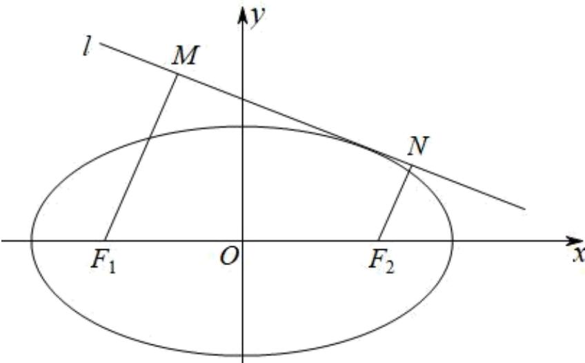

(1) 求证: $t^2 = 2k^2 + 1$ ;

(2) 求证: $\overrightarrow{F_1M} \cdot \overrightarrow{F_2N}$ 为定值, 并求出该定值;

(3) 求 $\left|\overrightarrow{OM} + \overrightarrow{ON} \mid \cdot \mid \overrightarrow{OM} - \overrightarrow{ON}\right|$ 的最大值.

#### 答案

(1) 证明过程见解析

(2) 证明过程见解析，定值为1

(3) 4

#### 解析（保留源稿）

(1) 联立 $l: y = kx + t$ 与 $\Gamma: \frac{x^2}{2} + y^2 = 1$ 得： $(2k^2 + 1)x^2 + 4ktx + 2t^2 - 2 = 0,$ 由直线与椭圆有一个公共点可知： $\Delta = (4kt)^2 - 4(2k^2 + 1)(2t^2 - 2) = 0,$ 化简得： $t^2 = 2k^2 + 1;$

(2) 由题意得: $F_{1}(-1,0), F_{2}(1,0)$ ,

因为 $F_{1}M \perp l, F_{2}N \perp l$ ，所以 $F_{1}M \| F_{2}N$ ，故 $\overrightarrow{F_1M} \cdot \overrightarrow{F_2N} = \left|\overrightarrow{F_1M}\right| \cdot \left|\overrightarrow{F_2N}\right|$ ，

其中 $F_{1}M = \frac{| - k + t|}{\sqrt{k^{2} + 1}}$ ， $F_{2}N = \frac{|k + t|}{\sqrt{k^{2} + 1}}$

所以

$$
\overrightarrow {F _ {1} M} \cdot \overrightarrow {F _ {2} N} = \left| \overrightarrow {F _ {1} M} \right| \cdot \left| \overrightarrow {F _ {2} N} \right| = \frac {| - k + t |}{\sqrt {k ^ {2} + 1}} \cdot \frac {| k + t |}{\sqrt {k ^ {2} + 1}} = \frac {\left| t ^ {2} - k ^ {2} \right|}{k ^ {2} + 1} = \frac {\left| 2 k ^ {2} + 1 - k ^ {2} \right|}{k ^ {2} + 1} =
$$

$\overrightarrow{F_{1}M}\cdot\overrightarrow{F_{2}N}$ 为定值，该定值为1；

(3) $\left|\overrightarrow{OM} +\overrightarrow{ON}\right| = \left|\overrightarrow{OF_1} +\overrightarrow{F_1M} +\overrightarrow{OF_2} +\overrightarrow{F_2N}\right| = \left|\overrightarrow{F_1M} +\overrightarrow{F_2N}\right| = \left|\overrightarrow{F_1M}\right| + \left|\overrightarrow{F_2N}\right|$

由题意得：点 $F_{1}, F_{2}$ 在直线l的同侧，

$$
\left| \overrightarrow {F _ {1} M} \right| + \left| \overrightarrow {F _ {2} N} \right| = \left| \frac {- k + t}{\sqrt {k ^ {2} + 1}} + \frac {k + t}{\sqrt {k ^ {2} + 1}} \right| = \frac {2 | t |}{\sqrt {k ^ {2} + 1}},
$$

$$
\left| \overrightarrow {O M} - \overrightarrow {O N} \right| = \left| \overrightarrow {N M} \right| = \frac {\left| \overrightarrow {F _ {1} F _ {2}} \cdot \overrightarrow {M N} \right|}{\left| \overrightarrow {M N} \right|} = \left| \overrightarrow {F _ {1} F _ {2}} \right| \cos \alpha = \frac {2}{\sqrt {k ^ {2} + 1}}, (\text {其中} \alpha \text {为}
$$

$\overrightarrow{F_{1}F_{2}},\overrightarrow{MN}$ 的夹角),

由此可知： $\left|\overrightarrow{OM} +\overrightarrow{ON}\right|\cdot |\overrightarrow{OM} -\overrightarrow{ON} |$ $= \frac{4|t|}{k^2 + 1} = \frac{8|t|}{t^2 + 1} = \frac{8}{|t| + \frac{1}{|t|}}\leq \frac{8}{2\sqrt{|t|\cdot\frac{1}{|t|}}} = 4,$

当且仅当 $|t| = \frac{1}{|t|}$ 即 $|t| = 1, k = 0$ 时，等号成立，所以 $\left|\overrightarrow{OM} + \overrightarrow{ON} \right| \cdot |\overrightarrow{OM} - \overrightarrow{ON}|$ 的最大值为4.

---

---

### 114 · 原第17题

**来源：** S038 · 上海海洋大学附属大团高级中学 · 高二 · 2025-2026 · 期中 · 原第17题

**考点说明：** 利用一般式系数关系，分别判定两直线相交、垂直、平行或重合。

已知直线 $l_{1}:x+my+6=0,l_{2}:(m-2)x+3y+2m=0,$ 求m的值，使得：

(1) $l_{1}$ 与 $l_{2}$ 相交；

(2) $l_{1} \bot l_{2}$ ;

(3) $l_{1} / / l_{2}$ ;

(4) $l_{1}$ , $l_{2}$ 重合.

#### 答案

(1) $m \neq -1$ ，且 $m \neq 3$ ; (2) $m = \frac{1}{2}$ ; (3) $m = -1$ ; (4) $m = 3$

#### 解析（保留源稿）

利用两直线相交、平行、垂直、重合的结论一一求解.

(1) 当 $l_{1}$ 和 $l_{2}$ 相交时， $1 \times 3 - (m - 2)m \neq 0$ .

令 $1 \times 3 - (m - 2)m = 0$ ，得 $m^{2} - 2m - 3 = 0$ ，解得m = -1或m = 3.

所以当 $m \neq -1$ ，且 $m \neq 3$ 时， $l_{1}$ 和 $l_{2}$ 相交.

(2) 当 $l_{1} \perp l_{2}$ 时， $1 \times (m - 2) + m \times 3 = 0$ ，解得 $m = \frac{1}{2}$ . 所以当 $m = \frac{1}{2}$ 时， $l_{1} \perp l_{2}$ .

（3）因为 $m = 0$ 时， $l_{1}$ 不平行于 $l_{2}$ ，所以 $m \neq 0$ ，所以 $\frac{1}{m} = \frac{m - 2}{3}$ ，且 $\frac{6}{m} \neq \frac{2}{3} m$ ，解得 $m = -1$ .

（4）因为 $m = 0$ 时， $l_{1}$ 与 $l_{2}$ 不重合，所以当 $l_{1}$ 与 $l_{2}$ 重合时，有 $\frac{1}{m} = \frac{m - 2}{3}$ 且 $\frac{6}{m} = \frac{2}{3} m$ ，解得

m = 3.

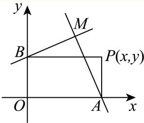

本题考查了两直线结论---（1）直线 $l_{1}$ ： $A_{1}x + By_{1} + C_{1} = 0$ 与直线 $l_{2}A_{2}x + By_{2} + C_{2} = 0$ 重合 $\Leftrightarrow\left\{\begin{aligned}A_{1}B_{2}-A_{2}B_{1}&=0\\ A_{1}C_{2}-A_{2}C_{1}&=0\end{aligned}\right.$

(2) 直线 $l_{1}$ : $A_{1}x + By_{1} + C_{1} = 0$ 与直线 $l_{2}A_{2}x + By_{2} + C_{2} = 0$ 平行 $\Leftrightarrow \left\{ \begin{aligned} & A_{1}B_{2} - A_{2}B_{1} = 0 \\ & A_{1}C_{2} - A_{2}C_{1} \neq 0 \end{aligned} \right.$ .

(3) 直线 $l_{1}$ : $A_{1}x + By_{1} + C_{1} = 0$ 与直线 $l_{2}A_{2}x + By_{2} + C_{2} = 0$ 垂直 $\Leftrightarrow A_{1}A_{2} + B_{2}B_{1} = 0$

(4) 直线 $l_{1}$ : $A_{1}x + By_{1} + C_{1} = 0$ 与直线 $l_{2}A_{2}x + By_{2} + C_{2} = 0$ 相交 $\Leftrightarrow A_{1}A_{2} + B_{2}B_{1} \neq 0$

---

---

### 115 · 原第19题

**来源：** S038 · 上海海洋大学附属大团高级中学 · 高二 · 2025-2026 · 期中 · 原第19题

**考点说明：** 圆拱实际建模：建立坐标系求圆方程，并以弦高关系计算支柱高度。

圆拱桥的一个圆拱如图所示，该圆拱的跨度AB为20m，拱高OP为4m，

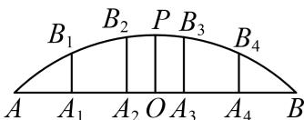

(1) 建立适当的平面直角坐标系，并求圆弧 $\widehat{AB}$ 所在圆的方程；

(2) 在建造过程中每隔 $4 \mathrm{~m}$ 需用一个支柱支撑。求支柱 $A_{2} B_{2}$ 的高度。（结果精确到 $0.01 \mathrm{~m}$ ）

#### 答案

(1) $x^{2} + \left(y + \frac{21}{2}\right)^{2} = \frac{841}{4}, (-10 \leq x \leq 10, 0 \leq y \leq 4)$ ;

(2) 3.86米.

#### 解析（保留源稿）

(1) 构建如下直角坐标系，则 $A(-10,0)$ ， $B(10,0)$ ， $P(0,4)$ ，

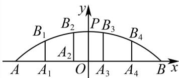

设A,B,P所在圆方程为 $(x-m)^{2}+(y-n)^{2}=r^{2}$ 且 $-10\leq x\leq10,0\leq y\leq4,$

$\left\{ \begin{array}{l} (-10 - m)^2 + n^2 = r^2 \\ (10 - m)^2 + n^2 = r^2 \\ (0 - m)^2 + (4 - n)^2 = r^2 \end{array} \right.$ ，解得 $\left\{ \begin{array}{l} m = 0 \\ n = -\frac{21}{2}, \\ r^2 = \frac{841}{4} \end{array} \right.$

所以圆弧所在圆的方程 $x^{2} + \left(y + \frac{21}{2}\right)^{2} = \frac{841}{4}, - 10\leq x\leq 10,0\leq y\leq 4.$

(2) 由题设知: $A_{2}(-2,0)$ , 则 $B_{2}(-2,y)$ , $y > 0$ 且在圆弧上,

所以 $4 + \left(y + \frac{21}{2}\right)^2 = \frac{841}{4}$ ，可得 $y = \frac{5\sqrt{33} - 21}{2}$ ，故 $A_{2}B_{2}$ 的长度为 $\frac{5\sqrt{33} - 21}{2} \approx 3.86$ 米.

---

---

### 116 · 原第17题

**来源：** S004 · 华东师范大学第二附属中学 · 高二 · 2025-2026 · 期中 · 原第17题

**考点说明：** 按一般式系数判定直线垂直或平行，规范化后计算平行线间距离。

已知直线 $l _ { 1 } { : } 6 x + ( t - 1 ) y - 8 = 0$ ，直线 $l _ { 2 } \colon ( t + 4 ) x + ( t + 6 ) y - 1 6 = 0$

(1) 若 $l _ { 1 } \bot l _ { 2 }$ ，求实数t的值；

(2) 若 $l _ { 1 } / / l _ { 2 }$ ，求实数t的值，并求平行直线 $l _ { 1 }$ 和 $l _ { 2 }$ 之间的距离.

#### 答案

(1) t = −2或 −9

(2) $t = - 5$ ，距离为 $\frac { 2 6 { \sqrt { 2 } } } { 3 }$

#### 解析（保留源稿）

(1) 因 $l _ { 1 } \bot l _ { 2 }$ ，所以6 (t + 4) + (t − 1) (t + 6) = 0, 即 $t ^ { 2 } + 1 1 t + 1 8 = 0$ ，解得 $t = - 2$ 或 $- 9$ ，所以实数t的值为-2或-9.

(2) 因为 $l _ { 1 } / / l _ { 2 }$ ，所以 $6 \left( t + 6 \right) - \left( t + 4 \right) \left( t - 1 \right) = 0$ ，即 $t ^ { 2 } - 3 t - 4 0 = 0$ ，解得 $t = 8$ 或 $- 5$ .当 $t = 8$ 时， $l _ { 1 } : 6 x + 7 y - 8 = 0 , \ l _ { 2 } : 1 2 x + 1 4 y - 1 6 = 0$ 即 $6 x + 7 y - 8 = 0$ ，此时 $l _ { 1 }$ 与 $l _ { 2 }$ 重合，不合题意；

当t = −5时， $l _ { 1 } \colon 6 x - 6 y - 8 = 0$ 即3x − 3y − 4 = 0, l2: −x + y − 16 = 0即3x − 3y + 48 = 0 ， $l _ { 1 } / / l _ { 2 }$ 符合题意，

此时平行直线l₁和 $l _ { 2 }$ 之间的距离 $d = \frac { \left| - 4 - 4 8 \right| } { \sqrt { 3 ^ { 2 } + \left( - 3 \right) ^ { 2 } } } = \frac { 5 2 } { 3 \sqrt { 2 } } = \frac { 2 6 \sqrt { 2 } } { 3 } .$

---

---

### 117 · 原第18题

**来源：** S004 · 华东师范大学第二附属中学 · 高二 · 2025-2026 · 期中 · 原第18题

**考点说明：** 双曲线渐近线与圆的相切建模，并计算指定直线截圆所得弦长。

已知双曲线 $\Gamma : { \frac { x ^ { 2 } } { 1 6 } } - { \frac { y ^ { 2 } } { 9 } } = 1$ ，其右顶点为 $P ,$ 右焦点为 $F _ { 2 }$

(1) 求以P为圆心，且与双曲线Γ的两条渐近线都相切的圆的标准方程;

(2) 设直线l经过 $F _ { 2 }$ 且与Γ的两条渐近线中的一条平行，与另一条相交且交点在第一象限.求直线l被(1)中圆P截得的弦长.

#### 答案

(1) $\left( x - 4 \right) ^ { 2 } + y ^ { 2 } = { \frac { 1 4 4 } { 2 5 } }$

(2) $\frac { 6 { \sqrt { 1 5 } } } { 5 }$

#### 解析（保留源稿）

(1) 因为双曲线 $\Gamma : \frac { x ^ { 2 } } { 1 6 } - \frac { y ^ { 2 } } { 9 } = 1$

故右顶点P的坐标为(4,0),

其渐近线方程为 $3 x \pm 4 y = 0$

则点P到渐近线的距离为 $d = { \frac { | 1 2 - 0 | } { 5 } } = { \frac { 1 2 } { 5 } }$

即所求圆的半径为 $\frac { 1 2 } { 5 }$

则所求圆的标准方程为 $( x - 4 ) ^ { 2 } + y ^ { 2 } = { \frac { 1 4 4 } { 2 5 } }$

(2) 依题可知直线l的斜率为 $- { \frac { 3 } { 4 } }$

又 $F _ { 2 }$ 的坐标为 $( 5 , 0 )$

所以直线l的方程为 $y = - { \frac { 3 } { 4 } } ( x - 5 )$

即3 $x + 4 y - 1 5 = 0$

则圆心P到直线l的距离为 ${ \frac { | 3 \times 4 + 0 - 1 5 | } { 5 } } = { \frac { 3 } { 5 } }$

所以弦长为 $1 2 { \sqrt { \frac { 1 4 4 } { 2 5 } - { \frac { 9 } { 2 5 } } } } = { \frac { 6 { \sqrt { 1 5 } } } { 5 } }$

---

---

### 118 · 原第19题

**来源：** S004 · 华东师范大学第二附属中学 · 高二 · 2025-2026 · 期中 · 原第19题

**考点说明：** 由距离差建立双曲线方程；双曲线与垂直平分线的交点

在沿海或岛屿上选择三个适当的地点，建立一个主导航台 $F _ { 1 }$ 和两个副导航台 $F _ { 2 } , F _ { 3 }$ .船S上的定位仪能接收从三个台发来的无线电信号.现设导航台 $F _ { 1 }$ 和 $F _ { 2 }$ 相距500海里，在船S的定位仪上读得两台同时发出的无线电信号到达的时间差为 $2 0 0 0 \mu \mathrm { s } \ \left( \mu \mathrm { s } \right.$ 表示微秒， $1 \mu \mathbf { s } = 1 0 ^ { - 6 } \mathbf { s } )$ .已知无线电在空气中传播的速度为161987海里/秒.以 $\overrightarrow { F _ { 1 } F _ { 2 } }$ 的方向为x轴正方向、线段 $F _ { 1 } F _ { 2 }$ 的垂直平分线为 $\mid y$ 轴，建立平面直角坐标系.

(1)试确定船S所在的曲线的方程（数值精确到整数）;

(2) 已知副导航台 $F _ { 3 }$ 的坐标为(0,-500)，三个台同时发出无线电信号，船S先收到 $F _ { 2 }$ 发来的信号，又读得 $F _ { 1 }$ 和 $F _ { 3 }$ 发出的无线电信号到达的时间差为0，求船S的位置（数值精确到整数）.

#### 答案

(1) ${ \frac { x ^ { 2 } } { 2 6 2 4 4 } } - { \frac { y ^ { 2 } } { 3 6 2 5 6 } } = 1$

(2) (245,–65)

#### 解析（保留源稿）

(1)

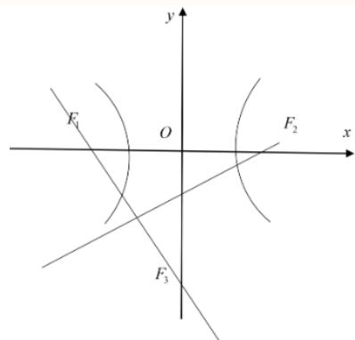

设船S的坐标为(x,y)，导航台 $F _ { 1 }$ 和 $F _ { 2 }$ 相距500海里，即 $| F _ { 1 } F _ { 2 } | = 2 c = 5 0 0$ ，即 $c = 2 5 0$ ·两台同时发出的无线电信号到达的时间差为 $2 0 0 0 \mu \mathrm { s } = 2 0 0 0 \times 1 0 ^ { - 6 } s$ ，无线电在空气中传播的速度为161987海里/秒，

可得 $| | S F _ { 1 } | - | S F _ { 2 } | | = 1 6 1 9 8 7 \times 2 0 0 0 \times 1 0 ^ { - 6 } = 3 2 3 . 9 7 4 \approx 3 2 4$ 海里，即 $2 a = 3 2 4 \Rightarrow a = 1 6 2$

$\therefore 2 a < | F _ { 1 } F _ { 2 } | = 5 0 0$ ,根据双曲线的定义可知船S所在的曲线是以 $F _ { 1 } , F _ { 2 }$ 为焦点的双曲线，

$$
\therefore b ^ { 2 } = c ^ { 2 } - a ^ { 2 } = 2 5 0 ^ { 2 } - 1 6 2 ^ { 2 } = 3 6 2 5 6 ,
$$

∵双曲线的焦点在x轴上，故其标准方程为 ${ \frac { x ^ { 2 } } { 2 6 2 4 4 } } - { \frac { y ^ { 2 } } { 3 6 2 5 6 } } = 1$

故船S所在的曲线的方程为 ${ \frac { x ^ { 2 } } { 2 6 2 4 4 } } - { \frac { y ^ { 2 } } { 3 6 2 5 6 } } = 1$

(2) ·船S先收到了 $F _ { 2 }$ 发来的信号，又读得 $F _ { 1 }$ 和 $F _ { 3 }$ 发出的无线电信号到达的时间差为0,

$$
\therefore | S F _ { 1 } | = | S F _ { 3 } | ,
$$

即船S在线段 $F _ { 1 } F _ { 3 }$ 的垂直平分线上，

又 $F _ { 1 } \left( - 2 5 0 , 0 \right) , F _ { 3 } \left( 0 , - 5 0 0 \right)$ ，∴线段 $F _ { 1 } F _ { 3 }$ 的中点坐标为(-125,-250),

直线 $F _ { 1 } F _ { 3 }$ 的斜率为 $\frac { - 5 0 0 - 0 } { 0 - ( - 2 5 0 ) } = - 2$ ，则线段 $F _ { 1 } F _ { 3 }$ 的垂直平分线的斜率为 $\frac { 1 } { 2 }$

∴线段 $F _ { 1 } F _ { 3 }$ 的垂直平分线的方程为 $y + 2 5 0 = { \frac { 1 } { 2 } } ( x + 1 2 5 ) \Rightarrow y = { \frac { 1 } { 2 } } x - { \frac { 3 7 5 } { 2 } }$

联立，得 $\left\{ \begin{array} { l } { y = { \frac { 1 } { 2 } } x - { \frac { 3 7 5 } { 2 } } } \\ { \displaystyle { \frac { x ^ { 2 } } { 2 6 2 4 4 } } - { \frac { y ^ { 2 } } { 3 6 2 5 6 } } = 1 } \end{array}  \right.$ ，得 $2 9 6 9 5 x ^ { 2 } + 4 9 2 9 7 5 0 x - 3 7 3 9 4 3 4 5 6 9 = 0$

解得x ≈ 245或x ≈ -295,

当 $x \approx 2 4 5$ 时， $y = - 6 5 ;$ 当 $x \approx - 2 9 5$ 时， $y = - 3 3 5$

∵船S先收到了 $F _ { 2 }$ 发来的信号，故船S在双曲线的右支上，

故船S的位置为 $( 2 4 5 , - 6 5 )$

---

---

### 119 · 原第20题

**来源：** S004 · 华东师范大学第二附属中学 · 高二 · 2025-2026 · 期中 · 原第20题

**考点说明：** 由准线求抛物线方程；直线与抛物线的定值问题；抛物线上的距离最小值

已知抛物线 $C : y ^ { 2 } = 2 p x ( p > 0 )$ ，其准线方程为 $\boldsymbol { x } + \boldsymbol { 1 } = 0$ ，直线l过点 $T ( t , 0 ) ( t > 0 )$ 且与抛物线交于A, B两点，O为坐标原点.

(1) 求抛物线C的方程;

(2) 当t = 2时，求证: $\overrightarrow { O A } \cdot \overrightarrow { O B }$ 的值与直线l的倾斜角的大小无关;

(3) 若P为抛物线上的动点，且 $| P T |$ 的最小值为d(t)，求函数 $y = d ( t )$ 的解析式.

#### 答案

(1) $y ^ { 2 } = 4 x ;$

(2) 证明见解析;

(3) $d \left( t \right) = \left\{ { t , 0 < t \leq 2 } \atop { 2 \sqrt { t - 1 } , t > 2 }  \right. .$

#### 解析（保留源稿）

(1) 由抛物线C: $y ^ { 2 } = 2 p x ( p > 0 )$ 的准线方程为 $x + 1 = 0$ ，得 ${ \frac { p } { 2 } } = 1$ ，解得 $p = 2$ 所以抛物线C的方程为 $y ^ { 2 } = 4 x$

(2) 设直线l: $x = m y + 2 , m \in \mathbb { R }$ ，点 $A ( x _ { 1 } , y _ { 1 } ) , B ( x _ { 2 } , y _ { 2 } )$

由 $\left\{ { \begin{array} { l } { y ^ { 2 } = 4 x } \\ { x = m y + 2 } \end{array} } \right.$ 消去x得 $y ^ { 2 } - 4 m y - 8 = 0$ ，则 $y _ { 1 } y _ { 2 } = - 8$

因此 $\overrightarrow { O A } \cdot \overrightarrow { O B } = x _ { 1 } x _ { 2 } + y _ { 1 } y _ { 2 } = \frac { ( y _ { 1 } y _ { 2 } ) ^ { 2 } } { 1 6 } - 8 = - 4$ ，为常数，所以 $\overrightarrow { O A } \cdot \overrightarrow { O B }$ 的值与直线l的倾斜角的大小无关

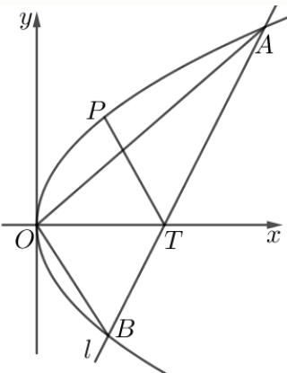

(3) 设 $P ( x , y )$ ，则 $y ^ { 2 } = 4 x , | P T | = { \sqrt { ( x - t ) ^ { 2 } + y ^ { 2 } } } = { \sqrt { x ^ { 2 } - ( 2 t - 4 ) x + t ^ { 2 } } } , x \geq 0$ 令 $\boldsymbol { f } ( x ) = x ^ { 2 } - ( 2 t - 4 ) x + t ^ { 2 } , x \geq 0$ 函数f(x)图象的对称轴为直线 $x = t - 2$ 当 $0 < t \leq 2$ 即t−2≤0时， $f ( x ) _ { \mathrm { m i n } } = f ( 0 ) = t ^ { 2 }$ ，则 $d ( t ) = t ;$ 当 $t > 2$ ，即 $t - 2 > 0$ 时， $f ( x ) _ { \mathrm { m i n } } = f ( t - 2 ) = t ^ { 2 } - ( t - 2 ) ^ { 2 } = 4 t - 4$ ，则 $d \left( t \right) = 2 \sqrt { t - 1 }$ 所以 $d \left( t \right) = \left\{ { \begin{array} { l } { t , 0 < t \leq 2 } \\ { 2 { \sqrt { t - 1 } } , t > 2 } \end{array} } \right.$

---

---

### 120 · 原第21题

**来源：** S004 · 华东师范大学第二附属中学 · 高二 · 2025-2026 · 期中 · 原第21题

**考点说明：** 椭圆与直线交点及对称；椭圆的焦点与等腰三角形；迭代操作下的面积定值

已知椭圆 $C : \frac { x ^ { 2 } } { a ^ { 2 } } + \frac { y ^ { 2 } } { b ^ { 2 } } = 1 ( a > b > 0 )$ .定义第 $n \left( n \geq 1 , n \in \mathbf { N } \right)$ 次操作为：经过C上的点 $A _ { n } \left( x _ { n } , y _ { n } \right)$ 作斜率为k的直线与C交于另一点 $B _ { n }$ ，记 $B _ { n }$ 关于x轴的对称点为 $A _ { n + 1 }$ ，若 $A _ { n + 1 }$ 与 $B _ { n }$ 重合，则操作停止；否则一直继续下去.

(1) 若 $a = 2 , b = 1 , A _ { 1 } \left( \sqrt { 2 } , \frac { \sqrt { 2 } } { 2 } \right) , k = \frac { 1 } { 2 }$ ，求 $x _ { 2 } , y _ { 2 }$

(2) 若a = 5, b = 4，点P是椭圆C上一点，且位于x轴的上方， $F _ { 1 } , \ F _ { 2 }$ 是椭圆C的两个焦点， $\triangle P F _ { 1 } F _ { 2 }$ 是等腰三角形，求点P的坐标；

(3) 若 $k = - \frac { b } { a } , A _ { 1 }$ 是C在第一象限与 $A \left( { \frac { \sqrt { 2 } } { 2 } } a , { \frac { \sqrt { 2 } } { 2 } } b \right)$ 不重合的一点，求证： $\triangle A _ { n } A _ { n + 1 } A _ { n + 2 }$ 的面积为定值，并求出该定值

#### 答案

(1) $x _ { 2 } = - { \sqrt { 2 } } , y _ { 2 } = { \frac { \sqrt { 2 } } { 2 } }$

(2) $(0,4), \left( \frac { 5 } { 3 } , \frac { 8 \sqrt { 2 } } { 3 } \right) , \left( - \frac { 5 } { 3 } , \frac { 8 \sqrt { 2 } } { 3 } \right)$

(3) 证明见解析；定值为 $ab$

#### 解析（保留源稿）

(1) 当 $a = 2 , b = 1$ 时，椭圆 $C : \frac { x ^ { 2 } } { 4 } + y ^ { 2 } = 1$ 因为 $A _ { 1 } \left( { \sqrt { 2 } } , { \frac { \sqrt { 2 } } { 2 } } \right) , k = { \frac { 1 } { 2 } }$ 所以直线 $A _ { 1 } B _ { 1 }$ 为 $y - { \frac { \sqrt { 2 } } { 2 } } = { \frac { 1 } { 2 } } { \Big ( } x - { \sqrt { 2 } } { \Big ) }$ ，即 $y = \frac { 1 } { 2 } x .$ 代入椭圆方程C: $\frac { x ^ { 2 } } { 4 } + y ^ { 2 } = 1$ ，得 ${ \frac { x ^ { 2 } } { 4 } } + \left( { \frac { x } { 2 } } \right) ^ { 2 } = 1$ ，即 $x = \pm \sqrt { 2 }$

当 $x = - { \sqrt { 2 } }$ 时， $y = - { \frac { \sqrt { 2 } } { 2 } }$ 所以 $B _ { 1 } \left( - \sqrt { 2 } , - \frac { \sqrt { 2 } } { 2 } \right)$

因为 $A _ { 2 }$ 与 $B _ { 1 }$ 关于x轴对称，所以 $A _ { 2 } \left( - { \sqrt { 2 } } , { \frac { \sqrt { 2 } } { 2 } } \right)$ ，所以 $x _ { 2 } = - { \sqrt { 2 } } , y _ { 2 } = { \frac { \sqrt { 2 } } { 2 } }$

(2) 若 $a = 5 , b = 4$ ，则椭圆 $C { : } \frac { x ^ { 2 } } { 2 5 } + \frac { y ^ { 2 } } { 1 6 } = 1$ 焦点为 $F _ { 1 } ( - 3 , 0 ) , F _ { 2 } ( 3 , 0 )$ ,则 $\left| F _ { 1 } F _ { 2 } \right| = 6$

在 $\triangle P F _ { 1 } F _ { 2 }$ 中，

当 $| P F _ { 1 } | = | P F _ { 2 } |$ 时，点P在椭圆的短轴上顶点，故 $P \left( 0 , 4 \right)$

当 $| P F _ { 1 } | = | F _ { 1 } F _ { 2 } | = 6$ 时，设 $P ( x _ { 0 } , y _ { 0 } ) , - 5 < x _ { 0 } < 5 , 0 < y _ { 0 } \leq 4$ ，则 $\sqrt { \left( x _ { 0 } + 3 \right) ^ { 2 } + y _ { 0 } ^ { 2 } } = 6$ ① 因为 $P \left( x _ { 0 } , y _ { 0 } \right)$ 在椭圆上，所以 $\frac { x _ { 0 } ^ { 2 } } { 2 5 } + \frac { y _ { 0 } ^ { 2 } } { 1 6 } = 1$ ②

由①、②得到 $9 x _ { 0 } ^ { 2 } + 1 5 0 x _ { 0 } - 2 7 5 = 0$ ，解得 $x _ { 0 } = { \frac { 5 } { 3 } }$ （ $x _ { 0 } = - { \frac { 5 5 } { 3 } }$ 舍去），所以 $y _ { 0 } = { \frac { 8 { \sqrt { 2 } } } { 3 } }$ 所以 $P \left( { \frac { 5 } { 3 } } , { \frac { 8 { \sqrt { 2 } } } { 3 } } \right)$

当 $| P F _ { 2 } | = | F _ { 1 } F _ { 2 } | = 6$ 时，根据椭圆的对称性得到 $P \left( - { \frac { 5 } { 3 } } , { \frac { 8 { \sqrt { 2 } } } { 3 } } \right)$

综上得，点P的坐标为 $( 0 , 4 ) , \left( { \frac { 5 } { 3 } } , { \frac { 8 { \sqrt { 2 } } } { 3 } } \right) , \left( - { \frac { 5 } { 3 } } , { \frac { 8 { \sqrt { 2 } } } { 3 } } \right)$

(3) 证明：设斜率 $k = - { \frac { b } { a } }$ ，过点 $A _ { n } \left( x _ { n } , y _ { n } \right)$ 的直线 $A _ { n } B _ { n }$ 的方程为 $y - y _ { n } = - { \frac { b } { a } } ( x - x _ { n } )$

即 $y = - \frac { b } { a } x + \frac { b x _ { n } } { a } + y _ { n }$

联立方程 $\left\{ \begin{array} { l l } { \displaystyle y = - \frac { b } { a } x + \frac { b x _ { n } } { a } + y _ { n } } \\ { \displaystyle \frac { x ^ { 2 } } { a ^ { 2 } } + \frac { y ^ { 2 } } { b ^ { 2 } } = 1 } \end{array} \right.$

$$
2 b ^ { 2 } x ^ { 2 } - 2 a b \left( { \frac { b x _ { n } } { a } } + y _ { n } \right) x + a ^ { 2 } \left( { \frac { b x _ { n } } { a } } + y _ { n } \right) ^ { 2 } - a ^ { 2 } b ^ { 2 } = 0
$$

设 $B _ { n } \left( x _ { 1 } , y _ { 1 } \right)$ 由韦达定理 $x _ { n } + x _ { 1 } = { \frac { 2 a b \left( { \frac { b x _ { n } } { a } } + y _ { n } \right) } { 2 b ^ { 2 } } } = x _ { n } + { \frac { a } { b } } y _ { n }$ ，所以 $x _ { 1 } = { \frac { a y _ { n } } { b } }$ ，代入 $y = - \frac { b } { a } x + \frac { b x _ { n } } { a } + y _ { n }$ ，得到 $y _ { 1 } = { \frac { b x _ { n } } { a } }$ ，所以 $B _ { n } \left( { \frac { a y _ { n } } { b } } , { \frac { b x _ { n } } { a } } \right)$

所以 $A _ { n + 1 } \left( { \frac { a y _ { n } } { b } } , - { \frac { b x _ { n } } { a } } \right)$

根据 $A _ { n }$ 与 $B _ { n }$ 的坐标关系，由 $A _ { n + 1 }$ 坐标得到 $B _ { n + 1 } \left( \frac { a \left( - \frac { b x _ { n } } { a } \right) } { b } , \frac { b \frac { a y _ { n } } { b } } { a } \right) = ( - x _ { n } , y _ { n } )$ 所以 $A _ { n + 2 } = \left( - x _ { n } , - y _ { n } \right)$

由两点间的距离公式得到 $| A _ { n } A _ { n + 2 } | = { \sqrt { ( - x _ { n } - x _ { n } ) ^ { 2 } + ( - y _ { n } - y _ { n } ) ^ { 2 } } } = 2 { \sqrt { x _ { n } ^ { 2 } + y _ { n } ^ { 2 } } }$ 所以由点斜式得到直线 $A _ { n } A _ { n + 2 }$ 的方程为： $y + y _ { n } = { \frac { y _ { n } } { x _ { n } } } ( x + x _ { n } )$ ，即 $y _ { n } x - x _ { n } y = 0$ 点 $A _ { n + 1 }$ 到直线 $A _ { n } A _ { n + 2 }$ 的距离为 $d = { \frac { \left| { \frac { a y _ { n } ^ { 2 } } { b } } + { \frac { b x _ { n } ^ { 2 } } { a } } \right| } { \sqrt { x _ { n } ^ { 2 } + y _ { n } ^ { 2 } } } }$ ，

所以 $\triangle A _ { n } A _ { n + 1 } A _ { n + 2 }$ 的面积为 $S _ { \triangle A _ { n } A _ { n + 1 } A _ { n + 2 } } = \frac { 1 } { 2 } | A _ { n } A _ { n + 2 } | d = \frac { 1 } { 2 } \times 2 \sqrt { x _ { n } ^ { 2 } + y _ { n } ^ { 2 } } \times \frac { \left| \frac { a y _ { n } ^ { 2 } } { b } + \frac { b x _ { n } ^ { 2 } } { a } \right| } { \sqrt { x _ { n } ^ { 2 } + y _ { n } ^ { 2 } } } = \left| \frac { a y _ { n } ^ { 2 } } { b } + \frac { b x _ { n } ^ { 2 } } { a } \right|$ 因为点 $A _ { n } \left( x _ { n } , y _ { n } \right)$ 在椭圆上，所以 ${ \frac { x _ { n } ^ { 2 } } { a ^ { 2 } } } + { \frac { y _ { n } ^ { 2 } } { b ^ { 2 } } } = 1$ ，所以 $y _ { n } ^ { 2 } = b ^ { 2 } \left( 1 - \frac { x _ { n } ^ { 2 } } { a ^ { 2 } } \right)$ 将其代入三角形面积公式得到 $S _ { \triangle A _ { n } A _ { n + 1 } A _ { n + 2 } } = \left| \frac { a } { b } \cdot b ^ { 2 } \left( 1 - \frac { x _ { n } ^ { 2 } } { a ^ { 2 } } \right) + \frac { b x _ { n } ^ { 2 } } { a } \right| = a b$

所以 $\triangle A _ { n } A _ { n + 1 } A _ { n + 2 }$ 的面积为定值ab.

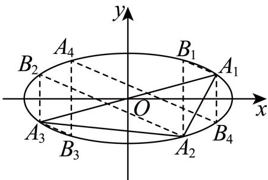

---

### 121 · 原第17题

**来源：** S040 · 华东师范大学附属东昌中学 · 高二 · 2025-2026 · 期中 · 原第17题

**考点说明：** 双曲线的渐近线方程；双曲线定义与右支上的焦半径关系

已知双曲线的方程是 $\frac{x^{2}}{9}-\frac{y^{2}}{4}=1.$

(1) 求双曲线的渐近线方程;

(2) 设 $F_{1}$ 和 $F_{2}$ 是双曲线的左、右焦点，点 $P$ 在双曲线右支上，且 $|PF_{1}| \cdot |PF_{2}| = 16$ ，求 $PF_{2}$ 的大小.

#### 答案

(1) $y = \pm \frac{2}{3} x;$

(2) 2.

#### 解析（保留源稿）

(1) 由双曲线方程知：其渐近线方程为 $y = \pm \frac{2}{3} x$ ;

(2) 由双曲线定义 $|PF_{1}| - |PF_{2}| = 2a = 6$ ，又 $|PF_{1}| \cdot |PF_{2}| = |PF_{2}|^{2} + 6|PF_{2}| = 16,$

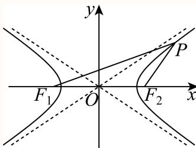

所以 $|PF_{2}|^{2}+6|PF_{2}|-16=(|PF_{2}|+8)(|PF_{2}|-2)=0$ ，可得 $|PF_{2}|=2$ （负值舍），所以 $PF_{2}$ 的大小为2.

---

---

### 122 · 原第20题

**来源：** S040 · 华东师范大学附属东昌中学 · 高二 · 2025-2026 · 期中 · 原第20题

**考点说明：** 直线斜率范围与截距求点，建立三角形面积模型讨论参数存在性。

如图所示，将一块直角三角形板ABO置于平面直角坐标系中，已知 $|AB|=|BO|=1$ ， $AB\perp BO$ ，点 $P\left(\frac{1}{2},\frac{1}{4}\right)$ 是三角板内一点，现因三角板中阴影部分受到损坏，要把损坏部分锯掉，可用经过点P的任一直线MN将三角形锯成 $\triangle AMN$ ，设直线MN的斜率为k，问：

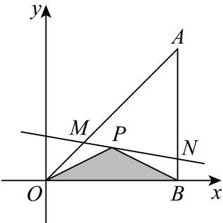

(1) 求直线 $MN$ 的方程及斜率 $k$ 的范围;

(2) 求出点 $M$ 的坐标（含 $k$ ）；并求出当 $k = 0$ 时 $\triangle OMP$ 的面积为 $S_{\triangle OMP}$ ;

(3) 若 $S$ 为 $\triangle AMN$ 的面积，问是否存在实数 $m$ ，使得关于 $S$ 的不等式 $S^2 \geq m (1 - 2S)$ 有解，若存在，求 $m$ 的取值范围；若不存在，说明理由.

#### 答案

(1) $4kx - 4y - 2k + 1 = 0, k \in \left[-\frac{1}{2}, \frac{1}{2}\right]$

(2) $M\left(\frac{2k - 1}{4k - 4},\frac{2k - 1}{4k - 4}\right),S_{\triangle OMP} = \frac{1}{32}$

(3) $\left(-\infty,\frac{1}{3}\right]$

#### 解析（保留源稿）

(1) 由题意知: $B(1,0), A(1,1)$ ;

∵直线MN经过点 $P\left(\frac{1}{2},\frac{1}{4}\right)$ ，斜率为k，

∴直线MN方程为： $y - \frac{1}{4} = k\left(x - \frac{1}{2}\right)$ ，即4kx - 4y - 2k + 1 = 0;

$\because k_{OP} = \frac{\frac{1}{4} - 0}{\frac{1}{2} - 0} = \frac{1}{2}, k_{PB} = \frac{0 - \frac{1}{4}}{1 - \frac{1}{2}} = -\frac{1}{2}$ ，又直线MN与线段OA, AB均有交点，

$\therefore k\in \left[-\frac{1}{2},\frac{1}{2}\right].$

(2) 由题意知: 直线OA: y = x,

由 $\left\{\begin{aligned}y&=x\\ y-\frac{1}{4}&=k\left(x-\frac{1}{2}\right)\end{aligned}\right.$ 得： $\left\{\begin{aligned}x&=\frac{2k-1}{4k-4}\\ y&=\frac{2k-1}{4k-4}\end{aligned}\right.,\therefore M\left(\frac{2k-1}{4k-4},\frac{2k-1}{4k-4}\right);$

当 $k = 0$ 时， $M\left(\frac{1}{4}, \frac{1}{4}\right)$ ，则 $MP // x$ 轴，

$$
\because | M P | = \frac {1}{2} - \frac {1}{4} = \frac {1}{4}, \therefore S _ {\triangle O M P} = \frac {1}{2} | M P | \cdot | y _ {P} | = \frac {1}{2} \times \frac {1}{4} \times \frac {1}{4} = \frac {1}{3 2}.
$$

(3) 由题意知: 直线AB:x = 1;

由 $\left\{\begin{aligned}x&=1\\ y-\frac{1}{4}&=k\left(x-\frac{1}{2}\right)\end{aligned}\right.$ 得： $\left\{\begin{aligned}x&=1\\ y&=\frac{2k+1}{4},\therefore N\left(1,\frac{2k+1}{4}\right);\end{aligned}\right.$

$$
\therefore | A N | = 1 - \frac {2 k + 1}{4} = \frac {3 - 2 k}{4},
$$

$$
\therefore S = \frac {1}{2} | A N | \cdot | x _ {B} - x _ {M} | = \frac {1}{2} \times \frac {3 - 2 k}{4} \times \frac {2 k - 3}{4 k - 4} = \frac {(3 - 2 k) ^ {2}}{3 2 (1 - k)},
$$

$\because k \in \left[-\frac{1}{2}, \frac{1}{2}\right], \therefore$ 设 $1 - k = t,$ 则 $t \in \left[\frac{1}{2}, \frac{3}{2}\right], k = 1 - t,$

$$
\therefore S = \frac {(1 + 2 t) ^ {2}}{3 2 t} = \frac {4 t ^ {2} + 4 t + 1}{3 2 t} = \frac {1}{8} \left(t + \frac {1}{4 t} + 1\right),
$$

$\because y = t + \frac{1}{4t}$ 在 $\left[\frac{1}{2}, \frac{3}{2}\right]$ 上单调递增， $\therefore 1 \leq t + \frac{1}{4t} \leq \frac{5}{3}, \therefore \frac{1}{4} \leq S \leq \frac{1}{3},$

$\therefore 1 - 2S > 0$ ，则 $S^2 \geq m(1 - 2S)$ 可化为： $m \leq \frac{S^2}{1 - 2S}$

令 $1 - 2S = n$ ，则 $n\in \left[\frac{1}{3},\frac{1}{2}\right], S = \frac{1 - n}{2},$

$$
\therefore \frac {S ^ {2}}{1 - 2 S} = \frac {(1 - n) ^ {2}}{4 n} = \frac {n ^ {2} - 2 n + 1}{4 n} = \frac {n}{4} + \frac {1}{4 n} - \frac {1}{2},
$$

$\because y = \frac{n}{4} + \frac{1}{4n} = \frac{1}{4}\left(n + \frac{1}{n}\right)$ 在 $\left[\frac{1}{3}, \frac{1}{2}\right]$ 上单调递减， $\therefore \left(\frac{S^2}{1 - 2S}\right)_{\max} = \frac{\frac{1}{9}}{1 - \frac{2}{3}} = \frac{1}{3},$ $\therefore m \leq \frac{1}{3}$ ，即 $m$ 的取值范围为 $\left(-\infty, \frac{1}{3}\right]$ .

---

---

### 123 · 原第21题

**来源：** S040 · 华东师范大学附属东昌中学 · 高二 · 2025-2026 · 期中 · 原第21题

**考点说明：** 椭圆的焦点坐标与焦半径范围；椭圆中垂直条件下的直线过定点；斜率关系与三角形面积的取值范围

已知椭圆的标准方程为 $\frac{x^{2}}{4} + y^{2} = 1$ ，定点 A(-2,0)，直线l与椭圆交于 P, Q 两点且不过原点.

(1) 求椭圆的焦点坐标，并且指出椭圆上的任意一点到椭圆右焦点的距离的取值范围（直接写出结果，可以不用证明）；

(2) 若 $AP \perp AQ$ ，求证：直线l经过定点，并求出定点的坐标；

(3) 若直线 $OP, PQ, OQ$ 的斜率分别为 $k_{1}, k_{2}, k_{3}$ , 且 $k_{2}^{2} = k_{1}k_{3}$ , 求 $\triangle OPQ$ 面积的取值范围.

#### 答案

(1) $\left(-\sqrt{3}, 0\right)$ , $\left(\sqrt{3}, 0\right)$ ; 范围为 $\left[2 - \sqrt{3}, 2 + \sqrt{3}\right]$ ;

(2) 证明见解析;

(3) $(0,1)$ .

#### 解析（保留源稿）

(1) $\because$ 椭圆方程为 $\frac{x^2}{4} + y^2 = 1,$

$$
\therefore a ^ {2} = 4, b ^ {2} = 1
$$

$\therefore c^{2} = a^{2} - b^{2} = 4 - 1 = 3,$ 则 $c = \sqrt{3},$

∴焦点坐标为 $(- \sqrt{3}, 0)$ ， $(\sqrt{3}, 0)$

$\because$ 椭圆的长半轴为 $a=\sqrt{4}=2,$

∴椭圆上的任意一点到椭圆右焦点的距离 $d\in[a-c,a+c]=\left[2-\sqrt{3},2+\sqrt{3}\right]$ .

(2)

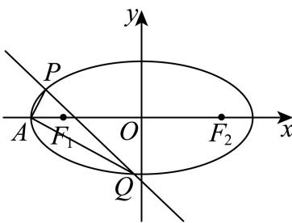

∵直线l与椭圆交于P,Q两点且不过原点，设直线l的方程为 $y=kx+m,m\neq0$ ,

联立椭圆方程得 $(1+4k^{2})x^{2}+8kmx+4m^{2}-4=0,$

设点 $P(x_{1},y_{1}),Q(x_{2},y_{2})$ ,

$$
\therefore x _ {1} + x _ {2} = - \frac {8 k m}{1 + 4 k ^ {2}}, x _ {1} x _ {2} = \frac {4 m ^ {2} - 4}{1 + 4 k ^ {2}},
$$

$$
\because A P \perp A Q, \overrightarrow {A P} = (x _ {1} + 2, y _ {1}), \overrightarrow {A Q} = (x _ {2} + 2, y _ {2}),
$$

$$
\therefore \overrightarrow {A P} \cdot \overrightarrow {A Q} = (x _ {1} + 2) (x _ {2} + 2) + y _ {1} y _ {2} = (1 + k ^ {2}) x _ {1} x _ {2} + (k m + 2) (x _ {1} + x _ {2}) + 4 + m ^ {2} = 0,
$$

即 $(1 + k^2)\frac{4m^2 - 4}{1 + 4k^2} -(km + 2)\frac{8km}{1 + 4k^2} +4 + m^2 = 0$ ，整理得 $5m^{2} + 12k^{2} - 16km = 0,$ 即 $(5m - 6k)(m - 2k) = 0.$

若 $m = 2k$ ，则直线方程为 $y = kx + 2k$ ，过点 $A(-2,0)$ ，与 $P,Q$ 与 $A$ 不重合矛盾，舍去；  

若 $m = \frac{6k}{5}$ ，则直线方程为 $y = kx + \frac{6k}{5}$ ，过定点 $\left(-\frac{6}{5},0\right)$

(3)

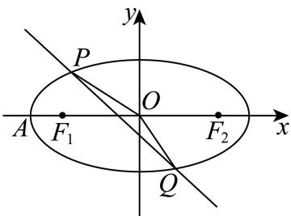

∵直线l与椭圆交于P,Q两点且不过原点，设直线l的方程为 $y=kx+m,m\neq0$ ,

联立椭圆方程得 $(1 + 4k^{2})x^{2} + 8kmx + 4m^{2} - 4 = 0,$

$$
\therefore \Delta = 6 4 k ^ {2} m ^ {2} - 4 (1 + 4 k ^ {2}) (4 m ^ {2} - 4) > 0,
$$

设点 $P(x_{1},y_{1}),Q(x_{2},y_{2})$ ,

$$
\therefore x _ {1} + x _ {2} = - \frac {8 k m}{1 + 4 k ^ {2}}, x _ {1} x _ {2} = \frac {4 m ^ {2} - 4}{1 + 4 k ^ {2}},
$$

$\because k_{2}=k_{PQ},\quad P,Q$ 是l上的点,

$$
\therefore k _ {2} = k, \quad k _ {1} = k _ {O P} = \frac {y _ {1}}{x _ {1}}, k _ {3} = k _ {O Q} = \frac {y _ {2}}{x _ {2}},
$$

$$
\because k _ {2} ^ {2} = k _ {1} k _ {3},
$$

$$
\therefore k ^ {2} = \frac {y _ {1} y _ {2}}{x _ {1} x _ {2}} = \frac {(k x _ {1} + m) (k x _ {2} + m)}{x _ {1} x _ {2}} = \frac {k ^ {2} x _ {1} x _ {2} + k m (x _ {1} + x _ {2}) + m ^ {2}}{x _ {1} x _ {2}},
$$

$$
\therefore k m \left(x _ {1} + x _ {2}\right) + m ^ {2} = 0,
$$

$$
\because m \neq 0,
$$

$$
\therefore k \left(x _ {1} + x _ {2}\right) + m = 0,
$$

$\therefore -\frac{8k^2m}{1 + 4k^2} + m = 0$ ，化简得 $4k^2 = 1$ ，解得 $k = \pm \frac{1}{2}$ ，

$$
\because k ^ {2} = \frac {1}{4},
$$

$$
\therefore x _ {1} + x _ {2} = - \frac {8 k m}{1 + 4 k ^ {2}} = - 4 k m, x _ {1} x _ {2} = \frac {4 m ^ {2} - 4}{1 + 4 k ^ {2}} = 2 m ^ {2} - 2,
$$

$$
\begin{array}{l} \therefore S _ {\triangle O P Q} = \frac {1}{2} \cdot | m | \cdot | x _ {1} - x _ {2} | = \frac {1}{2} \cdot | m | \sqrt {(x _ {1} + x _ {2}) ^ {2} - 4 x _ {1} x _ {2}} = \frac {1}{2} \cdot | m | \cdot \\ \sqrt {1 6 k ^ {2} m ^ {2} - 8 m ^ {2} + 8} \end{array}
$$

$$
= \frac {1}{2} | m | \sqrt {8 - 4 m ^ {2}} = | m | \sqrt {2 - m ^ {2}},
$$

$$
\because \Delta = 6 4 k ^ {2} m ^ {2} - 4 (1 + 4 k ^ {2}) (4 m ^ {2} - 4) = 3 2 - 1 6 m ^ {2} > 0,
$$

$$
\therefore m ^ {2} < 2,
$$

∵直线不过原点,

$$
\therefore m \neq 0,
$$

$$
\therefore 0 < m ^ {2} < 2,
$$

令 $t=m^{2}$ ，则 $S_{\triangle OPQ}=\sqrt{2m^{2}-m^{4}}=\sqrt{2t-t^{2}}=\sqrt{1-(t-1)^{2}}$

当 $t = 1$ ，即 $m = \pm 1$ 时 $P, Q$ 在坐标轴上，不合题设，

当 $t\to1$ 时， $S_{\triangle OPQ}\to1$ ，当 $t\to0$ 或2时， $S_{\triangle OPQ}\to0$

$\therefore \triangle OPQ$ 面积的取值范围是(0,1).

---
